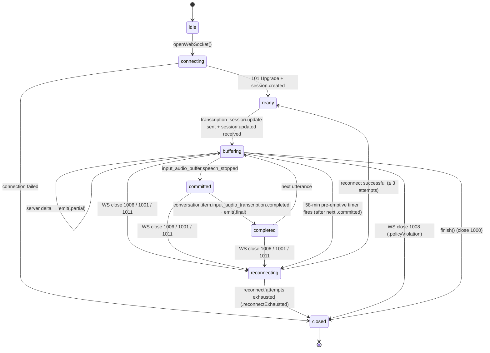

# Project Design — `ntakker-cli` macOS Dual-Source Audio Recording Tool

> Phase 5 (Designer) deliverable. Authoritative technical design consumed by
> Phase 6 (parallel Coders), Phase 7 (Code Reviewer), Phase 8 (Dependency
> Validator), Phase 9 (Test Builders), Phase 10 (Integration Verifier).
>
> **Source documents (locked inputs):**
> 1. `docs/design/refined-request-recording-tool.md` — FR-1..FR-16, NFR-1..NFR-10, AC-1..AC-20, OQ-1..OQ-10 (OQ-3 overridden 2026-04-26)
> 2. `docs/design/project-functions.md` — FR-17..FR-29 (FR-25..FR-29 added 2026-04-26 per OQ-3 override)
> 3. `docs/design/plan-001-recording-tool.md` — 12-phase plan, parallelization map, risk register (Phase K and risk register expanded 2026-04-26)
> 4. `docs/reference/investigation-recording-tool.md` — architectural sketch
> 5. `docs/research/scstream-audio-only.md` — SCStream knobs and watchdog
> 6. `docs/research/avassetwriter-aac.md` — AVAssetWriter recipe and SIGINT-safe finalization
> 7. `CLAUDE.md` — project conventions
>
> **Locked stack — DO NOT re-litigate:** Swift 5.9, macOS 14.0+, universal
> binary, foreground (default) + detached background mode (`--detach` +
> `stop` subcommand; OQ-3 override 2026-04-26 — see §14), internal
> pipeline format Float32/48 kHz/stereo, SCStream for system audio,
> AVCaptureSession for mic, AVAssetWriter for `.m4a`, AVAudioFile for
> `.wav`/`.caf`, swift-argument-parser 1.5.x and swift-log 1.5.x as the
> only third-party SPM deps.

---

## Section 1 — System Architecture

### 1.1 Component Diagram

```
                                  ntakker-cli process
   ┌──────────────────────────────────────────────────────────────────────────┐
   │                                                                          │
   │   main.swift  ──►  ToolAgentsBootstrap  ──►  LoggerFactory               │
   │      │                 (FR-13, AC-10)              │                     │
   │      │                                             │                     │
   │      ▼                                             ▼                     │
   │   RootCommand (swift-argument-parser AsyncParsableCommand)               │
   │   ├── StartCommand            ──┐                                        │
   │   ├── ListDevicesCommand      ──┤   each subcommand  ──►  NtakkerCore     │
   │   └── CheckPermissionsCommand ──┘                                        │
   │                                                                          │
   │ ── NtakkerCore library ─────────────────────────────────────────────────  │
   │                                                                          │
   │   Config:                  Permissions:                Devices:          │
   │   ┌──────────────────┐    ┌─────────────────────┐    ┌────────────────┐  │
   │   │ DotEnvParser     │    │ PermissionGate      │    │ AudioDevice-   │  │
   │   │ ConfigResolver   │    │  ├─ ScreenRecording │    │  Enumerator    │  │
   │   │ RecordingOptions │    │  └─ Microphone      │    │  (CoreAudio    │  │
   │   └────────┬─────────┘    └──────────┬──────────┘    │   HAL)         │  │
   │            │                         │               └────────┬───────┘  │
   │            │                         │                        │          │
   │            └─────────────┬───────────┴────────────────────────┘          │
   │                          ▼                                               │
   │               ┌────────────────────────┐                                 │
   │               │  RecordingSession      │ ◄── SignalHandler (SIGINT/TERM) │
   │               │  (orchestrator)        │ ◄── max-duration timer          │
   │               └─┬──────────┬───────────┘                                 │
   │                 │          │                                             │
   │ Capture:        ▼          ▼                                             │
   │  ┌──────────────────┐  ┌───────────────────┐                             │
   │  │ SystemAudioSource│  │ MicrophoneSource  │   (protocols)               │
   │  │  ├─ SCKitSystem- │  │  ├─ AVMicrophone- │                             │
   │  │  │  AudioSource  │  │  │  Source        │                             │
   │  │  └─ FakeAudio-   │  │  └─ FakeAudio-    │   (test fakes)              │
   │  │     Source       │  │     Source        │                             │
   │  └─────────┬────────┘  └─────────┬─────────┘                             │
   │            │                     │                                       │
   │            ▼                     ▼                                       │
   │   ┌────────────────────────────────────────┐                             │
   │   │  AVAudioConverter (one per source,     │                             │
   │   │  long-lived) → Float32/48 kHz/stereo   │                             │
   │   └─────────┬───────────────────────────┬──┘                             │
   │             │                           │                                │
   │             ▼                           ▼                                │
   │   Aligning:                                                              │
   │   ┌─────────────────────────────────────────┐    ┌──────────────────┐    │
   │   │  HostClockAligner                       │ ◄──┤ SilenceBuffer-   │    │
   │   │  (per-source ring buffer; nextExpected- │    │ Factory          │    │
   │   │  AudioTime; pair drain in lockstep)     │    └──────────────────┘    │
   │   └────────────────────┬────────────────────┘                            │
   │                        ▼                                                 │
   │   Mixing:                                                                │
   │   ┌─────────────────────────────────────────┐                            │
   │   │  layout=mixed         → BufferSummer    │                            │
   │   │  layout=stereo-split  → channel pin     │                            │
   │   │  layout=split         → passthrough x2  │                            │
   │   └────────────────────┬────────────────────┘                            │
   │                        ▼                                                 │
   │   Encoding:                                                              │
   │   ┌─────────────────────────────────────────┐                            │
   │   │  Recorder (protocol)                    │                            │
   │   │   ├─ M4ARecorder  (AVAssetWriter, AAC)  │                            │
   │   │   ├─ WAVRecorder  (AVAudioFile, PCM)    │                            │
   │   │   └─ CAFRecorder  (AVAudioFile, PCM)    │                            │
   │   └────────────────────┬────────────────────┘                            │
   │                        ▼                                                 │
   │              on-disk output file(s)                                      │
   │                                                                          │
   │   Cross-cutting:                                                         │
   │     - NtakkerError (typed; LocalizedError)                                │
   │     - LoggerFactory + Logger instances per subsystem (swift-log)         │
   └──────────────────────────────────────────────────────────────────────────┘
```

### 1.2 Data-Flow Diagram (CMSampleBuffer journey)

```
   ScreenCaptureKit                       AVCaptureSession
   (replayd XPC)                          (CoreAudio HAL → mic)
   PTS = host clock                       PTS = host clock (forced via
   Format = Float32 / 48k / stereo         synchronizationClock)
        │                                   │   Format = device-native
        │                                   │   (e.g. 24 kHz / mono Int16
        │                                   │   for AirPods)
        ▼                                   ▼
   stream(_:didOutputSampleBuffer:of:)   captureOutput(_:didOutput:from:
   in SCKitSystemAudioSource               connection:) in AVMicrophoneSource
   (queue: ntakker-cli.capture.system)          (queue: ntakker-cli.capture.mic)
        │  emits CaptureBuffer envelope    │  emits CaptureBuffer envelope
        │  (.system source tag)            │  (.microphone source tag)
        ▼                                   ▼
   ┌─────────────────────────────┐  ┌─────────────────────────────┐
   │ AVAudioConverter (system)   │  │ AVAudioConverter (mic)      │
   │ (no-op resample if already  │  │ Resample to 48 kHz, upmix   │
   │  Float32/48 kHz/stereo,     │  │ to stereo, convert to       │
   │  but instance still owned)  │  │ Float32 non-interleaved     │
   └──────────────┬──────────────┘  └──────────────┬──────────────┘
                  │                                │
                  ▼                                ▼
         (each side enqueues its CaptureBuffer onto its
          per-source ring buffer inside the aligner;
          capture callback returns immediately — no blocking)
                  │                                │
                  └────────────┬───────────────────┘
                               ▼
                  ┌──────────────────────────────┐
                  │ HostClockAligner             │
                  │ (queue: ntakker-cli.aligner)      │
                  │  - Compute gap = pts -       │
                  │    nextExpectedAudioTime[s]  │
                  │  - If gap > 1 sample, ask    │
                  │    SilenceBufferFactory for  │
                  │    a fill buffer             │
                  │  - Drain pairs in lockstep   │
                  │  - Emits AlignedFrame{s, m}  │
                  └──────────────┬───────────────┘
                                 │ (mixed / stereo-split)
        ┌────────────────────────┼─────────────────────────┐
        │                        │                         │
        ▼ split                  ▼ stereo-split            ▼ mixed
   ┌─────────────┐       ┌──────────────────┐       ┌──────────────────┐
   │ pass mic    │       │ Pin mic → L,     │       │ BufferSummer:    │
   │ frame to    │       │ system → R       │       │ Float32 per-     │
   │ mic writer  │       │ (flip per        │       │ sample sum,      │
   │ pass system │       │  --mic-channel)  │       │ clamp [-1,+1]    │
   │ frame to    │       │ → single buffer  │       │ → single buffer  │
   │ system wtr  │       └────────┬─────────┘       └────────┬─────────┘
   └──┬───────┬──┘                │                          │
      │       │                   │                          │
      ▼       ▼                   ▼                          ▼
   ┌──────┐ ┌──────┐         ┌──────────┐               ┌──────────┐
   │ Rec. │ │ Rec. │         │ Recorder │               │ Recorder │
   │ mic  │ │ sys  │         └────┬─────┘               └────┬─────┘
   └──┬───┘ └──┬───┘              │                          │
      ▼        ▼                  ▼                          ▼
   queue: ntakker-cli.recorder.{mic|system|main}   (one serial DispatchQueue per
                                                Recorder; honors
                                                isReadyForMoreMediaData)
        │
        ▼
   AVAssetWriterInput.append(_:)  /  AVAudioFile.write(from:)
        │
        ▼
   <output>.m4a / .wav / .caf  (or split: <basename>.{mic,system}.<ext>)
```

### 1.3 Threading Model

| Queue label                       | Type              | QoS               | Owned by                         | Purpose                                                           |
|-----------------------------------|-------------------|-------------------|----------------------------------|-------------------------------------------------------------------|
| `ntakker-cli.capture.system`           | serial Dispatch   | `.userInteractive`| `SCKitSystemAudioSource`         | Receives `SCStream` audio buffers; drops `.screen` buffers        |
| `ntakker-cli.capture.system.video`     | serial Dispatch   | `.utility`        | `SCKitSystemAudioSource`         | Receives & discards `.screen` SCStream output (kept tiny)         |
| `ntakker-cli.capture.mic`              | serial Dispatch   | `.userInteractive`| `AVMicrophoneSource`             | `AVCaptureAudioDataOutput` delegate queue                         |
| `ntakker-cli.aligner`                  | serial Dispatch   | `.userInitiated`  | `HostClockAligner`               | Places per-source chunks by PTS; emits 100 ms windows (plan-021) |
| `ntakker-cli.recorder.main`            | serial Dispatch   | `.userInitiated`  | M4A/WAV/CAF Recorder (mixed/SS)  | Wraps every `append`, `markAsFinished`, `endSession`              |
| `ntakker-cli.recorder.mic`             | serial Dispatch   | `.userInitiated`  | Recorder for split.mic           | As above (split layout only)                                      |
| `ntakker-cli.recorder.system`          | serial Dispatch   | `.userInitiated`  | Recorder for split.system        | As above (split layout only)                                      |
| `ntakker-cli.signals`                  | serial Dispatch   | `.userInteractive`| `SignalHandler`                  | `DispatchSourceSignal` for SIGINT/SIGTERM                         |
| `ntakker-cli.session`                  | serial Dispatch   | `.userInitiated`  | `RecordingSession`               | Orchestrator state machine; idempotent `stop()` guard             |
| `ntakker-cli.watchdog.scstream`        | Swift Task        | `.utility`        | `SCKitSystemAudioSource`         | Polls `lastBufferArrival`; restarts SCStream on stall (FR-19)     |
| `ntakker-cli.heartbeat`                | repeating Timer   | `.utility`        | `RecordingSession`               | RMS heartbeat every 10 s when log level is `debug` (FR-23)        |

**Concurrency rules:**
- Capture-source delegate methods MUST return in O(1) audio-pipeline cost — they perform conversion via the long-lived `AVAudioConverter` and enqueue onto the aligner's ring buffer; they MUST NOT call `Recorder.append` directly.
- The aligner queue is the only queue that calls `Recorder.append`. Recorder implementations re-dispatch onto their own writer queue.
- `RecordingSession.stop()` is the only method that may be invoked from any queue (signal handler, max-duration timer, programmatic). It hops to `ntakker-cli.session` and drains in serial order.
- All `CMSampleBuffer` references are passed by value (`CMSampleBuffer` is a Core Foundation type with retain semantics); never store raw pointers from the dataBuffer outside the lifetime of the enclosing buffer.
- All `Sendable` violations (e.g. closures capturing class-bound state across queue hops) are explicitly annotated `@unchecked Sendable` with a comment naming the protecting queue.

---

## Section 2 — Module Interfaces

This section gives the exact Swift surface the Phase-6 coders will type. All
file paths are absolute under `/Users/giorgosmarinos/aiwork/coding-platform/recording-tool/`.

### 2.1 `NtakkerError`

**File:** `Sources/NtakkerCore/Errors/NtakkerError.swift`

```swift
import Foundation

public enum NtakkerError: Error, LocalizedError, CustomStringConvertible {
    // Configuration
    case missingRequiredConfig(key: String, sourcesChecked: [String])
    case invalidConfigValue(key: String, value: String, expected: String)
    case dotEnvParseError(path: String, line: Int, reason: String)

    // Output path
    case outputParentMissing(URL)
    case outputAlreadyExists(URL)

    // Permissions
    case screenRecordingPermissionDenied
    case screenRecordingPermissionNotDetermined
    case microphonePermissionDenied
    case microphonePermissionNotDetermined
    case microphonePermissionRestricted

    // Devices
    case noInputDevicesAvailable
    case micDeviceNotFound(String)

    // Capture
    case scStreamFailedToStart(underlying: Error)
    case scStreamSilentStopExceeded(restartCount: Int)
    case avCaptureFailedToStart(underlying: Error)

    // Encoding
    case writerFailedToStart(underlying: Error)
    case writerFinalizationTimeout(URL)
    case finishWritingFailed(underlying: Error)

    // Detach mode and `stop` subcommand (added 2026-04-26 per FR-25..FR-29)
    case noActiveRecording(pidFilePath: String)
    case staleRecording(pid: Int32, pidFilePath: String)
    case stopTimeout(pid: Int32, seconds: Int)
    case alreadyRecording(pid: Int32, pidFilePath: String)
    case pidFileWriteFailed(path: String, reason: String)

    // Generic
    case ioError(String)
    case unknown(String)

    public var exitCode: Int32 {
        switch self {
        case .missingRequiredConfig, .micDeviceNotFound,
             .alreadyRecording, .noActiveRecording:                     return 78  // EX_CONFIG
        case .invalidConfigValue, .dotEnvParseError:                    return 64  // EX_USAGE
        case .outputParentMissing, .outputAlreadyExists,
             .pidFileWriteFailed:                                       return 66  // EX_NOINPUT
        case .screenRecordingPermissionNotDetermined,
             .microphonePermissionNotDetermined,
             .staleRecording:                                           return 75  // EX_TEMPFAIL
        case .screenRecordingPermissionDenied,
             .microphonePermissionDenied,
             .microphonePermissionRestricted:                           return 77  // EX_NOPERM
        case .noInputDevicesAvailable,
             .scStreamFailedToStart,
             .scStreamSilentStopExceeded,
             .avCaptureFailedToStart,
             .writerFailedToStart,
             .stopTimeout:                                              return 70  // EX_SOFTWARE
        case .writerFinalizationTimeout:                                return 2
        case .finishWritingFailed, .ioError, .unknown:                  return 1
        }
    }

    /// Short, single-line stderr summary. Must NOT contain audio samples,
    /// device serial numbers, or any user PII (NFR-7).
    public var description: String { /* ... locked strings, see below ... */ }

    /// Multi-line user-facing remediation guidance.
    public var remediation: String { /* ... locked strings, see below ... */ }

    public var errorDescription: String? { description }
}
```

**Locked stderr strings (Phase 9 will assert these verbatim):**

| Case                                          | `description`                                                                                       | `remediation` (one-liner)                                                                                                       |
|-----------------------------------------------|----------------------------------------------------------------------------------------------------|---------------------------------------------------------------------------------------------------------------------------------|
| `missingRequiredConfig(key, sourcesChecked)`  | `"missing required config: <key> (checked: <sourcesChecked.joined(\", \")>)"`                       | `"Set --<flag> on the command line, or define <KEY> in ./.env, ~/.tool-agents/ntakker-cli/.env, or your shell environment."`         |
| `invalidConfigValue(key, value, expected)`    | `"invalid value for <key>: '<value>' (expected: <expected>)"`                                       | `"See 'ntakker-cli start --help' for the accepted values."`                                                                          |
| `dotEnvParseError(path, line, reason)`        | `"failed to parse .env at <path>:<line>: <reason>"`                                                 | `"Fix the syntax in <path> (KEY=VALUE per line; # for comments; quoted values supported)."`                                     |
| `outputParentMissing(url)`                    | `"output parent directory does not exist: <url.deletingLastPathComponent().path>"`                  | `"Create the parent directory (e.g. mkdir -p) before running ntakker-cli start."`                                                    |
| `outputAlreadyExists(url)`                    | `"output file already exists: <url.path>"`                                                          | `"Pass --overwrite to replace it, or choose a different --output path."`                                                        |
| `screenRecordingPermissionDenied`             | `"Screen Recording permission denied"`                                                              | `"Open System Settings > Privacy & Security > Screen Recording and enable ntakker-cli, then re-run."`                                |
| `screenRecordingPermissionNotDetermined`      | `"Screen Recording permission not yet granted; system prompt has been triggered"`                   | `"Approve the prompt that just appeared, then re-run ntakker-cli start. (Same-process state cannot be re-read; relaunch is required.)"` |
| `microphonePermissionDenied`                  | `"Microphone permission denied"`                                                                    | `"Open System Settings > Privacy & Security > Microphone and enable ntakker-cli, then re-run."`                                      |
| `microphonePermissionNotDetermined`           | `"Microphone permission not yet granted; system prompt has been triggered"`                         | `"Approve the prompt that just appeared, then re-run ntakker-cli start."`                                                            |
| `microphonePermissionRestricted`              | `"Microphone access is restricted by an MDM profile or parental control"`                           | `"Contact your administrator; the tool cannot record audio under this restriction."`                                            |
| `noInputDevicesAvailable`                     | `"no input audio devices found on this system"`                                                     | `"Connect a microphone or enable the built-in microphone in System Settings > Sound."`                                          |
| `micDeviceNotFound(identifier)`               | `"microphone device not found: '<identifier>'"`                                                     | `"Run 'ntakker-cli list-devices' to see the available UIDs and names."`                                                              |
| `scStreamFailedToStart(underlying)`           | `"system audio capture failed to start: <underlying.localizedDescription>"`                         | `"Confirm Screen Recording permission is granted; try 'tccutil reset ScreenCapture' and re-grant."`                             |
| `scStreamSilentStopExceeded(restartCount)`    | `"system audio capture silently stopped <restartCount> times in 60s; aborting"`                     | `"Restart the Mac, or rerun the recording. If the problem persists, please file an issue with the debug log."`                  |
| `avCaptureFailedToStart(underlying)`          | `"microphone capture failed to start: <underlying.localizedDescription>"`                           | `"Confirm Microphone permission and that the selected device is available (see 'ntakker-cli list-devices')."`                        |
| `writerFailedToStart(underlying)`             | `"output writer failed to initialize: <underlying.localizedDescription>"`                           | `"Verify the output path is writable and the parent directory exists."`                                                         |
| `writerFinalizationTimeout(url)`              | `"finishWriting timed out after 30s; partial output at <url.path>"`                                 | `"The file may still be playable in VLC/ffmpeg thanks to fragmentation; re-run with shorter recordings if this recurs."`        |
| `finishWritingFailed(underlying)`             | `"writer finalization failed: <underlying.localizedDescription>"`                                   | `"The output file is likely incomplete. Re-run the recording."`                                                                 |
| `ioError(msg)`                                | `"I/O error: <msg>"`                                                                                | `"Check disk space and write permissions on the output directory."`                                                             |
| `unknown(msg)`                                | `"unexpected error: <msg>"`                                                                         | `"Re-run with --log-level debug and report the log to the project maintainer."`                                                 |
| `noActiveRecording(pidFilePath)`              | `"No active ntakker-cli recording found (PID file at <pidFilePath> does not exist)."`                    | `"Start a recording with 'ntakker-cli start --detach' first."`                                                                       |
| `staleRecording(pid, pidFilePath)`            | `"Stale PID file at <pidFilePath> referenced PID <pid> which is no longer running. The file has been removed."` | `"You can start a new recording with 'ntakker-cli start --detach'."`                                                                 |
| `stopTimeout(pid, seconds)`                   | `"ntakker-cli process <pid> did not exit within <seconds>s of SIGTERM. The process may still be finalizing or hung."` | `"Inspect 'ps -p <pid>'. If it is still finalizing, wait. If it is hung, escalate to 'kill -KILL <pid>' (will lose the recording)." |
| `alreadyRecording(pid, pidFilePath)`          | `"Another ntakker-cli recording is already running (PID <pid>, PID file <pidFilePath>)."`                | `"Run 'ntakker-cli stop' first or pass '--pid-file <path>' to use a different file."`                                                |
| `pidFileWriteFailed(path, reason)`            | `"Failed to write PID file at <path>: <reason>."`                                                   | `"Check that the parent directory exists and is writable; try passing '--pid-file <path>' to a writable location."`             |

**Exit-code rationale for the new cases:**
- `noActiveRecording` → 78 (`EX_CONFIG`): the user has misconfigured —
  asked to stop without having started anything reachable via the
  resolved PID-file path.
- `staleRecording` → 75 (`EX_TEMPFAIL`): informational — the file has
  been cleaned up, the user can immediately try again. Chosen over
  exit 0 because the user's intent ("stop the running recording") was
  not actually fulfilled — there was nothing to stop.
- `stopTimeout` → 70 (`EX_SOFTWARE`): runtime failure — the daemon
  did not respond to SIGTERM within the bounded window.
- `alreadyRecording` → 78 (`EX_CONFIG`): the user is trying to start
  a second daemon over an existing one — a configuration / workflow
  error. The running recording is left untouched.
- `pidFileWriteFailed` → 66 (`EX_NOINPUT`): I/O error on the PID
  file's parent directory.

**Lifecycle / ownership:** Pure value type. Created at the throw site, propagated up
the call stack. Never retained.

**Concurrency rules:** Trivially `Sendable` (enum of `Sendable` payloads except
`underlying: Error`, which is opaque — annotated `@unchecked Sendable` only if a
Swift 6 strict-concurrency build complains).

---

### 2.2 `ToolAgentsBootstrap`

**File:** `Sources/NtakkerCore/Bootstrap/ToolAgentsBootstrap.swift`

```swift
import Foundation

public enum ToolAgentsBootstrap {
    /// Ensures `~/.tool-agents/<toolName>/` exists at mode 0700 and contains
    /// a `.env` file at mode 0600. Idempotent. Re-chmods on every invocation
    /// (FR-13, AC-10).
    ///
    /// - Parameter toolName: e.g. "ntakker-cli".
    /// - Returns: The directory URL.
    /// - Throws: `NtakkerError.ioError` on filesystem failure.
    public static func ensureToolFolder(toolName: String) throws -> URL

    /// Path to the per-user `.env` for this tool.
    public static func userEnvPath(toolName: String) -> URL

    /// Path to the local `.env` (CWD).
    public static func localEnvPath() -> URL
}
```

**Lifecycle:** Stateless (`enum`). Called exactly once from `main.swift`
before any subcommand dispatches (per Phase K plan).

**Concurrency:** Thread-safe (filesystem ops are atomic for our needs;
called only from main thread on startup).

**Errors thrown:** `NtakkerError.ioError(String)`.

---

### 2.3 `DotEnvParser`

**File:** `Sources/NtakkerCore/Config/DotEnvParser.swift`

```swift
import Foundation

public enum DotEnvParser {
    /// Parses a `.env`-format string into key→value pairs.
    ///
    /// Accepted syntax:
    ///   KEY=VALUE                     (whitespace around `=` trimmed)
    ///   KEY="value with spaces"       (one matched pair of " or ' stripped)
    ///   KEY=value containing #hash    (NOT a comment when no leading whitespace)
    ///   # comment line                (skipped)
    ///   <blank line>                  (skipped)
    ///
    /// Behavior:
    ///   - Duplicate keys: last write wins.
    ///   - Lines without `=`: silently skipped (debug log entry).
    ///   - No `$VAR` interpolation in v1.
    ///   - No multi-line values; line endings split on `\n` and `\r\n`.
    ///
    /// - Throws: `NtakkerError.dotEnvParseError(path:line:reason:)` for
    ///   syntactically broken quoted values (unmatched quote, etc.).
    public static func parse(_ source: String, path: String) throws -> [String: String]

    /// Convenience: reads a file at `url` and parses it. Returns empty
    /// dictionary if the file does not exist (NOT an error).
    public static func parseFile(at url: URL) throws -> [String: String]
}
```

**Lifecycle:** Stateless.

**Errors thrown:** `NtakkerError.dotEnvParseError`, `NtakkerError.ioError`.

---

### 2.4 `ConfigResolver` + `RecordingOptions`

**File (resolver):** `Sources/NtakkerCore/Config/ConfigResolver.swift`
**File (options):** `Sources/NtakkerCore/Config/RecordingOptions.swift`

```swift
import Foundation

public enum OutputFormat: String, CaseIterable, Sendable {
    case m4a, wav, caf
}

public enum TrackLayout: String, CaseIterable, Sendable {
    case mixed
    case split
    case stereoSplit = "stereo-split"
}

public enum StereoChannel: String, CaseIterable, Sendable {
    case left, right
}

public enum LogLevel: String, CaseIterable, Sendable {
    case quiet, info, debug
}

/// Run mode (added 2026-04-26 per OQ-3 override / FR-25).
/// `.foreground` — runs in the invoking shell; logs to stderr; no PID file.
/// `.detached`   — double-forks; logs to log file; writes PID file.
public enum RunMode: String, CaseIterable, Sendable {
    case foreground, detached
}

public struct RecordingOptions: Sendable {
    public let outputPath: URL
    public let format: OutputFormat
    public let layout: TrackLayout
    public let sampleRate: Int           // 44100 | 48000
    public let bitDepth: Int             // 16 | 24 (PCM only; ignored for AAC)
    public let bitrate: Int              // 64...320 kbps (AAC only)
    public let micDevice: String?        // nil = system default
    public let micChannel: StereoChannel // .left | .right (stereo-split only)
    public let maxDuration: TimeInterval?
    public let overwrite: Bool
    public let logLevel: LogLevel
    // Run model (FR-25/FR-27/FR-29) — populated by StartCommand,
    // consumed by RecordingSession's PID file hook.
    public let runMode: RunMode          // .foreground (default) | .detached
    public let pidFilePath: URL          // honored only when runMode == .detached
    public let logFilePath: URL          // honored only when runMode == .detached
}

public final class ConfigResolver {
    /// Constructor. The four `[String: String]` arguments are the four
    /// configuration sources, lowest-to-highest priority.
    public init(
        shellEnv: [String: String],
        userEnv: [String: String],
        localEnv: [String: String],
        cliFlags: [String: String]
    )

    /// Returns the highest-priority value for `key`, or nil if unset
    /// in every source. The merge order is:
    ///   cliFlags > localEnv > userEnv > shellEnv
    public func resolve(_ key: String) -> String?

    /// Like `resolve`, but throws `NtakkerError.missingRequiredConfig` if
    /// every source returns nil.
    public func requireString(_ key: String) throws -> String

    /// Builds the final, validated `RecordingOptions`. Performs:
    ///   - Required-key check (only `OUTPUT_PATH` is required).
    ///   - Enum parsing (`format`, `layout`, `mic-channel`, `log-level`).
    ///   - Range validation (FR-17).
    ///   - `~` expansion in the output path.
    ///   - `--overwrite` boolean parsing (`"true"`, `"1"`, `"yes"` all true).
    /// - Throws: `NtakkerError.missingRequiredConfig` or
    ///   `NtakkerError.invalidConfigValue`.
    public func buildRecordingOptions() throws -> RecordingOptions
}
```

**Lifecycle:** Created once per CLI invocation, owned by the relevant
`StartCommand` instance, dies when `run()` returns.

**Concurrency:** Built and consumed on the main thread; `Sendable` after
`buildRecordingOptions()` returns its result.

**Errors thrown:** `NtakkerError.missingRequiredConfig`,
`NtakkerError.invalidConfigValue`.

---

### 2.5 `LoggerFactory`

**File:** `Sources/NtakkerCore/Logging/LoggerFactory.swift`

```swift
import Foundation
import Logging

public enum LoggerFactory {
    /// Bootstraps `swift-log` with a stderr handler at the requested level.
    /// Idempotent — safe to call multiple times in tests.
    /// Map: .quiet → .warning, .info → .info, .debug → .debug
    public static func bootstrap(level: LogLevel)

    /// Returns a logger for the given subsystem.
    /// Subsystem strings are listed in §6 (Logging contract).
    public static func make(subsystem: String) -> Logger
}
```

**Subsystem strings (locked, see §6):**
`ntakker-cli.cli`, `ntakker-cli.bootstrap`, `ntakker-cli.config`, `ntakker-cli.permissions`,
`ntakker-cli.devices`, `ntakker-cli.capture.system`, `ntakker-cli.capture.mic`,
`ntakker-cli.aligner`, `ntakker-cli.mixer`, `ntakker-cli.recorder.m4a`,
`ntakker-cli.recorder.wav`, `ntakker-cli.recorder.caf`, `ntakker-cli.session`,
`ntakker-cli.signal`.

---

### 2.6 Permissions

**Files:**
- `Sources/NtakkerCore/Permissions/PermissionGate.swift` (protocol + Live impl)
- `Sources/NtakkerCore/Permissions/ScreenRecordingPermission.swift`
- `Sources/NtakkerCore/Permissions/MicrophonePermission.swift`

```swift
import Foundation

public enum PermissionState: String, Sendable {
    case authorized, denied, notDetermined, restricted
}

public protocol PermissionGate: AnyObject, Sendable {
    func screenRecordingStatus() -> PermissionState
    func microphoneStatus() -> PermissionState

    /// Triggers the screen-recording prompt if state is .notDetermined.
    /// Returns immediately; same-process state is unreliable, so callers
    /// must exit and ask the user to relaunch.
    func requestScreenRecording() -> Bool

    /// Async micro-permission request; completion fires after the user
    /// dismisses the prompt.
    func requestMicrophone() async -> Bool
}

/// Production gate composing the two concrete permission helpers.
public final class LivePermissionGate: PermissionGate {
    public init()
    // ...
}

public enum ScreenRecordingPermission {
    public static func current() -> PermissionState     // CGPreflightScreenCaptureAccess()
    public static func request() -> Bool                 // CGRequestScreenCaptureAccess()
}

public enum MicrophonePermission {
    public static func current() -> PermissionState
    public static func request() async -> Bool
}
```

**Test fake (lives in `Tests/NtakkerCoreTests/Fakes/StubPermissionGate.swift`):**

```swift
import NtakkerCore

final class StubPermissionGate: PermissionGate {
    var screenState: PermissionState = .authorized
    var micState: PermissionState = .authorized
    func screenRecordingStatus() -> PermissionState { screenState }
    func microphoneStatus() -> PermissionState { micState }
    func requestScreenRecording() -> Bool { screenState == .authorized }
    func requestMicrophone() async -> Bool { micState == .authorized }
}
```

---

### 2.7 `AudioDeviceEnumerator`

**File:** `Sources/NtakkerCore/Devices/AudioDeviceEnumerator.swift`

```swift
import Foundation

public struct AudioInputDevice: Sendable, Equatable {
    public let uid: String
    public let name: String
    public let sampleRateHz: Double
    public let channelCount: Int
    public let isDefault: Bool
}

public protocol AudioDeviceEnumerating: AnyObject, Sendable {
    func listInputDevices() throws -> [AudioInputDevice]
    func resolve(_ identifier: String) throws -> AudioInputDevice
}

public final class AudioDeviceEnumerator: AudioDeviceEnumerating {
    public init()

    /// Lists all input-capable devices via Core Audio HAL
    /// (`kAudioHardwarePropertyDevices` + scope=Input filter).
    /// Throws `NtakkerError.noInputDevicesAvailable` if the list is empty.
    public func listInputDevices() throws -> [AudioInputDevice]

    /// Resolves `--mic-device` argument. Algorithm (OQ-8):
    ///   1. UID match (case-sensitive). UID always wins.
    ///   2. Name match (case-insensitive). Multiple matches → log warning,
    ///      pick the first by ascending AudioObjectID.
    ///   3. None → throw `NtakkerError.micDeviceNotFound(identifier)`.
    public func resolve(_ identifier: String) throws -> AudioInputDevice
}
```

**Test fake (`FakeAudioDeviceEnumerator`):** Holds a `[AudioInputDevice]`
constructed in tests; honors the same resolution rules.

---

### 2.8 Capture sources

**Files:**
- `Sources/NtakkerCore/Capture/SystemAudioSource.swift` (protocol)
- `Sources/NtakkerCore/Capture/MicrophoneSource.swift` (protocol)
- `Sources/NtakkerCore/Capture/SCKitSystemAudioSource.swift`
- `Sources/NtakkerCore/Capture/AVMicrophoneSource.swift`
- `Sources/NtakkerCore/Capture/FakeAudioSource.swift`

```swift
import CoreMedia

public enum CaptureSourceTag: Sendable {
    case system
    case microphone
}

/// Envelope around a CMSampleBuffer that carries source attribution.
/// Used by the aligner to route per-source.
public struct CaptureBuffer: @unchecked Sendable {
    public let source: CaptureSourceTag
    public let buffer: CMSampleBuffer       // retain semantics: opaque CF type
    public init(source: CaptureSourceTag, buffer: CMSampleBuffer)
}

public protocol AudioSource: AnyObject {
    /// The Core Media format description of the buffers this source emits
    /// AFTER the per-source AVAudioConverter. Always Float32/48k/stereo
    /// non-interleaved when the source is wired into the pipeline.
    var formatDescription: CMAudioFormatDescription? { get }

    /// Set by the orchestrator before `start()`. Called on the source's
    /// own delivery queue; the closure must enqueue and return promptly.
    var onSampleBuffer: ((CaptureBuffer) -> Void)? { get set }

    func start() async throws
    func stop() async
}

public protocol SystemAudioSource: AudioSource { }
public protocol MicrophoneSource: AudioSource { }
```

#### 2.8.1 `SCKitSystemAudioSource`

```swift
import ScreenCaptureKit
import CoreMedia
import AVFoundation
import Logging

public final class SCKitSystemAudioSource: NSObject,
                                            SystemAudioSource,
                                            SCStreamOutput,
                                            SCStreamDelegate {
    public init(sampleRate: Int = 48_000,
                channelCount: Int = 2,
                logger: Logger,
                clock: CMClock = CMClockGetHostTimeClock())

    public var formatDescription: CMAudioFormatDescription? { get }
    public var onSampleBuffer: ((CaptureBuffer) -> Void)?

    public func start() async throws    // throws .scStreamFailedToStart
    public func stop() async

    // SCStreamOutput
    public func stream(_ stream: SCStream,
                       didOutputSampleBuffer sb: CMSampleBuffer,
                       of type: SCStreamOutputType)

    // SCStreamDelegate
    public func stream(_ stream: SCStream, didStopWithError error: Error)
}
```

**Internal contract:** see §7 for the exact `SCStreamConfiguration` literal
and watchdog parameters. Conforms to FR-19 (5 s poll, 10 s threshold,
3-restarts-in-60 s fatal cap). All work in `didStopWithError` is wrapped in
`Task { ... }` to dodge the `swift_getErrorValue` `EXC_BAD_ACCESS` framework
bug (per `docs/research/scstream-audio-only.md` §3).

**Errors thrown:** `NtakkerError.scStreamFailedToStart`,
`NtakkerError.scStreamSilentStopExceeded`.

#### 2.8.2 `AVMicrophoneSource`

```swift
import AVFoundation
import CoreMedia
import Logging

public final class AVMicrophoneSource: NSObject,
                                        MicrophoneSource,
                                        AVCaptureAudioDataOutputSampleBufferDelegate {
    public init(deviceIdentifier: String?,
                deviceEnumerator: AudioDeviceEnumerating,
                targetSampleRate: Int = 48_000,
                targetChannelCount: Int = 2,
                logger: Logger)

    public var formatDescription: CMAudioFormatDescription? { get }
    public var onSampleBuffer: ((CaptureBuffer) -> Void)?

    public func start() async throws  // throws .avCaptureFailedToStart, .micDeviceNotFound
    public func stop() async

    // AVCaptureAudioDataOutputSampleBufferDelegate
    public func captureOutput(_ output: AVCaptureOutput,
                              didOutput sampleBuffer: CMSampleBuffer,
                              from connection: AVCaptureConnection)
}
```

**Internal contract:** Sets
`session.synchronizationClock = CMClockGetHostTimeClock()` (FR-22) before
adding inputs. Owns one long-lived `AVAudioConverter` (created lazily on
first buffer once the device's native format is known). Uses
`output.audioSettings = [:]` so the device delivers its native format and
the converter normalizes to Float32/48k/stereo.

#### 2.8.3 `FakeAudioSource`

```swift
import CoreMedia

public final class FakeAudioSource: AudioSource {
    public init(tag: CaptureSourceTag,
                frequencyHz: Double,
                channelCount: Int = 2,
                sampleRate: Double = 48_000,
                bufferDurationMs: Double = 20,
                hostClock: CMClock = CMClockGetHostTimeClock())

    public var formatDescription: CMAudioFormatDescription? { get }
    public var onSampleBuffer: ((CaptureBuffer) -> Void)?

    public func start() async throws
    public func stop() async

    // Convenience factories used by RecordingSessionTests:
    public static func makeSystem440Hz(logger: Logger? = nil) -> FakeAudioSource
    public static func makeMic880Hz(logger: Logger? = nil) -> FakeAudioSource
}

extension FakeAudioSource: SystemAudioSource { }
extension FakeAudioSource: MicrophoneSource  { }
```

Generates non-interleaved Float32 sine waves on a `DispatchQueue`. PTSs are
derived from the captured `CMClock.hostTimeClock.time` at `start()` plus
cumulative buffer durations.

---

### 2.9 Aligning + Mixing

**Files:**
- `Sources/NtakkerCore/Aligning/HostClockAligner.swift`
- `Sources/NtakkerCore/Aligning/SilenceBufferFactory.swift`
- `Sources/NtakkerCore/Mixing/BufferSummer.swift`

```swift
import CoreMedia
import AVFoundation
import Logging

/// One time-aligned pair of buffers covering the same wall-clock interval.
/// The aligner emits one of these per output tick. For `split` layout the
/// aligner is bypassed; sources go directly to per-source recorders.
public struct AlignedFrame: @unchecked Sendable {
    public let pts: CMTime
    public let duration: CMTime
    public let systemBuffer: CMSampleBuffer    // gap-filled if necessary
    public let micBuffer: CMSampleBuffer       // gap-filled if necessary
}

public final class HostClockAligner {
    public init(formatDescription: CMAudioFormatDescription,
                sampleRate: Double = 48_000,
                logger: Logger,
                ringCapacity: Int = 10)         // ~200 ms of 20 ms buffers

    /// Set by the orchestrator before any `accept` call.
    public var onAlignedFrame: ((AlignedFrame) -> Void)?

    /// Capture-source callbacks call this. Returns immediately; actual
    /// alignment runs on `ntakker-cli.aligner` queue.
    public func accept(_ capture: CaptureBuffer)

    /// Drain remaining buffered data on stop. Synchronous wrt the aligner
    /// queue; safe to call from `RecordingSession.stop()` after sources
    /// have been stopped.
    public func drain()
}

public enum SilenceBufferFactory {
    public static func makeSilence(
        startPTS: CMTime,
        duration: CMTime,
        formatDescription: CMAudioFormatDescription,
        sampleRate: Double = 48_000
    ) throws -> CMSampleBuffer
}

public enum BufferSummer {
    /// Pointwise float add of two non-interleaved Float32 stereo buffers
    /// of identical frame count. Output is clamped to [-1.0, +1.0].
    /// Per A-7: no AGC, no ducking, no echo cancellation.
    public static func sum(
        _ a: AVAudioPCMBuffer,
        _ b: AVAudioPCMBuffer,
        gainA: Float = 1.0,
        gainB: Float = 1.0
    ) throws -> AVAudioPCMBuffer

    /// CMSampleBuffer-level convenience used by RecordingSession.
    public static func sum(
        _ a: CMSampleBuffer,
        _ b: CMSampleBuffer,
        formatDescription: CMAudioFormatDescription
    ) throws -> CMSampleBuffer
}
```

**Aligner algorithm (rewritten 2026-10-16, plan-021; replaces the original
§4.3 recipe, whose flat-buffer implementation collapsed in-stream holes and
blocked on a stalled source: EVAL-2026-10-16 CAP-1 / CAP-2 / C1 / C5):**

1. **Timeline.** `accept(_:)` hops onto the `ntakker-cli.aligner` serial
   queue. Every PTS is converted to an absolute sample index at the target
   rate (48 kHz). Windows of `windowFrames` (100 ms) start at the first
   ingested buffer's index. A `cursor` marks the next window; nothing before
   it is emitted again.
2. **Placement.** Each source keeps a queue of chunks (one per buffer,
   samples copied once). A chunk is placed at its PTS:
   - within 5 ms of the previous chunk's end: snapped (contiguous, absorbs
     jitter);
   - further ahead: a hole, emitted as silence and counted once as a
     gap-fill;
   - behind: the overlap is trimmed.

   Samples before `cursor` are dropped on arrival.
3. **Emission.** A window `[ws, we)` is emitted when each source either
   covers `we`, or lags the other source by more than 400 ms (stalled or
   absent). A stalled source is silence-filled for the window and counted
   as a gap-fill. Each source's chunk overlaps are copied straight into the
   output block buffer; consumed chunks are popped (amortised O(1)). The
   output PTS is the window start (timescale = sample rate).
4. **Drift metric.** `stats.lastDriftSec` is the absolute difference between
   the two sources' current snap deviations, i.e. the residual misalignment
   between the tracks (≤ 5 ms per track, within NFR-4's 20 ms).

**`drain()` / `flush()` semantics:** stop accepting new captures, emit every
complete window, then emit the remaining partial windows padded with silence,
so the tail is kept instead of dropped. Padding windows are not counted as
gap-fills.

---

### 2.10 Recorders

**Files:**
- `Sources/NtakkerCore/Encoding/Recorder.swift` (protocol)
- `Sources/NtakkerCore/Encoding/M4ARecorder.swift`
- `Sources/NtakkerCore/Encoding/WAVRecorder.swift`
- `Sources/NtakkerCore/Encoding/CAFRecorder.swift`

> **R-18 resolution (Phase 7 Code Reviewer, 2026-04-26)**: the Phase G
> implementation adopted an `async throws` lifecycle and consumes
> `AlignedFrame` (the post-aligner envelope, owning per-side
> `CMSampleBuffer`s plus host-clock PTS / duration) instead of a raw
> `CMSampleBuffer`. The signature below is the authoritative shape;
> the original closure-based draft is retained for traceability in the
> commit history. The change keeps watchdog semantics (FR-20, 30 s
> finalize timeout) intact while integrating cleanly with
> `RecordingSession`'s async lifecycle (no
> `withCheckedThrowingContinuation` shim at every call site).

```swift
import CoreMedia
import Foundation

public protocol Recorder: AnyObject, Sendable {
    /// Open the underlying writer and begin a session. Captures the
    /// session-start time internally as
    /// `CMClockGetTime(CMClockGetHostTimeClock())`. Throws
    /// `NtakkerError.writerFailedToStart` on any pre-flight or open
    /// failure.
    func start() async throws

    /// Append one aligned frame (per-side `CMSampleBuffer`s plus host-
    /// clock PTS / duration). Recorders honor the configured
    /// `TrackLayout` themselves:
    ///   * `.mixed`        — sum mic + system into a single stereo track.
    ///   * `.stereoSplit`  — produce a stereo track where the mic
    ///                       occupies the configured channel and the
    ///                       system audio the other.
    ///   * `.split`        — write mic and system to separate sibling
    ///                       files (`<basename>.mic.<ext>` and
    ///                       `<basename>.system.<ext>`, FR-5).
    /// Implementations enqueue work onto their private writer queue and
    /// honor `isReadyForMoreMediaData` for AVAssetWriter-backed writers.
    func append(_ frame: AlignedFrame) throws

    /// Finalize and close the writer. Idempotent — repeated calls are
    /// no-ops. Awaits up to `timeout` for `finishWriting` to complete.
    /// On timeout: throws `NtakkerError.writerFinalizationTimeout` and
    /// leaves the partial file on disk. On AVAssetWriter failure:
    /// throws `NtakkerError.finishWritingFailed`.
    func finalize(timeout: TimeInterval) async throws
}

public final class M4ARecorder: Recorder {
    public init(options: RecordingOptions, logger: Logger? = nil)
    // ...
}

public final class WAVRecorder: Recorder {
    public init(options: RecordingOptions, logger: Logger? = nil)
    // ...
}

public final class CAFRecorder: Recorder {
    public init(options: RecordingOptions, logger: Logger? = nil)
    // ...
}
```

**File:** `Sources/NtakkerCore/Encoding/CMSampleBufferAudioConversion.swift`

```swift
import AVFoundation
import CoreMedia

internal enum CMSampleBufferAudioConversion {
    /// Convert a CMSampleBuffer of non-interleaved Float32 PCM to an
    /// AVAudioPCMBuffer of the same format. Used by WAVRecorder /
    /// CAFRecorder before calling AVAudioFile.write(from:).
    static func toPCMBuffer(_ buffer: CMSampleBuffer,
                            format: AVAudioFormat) throws -> AVAudioPCMBuffer

    /// Inverse: build a CMSampleBuffer from an AVAudioPCMBuffer with the
    /// given presentation time. Used by BufferSummer.
    static func toSampleBuffer(_ pcm: AVAudioPCMBuffer,
                               presentationTime: CMTime,
                               formatDescription: CMAudioFormatDescription)
        throws -> CMSampleBuffer
}
```

---

### 2.11 `RecordingSession`

**Files:**
- `Sources/NtakkerCore/RecordingSession.swift`
- `Sources/NtakkerCore/SignalHandler.swift`

```swift
import CoreMedia
import Foundation
import Logging

public enum StopReason: Sendable {
    case signal(Int32)
    case maxDuration
    case programmatic
    case error(NtakkerError)
}

public final class RecordingSession {
    public init(
        options: RecordingOptions,
        systemSource: SystemAudioSource,
        micSource: MicrophoneSource,
        permissions: PermissionGate,
        logger: Logger
    )

    /// Validates permissions (FR-10) and output path (FR-15, FR-24);
    /// captures sessionStart = CMClock.hostTimeClock.time; builds aligner
    /// + recorder(s) per layout; wires sources; calls
    /// systemSource.start() and micSource.start(); installs max-duration
    /// timer if set. Does NOT install signal handlers — the orchestrator
    /// (main.swift) does that.
    /// - Throws: any NtakkerError surfaced by permissions, output path,
    ///   capture, or recorder initialization.
    public func start() async throws

    /// Idempotent. Stops sources, drains aligner, finalizes recorder(s).
    /// Calls completion exactly once. Honors finalization timeout (FR-20).
    public func stop(reason: StopReason,
                     completion: @escaping (Result<[URL], NtakkerError>) -> Void)
}

public final class SignalHandler {
    public init()

    /// Installs SIGINT and SIGTERM handlers. Calls `stopAction` with the
    /// signal number on the first signal received; ignores subsequent
    /// signals (so a double Ctrl-C does not race the finalization).
    /// Pattern verbatim from `docs/research/avassetwriter-aac.md` §1.4 / §5.1.
    public func install(stopAction: @escaping (Int32) -> Void)
}
```

**`RecordingSession.start()` algorithm:**

1. **Permissions (FR-10):**
   - If `permissions.screenRecordingStatus() != .authorized`:
     - `.notDetermined` → `_ = permissions.requestScreenRecording()`; throw
       `screenRecordingPermissionNotDetermined`.
     - `.denied` / `.restricted` → throw `screenRecordingPermissionDenied`.
   - Same triage for microphone.
2. **Output path (FR-15, FR-24):** Per layout, validate one or two paths.
   - Parent dir must exist (no implicit `mkdir -p`); else throw
     `outputParentMissing`.
   - File must not exist OR `options.overwrite == true`; else throw
     `outputAlreadyExists`. If `overwrite == true` and file exists,
     `try FileManager.default.removeItem(at:)`.
3. **Capture sessionStart:** `let sessionStart = CMClock.hostTimeClock.time`.
4. **Build recorders:**
   - `mixed` / `stereo-split`: one Recorder at `options.outputPath`.
   - `split`: two recorders at
     `<basename>.mic.<ext>` and `<basename>.system.<ext>`.
5. **Build aligner:** `HostClockAligner` (skipped for `split` layout; see §1.2).
6. **Wire callbacks:**
   - For `split`: source's `onSampleBuffer` → per-source Recorder.append.
   - For `mixed`: source's `onSampleBuffer` → aligner.accept; aligner's
     `onAlignedFrame` → BufferSummer.sum → Recorder.append.
   - For `stereo-split`: aligner.onAlignedFrame → channel-pin to single
     stereo buffer → Recorder.append.
7. **Start writers:** `try recorder.start(at: sessionStart)` for each.
8. **Start sources:** `try await systemSource.start()`; `try await micSource.start()`.
9. **Max-duration timer:** if `options.maxDuration != nil`, schedule a
   `DispatchSourceTimer` on a `.utility` queue that calls
   `self.stop(reason: .maxDuration, completion: ...)`.
10. **RMS heartbeat (FR-23):** if `options.logLevel == .debug`, schedule a
    repeating `DispatchSourceTimer` (10 s interval) that computes per-source
    RMS over the last drained `AlignedFrame` and logs at `.debug` level on
    `ntakker-cli.session`.

**`RecordingSession.stop(reason:completion:)` algorithm:**

1. Idempotency guard: `let firstStop = isStopping.cas(false, true)`.
2. Cancel timers (max-duration, heartbeat).
3. `await systemSource.stop()`; `await micSource.stop()`.
4. `aligner.drain()` (if present).
5. For each recorder, call `recorder.finalize(at: CMClock.hostTimeClock.time,
   timeout: 30) { result in ... }`. Collect results in a `DispatchGroup`.
6. When all recorders complete (or any one fails), invoke `completion`
   with `.success([urls])` or `.failure(firstError)`.

---

### 2.12 CLI Commands

**Files:**
- `Sources/ntakker-cli/main.swift`
- `Sources/ntakker-cli/Commands/RootCommand.swift`
- `Sources/ntakker-cli/Commands/StartCommand.swift`
- `Sources/ntakker-cli/Commands/ListDevicesCommand.swift`
- `Sources/ntakker-cli/Commands/CheckPermissionsCommand.swift`

```swift
// main.swift
import ArgumentParser
import NtakkerCore

@main
struct NtakkerMain {
    static func main() async {
        // FR-13: every invocation, every subcommand.
        do {
            _ = try ToolAgentsBootstrap.ensureToolFolder(toolName: "ntakker-cli")
        } catch {
            fputs("ntakker-cli: bootstrap failed: \(error)\n", stderr)
            exit(1)
        }
        // Logger bootstrap is delegated to each subcommand once log-level
        // has been resolved.
        await RootCommand.main()
    }
}
```

```swift
// RootCommand.swift
import ArgumentParser

public struct RootCommand: AsyncParsableCommand {
    public static let configuration = CommandConfiguration(
        commandName: "ntakker-cli",
        abstract: "Simultaneously record macOS system audio and microphone audio.",
        version: "0.1.0",
        subcommands: [
            StartCommand.self,
            ListDevicesCommand.self,
            CheckPermissionsCommand.self,
        ],
        defaultSubcommand: nil
    )
    public init() {}
}
```

```swift
// StartCommand.swift
import ArgumentParser
import NtakkerCore

public struct StartCommand: AsyncParsableCommand {
    public static let configuration = CommandConfiguration(
        commandName: "start",
        abstract: "Begin a recording. Stop with Ctrl-C (SIGINT) or SIGTERM."
    )

    @Option(name: .shortAndLong, help: "Output file path (required).")
    var output: String?

    @Option(help: "Output format (m4a | wav | caf). Default: m4a.")
    var format: String?

    @Option(help: "Track layout (mixed | split | stereo-split). Default: mixed.")
    var layout: String?

    @Option(name: .customLong("sample-rate"),
            help: "Sample rate in Hz (44100 | 48000). Default: 48000.")
    var sampleRate: Int?

    @Option(name: .customLong("bit-depth"),
            help: "Bit depth (16 | 24, PCM only). Default: 16.")
    var bitDepth: Int?

    @Option(help: "AAC bitrate in kbps (64-320). Default: 192.")
    var bitrate: Int?

    @Option(name: .customLong("mic-device"),
            help: "Microphone device name or UID. Default: system default.")
    var micDevice: String?

    @Option(name: .customLong("mic-channel"),
            help: "Stereo-split mic channel (left | right). Default: left.")
    var micChannel: String?

    @Option(name: .customLong("max-duration"),
            help: "Auto-stop after N seconds. Default: run until SIGINT.")
    var maxDuration: Double?

    @Flag(help: "Overwrite an existing output file.")
    var overwrite: Bool = false

    @Option(name: .customLong("log-level"),
            help: "Log verbosity (quiet | info | debug). Default: info.")
    var logLevel: String?

    public init() {}

    public mutating func run() async throws {
        // Implementation:
        //   1. Build ConfigResolver from ProcessInfo.environment + the
        //      two .env files + the parsed flags (above).
        //   2. resolver.buildRecordingOptions() → RecordingOptions.
        //      (Reject `--output -` here per OQ-5.)
        //   3. LoggerFactory.bootstrap(level: options.logLevel).
        //   4. Build LivePermissionGate, SCKitSystemAudioSource,
        //      AVMicrophoneSource, RecordingSession.
        //   5. SignalHandler.install { signal in session.stop(...) }.
        //   6. try await session.start().
        //   7. Wait on a CheckedContinuation that the stop completion
        //      resolves with the result. exit(0) on success; exit
        //      with NtakkerError.exitCode on failure.
    }
}
```

```swift
// ListDevicesCommand.swift
public struct ListDevicesCommand: ParsableCommand {
    public static let configuration = CommandConfiguration(
        commandName: "list-devices",
        abstract: "List input audio devices."
    )
    public init() {}
    public func run() throws {
        // Calls AudioDeviceEnumerator.listInputDevices().
        // Output format (one line per device, tab-separated):
        //   <uid>\t<name>\t<channelCount>ch\t<sampleRateHz>Hz[ (default)]
    }
}
```

```swift
// CheckPermissionsCommand.swift
public struct CheckPermissionsCommand: ParsableCommand {
    public static let configuration = CommandConfiguration(
        commandName: "check-permissions",
        abstract: "Print Screen Recording and Microphone permission state."
    )
    public init() {}
    public func run() throws {
        // Prints two lines, e.g.:
        //   ScreenRecording: authorized
        //   Microphone:      denied
        // Exit code: 0 if both authorized; else the highest-priority
        // matching NtakkerError.exitCode (notDetermined → 75; denied → 77).
    }
}
```

---

## Section 3 — Data Shapes

### 3.1 `RecordingOptions` (resolved)

| Field         | Type               | Default       | Source key      | Required |
|---------------|--------------------|---------------|-----------------|----------|
| `outputPath`  | `URL`              | _none_        | `OUTPUT_PATH`   | **yes**  |
| `format`      | `OutputFormat`     | `.m4a`        | `FORMAT`        | no       |
| `layout`      | `TrackLayout`      | `.mixed`      | `LAYOUT`        | no       |
| `sampleRate`  | `Int`              | `48000`       | `SAMPLE_RATE`   | no       |
| `bitDepth`    | `Int`              | `16`          | `BIT_DEPTH`     | no       |
| `bitrate`     | `Int`              | `192`         | `BITRATE`       | no       |
| `micDevice`   | `String?`          | `nil`         | `MIC_DEVICE`    | no       |
| `micChannel`  | `StereoChannel`    | `.left`       | `MIC_CHANNEL`   | no       |
| `maxDuration` | `TimeInterval?`    | `nil`         | `MAX_DURATION`  | no       |
| `overwrite`   | `Bool`             | `false`       | `OVERWRITE`     | no       |
| `logLevel`    | `LogLevel`         | `.info`       | `LOG_LEVEL`     | no       |
| `runMode`     | `RunMode`          | `.foreground` | `DETACH` (Bool→enum) | no       |
| `pidFilePath` | `URL`              | `~/.tool-agents/ntakker-cli/ntakker-cli.pid` | `NTAKKER_PID_FILE` | no |
| `logFilePath` | `URL`              | `~/.tool-agents/ntakker-cli/ntakker-cli.log` | `NTAKKER_LOG_FILE` | no |

### 3.2 `AudioInputDevice`

```swift
public struct AudioInputDevice: Sendable, Equatable {
    public let uid: String           // kAudioDevicePropertyDeviceUID
    public let name: String          // kAudioDevicePropertyDeviceNameCFString
    public let sampleRateHz: Double  // kAudioDevicePropertyNominalSampleRate
    public let channelCount: Int     // sum of mNumberChannels in input streamConfig
    public let isDefault: Bool       // matches kAudioHardwarePropertyDefaultInputDevice
}
```

### 3.3 `AlignedFrame`

```swift
public struct AlignedFrame: @unchecked Sendable {
    public let pts: CMTime              // identical for both sub-buffers
    public let duration: CMTime         // identical for both sub-buffers
    public let systemBuffer: CMSampleBuffer   // gap-filled if the system
                                              // source stalled this slice
    public let micBuffer: CMSampleBuffer      // gap-filled if the mic
                                              // source stalled this slice
}
```

The sub-buffers are CMSampleBuffer references (CF retain semantics). The
`AlignedFrame` is consumed by exactly one downstream component
(BufferSummer or channel-pin step) and not retained beyond that call.

### 3.4 `CaptureBuffer`

```swift
public struct CaptureBuffer: @unchecked Sendable {
    public let source: CaptureSourceTag      // .system or .microphone
    public let buffer: CMSampleBuffer        // already converted to
                                             // Float32/48k/stereo by the
                                             // per-source AVAudioConverter
}
```

---

## Section 4 — Sequence Diagrams

### 4.1 Cold start, normal stop (SIGINT)

```
user        ntakker-cli(main)        ToolAgents      RootCommand   StartCommand   RecordingSession   SystemSrc   MicSrc   Recorder
 │              │                  │                │             │                │              │           │         │
 │ ntakker-cli start │                  │                │             │                │              │           │         │
 │   --output …│                  │                │             │                │              │           │         │
 │─────────────▶│                  │                │             │                │              │           │         │
 │              │ ensureToolFolder │                │             │                │              │           │         │
 │              │─────────────────▶│ (creates 0700/0600)          │                │              │           │         │
 │              │                  │                │             │                │              │           │         │
 │              │ RootCommand.main │                │             │                │              │           │         │
 │              │──────────────────────────────────▶│ dispatch    │                │              │           │         │
 │              │                  │                │────────────▶│ run()          │              │           │         │
 │              │                  │                │             │ buildOptions   │              │           │         │
 │              │                  │                │             │ bootstrap log  │              │           │         │
 │              │                  │                │             │ make session   │              │           │         │
 │              │                  │                │             │───────────────▶│ start()      │           │         │
 │              │                  │                │             │                │ check perms  │           │         │
 │              │                  │                │             │                │ validate path│           │         │
 │              │                  │                │             │                │ build rec.   │           │         │
 │              │                  │                │             │                │ wire cb.     │           │         │
 │              │                  │                │             │                │──start────  ▶│           │         │
 │              │                  │                │             │                │──start────────────────▶  │         │
 │              │                  │                │             │                │──recorder.start───────────────────▶│
 │              │                  │                │             │                │              │           │         │
 │              │                  │                │             │                │ install signals (main)   │         │
 │              │                  │                │             │ await stop ────│              │           │         │
 │              │                  │                │             │                │              │           │         │
 │  audio plays │                  │                │             │                │ buffers ▶ aligner ▶ rec  │         │
 │              │                  │                │             │                │              │           │         │
 │ Ctrl-C ─SIGINT▶                 │                │             │                │              │           │         │
 │              │                  │                │             │ SignalHandler  │              │           │         │
 │              │                  │                │             │   ───stop(.signal(SIGINT))───▶│           │         │
 │              │                  │                │             │                │ ──stop()──── ▶│           │         │
 │              │                  │                │             │                │ ──stop()────────────────▶│         │
 │              │                  │                │             │                │ aligner.drain()           │         │
 │              │                  │                │             │                │ ──finalize(timeout:30)────────────▶│
 │              │                  │                │             │                │              │           │ writeMoov│
 │              │                  │                │             │                │              │           │ done◀───│
 │              │                  │                │             │ ◀──completion(.success([url]))             │         │
 │              │                  │                │             │ exit(0)        │              │           │         │
```

### 4.2 Permission denied — early exit

```
user      ntakker-cli       PermissionGate   StartCommand
 │          │               │                │
 │ start... │               │                │
 │─────────▶│               │                │
 │          │ run()         │                │
 │          │──────────────▶│ screenStatus() │
 │          │               │ ── .denied     │
 │          │ throw .screenRecordingPermissionDenied
 │          │ stderr: "Screen Recording permission denied"
 │          │ stderr: "Open System Settings > … and enable ntakker-cli, then re-run."
 │          │ exit(77)      │                │
```

For `.notDetermined` the gate calls `requestScreenRecording()` (which spawns
the system prompt asynchronously) and exits 75 with the relaunch message.
**No partial output file is created** because path validation happens
AFTER permission validation in `RecordingSession.start()`.

### 4.3 SCStream silent-stop watchdog firing

```
SCStream   audioQueue   Watchdog Task   SCKitSource     Aligner   Recorder
   │           │            │                │            │          │
buffer ───────▶│            │                │            │          │
   │           │ lastBufferArrival = .now    │            │          │
   │           │ aligner.accept(buf) ───────────────────▶ │          │
   │           │            │                │            │          │
   ╳ (silent stop, no callback, no error) ───┤            │          │
   │           │            │                │            │          │
   │           │            │ poll every 5 s │            │          │
   │           │            │ staleness > 10s│            │          │
   │           │            │───────────────▶│ restartStream()       │
   │           │            │                │ try? await stream?.stopCapture()
   │           │            │                │ stream = nil          │
   │           │            │                │ rebuild filter+cfg    │
   │           │            │                │ stream = SCStream(...)│
   │           │            │                │ addStreamOutput(.audio,.screen)
   │           │            │                │ lastBufferArrival = .now
   │           │            │                │ try await stream.startCapture()
   │ (new buffers arrive) ──┐                │            │          │
   │           │ aligner.accept(buf) ───────────────────▶ │          │
   │           │            │                │            │          │
   │           │            │ if restartCount > 3 in 60 s:│          │
   │           │            │   throw .scStreamSilentStopExceeded(restartCount)
   │           │            │   → propagated to RecordingSession,
   │           │            │     which calls stop(.error(...)) and
   │           │            │     exits 70.
```

The aligner is **agnostic** to the restart: the new SCStream's first
buffer arrives with a PTS that is later than the last seen system PTS, so
the aligner's gap-fill logic synthesizes silence for the missing interval.
The `AVAssetWriter.startSession` is **not** called again; only one session
per writer per recording (`docs/research/avassetwriter-aac.md` §2.4).

### 4.4 Max-duration cap reached

```
DispatchSourceTimer    RecordingSession    Sources    Aligner    Recorder
       │                     │                │          │          │
 (fires at maxDuration) ────▶│ stop(.maxDuration, …)     │          │
                             │ idempotency guard         │          │
                             │ ── stop() ───────────────▶│          │
                             │ aligner.drain()           │          │
                             │ ── finalize(timeout:30) ─────────────▶│
                             │                                       │ writeMoov + finishWriting
                             │ ◀── completion(.success([url]))
                             │ exit(0)
```

### 4.5 `finishWriting` exceeds 30 s timeout

```
RecordingSession   M4ARecorder    AVAssetWriter   Watchdog (DispatchWorkItem)
       │                │              │                  │
 finalize(timeout:30) ─▶│ markAsFinished
                        │ endSession(at: end)
                        │ finishWriting { … }
                        │ schedule watchdog @ +30s
                        │ ◀── (still encoding/copying mdat)
                        │              │                  │
                        │              │   30s elapsed ──▶│ fires
                        │              │                  │ stderr: "ntakker-cli: finishWriting timed out — exiting with partial file"
                        │              │                  │ stderr: "ntakker-cli: Output file at <url> may be incomplete."
                        │ ◀── completion(.failure(.writerFinalizationTimeout(url)))
       │ ◀── propagation
       │ exit(2)
```

What is left on disk:
- The randomized **temp file** in the output directory holds raw mdat data.
  With `movieFragmentInterval = CMTime(value: 2, timescale: 1)` set, the
  temp file is a **valid fragmented MP4**: VLC and `ffmpeg -c copy` can
  recover it (`docs/research/avassetwriter-aac.md` §5.3, §7.3).
- The user-specified output path may not exist or may be incomplete.
- The tool exits 2 (`NtakkerError.writerFinalizationTimeout` →
  `EX_USAGE`-class catch-all per the FR-18 table).

---

## Section 5 — Configuration Precedence — Concrete Behavior

### 5.1 `ConfigResolver.buildRecordingOptions()` algorithm

```
Input: shellEnv, userEnv, localEnv, cliFlags  (each [String: String])

1. For each (cliKey, envKey) mapping in §5.2:
     v = cliFlags[cliKey] ?? localEnv[envKey] ?? userEnv[envKey] ?? shellEnv[envKey]
     store in `merged[envKey]`.

2. Required keys (only OUTPUT_PATH per OQ-10):
     guard let outputRaw = merged["OUTPUT_PATH"] else {
         throw .missingRequiredConfig(
             key: "OUTPUT_PATH",
             sourcesChecked: ["--output", "./.env", "~/.tool-agents/ntakker-cli/.env", "shell"]
         )
     }
     // Reject "-" per OQ-5 (stdout streaming deferred to v2).
     guard outputRaw != "-" else {
         throw .invalidConfigValue(
             key: "OUTPUT_PATH",
             value: "-",
             expected: "a writable file path (stdout streaming is not supported in v1)"
         )
     }
     let outputPath = expandTilde(outputRaw)   // ~/foo → /Users/<u>/foo

3. Defaultable keys: parse with type-specific helpers (§5.3). Range
   validation per FR-17. Each violation throws .invalidConfigValue with
   the offending key, the bad value, and the expected set/range.

4. Return RecordingOptions(...).
```

### 5.2 Mapping table — CLI flag ↔ env var ↔ default

| CLI flag         | Env var       | Default                | Required | Validator    |
|------------------|---------------|------------------------|----------|--------------|
| `--output`       | `OUTPUT_PATH` | _required_             | **yes**  | non-empty path; not "-" |
| `--format`       | `FORMAT`      | `m4a`                  | no       | enum: m4a, wav, caf |
| `--layout`       | `LAYOUT`      | `mixed`                | no       | enum: mixed, split, stereo-split |
| `--sample-rate`  | `SAMPLE_RATE` | `48000`                | no       | enum: 44100, 48000 |
| `--bit-depth`    | `BIT_DEPTH`   | `16`                   | no       | enum: 16, 24 |
| `--bitrate`      | `BITRATE`     | `192`                  | no       | range: [64, 320] |
| `--mic-device`   | `MIC_DEVICE`  | _system default input_ | no       | non-empty string |
| `--mic-channel`  | `MIC_CHANNEL` | `left`                 | no       | enum: left, right |
| `--max-duration` | `MAX_DURATION`| _none_                 | no       | TimeInterval > 0 |
| `--overwrite`    | `OVERWRITE`   | `false`                | no       | bool: true/1/yes vs false/0/no |
| `--log-level`    | `LOG_LEVEL`   | `info`                 | no       | enum: quiet, info, debug |

### 5.3 `.env` parser accepted syntax

| Syntax                          | Behavior                                                    |
|---------------------------------|-------------------------------------------------------------|
| `KEY=VALUE`                      | Parsed; whitespace around `=` trimmed.                      |
| `KEY=`                           | Parsed as `KEY → ""`.                                       |
| `KEY="value with spaces"`        | One matched pair of `"` stripped.                           |
| `KEY='value with spaces'`        | One matched pair of `'` stripped.                           |
| `KEY=value containing #hash`     | Hash is part of the value (no leading whitespace before `#`).|
| `# comment`                      | Skipped.                                                    |
| `   # indented comment`          | Skipped.                                                    |
| Blank line                       | Skipped.                                                    |
| Duplicate key                    | Last write wins.                                            |
| Line without `=`                 | Silently skipped (debug log entry).                         |
| `KEY="unterminated`              | Throws `.dotEnvParseError(path:line:reason:"unmatched quote")`. |
| `$VAR` interpolation             | Not supported in v1 — `$VAR` becomes a literal value.       |
| Multi-line values                | Not supported in v1.                                        |

### 5.4 Required-value missing — error contract

When `requireString("OUTPUT_PATH")` returns nil after exhausting all four
sources, the resolver MUST throw:

```swift
throw NtakkerError.missingRequiredConfig(
    key: "OUTPUT_PATH",
    sourcesChecked: ["--output", "./.env", "~/.tool-agents/ntakker-cli/.env", "shell"]
)
```

The CLI prints (to stderr) and exits 78:

```
ntakker-cli: missing required config: OUTPUT_PATH (checked: --output, ./.env, ~/.tool-agents/ntakker-cli/.env, shell)
hint: Set --output on the command line, or define OUTPUT_PATH in ./.env, ~/.tool-agents/ntakker-cli/.env, or your shell environment.
```

---

## Section 6 — Logging Contract

### 6.1 Default log format

`StreamLogHandler.standardError(label:)` produces lines of the form:

```
2026-04-26T13:45:01+0300 info ntakker-cli.session : recording started; output=/Users/me/test.m4a layout=mixed format=m4a
```

Format components: ISO8601 timestamp with timezone, level, label
(subsystem), `:`, free-form message. Metadata key=value pairs are appended
when supplied via `logger.info("...", metadata: [...])`.

### 6.2 Subsystem strings

| Subsystem                     | Owner                              |
|-------------------------------|------------------------------------|
| `ntakker-cli.cli`                  | `RootCommand`, subcommands         |
| `ntakker-cli.bootstrap`            | `ToolAgentsBootstrap`              |
| `ntakker-cli.config`               | `ConfigResolver`, `DotEnvParser`   |
| `ntakker-cli.permissions`          | `PermissionGate` & helpers         |
| `ntakker-cli.devices`              | `AudioDeviceEnumerator`            |
| `ntakker-cli.capture.system`       | `SCKitSystemAudioSource`           |
| `ntakker-cli.capture.system.watchdog` | `SCKitSystemAudioSource` watchdog Task |
| `ntakker-cli.capture.mic`          | `AVMicrophoneSource`               |
| `ntakker-cli.aligner`              | `HostClockAligner`                 |
| `ntakker-cli.mixer`                | `BufferSummer`                     |
| `ntakker-cli.recorder.m4a`         | `M4ARecorder`                      |
| `ntakker-cli.recorder.wav`         | `WAVRecorder`                      |
| `ntakker-cli.recorder.caf`         | `CAFRecorder`                      |
| `ntakker-cli.session`              | `RecordingSession`                 |
| `ntakker-cli.signal`               | `SignalHandler`                    |

### 6.3 Event → level mapping

| Event                                                                        | Level     | Subsystem                    |
|------------------------------------------------------------------------------|-----------|------------------------------|
| Recording started                                                            | `.info`   | `ntakker-cli.session`             |
| Recording stopped (reason)                                                   | `.info`   | `ntakker-cli.session`             |
| Output file finalized successfully                                           | `.info`   | `ntakker-cli.session`             |
| Per-source RMS heartbeat (FR-23, every 10 s)                                 | `.debug`  | `ntakker-cli.session`             |
| Permission state on startup                                                  | `.debug`  | `ntakker-cli.permissions`         |
| First audio buffer arrived (per source)                                      | `.debug`  | `ntakker-cli.capture.{system,mic}`|
| SCStream silent-stop detected, restarting                                    | `.warning`| `ntakker-cli.capture.system.watchdog` |
| SCStream restart count exceeded                                              | `.error`  | `ntakker-cli.capture.system.watchdog` |
| `isReadyForMoreMediaData == false` → buffer dropped                          | `.warning`| `ntakker-cli.recorder.m4a`        |
| `finishWriting` completed                                                    | `.info`   | `ntakker-cli.recorder.{m4a,wav,caf}` |
| `finishWriting` timeout fired                                                | `.error`  | `ntakker-cli.recorder.m4a`        |
| Aligner emitted a synthesized silence-fill buffer                            | `.debug`  | `ntakker-cli.aligner`             |
| Aligner detected gap > 100 ms                                                | `.warning`| `ntakker-cli.aligner`             |
| `.env` parse error                                                           | `.error`  | `ntakker-cli.config`              |
| Multiple mic devices match by name (OQ-8)                                    | `.warning`| `ntakker-cli.devices`             |

### 6.4 No-PII rule (NFR-7)

Log messages MUST NOT contain raw audio sample bytes, device serial
numbers, MAC addresses, or absolute home-directory paths beyond the
specific user-provided `--output` path. RMS heartbeat values are
aggregate amplitudes (a single Float per source per 10 s), which do
NOT constitute PII.

---

## Section 7 — File Outputs — Coder Recipes

### 7.1 `SCStreamConfiguration` literal (verbatim, `docs/research/scstream-audio-only.md` §1, §2)

```swift
import ScreenCaptureKit
import CoreMedia

func makeAudioOnlyConfiguration(sampleRate: Int = 48_000,
                                channelCount: Int = 2) -> SCStreamConfiguration {
    let cfg = SCStreamConfiguration()

    // Audio knobs
    cfg.capturesAudio              = true
    cfg.excludesCurrentProcessAudio = true
    cfg.sampleRate                 = sampleRate    // 48_000 by spec; FR-7 default
    cfg.channelCount               = channelCount  // 2 by spec; FR-9 default

    // Video suppression — values per `docs/research/scstream-audio-only.md` §2.1
    cfg.minimumFrameInterval = CMTime(value: 1, timescale: CMTimeScale.max)
    cfg.width                = 2
    cfg.height               = 2
    cfg.queueDepth           = 5
    cfg.showsCursor          = false
    // Leave pixelFormat at default (kCVPixelFormatType_32BGRA).

    // Do NOT set captureMicrophone or microphoneCaptureDeviceID
    // (macOS 15+ only, and we capture mic via AVCaptureSession).
    return cfg
}
```

### 7.2 `SCContentFilter` literal

```swift
func makeSystemAudioFilter() async throws -> SCContentFilter {
    let content = try await SCShareableContent.excludingDesktopWindows(
        false, onScreenWindowsOnly: true
    )
    guard let display = content.displays.first else {
        throw NtakkerError.scStreamFailedToStart(
            underlying: NSError(domain: "ntakker-cli", code: -1,
                                userInfo: [NSLocalizedDescriptionKey:
                                    "no SCDisplay available"])
        )
    }
    return SCContentFilter(
        display: display,
        excludingApplications: [],
        exceptingWindows: []
    )
}
```

### 7.3 Watchdog parameters (FR-19)

| Constant                  | Value         | Rationale (research doc §3 / §8 OI-3)              |
|---------------------------|---------------|----------------------------------------------------|
| `pollInterval`            | 5 s           | Balances detection latency against cost.           |
| `stalenessThreshold`      | 10 s          | Two missed polls.                                  |
| `restartWindow`           | 60 s          | Sliding window for restart-count cap.              |
| `maxRestartsInWindow`     | 3             | Heuristic; revisit during Phase 10.                |

### 7.4 `M4ARecorder.outputSettings` (verbatim, `docs/research/avassetwriter-aac.md` §1.1)

```swift
import AVFoundation

var channelLayout = AudioChannelLayout()
memset(&channelLayout, 0, MemoryLayout<AudioChannelLayout>.size)
channelLayout.mChannelLayoutTag = kAudioChannelLayoutTag_Stereo

let outputSettings: [String: Any] = [
    AVFormatIDKey:          Int(kAudioFormatMPEG4AAC),
    AVSampleRateKey:        sampleRate,                // options.sampleRate
    AVNumberOfChannelsKey:  2,
    AVEncoderBitRateKey:    bitrateKbps * 1_000,       // options.bitrate * 1000
    AVChannelLayoutKey:     Data(bytes: &channelLayout,
                                 count: MemoryLayout<AudioChannelLayout>.size)
]

let writer = try AVAssetWriter(outputURL: outputURL, fileType: .m4a)
writer.shouldOptimizeForNetworkUse = true                       // FR-21
writer.movieFragmentInterval = CMTime(value: 2, timescale: 1)   // FR-21

let audioInput = AVAssetWriterInput(mediaType: .audio,
                                    outputSettings: outputSettings)
audioInput.expectsMediaDataInRealTime = true
writer.add(audioInput)

guard writer.startWriting() else {
    throw NtakkerError.writerFailedToStart(underlying: writer.error
        ?? NSError(domain: "M4ARecorder", code: -1))
}
writer.startSession(atSourceTime: sessionStart)   // sessionStart = host-clock at RecordingSession.start()
```

### 7.5 `WAVRecorder.outputSettings` (verbatim, `docs/research/avassetwriter-aac.md` §1.2)

```swift
let settings: [String: Any] = [
    AVFormatIDKey:               kAudioFormatLinearPCM,
    AVSampleRateKey:             Double(sampleRate),         // 48_000.0
    AVNumberOfChannelsKey:       2,
    AVLinearPCMBitDepthKey:      bitDepth,                   // 16 or 24
    AVLinearPCMIsFloatKey:       false,
    AVLinearPCMIsBigEndianKey:   false,                      // WAV = little-endian
    AVLinearPCMIsNonInterleaved: false                       // WAV = interleaved
]
let file = try AVAudioFile(forWriting: outputURL,
                           settings: settings,
                           commonFormat: .pcmFormatFloat32,
                           interleaved: false)
```

### 7.6 `CAFRecorder.outputSettings` (verbatim, `docs/research/avassetwriter-aac.md` §1.3)

```swift
let settings: [String: Any] = [
    AVFormatIDKey:               kAudioFormatLinearPCM,
    AVSampleRateKey:             Double(sampleRate),         // 48_000.0
    AVNumberOfChannelsKey:       2,
    AVLinearPCMBitDepthKey:      bitDepth,                   // 24 by default
    AVLinearPCMIsFloatKey:       false,
    AVLinearPCMIsBigEndianKey:   true,                       // CAF = big-endian
    AVLinearPCMIsNonInterleaved: false
]
let file = try AVAudioFile(forWriting: outputURL,
                           settings: settings,
                           commonFormat: .pcmFormatFloat32,
                           interleaved: false)
```

### 7.7 `M4ARecorder.finalize` watchdog (FR-20)

```swift
public func finalize(at sessionEnd: CMTime,
                     timeout: TimeInterval,
                     completion: @escaping (Result<URL, NtakkerError>) -> Void) {
    writerQueue.async { [self] in
        guard !isStopping else { return }
        isStopping = true

        guard let writer = self.writer, let input = self.input,
              writer.status == .writing else {
            completion(.success(self.outputURL))
            return
        }

        input.markAsFinished()
        writer.endSession(atSourceTime: sessionEnd)

        let watchdog = DispatchWorkItem { [outputURL] in
            self.logger.error("finishWriting timeout for \(outputURL.path)")
            completion(.failure(.writerFinalizationTimeout(outputURL)))
        }
        DispatchQueue.global(qos: .utility).asyncAfter(
            deadline: .now() + timeout,
            execute: watchdog
        )

        writer.finishWriting { [weak self] in
            watchdog.cancel()
            guard let self else { return }
            if let err = writer.error {
                completion(.failure(.finishWritingFailed(underlying: err)))
            } else {
                completion(.success(self.outputURL))
            }
        }
    }
}
```

---

## Section 8 — Permission Flow on First Run

### 8.1 Decision tree — Screen Recording

```
ScreenRecordingPermission.current()
   │
   ├── .authorized      → proceed
   │
   ├── .notDetermined   → ScreenRecordingPermission.request()
   │                      │
   │                      └── stderr: "Screen Recording permission not yet granted; system prompt has been triggered"
   │                          stderr: "hint: Approve the prompt that just appeared, then re-run ntakker-cli start. (Same-process state cannot be re-read; relaunch is required.)"
   │                          exit(75)   // EX_TEMPFAIL
   │
   ├── .denied          → stderr: "Screen Recording permission denied"
   │                      stderr: "hint: Open System Settings > Privacy & Security > Screen Recording and enable ntakker-cli, then re-run."
   │                      exit(77)       // EX_NOPERM
   │
   └── .restricted      → (treated as .denied — same stderr, same exit code)
```

### 8.2 Decision tree — Microphone

Identical shape, with strings substituting "Microphone" for "Screen
Recording" and the System Settings path
"System Settings > Privacy & Security > Microphone".

`.notDetermined` invokes `await MicrophonePermission.request()` instead of
the Cg-level call.

### 8.3 Test fixtures

`Tests/NtakkerCoreTests/PermissionDetectionTests.swift` runs against
`StubPermissionGate` and asserts the four-by-four matrix of
(screen state × mic state) produces the expected `NtakkerError` case and
exit code.

### 8.4 `stop` subcommand permission requirements (added 2026-04-26)

The `stop` subcommand performs **no TCC-protected operations**. It only:
1. Reads the PID file (filesystem read on a path inside the user's home).
2. Calls `kill(pid, 0)` to probe liveness.
3. Calls `kill(pid, SIGTERM)` to request shutdown.
4. Polls `kill(pid, 0)` to detect exit.

None of these operations touch the screen-recording or microphone TCC
namespaces. `StopCommand` therefore SKIPS the `PermissionGate` checks
entirely — it is safe to invoke from a context (e.g. SSH session, cron
job) where TCC prompts cannot be displayed.

`ListDevicesCommand` and `CheckPermissionsCommand` are unaffected by
the 2026-04-26 detach-mode update — they remain foreground-only and
do not interact with the PID file.

---

## Section 9 — CLI Surface

### 9.1 `ntakker-cli --help`

```
OVERVIEW: Simultaneously record macOS system audio and microphone audio.

USAGE: ntakker-cli <subcommand>

SUBCOMMANDS:
  start                   Begin a recording. Stop with Ctrl-C (SIGINT), SIGTERM,
                          or 'ntakker-cli stop' (when started with --detach).
  stop                    Stop a detached recording started with 'ntakker-cli start --detach'.
  list-devices            List input audio devices.
  check-permissions       Print Screen Recording and Microphone permission state.

OPTIONS:
  --version               Show the version.
  -h, --help              Show help information.

  See 'ntakker-cli <subcommand> --help' for subcommand-specific options.
```

### 9.2 `ntakker-cli start --help`

```
OVERVIEW: Begin a recording. Stop with Ctrl-C (SIGINT) or SIGTERM (foreground),
or with 'ntakker-cli stop' (when started with --detach).

USAGE: ntakker-cli start [<options>]

OPTIONS:
  -o, --output <output>   Output file path (required).
  --format <format>       Output format (m4a | wav | caf). Default: m4a.
  --layout <layout>       Track layout (mixed | split | stereo-split). Default: mixed.
  --sample-rate <sample-rate>
                          Sample rate in Hz (44100 | 48000). Default: 48000.
  --bit-depth <bit-depth> Bit depth (16 | 24, PCM only). Default: 16.
  --bitrate <bitrate>     AAC bitrate in kbps (64-320). Default: 192.
  --mic-device <mic-device>
                          Microphone device name or UID. Default: system default.
  --mic-channel <mic-channel>
                          Stereo-split mic channel (left | right). Default: left.
  --max-duration <max-duration>
                          Auto-stop after N seconds. Default: run until SIGINT.
  --overwrite             Overwrite an existing output file.
  --log-level <log-level> Log verbosity (quiet | info | debug). Default: info.
  --detach                Run the recording in the background (double-fork daemon).
                          The shell prompt returns immediately; PID is written
                          to --pid-file. Stop with 'ntakker-cli stop'. (FR-25)
  --pid-file <pid-file>   PID file path for --detach mode.
                          Default: ~/.tool-agents/ntakker-cli/ntakker-cli.pid.
                          Env: NTAKKER_PID_FILE. (FR-25/FR-27/FR-28)
  --log-file <log-file>   Log file path for --detach mode (mode 0600, append).
                          Default: ~/.tool-agents/ntakker-cli/ntakker-cli.log.
                          Env: NTAKKER_LOG_FILE. (FR-29)
  -h, --help              Show help information.
```

### 9.2a `ntakker-cli stop --help` _(added 2026-04-26 — FR-26)_

```
OVERVIEW: Stop a detached recording started with 'ntakker-cli start --detach'.

USAGE: ntakker-cli stop [<options>]

OPTIONS:
  --pid-file <pid-file>   PID file path of the detached recording.
                          Default: ~/.tool-agents/ntakker-cli/ntakker-cli.pid.
                          Env: NTAKKER_PID_FILE.
  --stop-timeout <stop-timeout>
                          Seconds to wait for the recording process to exit
                          cleanly after SIGTERM. Default: 35.
                          Env: NTAKKER_STOP_TIMEOUT.
  -h, --help              Show help information.

EXIT CODES:
  0   The recording was stopped cleanly and the file was finalized.
  70  The process did not exit within --stop-timeout (NtakkerError.stopTimeout).
  75  The PID file referenced a stale PID; the file has been cleaned up
      (NtakkerError.staleRecording).
  78  No PID file was found (NtakkerError.noActiveRecording).
```

### 9.3 `ntakker-cli list-devices --help`

```
OVERVIEW: List input audio devices.

USAGE: ntakker-cli list-devices

OPTIONS:
  -h, --help              Show help information.
```

### 9.4 `ntakker-cli check-permissions --help`

```
OVERVIEW: Print Screen Recording and Microphone permission state.

USAGE: ntakker-cli check-permissions

OPTIONS:
  -h, --help              Show help information.
```

### 9.5 Exit-code table (final, locked)

| Code | Symbolic         | `NtakkerError` cases producing it                                                                                                                                | Meaning                                  |
|------|------------------|---------------------------------------------------------------------------------------------------------------------------------------------------------------|------------------------------------------|
| 0    | _success_        | _normal completion or SIGINT-finalized recording or clean `stop`_                                                                                              | success                                  |
| 1    | _generic_        | `unknown`, `ioError`, `finishWritingFailed`                                                                                                                    | generic / unexpected runtime failure     |
| 2    | _partial output_ | `writerFinalizationTimeout`                                                                                                                                    | finalization timed out (file may be partial) |
| 64   | `EX_USAGE`       | `invalidConfigValue`, `dotEnvParseError`                                                                                                                       | usage error / invalid argument           |
| 66   | `EX_NOINPUT`     | `outputParentMissing`, `outputAlreadyExists`, `pidFileWriteFailed`                                                                                              | I/O / output path / PID file write error |
| 70   | `EX_SOFTWARE`    | `noInputDevicesAvailable`, `scStreamFailedToStart`, `scStreamSilentStopExceeded`, `avCaptureFailedToStart`, `writerFailedToStart`, `stopTimeout`                | runtime failure                          |
| 75   | `EX_TEMPFAIL`    | `screenRecordingPermissionNotDetermined`, `microphonePermissionNotDetermined`, `staleRecording`                                                                | retryable (re-run after granting prompt or after a fresh `start`) |
| 77   | `EX_NOPERM`      | `screenRecordingPermissionDenied`, `microphonePermissionDenied`, `microphonePermissionRestricted`                                                              | permission denied                        |
| 78   | `EX_CONFIG`      | `missingRequiredConfig`, `micDeviceNotFound`, `alreadyRecording`, `noActiveRecording`                                                                          | configuration / workflow error           |

---

## Section 10 — Test Design

### 10.1 Protocol-injected fake-source strategy

`SystemAudioSource`, `MicrophoneSource`, `PermissionGate`, and
`AudioDeviceEnumerating` are all protocols. Production code (`StartCommand`)
constructs the live concrete types; test code (`NtakkerCoreTests`) constructs
fakes:

- `FakeAudioSource` (lives in `NtakkerCore`, used by both fakes and tests).
- `StubPermissionGate` (lives in `Tests/NtakkerCoreTests/Fakes/`).
- `FakeAudioDeviceEnumerator` (lives in `Tests/NtakkerCoreTests/Fakes/`).

`RecordingSession` tests construct the orchestrator with two
`FakeAudioSource` instances at known frequencies (440 Hz mic, 880 Hz
system) and assert the encoded output's duration, file existence, and
(for `stereo-split`) per-channel RMS.

### 10.2 Unit-testable vs. E2E-only behaviors

| Behavior                                                  | Unit test? | Notes                                                        |
|-----------------------------------------------------------|------------|--------------------------------------------------------------|
| Configuration precedence (FR-12, AC-9)                    | yes        | Table-driven `ConfigResolverTests`.                          |
| Tool-folder bootstrap (FR-13, AC-10)                      | yes        | `ToolAgentsBootstrapTests` with temp HOME.                   |
| `.env` parser syntax                                       | yes        | `DotEnvParserTests`.                                         |
| `RecordingOptions` validation (FR-17)                     | yes        | `RecordingOptionsTests`.                                     |
| `NtakkerError` exit-code mapping (FR-18)                   | yes        | `NtakkerErrorTests`.                                          |
| Permission state branching                                | yes        | `PermissionDetectionTests` with `StubPermissionGate`.        |
| Device enumeration HAL bindings (live)                    | manual     | Cannot mock Core Audio HAL in CI; smoke-tested via `list-devices`. |
| FakeAudioSource buffer cadence                            | yes        | `FakeAudioSourceTests`.                                      |
| Aligner gap-fill, drift bound, monotonic PTS              | yes        | `HostClockAlignerTests`.                                     |
| `SilenceBufferFactory` zero bytes, valid timing           | yes        | `SilenceBufferFactoryTests`.                                 |
| `BufferSummer` byte-exact sum                             | yes        | `BufferSummerTests`.                                         |
| `M4ARecorder` round-trip with FakeAudioSource             | yes        | `M4ARecorderTests` (writes a real file).                     |
| `WAVRecorder` / `CAFRecorder` round-trip                  | yes        | `WAVRecorderTests`, `CAFRecorderTests`.                      |
| `RecordingSession` end-to-end with fake sources           | yes        | `RecordingSessionTests`.                                     |
| SCStream live capture                                     | E2E        | `test_scripts/e2e-30s-mixed.sh`.                             |
| AVCapture live mic                                         | E2E        | Same script.                                                 |
| TCC permissions in production                             | E2E        | Cannot grant in CI.                                          |
| 60-minute stability + drift                               | E2E        | `test_scripts/e2e-60min-stability.sh`.                       |
| SIGINT finalization (real signal)                         | E2E        | `test_scripts/e2e-sigint-finalize.sh`.                       |
| `--layout split` / `--layout stereo-split` real audio      | E2E        | dedicated scripts.                                           |
| `--max-duration` cap                                       | unit + E2E | RecordingSessionTests covers the timer; E2E confirms wall-clock duration. |

### 10.3 `test_scripts/` outline (Phase L will author them)

Five shell scripts, each a thin wrapper around `swift run ntakker-cli`:

| Script                                  | Purpose                                  | Expected `afinfo` (key lines)                                            |
|-----------------------------------------|------------------------------------------|--------------------------------------------------------------------------|
| `e2e-30s-mixed.sh`                      | AC-4 — 30 s mixed recording              | `2 ch, 48000 Hz, 'aac '`, `bit rate: 192000`, `estimated duration: ~30 s`, `optimized` |
| `e2e-60min-stability.sh`                | AC-11, AC-12, NFR-3                       | `estimated duration: ~3600 s ±1 s`, no priming inflation                 |
| `e2e-sigint-finalize.sh`                | AC-7 — SIGINT-finalized file is playable | `optimized`, `estimated duration` matches wall-clock-at-SIGINT           |
| `e2e-layout-split.sh`                   | AC-5 — two output files                  | both files: AAC stereo, similar `estimated duration`                     |
| `e2e-layout-stereo-split.sh`            | AC-6 — channel pinning                   | `Channel layout: Stereo (L R)`; visual inspection in Audacity            |

Each script `set -e`'s, runs the binary, executes `afinfo` against the
output, and `grep`s the expected lines.

---

## Section 11 — Implementation-Unit Independence Map for Phase 6

> One coder briefing per phase. Each briefing lists owned files, upstream
> dependencies (with section refs), MUST-implement vs. MAY-defer, and
> owned tests.

### 11.1 Phase A — SPM scaffold (sequential, single coder)

**Owned files:**
- `Package.swift` (verbatim from `docs/design/plan-001-recording-tool.md` §A).
- `.gitignore` (verbatim from same).
- `Issues - Pending Items.md` (skeleton: header + Pending and Completed sections, both empty).
- All source-file stubs under `Sources/ntakker-cli/` and `Sources/NtakkerCore/` (each `import Foundation` + a single `// MARK: TODO(plan-001 §<phase>)`).
- All test-file stubs under `Tests/NtakkerCoreTests/` (each an empty `XCTestCase` subclass).
- `Sources/NtakkerCore/Resources/.gitkeep`.

**Dependencies:** none.

**MUST:** `swift build`, `swift test`, `swift run ntakker-cli --help` all succeed.
**MAY DEFER:** _(nothing — this is a build gate)_

**Owned tests:** none yet (the test target compiles).

---

### 11.2 Phase B — Bootstrap + Config (Wave 2; runs in parallel with C, D, E)

**Owned files (finalize):**
- `Sources/NtakkerCore/Bootstrap/ToolAgentsBootstrap.swift` (§2.2)
- `Sources/NtakkerCore/Config/DotEnvParser.swift` (§2.3)
- `Sources/NtakkerCore/Config/ConfigResolver.swift` (§2.4)
- `Sources/NtakkerCore/Config/RecordingOptions.swift` (§2.4)

**Upstream dependencies:**
- `NtakkerError` (§2.1) — Phase C is delivering; cross-coordinate via the
  protocol contract: only the cases `missingRequiredConfig`,
  `invalidConfigValue`, `dotEnvParseError`, `ioError` are needed by Phase B.

**MUST:**
- Implement the four-source precedence merge (§5.1).
- Implement the `.env` syntax in §5.3.
- Validate every value per FR-17 (§3.1 / §5.2).
- Bootstrap creates dir at 0700 and seeds `.env` at 0600 (FR-13).
- Re-chmod on every invocation.

**MAY DEFER:**
- `$VAR` interpolation in `.env`. Mark with
  `// MARK: TODO(plan-001 §B - v2 — env-var interpolation)`.

**Owned tests:**
- `Tests/NtakkerCoreTests/ToolAgentsBootstrapTests.swift`
- `Tests/NtakkerCoreTests/DotEnvParserTests.swift`
- `Tests/NtakkerCoreTests/ConfigResolverTests.swift`
- `Tests/NtakkerCoreTests/RecordingOptionsTests.swift`

---

### 11.3 Phase C — Logging + Errors (Wave 2)

**Owned files (finalize):**
- `Sources/NtakkerCore/Logging/LoggerFactory.swift` (§2.5)
- `Sources/NtakkerCore/Errors/NtakkerError.swift` (§2.1)

**Upstream dependencies:** none beyond Foundation + swift-log.

**MUST:**
- All `NtakkerError` cases listed in §2.1.
- Locked `description` and `remediation` strings (Phase 9 will assert verbatim).
- Exit-code mapping per §9.5 / FR-18.
- `LoggerFactory.bootstrap` is idempotent.
- All subsystem strings in §6.2 are reachable as constants in
  `LoggerFactory` (e.g. `LoggerFactory.Subsystem.captureSystem = "ntakker-cli.capture.system"`).

**MAY DEFER:** _(nothing)_

**Owned tests:** `Tests/NtakkerCoreTests/NtakkerErrorTests.swift` —
exit-code mapping, no-PII assertion (description must not contain
substrings from a banned list: `mNumberChannels`, `kAudio`, fixture sample
hex, etc.).

---

### 11.4 Phase D — Permissions + Devices (Wave 2)

**Owned files (finalize):**
- `Sources/NtakkerCore/Permissions/PermissionGate.swift` (§2.6)
- `Sources/NtakkerCore/Permissions/ScreenRecordingPermission.swift` (§2.6)
- `Sources/NtakkerCore/Permissions/MicrophonePermission.swift` (§2.6)
- `Sources/NtakkerCore/Devices/AudioDeviceEnumerator.swift` (§2.7)

**Upstream dependencies:** `NtakkerError` (Phase C — needs
`micDeviceNotFound`, `noInputDevicesAvailable`).

**MUST:**
- All four `PermissionState` values exposed.
- `ScreenRecordingPermission.current()` uses `CGPreflightScreenCaptureAccess`.
- `MicrophonePermission` uses `AVCaptureDevice.authorizationStatus`/`requestAccess`.
- `AudioDeviceEnumerator` uses Core Audio HAL (no AVCaptureDevice listing).
- `resolve` follows OQ-8 algorithm (UID first, name fallback case-insensitive,
  warn on multi-match, throw `micDeviceNotFound`).

**MAY DEFER:**
- Live HAL tests (cannot run in CI). Mark with `// MARK: TODO(plan-001 §10 manual)`.

**Owned tests:**
- `Tests/NtakkerCoreTests/PermissionDetectionTests.swift` (against `StubPermissionGate`).
- `Tests/NtakkerCoreTests/AudioDeviceEnumeratorTests.swift` (against `FakeAudioDeviceEnumerator`).

---

### 11.5 Phase E — Capture protocols + fakes (Wave 2)

**Owned files (finalize):**
- `Sources/NtakkerCore/Capture/SystemAudioSource.swift` (protocol; §2.8)
- `Sources/NtakkerCore/Capture/MicrophoneSource.swift` (protocol; §2.8)
- `Sources/NtakkerCore/Capture/FakeAudioSource.swift` (§2.8.3)

**Upstream dependencies:** none beyond CoreMedia.

**MUST:**
- The `AudioSource` protocol with the exact signatures in §2.8.
- `CaptureBuffer` envelope.
- `FakeAudioSource` produces non-interleaved Float32 sine waves with
  monotonically increasing PTSs derived from `CMClock.hostTimeClock`.
- Convenience factories `makeSystem440Hz()`, `makeMic880Hz()`.

**MAY DEFER:** _(nothing)_

**Owned tests:** `Tests/NtakkerCoreTests/FakeAudioSourceTests.swift`.

---

### 11.6 Phase F — Aligner + Silence + Mixer (Wave 3a, after B/C/E)

**Owned files (finalize):**
- `Sources/NtakkerCore/Aligning/HostClockAligner.swift` (§2.9)
- `Sources/NtakkerCore/Aligning/SilenceBufferFactory.swift` (§2.9)
- `Sources/NtakkerCore/Mixing/BufferSummer.swift` (§2.9)

**Upstream dependencies:** Phase C (`NtakkerError`), Phase E (`CaptureBuffer`).

**MUST:**
- Aligner algorithm in §2.9 (per-source `nextExpectedAudioTime`,
  ring buffer cap = 10 buffers ≈ 200 ms, lockstep drain, monotonic PTS).
- Internal timestamp normalization to timescale `48_000` at ingress (R-1).
- Silence factory verbatim per `docs/research/avassetwriter-aac.md` §4.3.
- BufferSummer pointwise float add with clamp to `[-1, +1]`.

**MAY DEFER:**
- vDSP-accelerated sum. Note with `// MARK: TODO(plan-001 §F - perf)`.

**Owned tests:**
- `Tests/NtakkerCoreTests/HostClockAlignerTests.swift` (drift bound, gap fill, monotonic PTS).
- `Tests/NtakkerCoreTests/SilenceBufferFactoryTests.swift`.
- `Tests/NtakkerCoreTests/BufferSummerTests.swift`.

---

### 11.7 Phase G — Recorder protocol + M4ARecorder (Wave 3b, after F)

**Owned files (finalize):**
- `Sources/NtakkerCore/Encoding/Recorder.swift` (§2.10)
- `Sources/NtakkerCore/Encoding/M4ARecorder.swift` (§2.10, recipe §7.4)

**Upstream dependencies:** Phase C (`NtakkerError`), Phase F
(`SilenceBufferFactory` for synthetic test buffers).

**MUST:**
- `Recorder` protocol per §2.10.
- `M4ARecorder` uses the verbatim outputSettings in §7.4.
- `shouldOptimizeForNetworkUse = true` (FR-21).
- `movieFragmentInterval = CMTime(value: 2, timescale: 1)` (FR-21).
- `expectsMediaDataInRealTime = true`.
- `start(at:)` calls `startWriting` then `startSession(atSourceTime:)`.
- `append` honors `isReadyForMoreMediaData`; drops + warns on back-pressure.
- `finalize` runs the 30 s watchdog (§7.7); on timeout returns
  `.failure(.writerFinalizationTimeout(url))` (FR-20).

**MAY DEFER:**
- `overallDurationHint` for `--max-duration` runs. Mark with
  `// MARK: TODO(plan-001 §G - perf)`.

**Owned tests:** `Tests/NtakkerCoreTests/M4ARecorderTests.swift` (round
trip 5 s of 440 Hz; metadata assertions; white-box check that
`shouldOptimizeForNetworkUse` and `movieFragmentInterval` were set).

---

### 11.8 Phase H — WAV + CAF Recorders (Wave 3b, after F; parallel with G)

**Owned files (finalize):**
- `Sources/NtakkerCore/Encoding/WAVRecorder.swift` (recipe §7.5)
- `Sources/NtakkerCore/Encoding/CAFRecorder.swift` (recipe §7.6)
- `Sources/NtakkerCore/Encoding/CMSampleBufferAudioConversion.swift` (§2.10)

**Upstream dependencies:** Phase C, Phase F, Phase G (Recorder protocol).

**MUST:**
- Settings dicts constructed manually (do NOT pass `buffer.format.settings`).
- `start(at:)` is a no-op (record `sessionStart` for log diagnostics only).
- `append` converts CMSampleBuffer → AVAudioPCMBuffer via
  `CMSampleBufferAudioConversion.toPCMBuffer` and calls
  `AVAudioFile.write(from:)`.
- `finalize` nil-outs the file handle and synchronously calls
  `completion(.success(url))`. No watchdog needed (PCM writes are sync).

**MAY DEFER:** _(nothing)_

**Owned tests:**
- `Tests/NtakkerCoreTests/WAVRecorderTests.swift`
- `Tests/NtakkerCoreTests/CAFRecorderTests.swift`

---

### 11.9 Phase I — Real capture sources (Wave 4, parallel with J)

**Owned files (finalize):**
- `Sources/NtakkerCore/Capture/SCKitSystemAudioSource.swift` (§2.8.1)
- `Sources/NtakkerCore/Capture/AVMicrophoneSource.swift` (§2.8.2)

**Upstream dependencies:** Phases C, D, E.

**MUST:**
- `SCStreamConfiguration` per §7.1.
- `SCContentFilter` per §7.2.
- Watchdog with parameters from §7.3 (FR-19).
- `didStopWithError` wraps work in `Task { ... }` (FR-19).
- `.notDetermined` `SCStreamError` matched by raw domain string + code only.
- `AVCaptureSession.synchronizationClock = CMClockGetHostTimeClock()` (FR-22).
- One long-lived `AVAudioConverter` per source (avoid 2112-frame priming reset).

**MAY DEFER:**
- `NSWorkspace.willSleepNotification` integration (research OI-7). Mark
  in `Issues - Pending Items.md`.

**Owned tests:**
- `Tests/NtakkerCoreTests/SCKitSystemAudioSourceCompilationTest.swift` (compile-only).
- `Tests/NtakkerCoreTests/AVMicrophoneSourceCompilationTest.swift` (compile-only).

---

### 11.10 Phase J — RecordingSession orchestrator (Wave 4)

**Owned files (finalize):**
- `Sources/NtakkerCore/RecordingSession.swift` (§2.11)
- `Sources/NtakkerCore/SignalHandler.swift` (§2.11)

**Upstream dependencies:** B, C, D, E, F, G, H.

**MUST:**
- `start()` algorithm in §2.11 (permissions → output validation →
  sessionStart capture → recorders → aligner → wire → start sources →
  start recorders → max-duration timer → heartbeat).
- `stop(reason:completion:)` algorithm (idempotent, drains aligner,
  finalizes recorders, collects in DispatchGroup, exits with first error).
- `SignalHandler.install` follows §1.4 of the avassetwriter research doc:
  `Darwin.signal(SIGINT, SIG_IGN)` first, then `DispatchSourceSignal`.
- RMS heartbeat (FR-23) at debug level only.
- **PID file lifecycle hook (FR-25/FR-27 — added 2026-04-26)**: when
  `RecordingOptions.runMode == .detached`, call
  `PidFile.write(getpid(), to: options.pidFilePath)` IMMEDIATELY after
  `recorder.start(at:)` completes (step 9 in §2.11) and BEFORE the
  first capture buffer is enqueued. On every clean exit path
  (`SIGINT`, `SIGTERM`, `--max-duration` cap, finalize-success), best-
  effort `PidFile.remove(options.pidFilePath)` in the completion
  handler. Crashes leave the file as a stale marker that the next
  `stop` call cleans up. See §14.1 / §14.7.

**MAY DEFER:**
- FFT-based frequency assertion in `RecordingSessionTests` (downgrade to
  duration + non-zero size if FFT proves brittle).

**Owned tests:** `Tests/NtakkerCoreTests/RecordingSessionTests.swift` —
mixed/split/stereo-split layouts, signal-driven stop, max-duration,
**PID file lifecycle in detached mode (write on start, remove on each
clean exit path)**.

---

### 11.11 Phase K — CLI shell (Wave 5) — _expanded 2026-04-26 per OQ-3 override_

**Owned files (finalize):**
- `Sources/ntakker-cli/main.swift`
- `Sources/ntakker-cli/Commands/RootCommand.swift`
- `Sources/ntakker-cli/Commands/StartCommand.swift`
- `Sources/ntakker-cli/Commands/StopCommand.swift` _(NEW — FR-26)_
- `Sources/ntakker-cli/Commands/ListDevicesCommand.swift`
- `Sources/ntakker-cli/Commands/CheckPermissionsCommand.swift`
- `Sources/ntakker-cli/Daemonization/Daemonizer.swift` _(NEW — FR-25)_
- `Sources/ntakker-cli/Daemonization/PidFile.swift` _(NEW — FR-25/FR-27/FR-28)_

**Upstream dependencies:** Phases B (config keys for `--detach`,
`--pid-file`, `--log-file`, `--stop-timeout`), C (the 5 new
`NtakkerError` cases), D, J (PID-file write/remove hook in
RecordingSession).

**MUST:**
- `--help` text per §9.1 / §9.2 / §9.2a / §9.3 / §9.4 (regression-tested verbatim).
- `--output -` rejected with `NtakkerError.invalidConfigValue` (OQ-5).
- `main.swift` calls `ToolAgentsBootstrap.ensureToolFolder(toolName: "ntakker-cli")`
  BEFORE dispatching to `RootCommand` (FR-13).
- Exit codes per §9.5 (including the 5 new mappings).
- **FR-25 — Daemonizer.detach()**: classic POSIX double-fork sequence
  (see §14.2). Use `Darwin.fork`, `Darwin.setsid`, `Darwin._exit`,
  `Darwin.chdir`, `Darwin.umask`, `Darwin.dup2`, `Darwin.close`.
  The intermediate parent MUST `_exit(0)` (NOT `exit(0)` — see §14.2).
- **FR-26 — StopCommand**: implement the four-case decision tree from
  §14.3. Poll `kill(pid, 0)` every 100 ms; respect `--stop-timeout`.
- **FR-27 — PID file lifecycle hook in RecordingSession**: collaborate
  with Phase J — `RecordingSession.start()` writes the PID file when
  `runMode == .detached`; `RecordingSession.stop()` removes it on
  every clean exit path. (J owns the hook; K owns the
  `PidFile.write/read/remove/isAlive` helpers.)
- **FR-28 — Already-recording guard**: only enforced in detach mode;
  foreground `start` is exempt. Stale PID files are auto-cleaned.
- **FR-29 — Detach log file**: open with `O_WRONLY | O_CREAT | O_APPEND`,
  mode `0600`. Re-bootstrap `LoggerFactory` AFTER the
  `dup2(logFd, STDERR_FILENO)` so the swift-log handler sees the new
  fd.
- **`stop` subcommand has NO TCC permission preflight** (see §8.4).

**MAY DEFER:**
- Log-file rotation in detach mode (FR-29 known limitation; v2).

**Owned tests:**
- `Tests/NtakkerCoreTests/CLIArgumentParsingTests.swift` — extend with
  the new flags (`--detach`, `--pid-file`, `--log-file`,
  `--stop-timeout`).
- `Tests/NtakkerCoreTests/StopCommandTests.swift` — simulate the four
  `stop` cases against an injectable `ProcessSignaler` fake (no real
  `kill` syscall in unit tests).
- `Tests/NtakkerCoreTests/PidFileTests.swift` — round-trip
  write/read/remove; assert mode `0600`; assert atomic-rename
  semantics; assert stale detection.

**Special note on Daemonizer testing:** the double-fork itself cannot
be unit-tested without forking the test process; coverage falls to
`test_scripts/e2e-detach-stop.sh` and
`test_scripts/e2e-detach-orphan-check.sh` (Phase L). The unit-test
surface for Phase K targets `PidFile` and `StopCommand`'s decision
tree only.

---

### 11.12 Phase L — Documentation (Wave 6, terminal)

**Owned files (finalize):**
- `docs/tools/ntakker-cli.md` (FR-16 XML format)
- `CLAUDE.md` (append `ntakker-cli` entry under existing `## Tools` section ONLY)
- `docs/design/configuration-guide.md`
- `Issues - Pending Items.md` (populate with risks R-1..R-13 from plan-001 §6 and OI-1..OI-7 from research docs)
- `test_scripts/e2e-30s-mixed.sh`
- `test_scripts/e2e-60min-stability.sh`
- `test_scripts/e2e-sigint-finalize.sh`
- `test_scripts/e2e-layout-split.sh`
- `test_scripts/e2e-layout-stereo-split.sh`

**Upstream dependencies:** all of A–K.

**MUST:**
- All required docs satisfy the `<configuration-guide>` rules in CLAUDE.md.
- The CLAUDE.md edit is **strictly additive** — append a single bullet under
  the existing `## Tools` section. Do not modify the
  `<structure-and-conventions>` block or `Exception 001`.

**MAY DEFER:** _(nothing — terminal phase)_

**Owned tests:** _(none — docs are validated by Phase 10 manual checks)_.

---

## Section 12 — Architectural Decision Records

| ADR  | Decision                                                                              | One-line rationale                                                                                                                          | Driver                                          |
|------|---------------------------------------------------------------------------------------|---------------------------------------------------------------------------------------------------------------------------------------------|-------------------------------------------------|
| 001  | Implementation language = Swift                                                        | User-approved Exception 001; native macOS frameworks are Swift/Obj-C only                                                                    | `CLAUDE.md` Exception 001                       |
| 002  | macOS 14.0+ minimum                                                                    | Cleaner SCStream audio-only config; user is on macOS 15+                                                                                      | OQ-1; `docs/reference/investigation-recording-tool.md` §1 |
| 003  | Swift Package Manager + library target                                                 | NFR-9 mandates a library so a future menu-bar UI reuses the engine                                                                            | NFR-9                                           |
| 004  | System audio = SCStream audio-only; `width=2, height=2`, `minimumFrameInterval = CMTime(1, .max)` | Production-validated by Azayaka; lowest CPU footprint for audio-only path                                                                  | `docs/research/scstream-audio-only.md` §1, §2.1 |
| 005  | Microphone = AVCaptureSession with `synchronizationClock = CMClockGetHostTimeClock()`  | Settable sync clock + uniform CMSampleBuffer pipeline + reliable Bluetooth & USB device support                                              | `docs/reference/investigation-recording-tool.md` §2; FR-22 |
| 006  | Internal canonical format = Float32 / 48 kHz / stereo non-interleaved                  | SCStream native format; AVAudioConverter cleanest target; mixing by pointwise float add is trivial                                           | `docs/reference/investigation-recording-tool.md` §3 |
| 007  | `m4a` writer = AVAssetWriter (NOT AVAudioFile)                                         | AVAudioFile ignores `AVEncoderBitRateKey` for compressed formats                                                                              | `docs/research/avassetwriter-aac.md` §1.1 / §6.1 |
| 008  | `wav` / `caf` writer = AVAudioFile                                                     | Simpler API; no encoder knobs; correct PCM behavior                                                                                            | `docs/research/avassetwriter-aac.md` §6.2 / §6.3 |
| 009  | Mixing = manual buffer sum (BufferSummer); no AVAudioEngine mixer                      | Both inputs are already canonical Float32; AVAudioEngine adds glue + the speaker-feedback footgun                                            | `docs/reference/investigation-recording-tool.md` §3 |
| 010  | One AVAudioConverter per source per session, long-lived                                | Recreating it drops 2112 priming frames and produces silence runs                                                                             | `docs/reference/investigation-recording-tool.md` §3 |
| 011  | Aligner = host-clock + drift correction + silence fill (`HostClockAligner`)             | Two-clock domain unified by FR-22; gaps inevitable per Nonstrict §15                                                                          | NFR-4; `docs/research/scstream-audio-only.md` §15 |
| 012  | SCStream watchdog: 5 s poll, 10 s threshold, 3-restart-in-60 s fatal                   | `replayd` silent-stop bug confirmed in research; matches Azayaka heuristic                                                                    | FR-19; `docs/research/scstream-audio-only.md` §3 |
| 013  | `didStopWithError` wraps work in `Task { ... }`                                         | Avoids `swift_getErrorValue` `EXC_BAD_ACCESS` framework bug                                                                                   | `docs/research/scstream-audio-only.md` §3       |
| 014  | M4A: `shouldOptimizeForNetworkUse = true` + `movieFragmentInterval = CMTime(2, 1)`     | Belt-and-suspenders crash recovery: moov-at-front for clean stop; fragments for hard kill                                                   | FR-21; `docs/research/avassetwriter-aac.md` §5.3 |
| 015  | `startSession(atSourceTime: CMClock.hostTimeClock.time)` (uptime PTS)                   | Avoids per-buffer retiming allocations; QuickTime shows non-zero start offset but duration & sync are correct                                 | `docs/research/avassetwriter-aac.md` §2.3       |
| 016  | `finishWriting` 30 s watchdog → exit 2 with partial-file message                       | Bounded finalization time; prevents indefinite hang on degenerate IO                                                                          | FR-20; `docs/research/avassetwriter-aac.md` §5.3 |
| 017  | ~~Foreground-only v1 (no daemon, no PID file, no `stop` subcommand)~~ **OVERRIDDEN 2026-04-26** | Originally ruled foreground-only for state-model simplicity. User overrode: v1 supports BOTH foreground (default) and detached background mode via `--detach` + `stop` subcommand. See ADRs 029-031, FR-25..FR-29, §14. | OQ-3 (override) |
| 029  | Detached background mode via classic POSIX double-fork (NOT `posix_spawn` / `launchctl bootstrap`) | `posix_spawn` requires re-exec'ing the binary and re-resolving every flag/env/TCC state; `launchctl bootstrap` requires a `.plist` agent (wrong UX for an ad-hoc CLI tool). Classic double-fork keeps every framework reference live in-process. | FR-25; OQ-3 override |
| 030  | PID file at `~/.tool-agents/ntakker-cli/ntakker-cli.pid` (mode 0600, single-line decimal PID)    | Reuses the per-tool durable-defaults folder (FR-13); mode 0600 prevents other users from reading the PID; single-line decimal is the simplest reliable format.                                                | FR-25, FR-27                                    |
| 031  | `staleRecording` exits 75 (`EX_TEMPFAIL`), not 0                                        | The user's intent ("stop the running recording") was not actually fulfilled (there was nothing alive to stop). 75 signals "retryable / informational" — the file has been cleaned up and a fresh `start --detach` will succeed.                                                                              | FR-26; design §14.3                              |
| 018  | SignalHandler = `Darwin.signal(SIGINT, SIG_IGN)` + `DispatchSourceSignal`               | Standard macOS Swift pattern; signal-safe                                                                                                     | `docs/research/avassetwriter-aac.md` §1.4 / §5.1 |
| 019  | CLI parser = swift-argument-parser ≥ 1.5.0                                             | First-party Apple lib; `AsyncParsableCommand` matches our async lifecycle                                                                     | `docs/reference/investigation-recording-tool.md` §5 |
| 020  | Logging = swift-log + `StreamLogHandler.standardError`                                  | Levelled output to stderr; pluggable; Apache-2.0                                                                                              | `docs/reference/investigation-recording-tool.md` §8 |
| 021  | Config = hand-rolled `.env` parser + 4-source resolver                                 | Off-the-shelf packages mutate `ProcessInfo`, breaking the documented precedence                                                              | `docs/reference/investigation-recording-tool.md` §7; FR-12 |
| 022  | No fallbacks for required config; `OUTPUT_PATH` is the only required value              | Project convention (`CLAUDE.md`); user-friendly defaults for every other setting                                                              | OQ-10; FR-14                                    |
| 023  | Device enumeration = Core Audio HAL (not AVCaptureDevice listing)                      | Matches user's mental model from System Settings → Sound; UID is stable across both namespaces                                                | `docs/reference/investigation-recording-tool.md` §2 |
| 024  | Permissions = preflight + request + relaunch UX                                        | Same-process state read returns stale value; relaunch is the only reliable path                                                              | FR-10; `docs/research/scstream-audio-only.md` §6 |
| 025  | Test strategy = protocol-injected fakes + XCTest; E2E in `test_scripts/`                | TCC + live frameworks unmockable in CI; manual procedure repeatable by humans                                                                | NFR-10                                          |
| 026  | Aligner internal timestamps normalized to timescale 48 000 at ingress                  | Mixed-timescale CMTime arithmetic is the most common bug class                                                                                | plan-001 §F R-1                                 |
| 027  | RMS heartbeat every 10 s at `.debug` level when `--log-level debug`                     | Distinguishes silent-capture-failure from legitimate silence                                                                                  | FR-23 / OQ-9                                    |
| 028  | Encoder back-pressure = drop + warn (do NOT queue)                                      | Unbounded queue = unbounded memory; live capture at 192 kbps should never back-pressure on Apple Silicon                                      | `docs/research/avassetwriter-aac.md` §4.6       |

---

## Section 13 — Open Questions Remaining for the User

> Each question carries a recommended locked default (already adopted in
> the design above). The orchestrator should present these to the user via
> `AskUserQuestion` BEFORE Phase 6 begins so any override can be folded
> into the plan with minimal rework. Wording is preserved verbatim where
> the upstream docs supply it.

### 13.1 Refined-request OQs

**OQ-1 — Minimum macOS target: 13.0 vs. 14.0+?**
*Locked default:* **macOS 14.0+**.
*Confirm or override?*

**OQ-2 — CLI binary name (`ntakker-cli` / `audiorec` / `recorder` / `dualrec`)?**
*Locked default:* **`ntakker-cli`**.
*Confirm or override?*

**OQ-3 — Single-process foreground vs. background daemon for `stop`?**
*Locked default:* ~~Foreground only; SIGINT/SIGTERM stop. No `stop` subcommand in v1.~~
*Resolution (2026-04-26 — user override):* v1 supports **BOTH** foreground (default) and detached background execution via `--detach` and `stop`. See FR-25..FR-29 in `project-functions.md` and §14 below. ADR 017 is superseded by ADRs 029-031.

**OQ-4 — Intel (x86_64) support — universal binary or arm64-only?**
*Locked default:* **Universal binary (arm64 + x86_64)**.
*Confirm or override?*

**OQ-5 — Output to stdout (`--output -`)?**
*Locked default:* **Not in v1; the parser rejects `--output -` with `EX_USAGE`**.
*Confirm or override?*

**OQ-6 — Default track layout when `--layout` is omitted?**
*Locked default:* **`mixed`**.
*Confirm or override?*

**OQ-7 — Default output format when `--format` is omitted?**
*Locked default:* **`m4a` (AAC-LC, 192 kbps, 48 kHz stereo)**.
*Confirm or override?*

**OQ-8 — Mic device selection by name vs. UID?**
*Locked default:* **Either name or UID; UID match wins; name match is case-insensitive; warn on multiple name matches and pick the first by ascending AudioObjectID.**
*Confirm or override?*

**OQ-9 — Behavior when system audio submix is silent?**
*Locked default:* **Per-source RMS heartbeat every 10 s at `--log-level debug` (FR-23).**
*Confirm or override?*

**OQ-10 — Required vs. optional config values?**
*Locked default:* **Required (no default): `--output` / `OUTPUT_PATH`. Defaultable: every other setting per FR-7..FR-9 / §3.1.**
*Confirm or override?*

### 13.2 Research follow-ups (`docs/research/scstream-audio-only.md` §8)

**OI-1 — Minimum reliable `width`/`height` for `SCStreamConfiguration`?**
*Locked default:* **`2`/`2`** (Azayaka-validated).
*Confirm or override (fall back to `32`/`32` if Phase 10 finds init failures)?*

**OI-2 — `CMTimeScale.max` vs. `CMTime(value: 1, timescale: 1)` for `minimumFrameInterval`?**
*Locked default:* **`CMTime(value: 1, timescale: CMTimeScale.max)`** (cleaner; no video frames).
*Confirm or override (fall back to 1 fps if Phase 10 finds audio-callback regressions)?*

**OI-3 — Watchdog restart cap "3 in 60 s"?**
*Locked default:* **3 restarts within 60 s = fatal**.
*Confirm or override (revisit after field testing)?*

### 13.3 Research follow-ups (`docs/research/avassetwriter-aac.md` §7)

**7.1 — Priming with `.zero` session start vs. host-clock session start?**
*Locked default:* **Host-clock session start** (avoids per-buffer retiming allocations); QuickTime shows non-zero start offset but duration & sync are correct.
*Confirm or override (any future downstream phase that needs t=0 timeline)?*

**7.2 — `movieFragmentInterval` × `shouldOptimizeForNetworkUse` interaction?**
*Locked default:* **Both enabled**. Phase 10 verifies via `afinfo` and `mp4info`.
*Confirm or override (drop fragmentation if interaction is found broken)?*

**7.4 — `finishWriting` duration for a 60-minute file?**
*Locked default:* **30 s watchdog timeout**. Phase 10 measures actual duration in `e2e-60min-stability.sh` and tunes if needed.
*Confirm or override?*

---

## Section 14 — Detach mode and `stop` subcommand

> **Added 2026-04-26 — overrides OQ-3 / ADR 017.** v1 ships with BOTH
> foreground (default) and detached background execution. This section
> is the authoritative reference for the run-model state machine, the
> double-fork sequence, the PID file format, and the `stop`
> decision tree.

### 14.1 Decision tree — `start --detach`

```
start --detach --output <out>
   │
   ▼
[1] Resolve pidFilePath via the standard 4-source precedence chain
    (default: ~/.tool-agents/ntakker-cli/ntakker-cli.pid)
   │
   ▼
[2] PidFile.read(pidFilePath)
       │
       ├── nil (ENOENT)              → continue to [3]
       │
       ├── pid present
       │     │
       │     ├── PidFile.isAlive(pid) == .alive
       │     │      → throw NtakkerError.alreadyRecording(pid, pidFilePath)
       │     │      → exit 78 (EX_CONFIG); the running daemon is untouched
       │     │
       │     ├── PidFile.isAlive(pid) == .stale
       │     │      → log warning "removing stale PID file (PID <pid>)"
       │     │      → PidFile.remove(pidFilePath)
       │     │      → continue to [3]
       │     │
       │     └── PidFile.isAlive(pid) == .unknown (EPERM)
       │            → treat as alive; throw alreadyRecording (conservative
       │               default — better to refuse than to clobber)
       │
       └── parse error (malformed file)
             → log warning "removing malformed PID file"
             → PidFile.remove(pidFilePath); continue to [3]
   │
   ▼
[3] Open log file (O_WRONLY | O_CREAT | O_APPEND, mode 0600).
    On failure → NtakkerError.ioError; exit 1
   │
   ▼
[4] Daemonizer.detach(logFilePath):  (see §14.2)
      fork → setsid → fork → chdir("/") → umask(0)
      → close(stdin), dup2(logFd, stdout), dup2(logFd, stderr)
   │
   ▼ (only the grandchild reaches here; parents have _exit(0))
   │
[5] Re-bootstrap LoggerFactory (so swift-log picks up the new fd-2)
   │
   ▼
[6] Run the same RecordingSession.start() pipeline as foreground mode,
    EXCEPT runMode == .detached, so:
      - PidFile.write(getpid(), to: pidFilePath) IMMEDIATELY after step 9
        of RecordingSession.start (after recorder.start, before first
        capture buffer).
      - On every clean exit (SIGINT, SIGTERM, max-duration, finalize),
        PidFile.remove(pidFilePath). Crash → file is left as stale.
```

### 14.2 Double-fork sequence (concrete pseudo-Swift)

```swift
import Darwin
import Foundation

enum Daemonizer {
    /// Performs the classic POSIX double-fork. Returns ONLY in the
    /// grandchild process. Parent and intermediate parent _exit(0).
    /// On failure, throws BEFORE the first fork.
    ///
    /// Justification for double-fork (vs. posix_spawn or launchctl):
    ///   - posix_spawn requires re-exec'ing the binary, which forces
    ///     re-resolving every CLI flag, env var, and TCC state.
    ///     We'd need an --internal-detached-child hidden flag and a
    ///     full-pipeline re-bootstrap. Brittle.
    ///   - launchctl bootstrap requires a .plist agent. Wrong UX
    ///     for an ad-hoc CLI tool; drops us into LaunchAgent
    ///     lifecycle and out-of-process logging that conflicts
    ///     with FR-29.
    ///   - Classic double-fork is in-process, keeps every Swift
    ///     framework reference live, and matches user expectations.
    static func detach(logFilePath: URL) throws {
        // Open the log fd BEFORE forking — easier to error-handle.
        let logFd = open(logFilePath.path,
                         O_WRONLY | O_CREAT | O_APPEND,
                         0o600)
        guard logFd >= 0 else {
            throw NtakkerError.ioError(
                "Failed to open log file \\(logFilePath.path): \\(String(cString: strerror(errno)))"
            )
        }

        // First fork: detach from the invoking shell.
        let pid1 = fork()
        if pid1 < 0 {
            close(logFd)
            throw NtakkerError.ioError("first fork() failed: \\(String(cString: strerror(errno)))")
        }
        if pid1 > 0 {
            // Parent — return to the user's shell prompt immediately.
            close(logFd)
            _exit(0)  // _exit, NOT exit — skip atexit handlers
        }

        // Child 1: become a session leader (no controlling terminal).
        if setsid() < 0 {
            close(logFd)
            _exit(1)
        }

        // Second fork: ensure we cannot reacquire a controlling terminal.
        let pid2 = fork()
        if pid2 < 0 {
            close(logFd)
            _exit(1)
        }
        if pid2 > 0 {
            // Intermediate parent — _exit immediately.
            close(logFd)
            _exit(0)
        }

        // Grandchild: this is the daemon.
        chdir("/")           // don't pin the user's CWD
        umask(0)             // permissive umask; PidFile.write will
                             // explicitly chmod 0600.

        // Redirect standard streams.
        // stdin → /dev/null (close + open).
        close(STDIN_FILENO)
        let nullFd = open("/dev/null", O_RDONLY)
        if nullFd != STDIN_FILENO {
            dup2(nullFd, STDIN_FILENO)
            close(nullFd)
        }
        // stdout → log file
        dup2(logFd, STDOUT_FILENO)
        // stderr → log file (same fd; swift-log will write here)
        dup2(logFd, STDERR_FILENO)
        close(logFd)

        // Returns here ONLY in the grandchild.
    }
}
```

**Why `_exit(0)` and not `exit(0)`?**
`exit()` runs every registered `atexit` handler. The Swift runtime and
Foundation register handlers that flush logging, run deinitializers,
and (in some configurations) call `objc_terminate()`. Running these in
the parent forks would (a) flush log output to the parent's
inherited-but-soon-to-be-redirected stderr, polluting the user's
terminal, and (b) double-run any deinitializer that has live state
captured by the soon-to-be-grandchild. `_exit()` skips all of that and
goes straight to the kernel `exit(2)` syscall. This is the standard
Stevens APUE §13.3 rule for daemonization.

### 14.3 Decision tree — `stop`

```
stop --pid-file <path> --stop-timeout <seconds>
   │
   ▼
[1] Resolve pidFilePath, stopTimeout via the 4-source chain
   │
   ▼
[2] PidFile.read(pidFilePath)
       │
       ├── nil (ENOENT)
       │     → throw NtakkerError.noActiveRecording(pidFilePath)
       │     → exit 78 (EX_CONFIG)
       │     stderr: "No active ntakker-cli recording found
       │              (PID file at <path> does not exist)."
       │     hint:   "Start a recording with 'ntakker-cli start --detach' first."
       │
       ├── parse error (malformed file)
       │     → PidFile.remove(pidFilePath)
       │     → throw NtakkerError.staleRecording(pid: 0, pidFilePath)
       │     → exit 75 (EX_TEMPFAIL)
       │
       └── pid present → continue to [3]
   │
   ▼
[3] PidFile.isAlive(pid)
       │
       ├── .stale (kill(pid, 0) → ESRCH)
       │     → PidFile.remove(pidFilePath)
       │     → throw NtakkerError.staleRecording(pid, pidFilePath)
       │     → exit 75 (EX_TEMPFAIL)
       │     stderr: "Stale PID file at <path> referenced PID <pid>
       │              which is no longer running. The file has been removed."
       │
       ├── .alive
       │     → continue to [4]
       │
       └── .unknown (kill(pid, 0) → EPERM)
             → log warning "PID <pid> exists but we don't own it; trying SIGTERM"
             → continue to [4]
   │
   ▼
[4] kill(pid, SIGTERM)
       │
       ├── success      → continue to [5]
       │
       └── EPERM/EINVAL → throw NtakkerError.unknown("kill failed: ...")
                         → exit 1
   │
   ▼
[5] Poll kill(pid, 0) every 100 ms for up to stopTimeout seconds
       │
       ├── ESRCH within timeout
       │     → process exited cleanly
       │     → check PidFile.read(pidFilePath):
       │            ├── nil → daemon cleaned up correctly. exit 0.
       │            └── pid present → log warning
       │                "daemon did not clean up its own PID file";
       │                PidFile.remove(pidFilePath); exit 0.
       │
       └── timeout fires
             → throw NtakkerError.stopTimeout(pid, seconds: stopTimeout)
             → exit 70 (EX_SOFTWARE)
             stderr: "ntakker-cli process <pid> did not exit within <seconds>s
                     of SIGTERM. The process may still be finalizing or hung."
```

### 14.4 PID file format

- **Path (default):** `~/.tool-agents/ntakker-cli/ntakker-cli.pid`. Overridable
  via `--pid-file <path>` and env var `NTAKKER_PID_FILE`.
- **Mode:** `0600` (owner read/write only). Enforced by `PidFile.write`.
- **Content:** a single line containing the decimal PID, no leading
  zeros, no trailing whitespace, no trailing newline (Unix convention
  varies; we pick "no newline" so `cat ~/.tool-agents/ntakker-cli/ntakker-cli.pid`
  shows on the same line as the prompt — easier for ad-hoc inspection).
- **Write strategy:** atomic via `<path>.tmp` + `rename` to avoid a
  partial-PID-file race if the daemon is killed mid-write.

### 14.5 Log file rotation policy

**v1 ships with NO rotation.** The log file
(`~/.tool-agents/ntakker-cli/ntakker-cli.log` by default) grows monotonically.
The user is responsible for managing its size — typical workflows:

```sh
# Inspect:
tail -f ~/.tool-agents/ntakker-cli/ntakker-cli.log
# Truncate (while no recording is active):
: > ~/.tool-agents/ntakker-cli/ntakker-cli.log
# Archive:
mv ~/.tool-agents/ntakker-cli/ntakker-cli.log ~/ntakker-cli-$(date +%F).log
```

This is documented as a **known limitation in FR-29** and tracked in
`Issues - Pending Items.md` for v2 consideration. Rationale: a
recording-tool log file gains ~10 KB/minute at info level — 600 MB
over 1000 hours of recording, well within "user can manage manually"
territory.

### 14.6 Sequence diagrams

#### 14.6 (a) — `start --detach` happy path

```
User shell                  parent          intermediate     grandchild        kernel/SCStream
    │                         │                  │                │                   │
    │  ntakker-cli start --detach  │                  │                │                   │
    │ ─────────────────────►  │                  │                │                   │
    │                         │ open log fd      │                │                   │
    │                         │ check PID file   │                │                   │
    │                         │   (none → ok)    │                │                   │
    │                         │ fork() ─────────►│                │                   │
    │                         │ _exit(0)         │ setsid()       │                   │
    │ ◄─ shell prompt back ───│ (parent gone)    │ fork() ───────►│                   │
    │  (target: < 1 s)        │                  │ _exit(0)       │ chdir/umask/dup2  │
    │                         │                  │ (mid gone)     │ re-bootstrap log  │
    │                         │                  │                │ RecordingSession  │
    │                         │                  │                │   .start()        │
    │                         │                  │                │ PidFile.write(    │
    │                         │                  │                │   getpid())       │
    │                         │                  │                │ first capture     │
    │                         │                  │                │ buffer flows      │
    │                         │                  │                │ ─────────────────►│
    │                         │                  │                │                   │
```

#### 14.6 (b) — `start --detach` blocked by live PID

```
User shell                  parent
    │                         │
    │  ntakker-cli start --detach  │
    │ ─────────────────────►  │
    │                         │ check PID file
    │                         │   (PID 12345 → kill(0) succeeds → alive)
    │                         │ throw NtakkerError.alreadyRecording(12345, ...)
    │                         │ stderr: "Another ntakker-cli recording is already
    │                         │          running (PID 12345, ...)"
    │ ◄─── exit 78 ───────────│
    │                         │ (the running daemon at PID 12345 is undisturbed)
```

#### 14.6 (c) — `stop` happy path

```
User shell        stop process       kernel/daemon (PID 12345)
    │                  │                       │
    │ ntakker-cli stop      │                       │
    │ ───────────────► │                       │
    │                  │ read PID file (12345) │
    │                  │ kill(12345, 0) → 0    │
    │                  │ kill(12345, SIGTERM)  │ ─►
    │                  │                       │ SignalHandler fires
    │                  │                       │ RecordingSession.stop(.signal(SIGTERM))
    │                  │ poll kill(0) every    │ recorder.finalize(...)
    │                  │ 100 ms                │ PidFile.remove(...)
    │                  │ ...                   │ process exits
    │                  │ kill(0) → ESRCH       │
    │                  │ check PID file (gone) │
    │                  │ exit 0                │
    │ ◄ shell prompt ──│                       │
```

#### 14.6 (d) — `stop` against stale PID

```
User shell        stop process       kernel
    │                  │                  │
    │ ntakker-cli stop      │                  │
    │ ───────────────► │                  │
    │                  │ read PID file (12345)
    │                  │ kill(12345, 0) → ESRCH
    │                  │ PidFile.remove(...)
    │                  │ throw NtakkerError.staleRecording(12345, ...)
    │                  │ stderr: "Stale PID file ... referenced PID 12345
    │                  │          which is no longer running. The file
    │                  │          has been removed."
    │ ◄ exit 75 ──────│
```

#### 14.6 (e) — `stop` timeout

```
User shell        stop process       daemon (PID 12345; hung)
    │                  │                       │
    │ ntakker-cli stop      │                       │
    │ ───────────────► │                       │
    │                  │ read PID file (12345) │
    │                  │ kill(12345, 0) → 0    │
    │                  │ kill(12345, SIGTERM)  │ ─►  (ignored / busy)
    │                  │ poll for 35 s (default)
    │                  │ kill(0) keeps         │
    │                  │   returning 0         │
    │                  │ throw NtakkerError.stopTimeout(12345, 35)
    │                  │ stderr: "ntakker-cli process 12345 did not exit
    │                  │          within 35s of SIGTERM. ..."
    │ ◄ exit 70 ──────│
    │                  │                       │
    │ (user can escalate to kill -KILL 12345  │
    │  manually; will lose the recording)     │
```

### 14.7 Foreground vs. detach behavior parity

The recording pipeline (sources → aligner → mixer → recorder) is
**identical** between foreground and detached modes. Only the run-mode
shell differs:

| Aspect                          | Foreground               | Detached (`--detach`)                          |
|---------------------------------|--------------------------|------------------------------------------------|
| Process tree                    | `shell → ntakker-cli`         | `shell → orphan → setsid → orphan → daemon`   |
| stdout                          | inherited from shell     | redirected to log file                         |
| stderr                          | inherited from shell     | redirected to log file                         |
| stdin                           | inherited from shell     | redirected from `/dev/null`                    |
| PID file                        | NOT written              | written at `pidFilePath`                       |
| `stop` subcommand applicable?   | no (use Ctrl-C / SIGTERM)| yes                                            |
| Two concurrent recordings?      | yes (different `--output`) | no — second `start --detach` fails FR-28      |
| TCC permissions required?       | screen + mic             | screen + mic (same as foreground)              |
| `RecordingSession` finalization | identical                | identical                                      |
| `--max-duration` cap            | identical                | identical                                      |

---

## Design changes since plan-001

This section catalogs every place this design departs from
`docs/design/plan-001-recording-tool.md` or extends it in ways the plan
should mirror.

### Deviations and extensions

1. **Capture envelope `CaptureBuffer`.** plan-001 had every source emit a
   bare `CMSampleBuffer` via `onSampleBuffer: ((CMSampleBuffer) -> Void)?`.
   This design wraps it in a `CaptureBuffer` envelope that carries a
   `CaptureSourceTag` so the aligner does not need a parallel callback per
   source. Rationale: simpler closure plumbing in `RecordingSession.start()`
   and one queue per source. **Plan should be amended** in Phase E §2 to
   describe `CaptureBuffer`.

2. **`AlignedFrame` type.** plan-001 §F describes the aligner emitting
   "time-aligned pairs" without a concrete type. This design names them
   `AlignedFrame { pts, duration, systemBuffer, micBuffer }` and routes
   them through `BufferSummer` / channel-pin / split passthrough.
   **Plan-001 §F is consistent** with this; just a naming-and-shape
   tightening.

3. **PermissionGate composes the two helpers.** plan-001 §D names
   `LivePermissionGate` and `StubPermissionGate`. This design adds the
   protocol method `requestMicrophone() async -> Bool` (async because
   `AVCaptureDevice.requestAccess(for: .audio)` is async). **Plan should
   be amended** to spell this signature out.

4. **`FakeAudioSource` conforms to BOTH `SystemAudioSource` AND
   `MicrophoneSource`.** plan-001 §E says this implicitly but doesn't
   state it. Both production sources share the same `AudioSource` base, so
   the fake is the natural double-conformance. **Plan should be amended.**

5. **Subsystem strings (§6.2).** plan-001 §C did not enumerate them;
   this design pins them so loggers can be set up consistently across
   modules. **Plan should be amended** to reference §6.2 of this design.

6. **Locked stderr strings (§2.1 table).** plan-001 listed exit codes per
   error case but not the user-facing strings. This design pins them
   so Phase 9 can assert verbatim. **Plan should be amended** to reference
   the §2.1 table.

7. **`SignalHandler` signature: `(Int32) -> Void`.** plan-001 §J said
   `stopAction: () -> Void`; this design passes the signal number through
   so the orchestrator can log which signal was received. Cosmetic; **plan
   does not need amending** (interface still backward-compatible).

8. **Threading model (§1.3 table).** plan-001 implied this but did not
   enumerate the queues. The table here is the authoritative reference.
   **Plan should be amended** to reference §1.3 of this design.

9. **`CMSampleBufferAudioConversion` lives under `Encoding/`.** plan-001
   §H placed this file there; this design confirms the location and adds
   a second function (`toSampleBuffer`) that `BufferSummer` needs. **Plan
   should be amended** to mention the second function.

### Recommended amendments to `plan-001-recording-tool.md`

The orchestrator should propose to the user (do NOT edit the plan in
this phase) the following minor amendments to plan-001:

> **Phase E — Capture protocols + fakes:**
> - Add: "Capture sources emit a `CaptureBuffer { source: CaptureSourceTag, buffer: CMSampleBuffer }` envelope so the aligner can route per-source without a parallel callback per source."
> - Add: "`FakeAudioSource` conforms to BOTH `SystemAudioSource` AND `MicrophoneSource`."
>
> **Phase D — Permissions + Devices:**
> - Add: "`PermissionGate.requestMicrophone() async -> Bool` is async because `AVCaptureDevice.requestAccess(for: .audio)` is async."
>
> **Phase C — Logging + Errors:**
> - Add cross-reference: "User-facing error strings are pinned in §2.1 of `docs/design/project-design.md`. Phase 9 asserts them verbatim."
> - Add cross-reference: "Subsystem strings are pinned in §6.2 of `docs/design/project-design.md`."
>
> **Phase F — Aligner + Mixer:**
> - Add cross-reference: "Aligner emits `AlignedFrame { pts, duration, systemBuffer, micBuffer }`. Type and algorithm pinned in §2.9 + §1.2 of project-design."
> - Add cross-reference: "Threading queues pinned in §1.3 of project-design."
>
> **Phase H — WAV + CAF Recorders:**
> - Add: "`CMSampleBufferAudioConversion.swift` exposes both `toPCMBuffer` (used by WAVRecorder/CAFRecorder) and `toSampleBuffer` (used by BufferSummer)."

No amendments needed for the Files-to-modify matrix, the parallelization
map, or the risk register — all entries match this design.

---

## Section 15 — `ntakker` Toolbar UI Architecture (added 2026-04-26 — plan-002)

> **Authoritative source documents** for this section:
> 1. `docs/design/refined-request-toolbar-ui.md` — refined spec
>    (FR-30..FR-44, NFR-11..NFR-16, AC-UI-1..AC-UI-18, "Decisions Locked").
> 2. `docs/reference/investigation-toolbar-ui.md` — implementation-level
>    "how" for each locked decision (Topics 1–7).
> 3. `docs/reference/codebase-scan-toolbar-ui.md` — exact file:line
>    integration points with the engine.
> 4. `docs/design/plan-002-toolbar-ui.md` — phase-by-phase plan with the
>    Wave 1..7 parallelization map this section anchors against.
>
> The CLI (`ntakker-cli`) sections §1..§14 above remain unchanged. This
> section is strictly additive: a new SwiftPM `executableTarget` named
> `ntakker` reuses every existing `NtakkerCore` component and adds four
> small engine extensions (`SessionState` + `stateStream`, `split()`,
> `levelTap`, `PermissionGating` protocol) listed in §15.4 below.

### 15.1 System Architecture & Component Diagram

`ntakker` is an in-process menu-bar accessory app: an AppKit
`NSStatusItem` + `NSPopover` shell hosts a SwiftUI body via
`NSHostingController<RootView>`, drives a `@MainActor @Observable
RecordingController` view model, which delegates pause/resume/split
orchestration to a non-MainActor `actor SessionCoordinator`, which in
turn instantiates and runs `RecordingSession` from `NtakkerCore`. No
subprocess shell-out, no IPC — the engine is linked directly per ADR
032 (locked OQ-PROC-1).

```
                             ┌─────────────────────────────────────────┐
                             │  macOS — User clicks status-bar icon    │
                             └─────────────────────────────────────────┘
                                              │
                                              ▼
┌──────────────────────────────────────────────────────────────────────────────────┐
│  Process: .build/debug/ntakker     (CFBundleIdentifier=com.local.ntakker)    │
│  Activation policy: .accessory   LSUIElement=true   (no Dock icon, no app menu)  │
│                                                                                  │
│  ┌─────────────────────────────┐                                                 │
│  │  @main NtakkerUIApp : App    │  (SwiftUI App scope)                            │
│  │   Settings { EmptyView() }  │  ← only declared scene; placeholder             │
│  │  @NSApplicationDelegate     │                                                 │
│  │   Adaptor AppDelegate       │                                                 │
│  └────────────┬────────────────┘                                                 │
│               │ owns                                                             │
│               ▼                                                                  │
│  ┌──────────────────────────────────────────────────────────────────────────┐   │
│  │  AppDelegate                                                             │   │
│  │   ├─ NSApp.setActivationPolicy(.accessory)                               │   │
│  │   ├─ LoggerFactory.bootstrap(.info)                                      │   │
│  │   ├─ ToolAgentsBootstrap.ensure(toolName:"ntakker") + log redirect     │   │
│  │   ├─ statusItem: NSStatusItem (strong-retained)                          │   │
│  │   ├─ statusItemController: StatusItemController                          │   │
│  │   ├─ popoverController: PopoverController                                │   │
│  │   ├─ recordingController: RecordingController  (long-lived parent)       │   │
│  │   └─ applicationShouldTerminate(_:) → confirm-then-finalize-then-quit    │   │
│  └────────────┬─────────────────────────────────────────────┬───────────────┘   │
│               │                                             │                   │
│               │ click action                                │ environment       │
│               ▼                                             ▼                   │
│  ┌─────────────────────────────┐         ┌──────────────────────────────────┐   │
│  │  StatusItemController       │         │  PopoverController               │   │
│  │   ├─ NSStatusItem.button    │         │   ├─ NSPopover (.transient)      │   │
│  │   │   .image (template)     │         │   │   .contentViewController =   │   │
│  │   │      ↓ setIcon(state:)  │         │   │     NSHostingController<     │   │
│  │   │   • idle      → circle  │         │   │       RootView>(             │   │
│  │   │   • recording → record  │         │   │       rootView: RootView())  │   │
│  │   │   • paused    → pause   │         │   └─  toggle / close  /          │   │
│  │   │   • failed    → ! tri.  │         │       setBehavior(.semitrans-    │   │
│  │   └─ click → popover.toggle │         │       ient) when NSOpenPanel up  │   │
│  └─────────────────────────────┘         └─────────────┬────────────────────┘   │
│                                                        │ hosts                   │
│                                                        ▼                         │
│  ┌────────────────────────────────────────────────────────────────────────────┐ │
│  │  SwiftUI body (Sources/ntakker/Views/)                                   │ │
│  │  RootView                                                                  │ │
│  │   ├─ ErrorBanner (top, NFR-12)                                             │ │
│  │   ├─ FilenameField           (FR-35)   PermissionStatusView (FR-37)        │ │
│  │   ├─ FormatPicker / LayoutPicker (FR-38)                                   │ │
│  │   ├─ FolderPicker (FR-36)            MicrophonePicker (FR-39)              │ │
│  │   ├─ ControlBar  Start | Pause | Resume | Stop | Split  (FR-31, FR-32)     │ │
│  │   ├─ ElapsedTimeView (FR-40)         LevelMeterView × 2 (FR-43)            │ │
│  │   └─ SavedToDisclosure (FR-34, OQ-UI-11)                                   │ │
│  │  every view reads recordingController via @Environment(\.recording-        │ │
│  │   Controller)                                                              │ │
│  └────────────────────────────────┬───────────────────────────────────────────┘ │
│                                   │ writes (button taps)   reads (@Observable) │
│                                   ▼                                             │
│  ┌────────────────────────────────────────────────────────────────────────────┐ │
│  │  @MainActor @Observable final class RecordingController                    │ │
│  │   state: SessionState         levels: [Source: LevelSample]                │ │
│  │   segmentElapsed: Duration    totalElapsed: Duration                       │ │
│  │   permissionSnapshot: PermissionGate.Snapshot?                             │ │
│  │   completedSegments: [URL]    latestErrorMessage: String?                  │ │
│  │   basename / format / folder / layout / micUID  (UI-state inputs)          │ │
│  │   private runTask, stateTask, levelsTask, elapsedTask                      │ │
│  │   private coordinator: SessionCoordinator?                                 │ │
│  │   func start(...) | requestStop() | pause() | resume() | split()           │ │
│  └────────────────────────────────┬───────────────────────────────────────────┘ │
│                                   │ awaits across actor hop                    │
│                                   ▼                                             │
│  ┌────────────────────────────────────────────────────────────────────────────┐ │
│  │  actor SessionCoordinator                                                  │ │
│  │   basename, folder, baseOptions, segmentCounter (1-based)                  │ │
│  │   current: RecordingSession?    currentRunTask: Task<Void, Error>?         │ │
│  │   stateStream: AsyncStream<SessionState>  (synthetic for .pausing /        │ │
│  │     .paused / .resuming and forwarded for engine-emitted states)           │ │
│  │   start() | pause() | resume() | split() | stop()                          │ │
│  └────────────────────────────────┬───────────────────────────────────────────┘ │
│                                   │ instantiates / drives                      │
│                                   ▼                                             │
│  ┌────────────────────────────────────────────────────────────────────────────┐ │
│  │  NtakkerCore.RecordingSession  (existing engine; minor extensions in §15.4) │ │
│  │   stateStream: AsyncStream<SessionState>           ← NEW (FR-33)           │ │
│  │   func split(nextOutput: URL) async throws         ← NEW (FR-32)           │ │
│  │   serialQueue + OSAllocatedUnfairLock<Recorder?>   ← swap point for split  │ │
│  │   permissionGate: any PermissionGating  (injected) ← unblocks ISSUE-02     │ │
│  │   ┌──────────────────────────┐ ┌──────────────────────────┐                │ │
│  │   │ SCKitSystemAudioSource   │ │ AVMicrophoneSource       │                │ │
│  │   │  onSampleBuffer  (engine)│ │  onSampleBuffer (engine) │                │ │
│  │   │  levelTap  ← NEW (FR-43) │ │  levelTap  ← NEW (FR-43) │                │ │
│  │   └────────────┬─────────────┘ └─────────────┬────────────┘                │ │
│  └────────────────┼───────────────────────────────┼───────────────────────────┘ │
│                   │ CaptureBuffer (post-tap, audio queues)                       │
│                   ▼                                                              │
│  ┌────────────────────────────────────────────────────────────────────────────┐ │
│  │  LevelMeterPublisher  (Sources/ntakker/)                                 │ │
│  │   ├─ LevelMeterTap (mic)     ─ vDSP_rmsqv + vDSP_maxmgv on a               │ │
│  │   │     pre-allocated AVAudioPCMBuffer; coalesce to 30 Hz                  │ │
│  │   ├─ LevelMeterTap (system)  ─ same shape                                  │ │
│  │   └─ merged AsyncStream<LevelSample>(.bufferingNewest(2))                  │ │
│  └────────────────────────────────────────────────────────────────────────────┘ │
└──────────────────────────────────────────────────────────────────────────────────┘
```

**Read-paths between layers** (every arrow above is a Swift call,
nothing crosses a process boundary):

- **AppKit → SwiftUI**: `NSHostingController<RootView>(rootView:)`.
- **SwiftUI views → controller**: `@Environment(\.recordingController)`.
- **Controller → coordinator**: `await coordinator.<method>()`.
- **Coordinator → engine**: `try await session.run()` + `session.requestStop()`
  + `try await session.split(nextOutput:)`.
- **Engine → controller**: `for await s in session.stateStream { ... }` +
  per-source `levelTap` closures into `LevelMeterPublisher`.
- **Controller → SwiftUI views**: `@Observable`-tracked property reads
  trigger only the views that read those specific properties (per-property
  fine-grained tracking — Topic 2 motivation for `@Observable`).

#### 15.1.1 Pop-out window (FR-WIN-1, 2026-10-17)

`PopoverController` owns the pop-out:

- `popOut()` closes the popover and shows the same SwiftUI tree (`RootView` plus the same environment) in a titled, resizable `NSWindow` with its own `NSHostingController`.
- `dockBack(showPopover:)` closes that window. The status-item click calls it with `true`, so the popover opens; the window's close button calls it with `false`.
- `PopoverPresentation` (an `@Observable` in the environment) tells `RootView` which mode it is in. In window mode RootView sizes flexibly, hides the popover `ResizeHandle`, and shows "Return to the menu bar" instead of "Pop out".

Two implementation constraints, both found by crashing the app:

1. The popover's live `NSHostingView` is not moved into the window. Re-parenting it threw a constraint-update exception in AppKit's display cycle.
2. The window's hosting controller uses `sizingOptions = []`, with `NSWindow.contentMinSize` set explicitly. Letting SwiftUI drive the window's size extrema (`.minSize`) caused the same exception.

The frame is persisted under the autosave name `ntakker.detachedWindow`, and tabbing is disallowed.

### 15.2 Module Organization

The `ntakker` source layout is below. Per investigation Topic 1
gotchas, the AppKit shell is intentionally minimal (~80 LOC across
three files) and the bulk of UI code lives in SwiftUI views and pure
domain types.

```
Sources/ntakker/
  NtakkerUIApp.swift          # @main; SwiftUI App with Settings{EmptyView()};
                             # @NSApplicationDelegateAdaptor(AppDelegate.self)
  App/
    AppDelegate.swift          # NSApplicationDelegate; activation policy;
                               # owns statusItem, popover, controllers;
                               # applicationShouldTerminate(_:) flow (§15.10)
    StatusItemController.swift # NSStatusItem + setIcon(for:SessionState)
    PopoverController.swift    # NSPopover + NSHostingController<RootView>;
                               # toggle / close; .transient ↔ .semitransient
    QuitFlow.swift             # confirm-then-finalize-then-quit helper
                               # (Phase F deliverable; see §15.10)
  Domain/
    RecordingController.swift  # @MainActor @Observable view model
    SessionCoordinator.swift   # actor; stop-and-stitch state machine
    FilenameGenerator.swift    # default basename generator (FR-35)
    SegmentNamer.swift         # partNN URL computation (FR-34)
    LevelMeterTap.swift        # vDSP peak/RMS on pre-allocated PCM buffer
    LevelMeterPublisher.swift  # merges per-source streams to one
    LevelSample.swift          # Sendable value type for level samples
    UIErrorPresenter.swift     # NtakkerError → user-visible string + action
    UILoggingMenu.swift        # hidden "Show debug log" toggle (NFR-16)
  Views/
    RecordingControllerKey.swift # SwiftUI EnvironmentKey
    RootView.swift               # top-level popover composition
    FilenameField.swift          # FR-35
    FormatPicker.swift           # FR-38 (m4a / wav / caf)
    LayoutPicker.swift           # FR-38 (mixed / split / stereo-split)
    FolderPicker.swift           # FR-36 (NSOpenPanel)
    MicrophonePicker.swift       # FR-39 (AudioDeviceEnumerator)
    PermissionStatusView.swift   # FR-37
    ElapsedTimeView.swift        # FR-40 (mm:ss × 2)
    ControlBar.swift             # Start / Pause / Resume / Stop / Split
    LevelMeterView.swift         # FR-43 (peak + RMS bar × 2)
    SavedToDisclosure.swift      # FR-34, OQ-UI-11
    ErrorBanner.swift            # NFR-12 banner

Resources/NtakkerUI-Info.plist  # separate from CLI's Info.plist
                               # CFBundleIdentifier=com.local.ntakker
                               # LSUIElement=true; same TCC usage strings

Tests/NtakkerUITests/
  FilenameGeneratorTests.swift
  SegmentNamerTests.swift
  SessionCoordinatorTests.swift
  RecordingControllerTests.swift
```

> **AMB-3 resolution**: `FilenameGenerator` lives in `Sources/ntakker/`,
> NOT in `Sources/NtakkerCore/`. The CLI does not auto-fill output names
> (it errors on missing `--output`). Keeping the helper UI-scoped means
> the engine API surface is not bloated by a UI-only concern. Confirmed
> per investigation Topic 6 Option 6A and codebase-scan §4.3.
>
> **AMB-3 follow-up — `NtakkerUIKit` library target**: To make Swift
> Testing on an `executableTarget` work cleanly (Swift Testing cannot
> import an `executableTarget` directly), Phase D adds a small
> `NtakkerUIKit` library target in `Package.swift` containing every file
> under `Domain/` and `Views/`. The `ntakker` `executableTarget` then
> reduces to `NtakkerUIApp.swift`, `AppDelegate.swift`, and the three
> `App/` shell files; `NtakkerUITests` imports `NtakkerUIKit`. This is
> a SwiftPM mechanical refactor, not a design change — the runtime
> graph is unchanged.

### 15.3 Engine Extensions (additive to `NtakkerCore`)

These are the four (and a half) new APIs the UI requires. None of them
break any existing CLI behavior; the CLI does not subscribe to the
state stream, does not call `split()`, does not install `levelTap`s,
and uses the default-`nil` `permissionGate` injection point.

#### 15.3.1 `SessionState` enum + `stateStream` (FR-33)

```swift
public enum SessionState: Sendable, Equatable {
    case idle
    case starting
    case recording
    case pausing       // synthesized by SessionCoordinator (not engine)
    case paused        // synthesized by SessionCoordinator
    case resuming      // synthesized by SessionCoordinator
    case splitting     // emitted by RecordingSession.split() (AMB-1: discrete)
    case stopping
    case stopped
    case failed(NtakkerError)
}
```

> **AMB-1 resolution**: `splitting` is a discrete enum case (not a
> transient flag on `recording`). Justifications: (a) keeps the FR-33
> enum exhaustive and matches the spec verbatim; (b) the UI may render
> it identically to `recording` if it chooses, but the state machine
> remains observable; (c) tests can assert `[.splitting, .recording]`
> after `split()` deterministically.

`RecordingSession` gets two new fields and emits at every transition:

```swift
public final class RecordingSession: @unchecked Sendable {
    // existing fields ...
    private let stateContinuation: AsyncStream<SessionState>.Continuation
    public  let stateStream: AsyncStream<SessionState>
    // ...
}
```

`AsyncStream` constructed via `AsyncStream.makeStream(of: SessionState.self,
bufferingPolicy: .bufferingNewest(8))` in `init`. Buffer size of 8 is
generous — the stream rarely outruns its consumer, and a slow consumer
(UI lag) keeps only the most recent transitions.

**State-transition emission points** (cross-referenced to existing
`RecordingSession.swift` lines per codebase-scan §4.1):

| Where in engine | Emitted state |
|-----------------|---------------|
| Top of `run()` (line 231) | `.starting` |
| After sources/recorder wired and `_running = true` (line 349) | `.recording` |
| `split(nextOutput:)` entry | `.splitting` |
| `split(nextOutput:)` after swap settles | `.recording` |
| `requestStop()` body (line 218) | `.stopping` |
| `resolveRunLoop` cleanup, success path (line 513) | `.stopped` |
| `resolveRunLoop` cleanup, error path | `.failed(error)` |
| End of `resolveRunLoop` (very last line, after the above) | `stateContinuation.finish()` |

> **R-28 (toolbar) mitigation**: `stateContinuation.finish()` MUST be
> called from `resolveRunLoop` exit. Otherwise the consumer `Task` in
> `RecordingController.stateTask` leaks. Phase 7 Code Reviewer audits
> this.

**State-machine diagram (engine-only — coordinator-synthesized states
in §15.5)**:

```
              ┌──────────┐  init / await run()
              │   idle   │ ─────────────────────────►  starting
              └──────────┘
                                   │ sources + recorder up; _running=true
                                   ▼
       ┌──────────────────────► recording ◄─────────────────────────┐
       │                            │                                │
       │                            │ split(nextOutput:)             │
       │                            ▼                                │
       │                       splitting ──── swap settles ──────────┘
       │                            │
       │                            │ requestStop() / SIGINT / SIGTERM
       │                            ▼
       │                        stopping
       │                            │
       │                            │  resolveRunLoop cleanup
       │                            ▼
       │              ┌─────────────┴─────────────┐
       │              ▼                           ▼
       │           stopped                   failed(NtakkerError)
       │              │                           │
       └──────────────┴─── (terminal; stateContinuation.finish())
```

#### 15.3.2 `RecordingSession.split(nextOutput:)` (FR-32, AC-UI-7)

The split primitive is the heart of FR-32. It rotates the output
encoder while keeping `SCStream` and `AVCaptureSession` alive — the
audible-gap budget is **≤ 250 ms** (AC-UI-7), and the design achieves
**≤ ~52 ms** per investigation Topic 4.

**Algorithm** (locked per investigation Topic 4 Option 4A):

```
Inputs : nextOutput: URL  (must be writable; pre-validated)
State  : self._recorderLock : OSAllocatedUnfairLock<Recorder?>
Pre    : current state is .recording

1. Emit .splitting on stateStream.

2. Pre-flight new recorder OFF the serial queue:
     let newOptions  = options.withOutput(nextOutput)
     let newRecorder = try makeRecorder(options: newOptions, logger:)
     try await newRecorder.start()
   makeRecorder pre-validates the output path and overwrite policy
   (codebase-scan §4.1, "makeRecorder factory"). If start() throws,
   abort the split, emit .failed(error), DO NOT touch _recorder, the
   old recorder continues unchanged.

3. Atomic swap on serialQueue.sync(execute:):
     let oldRecorder = self._recorderLock.withLock { current in
         let prev = current
         current = newRecorder
         return prev!
     }
   The lock is read on every aligned-frame callback (§15.3.3) so the
   swap is observable atomically — frame N goes to old, frame N+1 to
   new. No frame is dropped or duplicated.

4. aligner.onAlignedFrame closure does NOT need to be re-pointed
   (per investigation Topic 4 gotcha). The closure reads
   _recorderLock.withLock { $0?.append(frame) } each call.

5. Finalize old recorder OFF the serial queue:
     try await oldRecorder.finalize(timeout: 5)
   This is async because m4a finalize writes the moov atom and can
   take seconds (FR-20 30 s ceiling reused).

6. Emit .recording on stateStream.

Post   : capture is uninterrupted; old file is on disk and playable;
         new file is open and accepting frames; audible seam ≤ ~52 ms.
```

**Seam-gap upper bound** (per investigation Topic 4):

| Component | Duration |
|-----------|----------|
| Lock acquire + swap reference | < 1 ms |
| Aligner-frame interval (one frame may be in-flight at swap) | ~10 ms |
| AAC priming gap on first frame of new m4a (zero for wav/caf) | ~42 ms |
| **Total worst-case (m4a)** | **~52 ms** |
| **Total worst-case (wav / caf)** | **~10 ms** |
| **Headroom against AC-UI-7 250 ms ceiling** | **≥ 198 ms** |

> **AMB-2 resolution**: `_recorderLock` is `OSAllocatedUnfairLock<Recorder?>`
> (macOS 13+, `Sendable`-friendly successor to `os_unfair_lock_s`).
> Justifications: (a) macOS 14+ project minimum so the API is
> available; (b) the `Sendable` story is cleaner than the unmanaged
> `os_unfair_lock_s`; (c) `withLock` provides scoped exclusive access
> with no manual `lock()` / `unlock()` pairing. `RecordingSession.swift`
> replaces the existing `_recorder: Recorder?` storage with this
> lock-guarded reference; the existing `serialQueue` continues to
> serialize state transitions and the lock additionally guarantees
> safe reads from the audio-thread aligner callback.

#### 15.3.3 `levelTap` closure on each capture source (FR-43)

```swift
// SCKitSystemAudioSource.swift
public var levelTap: ((CaptureBuffer) -> Void)?

// In handleAudioBuffer, AFTER calling onSampleBuffer:
levelTap?(buffer)

// AVMicrophoneSource.swift — same shape
public var levelTap: ((CaptureBuffer) -> Void)?
```

**Threading guarantee**: `levelTap` is invoked on the same
`userInteractive` capture queue that delivers `onSampleBuffer`
(`ntakker-cli.capture.system` and `ntakker-cli.capture.mic`). It MUST NOT touch
SwiftUI state directly. The UI installs taps that route into a
`LevelMeterPublisher` (§15.6), which yields onto an `AsyncStream` whose
consumer (`RecordingController.levelsTask`) is `@MainActor`-isolated.

**Wiring point** (cross-reference codebase-scan §4.1, "Audio pipeline
tap point"): `RecordingSession` exposes the two sources via existing
references (or via `Sources/NtakkerCore/RecordingSession.swift` adding
small accessors `var systemAudioSource: any SystemAudioSource { get }`
and `var microphoneSource: any MicrophoneSource { get }` if not
already public). The UI writes `session.systemAudioSource.levelTap = {
publisher.ingest($0, source: .system) }` immediately after
constructing the session and before `await session.run()`.

#### 15.3.4 `PermissionGating` protocol (resolves ISSUE-02)

The existing `PermissionGate` class becomes a conformer of a new
protocol:

```swift
public protocol PermissionGating: Sendable {
    func snapshot() async -> PermissionGate.Snapshot
    func requireBothOrThrow() async throws
}

public final class PermissionGate: PermissionGating { /* existing impl */ }
```

`RecordingSession.init` accepts the protocol with a default value:

```swift
public init(
    options: RecordingOptions,
    logger: Logger? = nil,
    systemSource: (any SystemAudioSource)? = nil,
    micSource: (any MicrophoneSource)? = nil,
    permissionGate: (any PermissionGating)? = nil   // NEW
) {
    self.permissionGate = permissionGate ?? PermissionGate(logger: logger ?? ...)
    // ...existing init body...
}
```

Default-`nil` preserves existing CLI call-sites unchanged. Tests
inject a `StubPermissionGating` that always returns `.bothAuthorized`,
unblocking ISSUE-02 (codebase-scan §5).

#### 15.3.5 `RecordingOptions.withOutput(_:)` helper (used by `split()`)

```swift
extension RecordingOptions {
    /// Returns a copy with `output` replaced and all other fields preserved.
    /// Used by RecordingSession.split(nextOutput:) and by SessionCoordinator
    /// to produce per-segment options.
    func withOutput(_ url: URL) -> RecordingOptions { ... }
}
```

Pure value-type derivation; lives in `Sources/NtakkerCore/Config/RecordingOptions.swift`.

### 15.4 `RecordingController` view model (UI domain layer)

`RecordingController` is the single owner of all UI-visible state. It
is `@MainActor`-isolated so every observable property mutation
happens on the main thread, which removes any need for
`DispatchQueue.main.async` ceremony in call sites.

```swift
@MainActor
@Observable
public final class RecordingController {
    // ─── observed state (read by SwiftUI views) ───
    public private(set) var state: SessionState = .idle
    public private(set) var levels: [CaptureBuffer.Source: LevelSample] = [:]
    public private(set) var segmentElapsed: Duration = .zero
    public private(set) var totalElapsed: Duration = .zero
    public private(set) var permissionSnapshot: PermissionGate.Snapshot?
    public private(set) var completedSegments: [URL] = []
    public private(set) var latestErrorMessage: String?

    // ─── user inputs (driven by views) ───
    public var basename: String = FilenameGenerator.defaultBasename(now: .now)
    public var format: OutputFormat = .m4a
    public var layout: TrackLayout = .mixed
    public var folder: URL = RecordingController.defaultFolder
    public var micUID: String? = nil

    // ─── private workers ───
    private var coordinator: SessionCoordinator?
    private var stateTask: Task<Void, Never>?
    private var levelsTask: Task<Void, Never>?
    private var elapsedTask: Task<Void, Never>?
    private let logger: Logger

    // ─── lifecycle ───
    public func start() { /* build options; create coordinator; spawn tasks */ }
    public func requestStop() { Task { try? await coordinator?.stop() } }
    public func pause()   { Task { try? await coordinator?.pause() } }
    public func resume()  { Task { try? await coordinator?.resume() } }
    public func split()   { Task { try? await coordinator?.split() } }
    public func cancelAll() { /* stop tasks, called on app terminate */ }
}
```

**Threading discipline** (per investigation Topic 2 gotchas):

- All writes to observed properties happen inside `@MainActor`-
  isolated code paths (the controller is `@MainActor`).
- The `for await s in coordinator.stateStream { self.state = s }` loop
  runs inside an unstructured `Task { ... }` started from a
  `@MainActor` method, which inherits the actor — no manual
  `Task { @MainActor in ... }` annotation needed.
- The `levelsTask` consumes the merged `AsyncStream<LevelSample>` from
  `LevelMeterPublisher` and writes `self.levels[sample.source] = sample`.
- `elapsedTask` runs a 1 Hz `Timer.publish(every: 1, on: .main, in:
  .common)`-equivalent (`AsyncTimerSequence` works) only while
  `state == .recording`; ticks update `segmentElapsed` and
  `totalElapsed`.
- **Stop is `requestStop()`, never `runTask?.cancel()`** — investigation
  Topic 2 explicitly forbids cancelling the run task because that
  interrupts `await session.run()` mid-finalize. Only on app shutdown
  (`cancelAll()`) is `cancel()` permitted, and even then only after
  `.stopped` has been observed.

### 15.5 `SessionCoordinator` actor — Stop-and-Stitch State Machine

`SessionCoordinator` is the heart of the pause/resume orchestration
layer. It synthesizes `.pausing → .paused → .resuming` between
sequential `RecordingSession` instances (per locked OQ-UI-2
stop-and-stitch decision) and forwards engine-emitted states for the
active session. It is an `actor` (AMB-4) so the segment counter and
session reference are serialized without any locks.

```swift
public actor SessionCoordinator {
    private let basename: String       // "recording-2026-04-26-103015"
    private let folder: URL
    private let baseOptions: RecordingOptions   // format / layout / mic / etc.
    private var segmentCounter: Int = 0
    private var current: RecordingSession?
    private var currentRunTask: Task<Void, Error>?
    private var totalSegments: Int = 1          // updated for FR-34 naming
    private let stateContinuation: AsyncStream<SessionState>.Continuation
    public  let stateStream: AsyncStream<SessionState>

    public func start() async throws { ... }
    public func pause() async throws { ... }
    public func resume() async throws { ... }
    public func split() async throws { ... }
    public func stop() async throws  { ... }
}
```

**State-transition table** (formal contract for Phase D coder + Phase
9 Test Builder):

| Coordinator state | Input | Side-effects | Next state | Emits on stateStream |
|-------------------|-------|--------------|------------|----------------------|
| `idle` | `start()` | segmentCounter←1; build session(seg=1); spawn runTask; forward session.stateStream | `recording(seg:1)` | `.starting` then forward `.recording` |
| `recording(seg:N)` | `pause()` | session.requestStop(); await runTask | `paused(seg:N, lastFile:URL)` | synth `.pausing` → forward engine `.stopping`/`.stopped` → synth `.paused` |
| `paused(seg:N, ...)` | `resume()` | segmentCounter←N+1; totalSegments←N+1; build session(seg=N+1) using SegmentNamer.url(seg=N+1, total=N+1); spawn runTask | `recording(seg:N+1)` | synth `.resuming` → forward `.starting` → forward `.recording` |
| `recording(seg:N)` | `split()` | totalSegments←N+1; await session.split(nextOutput: SegmentNamer.url(...,seg=N+1, total=N+1)); segmentCounter←N+1 | `recording(seg:N+1)` | forward `.splitting` → forward `.recording` |
| `recording(seg:N)` | `stop()` | session.requestStop(); await runTask | `stopped` | forward `.stopping` → forward `.stopped` |
| `paused(...)` | `stop()` | (session already stopped) | `stopped` | synth `.stopped` |
| any | engine emits `.failed(e)` | preserve last segment file; clear current | `failed` | forward `.failed(e)` |
| `idle / stopped / failed` | `pause / resume / split` | NO-OP (logged, ignored) | unchanged | none |

> **Multi-file FR-34 naming**: When `totalSegments == 1` (no pause was
> ever pressed and no split ever happened), the only output file gets
> the bare `<basename>.<ext>` name. As soon as `totalSegments` becomes
> 2 (first pause OR first split), the coordinator MUST rename the
> already-finalized segment 1 file from `<basename>.<ext>` to
> `<basename>.part01.<ext>` (or for split layout, both `.mic.<ext>`
> and `.system.<ext>` get the `.part01` infix inserted). This rename
> is performed by `SessionCoordinator` immediately after a successful
> `pause()` or `split()` returns the second segment. `SegmentNamer`
> exposes both the pre-rename single-file shape and the multi-file
> indexed shape so the coordinator can compute both URLs cleanly.

**Lifecycle wiring** (entry sequence at construction):

1. `RecordingController.start()` constructs `SessionCoordinator` with
   the user-edited `basename`, the resolved `folder`, and a
   `baseOptions: RecordingOptions` derived from the UI's format /
   layout / mic / micChannel selections.
2. `coordinator.start()` increments `segmentCounter` to 1, calls
   `SegmentNamer.url(basename:, ext:, layout:, segmentNumber: 1,
   totalSegments: 1)` to compute the first output URL (no `.partNN`
   infix initially), constructs `RecordingSession(options:
   baseOptions.withOutput(url), ...)`, sets `levelTap` on each source
   to route into the `LevelMeterPublisher`, spawns
   `currentRunTask = Task { try await current!.run() }`, and starts
   forwarding `session.stateStream` into `stateStream`.
3. `RecordingController.stateTask` consumes
   `coordinator.stateStream` and writes `self.state = ...`.

**Pause flow** (the locked stop-and-stitch primitive):

```
     ┌─────────────────────┐
     │ coordinator.pause() │
     └──────────┬──────────┘
                │ synth .pausing
                ▼
     ┌────────────────────────┐
     │ session.requestStop()  │ ← engine emits .stopping then .stopped
     └──────────┬─────────────┘
                │ await currentRunTask?.value  (file finalize completes)
                ▼
     ┌─────────────────────────────────┐
     │ append lastFile to              │
     │ controller.completedSegments    │ ← UI's SavedToDisclosure refreshes
     │ rename seg1 if totalSegments=2  │
     └──────────┬──────────────────────┘
                │ synth .paused
                ▼
            (parked; user can press Resume or Stop)
```

**Resume latency note** (R-29 / investigation Topic 3): each resume
incurs ~200–500 ms of SCStream cold-start. v1 imposes no resume-latency
SLO; if observed cold-start consistently exceeds 1 s (Phase K AC-UI-6
measurement), a v1.1 follow-up may pre-warm a parked SCStream during
`.paused`. Out of v1 scope.

### 15.6 Filename Generation (FR-34, FR-35)

`FilenameGenerator` produces the default basename. `SegmentNamer`
inserts `partNN` infixes per the FR-34 multi-file rules.

```swift
public struct FilenameGenerator {
    public static let formatter: DateFormatter = {
        let f = DateFormatter()
        f.locale = Locale(identifier: "en_US_POSIX")  // gotcha: avoid
                                                       // non-Gregorian surprises
        f.timeZone = .current
        f.dateFormat = "yyyy-MM-dd-HHmmss"
        return f
    }()

    /// Default basename only — no extension, no folder, no partNN infix.
    /// e.g. "recording-2026-04-26-103015"
    public static func defaultBasename(now: Date = .now) -> String {
        "recording-\(formatter.string(from: now))"
    }
}

public enum SegmentNamer {
    /// FR-34 URL computation.
    /// - totalSegments == 1: <folder>/<basename>.<ext>           (no infix)
    /// - totalSegments  > 1: <folder>/<basename>.partNN.<ext>
    /// For .layout = .split or .stereoSplit, returns TWO URLs (mic, system)
    /// with the partNN infix BEFORE the .mic/.system token.
    public static func urls(
        folder: URL,
        basename: String,
        ext: String,
        layout: TrackLayout,
        segmentNumber: Int,
        totalSegments: Int
    ) -> [URL] { ... }

    /// Convenience: returns the FIRST URL (the "primary" output passed to
    /// RecordingOptions.output). The recorder produces both files for split
    /// layouts internally; the primary URL is sufficient for makeRecorder.
    public static func url(...) -> URL { urls(...).first! }
}
```

**Algorithm** (pure / date-injectable for testability):

```
1. Default basename:
   basename ← "recording-" + formatter.string(from: now)
   where formatter is yyyy-MM-dd-HHmmss with en_US_POSIX locale and
   the user's current time zone.

2. URL with extension only (single-segment, no pause/split):
   folder / "<basename>.<ext>"

3. URL with partNN infix (multi-segment):
   folder / "<basename>.partNN.<ext>"
   where NN is segmentNumber zero-padded to 2 digits (FR-34 verbatim).

4. URL for split layout, multi-segment:
   folder / "<basename>.partNN.mic.<ext>"
   folder / "<basename>.partNN.system.<ext>"
   The .partNN infix appears BEFORE the .mic / .system token (FR-34
   sort-by-filename groups by segment).

5. Collision avoidance (defensive — this should be rare given the
   timestamp basename):
   If FileManager.default.fileExists(at: url), append "-N" suffix
   to basename (where N starts at 2) until the URL is unique.
   Applies to single-segment URLs only — multi-segment URLs are
   generated from the unique basename so they inherit uniqueness.
```

**Test surface** (Phase D):

| Test | Input | Expected |
|------|-------|----------|
| `defaultBasename` golden | fixed `Date(timeIntervalSince1970: 1745654400)` (2026-04-26 10:00:00 UTC) | `"recording-2026-04-26-100000"` (UTC) or local equivalent |
| `urls` single-segment, mixed | folder, basename, "m4a", .mixed, 1, 1 | `[<folder>/<basename>.m4a]` |
| `urls` single-segment, split | folder, basename, "wav", .split, 1, 1 | `[<basename>.mic.wav, <basename>.system.wav]` |
| `urls` part-2, mixed | folder, basename, "m4a", .mixed, 2, 2 | `[<basename>.part02.m4a]` |
| `urls` part-3, split | folder, basename, "wav", .split, 3, 4 | `[<basename>.part03.mic.wav, <basename>.part03.system.wav]` |

### 15.7 Level-Meter Pipeline (FR-43)

The level-meter pipeline is a single-writer, non-blocking publisher
that delivers smooth 30 Hz peak/RMS samples to SwiftUI without ever
allocating on the audio thread.

**Tap point**: `levelTap` closure on each `SCKitSystemAudioSource` and
`AVMicrophoneSource` (§15.3.3). The closure receives a
`CaptureBuffer` (existing struct;
`Sources/NtakkerCore/Capture/CaptureBuffer.swift`) carrying `source: .mic | .system`
and the raw `CMSampleBuffer` with host-clock PTS.

**`LevelMeterTap`** (per-source; one for mic, one for system):

```swift
public final class LevelMeterTap: @unchecked Sendable {
    private let source: CaptureBuffer.Source
    private let pcmBuffer: AVAudioPCMBuffer       // pre-allocated, 4096 samples,
                                                  // Float32 stereo non-interleaved
    private let lastEmitLock = OSAllocatedUnfairLock<ContinuousClock.Instant>(
        initialState: ContinuousClock.now
    )
    private let continuation: AsyncStream<LevelSample>.Continuation
    public  let stream: AsyncStream<LevelSample>

    public init(source: CaptureBuffer.Source, format: AVAudioFormat) {
        self.source = source
        self.pcmBuffer = AVAudioPCMBuffer(pcmFormat: format,
                                          frameCapacity: 4096)!
        let (s, c) = AsyncStream.makeStream(of: LevelSample.self,
                                            bufferingPolicy: .bufferingNewest(2))
        self.stream = s; self.continuation = c
    }

    public func ingest(_ buffer: CaptureBuffer) {
        // 1. Coalesce: emit only every ~33 ms (30 Hz cap).
        let now = ContinuousClock.now
        let shouldEmit = lastEmitLock.withLock { last -> Bool in
            if now - last < .milliseconds(33) { return false }
            last = now; return true
        }
        guard shouldEmit else { return }

        // 2. Convert CMSampleBuffer → reused AVAudioPCMBuffer (no alloc).
        // 3. vDSP_maxmgv → peak; vDSP_rmsqv → rms.
        // 4. dB conversion: 20 * log10(value), clamped at -80 dB floor.
        // 5. Yield onto the stream.
        let sample = LevelSample(source: source,
                                 peakDb: peak,
                                 rmsDb:  rms,
                                 timestamp: now)
        continuation.yield(sample)
    }

    deinit { continuation.finish() }
}
```

**`LevelMeterPublisher`** (façade owning both taps, merging streams):

```swift
public final class LevelMeterPublisher {
    private let micTap:    LevelMeterTap
    private let systemTap: LevelMeterTap
    public  let stream: AsyncStream<LevelSample>   // merged

    public init(micFormat: AVAudioFormat, systemFormat: AVAudioFormat) { ... }

    /// Wired from RecordingController.start():
    ///   session.systemAudioSource.levelTap = { publisher.systemTap.ingest($0) }
    ///   session.microphoneSource.levelTap   = { publisher.micTap.ingest($0) }
    public func handleSystem(_ buf: CaptureBuffer) { systemTap.ingest(buf) }
    public func handleMic(_ buf: CaptureBuffer)    { micTap.ingest(buf) }
}
```

**Properties (per investigation Topic 5)**:

- **Allocation**: zero on the audio thread. The `AVAudioPCMBuffer` is
  pre-allocated at 4096 samples × stereo Float32 (~64 KB per source ×
  2 sources = 128 KB total).
- **Coalescing**: 30 Hz cap via `OSAllocatedUnfairLock<ContinuousClock.Instant>`.
  Buffers arriving more often than 33 ms apart are dropped (level
  meters do not need every buffer).
- **Back-pressure**: `AsyncStream` constructed with
  `.bufferingPolicy: .bufferingNewest(2)` so a slow consumer (UI lag)
  cannot back up audio-thread memory.
- **Publication gate (EVAL-2026-10-16 M1 / M2 / UI-5, plan-022 T3)**:
  `LevelMeterPublisher` yields a merged sample only when its
  `LevelMeterScale.displayKey` (dBFS-mapped peak and RMS, quantised to
  48 steps) differs from the last one, and yields nothing while
  `RecordingController.levelMetersVisible` is false. The popover sets
  that flag from `NSPopover.willShow` / `didClose`. The status-bar
  bars are a fixed centre-weighted profile scaled by the dBFS level,
  with no `TimelineView`.
- **Per-source isolation**: separate `AVAudioPCMBuffer` per source
  (sharing one would race).
- **dB floor**: `20 * log10(0)` is `-inf`; clamped to `-80 dB`.
- **stereo-split layout**: meters still report per-source (mic vs
  system), not per-channel — agreed by FR-43.

**Consumer side (`RecordingController.levelsTask`)**:

```swift
private func observeLevels() {
    levelsTask = Task { @MainActor in
        for await sample in levelMeterPublisher.stream {
            self.levels[sample.source] = sample
        }
    }
}
```

`LevelMeterView` reads `recordingController.levels[.mic]` and
`recordingController.levels[.system]` and applies
`.animation(.linear(duration: 0.05))` for visual smoothing
(investigation Topic 5).

### 15.8 Permission-Status Panel (FR-37)

Per FR-37, the panel polls `PermissionGate.snapshot()` on a 2-second
cadence ONLY while the popover is visible. Two reasons: (a)
battery-friendly — no work when the user isn't looking; (b)
correctness — TCC state cannot change while the user is in our
popover, only via System Settings, which is a foreground app
transition we already detect.

**Polling lifecycle** (Phase E `PermissionStatusView`):

```
View .task { ... }                     ← starts when popover opens
  │
  ▼
while !Task.isCancelled {
    let snap = await permissionGate.snapshot()
    recordingController.permissionSnapshot = snap
    try? await Task.sleep(for: .seconds(2))
}
                                       ← cancelled when popover closes

NotificationCenter (NSApplication.didBecomeActiveNotification)
  │
  ▼
Task { await permissionGate.snapshot() }   ← immediate refresh
```

**Visual contract**:

| State | Visual | On click |
|-------|--------|----------|
| `granted` | Green dot + checkmark | (no-op) |
| `denied` | Red dot + "Open Settings…" affordance | Opens `x-apple.systempreferences:com.apple.preference.security?Privacy_ScreenCapture` (or `Privacy_Microphone`) — exact deep links pinned in §8 above |
| `notDetermined` | Yellow dot + "Grant…" affordance | Calls `ScreenRecordingPermission.request()` (or `MicrophonePermission.request()`); on macOS this triggers the system TCC prompt the first time, no-op afterwards |

**Start-button gating** (`ControlBar`): Start is enabled iff
`recordingController.permissionSnapshot?.bothAuthorized == true` AND
`state == .idle`. Tooltip on disabled-due-to-permission state:
"Screen Recording and Microphone permissions are required."

### 15.9 `Package.swift` Diff (Phase B)

The new build slot is a single `executableTarget` plus a separate
`Resources/NtakkerUI-Info.plist`. After AMB-3 resolution (Phase D), a
`NtakkerUIKit` library target is also added so `NtakkerUITests` can
import the UI domain layer; the executable target then contains only
the AppKit shell.

```swift
// Package.swift  (unified diff against the current state)

let package = Package(
    name: "ntakker-cli",
    platforms: [.macOS(.v14)],
    products: [
        .executable(name: "ntakker-cli",    targets: ["ntakker-cli"]),
        .library   (name: "NtakkerCore", targets: ["NtakkerCore"]),
+       .executable(name: "ntakker", targets: ["ntakker"]),
    ],
    dependencies: [
        .package(url: "https://github.com/apple/swift-argument-parser", from: "1.5.0"),
        .package(url: "https://github.com/apple/swift-log",             from: "1.5.0"),
    ],
    targets: [
        .target(name: "NtakkerCore", dependencies: [
            .product(name: "Logging",        package: "swift-log"),
            .product(name: "ArgumentParser", package: "swift-argument-parser"),
        ]),
        .executableTarget(name: "ntakker-cli", dependencies: [
            "NtakkerCore",
            .product(name: "Logging",        package: "swift-log"),
            .product(name: "ArgumentParser", package: "swift-argument-parser"),
        ], linkerSettings: [
            .unsafeFlags(["-Xlinker", "-sectcreate", "-Xlinker", "__TEXT",
                          "-Xlinker", "__info_plist",
                          "-Xlinker", "Resources/Info.plist"])
        ]),
+       .target(name: "NtakkerUIKit",
+               dependencies: [
+                   "NtakkerCore",
+                   .product(name: "Logging", package: "swift-log"),
+               ],
+               path: "Sources/NtakkerUIKit"),
+       .executableTarget(name: "ntakker",
+               dependencies: [
+                   "NtakkerCore",
+                   "NtakkerUIKit",
+                   .product(name: "Logging", package: "swift-log"),
+               ],
+               path: "Sources/ntakker",
+               linkerSettings: [
+                   .unsafeFlags(["-Xlinker", "-sectcreate", "-Xlinker", "__TEXT",
+                                 "-Xlinker", "__info_plist",
+                                 "-Xlinker", "Resources/NtakkerUI-Info.plist"])
+               ]),
        .testTarget(name: "NtakkerCoreTests", dependencies: ["NtakkerCore"]),
+       .testTarget(name: "NtakkerUITests",
+                   dependencies: ["NtakkerUIKit"],
+                   path: "Tests/NtakkerUITests"),
    ]
)
```

> **Note on the AMB-3 split**: the plan §6.1 file manifest lists every
> Domain/ and Views/ file under `Sources/ntakker/`. After Phase D's
> `NtakkerUIKit` introduction, those files physically move to
> `Sources/NtakkerUIKit/` (subfolders preserved). `NtakkerUIApp.swift`,
> `AppDelegate.swift`, `StatusItemController.swift`, and
> `PopoverController.swift` remain in `Sources/ntakker/` (they
> reference AppKit and `@main`, which an `executableTarget` requires).
> The executable target depends on `NtakkerUIKit`. This is a SwiftPM
> mechanical re-shape; the runtime architecture in §15.1 is unchanged.

**`Resources/NtakkerUI-Info.plist`** (verbatim from investigation Topic 7):

```xml
<?xml version="1.0" encoding="UTF-8"?>
<!DOCTYPE plist PUBLIC "-//Apple//DTD PLIST 1.0//EN" "http://www.apple.com/DTDs/PropertyList-1.0.dtd">
<plist version="1.0">
<dict>
    <key>CFBundleIdentifier</key>            <string>com.local.ntakker</string>
    <key>CFBundleName</key>                  <string>ntakker</string>
    <key>CFBundleDisplayName</key>           <string>ntakker</string>
    <key>CFBundleShortVersionString</key>    <string>0.1.0</string>
    <key>CFBundleVersion</key>               <string>0.1.0</string>
    <key>CFBundleExecutable</key>            <string>ntakker</string>
    <key>CFBundlePackageType</key>           <string>APPL</string>
    <key>LSMinimumSystemVersion</key>        <string>14.0</string>
    <key>LSUIElement</key>                   <true/>
    <key>NSMicrophoneUsageDescription</key>
    <string>ntakker records the microphone alongside system audio. Audio is
written only to the file path you choose. Nothing is sent over the network.</string>
    <key>NSScreenCaptureUsageDescription</key>
    <string>ntakker uses the Screen Recording permission to capture system
audio (the audio output of all running applications) via ScreenCaptureKit.
No video frames are saved; only audio is recorded.</string>
    <key>NSScreenCaptureDescription</key>
    <string>ntakker uses the Screen Recording permission to capture system
audio (the audio output of all running applications) via ScreenCaptureKit.
No video frames are saved; only audio is recorded.</string>
</dict>
</plist>
```

> **TCC identity drift (R-23)**: `com.local.ntakker` ≠
> `com.local.ntakker-cli`. Granting Screen Recording to the CLI does NOT
> grant it to the UI; users will be prompted again on first UI run.
> Documented in `Issues - Pending Items.md` and `docs/tools/ntakker.md`
> per FR-44.

**Universal-binary build** (NFR-15): unchanged from existing CLI
guidance — `swift build -c release --arch arm64 --arch x86_64` for
both products. The `ntakker` target inherits the same
`platforms: [.macOS(.v14)]` constraint.

### 15.10 Error-Handling Strategy (NFR-12)

The UI MUST NOT introduce a parallel error type. Every engine-thrown
error is `NtakkerError` (existing 26 cases, `Sources/NtakkerCore/Errors/NtakkerError.swift`).
The UI translates each case to a user-visible string via a single
helper:

```swift
enum UIErrorPresenter {
    struct Presentation {
        let title: String
        let message: String
        let recovery: RecoveryAction?
    }
    enum RecoveryAction {
        case openScreenRecordingSettings
        case openMicrophoneSettings
        case retry
        case dismiss
    }

    static func present(_ error: NtakkerError) -> Presentation {
        // dispatch on the case; pull description + remediation from
        // the error itself (Sources/NtakkerCore/Errors/NtakkerError.swift),
        // then attach a recovery action where applicable.
    }
}
```

**Surfacing path**:

```
RecordingSession run() throws NtakkerError
  │
  ▼
session.stateStream emits .failed(error)
  │
  ▼
SessionCoordinator forwards .failed(error)
  │
  ▼
RecordingController.stateTask receives .failed(error)
  │   self.state = .failed(error)
  │   let p = UIErrorPresenter.present(error)
  │   self.latestErrorMessage = "\(p.title): \(p.message)"
  │   logger.error("session failed: \(error)")
  │   schedule auto-clear after 8 s
  ▼
SwiftUI ErrorBanner observes recordingController.latestErrorMessage
  │
  ▼
User sees a non-modal banner at the top of the popover; clicking it
either dismisses (`.dismiss`) or invokes the recovery action.
```

**NFR-12 invariant**: a recoverable engine error MUST NOT bring down
the UI process. The `.failed` state is observable and recoverable
(user clicks Start again to begin a new session). Unrecoverable
exceptions (e.g., an actor crash from misuse) are not in scope —
those would propagate via Swift's normal trapping mechanism, and
v1 accepts the resulting process crash because no in-process
supervision strategy is feasible without significant complexity.

**Mapping table** (for Phase G coder + Phase 9 Test Builder):

| `NtakkerError` case (selected) | Presentation title | Recovery action |
|-------------------------------|--------------------|-----------------|
| `.screenRecordingPermissionDenied` | "Screen Recording permission denied" | `openScreenRecordingSettings` |
| `.microphonePermissionDenied`      | "Microphone permission denied"      | `openMicrophoneSettings`     |
| `.scStreamFailedToStart(reason:)`  | "Failed to start system-audio capture" | `retry` |
| `.recorderFinalizeTimeout(...)`    | "File finalize took too long; partial file saved" | `dismiss` |
| `.outputPathInvalid(...)`          | "Output path is invalid"            | `dismiss` (user fixes path) |
| `.missingRequiredConfig(...)`      | "Required configuration missing"    | `dismiss` |
| (all others)                       | error.description                    | `dismiss` |

All errors are also logged at `.error` level via
`logger.error("...")` per NFR-16.

### 15.11 Quit-While-Recording Flow (OQ-UI-10)

Quit semantics are locked: confirm dialog → finalize current file →
quit. The flow must integrate with AppKit's
`applicationShouldTerminate(_:)` because macOS routes quit requests
(Cmd-Q via menu, `NSApp.terminate`, login-out, system-shutdown)
through that delegate method.

**Algorithm** (Phase F):

```
applicationShouldTerminate(_ sender: NSApplication) -> NSApplication.TerminateReply
  │
  ▼
let active : Bool = recordingController.state ∈ {
    .recording, .pausing, .paused, .resuming, .splitting }

if !active {
    return .terminateNow            ← idle/stopped/failed: quit immediately
}

let alert = NSAlert(...)
  alert.messageText      = "Stop recording and quit?"
  alert.informativeText  = "The current file will be finalized and saved."
  alert.addButton(withTitle: "Cancel")          // .alertFirstButtonReturn (1000)
  alert.addButton(withTitle: "Stop & Quit")     // .alertSecondButtonReturn (1001)
let response = alert.runModal()

if response == .alertFirstButtonReturn {
    return .terminateCancel         ← user backs out; recording continues
}

// User chose "Stop & Quit":
recordingController.requestStop()   ← coordinator.stop() under the hood

Task { @MainActor in
    // Wait for terminal state.
    for await s in recordingController.stateChangeStream {
        if s == .stopped || (case .failed = s) {
            NSApp.reply(toApplicationShouldTerminate: true)
            break
        }
    }
}

return .terminateLater              ← AppKit defers quit until reply()
```

**`NSAlert` modality + popover**: the alert is presented as a
window-modal sheet on the popover or as a stand-alone modal if the
popover is closed. Per Topic 1 gotcha, `popover.behavior` should be
switched to `.semitransient` for the duration of the alert and
restored to `.transient` after, to prevent the popover from dismissing
underneath the alert.

**Quit menu item**: per `LSUIElement=true`, there is no app menu in
the menu bar. The "Quit" affordance is a button at the bottom of the
popover (or an item in the status-item right-click context menu)
that calls `NSApp.terminate(nil)`, which routes through
`applicationShouldTerminate(_:)` above.

**`stateChangeStream`**: a small helper on `RecordingController` that
exposes the same data as `state` but as an `AsyncStream<SessionState>`
so the quit handler can `for await` for the terminal transition without
spinning. Implemented as a thin `AsyncStream`-emitting wrapper around
the controller's existing state observation.

### 15.12 Threading & Concurrency Model

The toolbar UI introduces three concurrent contexts; each has a clear
contract enforced at compile time by Swift Concurrency annotations.

| Context | Isolation | Responsibilities | Forbidden |
|---------|-----------|------------------|-----------|
| `NtakkerUIApp`, `RootView` and all `Views/` | `@MainActor` (default in macOS 14+ SwiftUI) | Render observed state; emit user actions via `recordingController.<method>()` | Direct mutation of engine state; blocking calls |
| `RecordingController` | `@MainActor @Observable` | Owns observed state; drives Tasks; routes user actions to coordinator | Direct creation of `RecordingSession` (delegates to coordinator); cancel runTask except on `cancelAll()` |
| `SessionCoordinator` | `actor` (cooperative thread pool) | Segment counter, current session reference, multi-segment orchestration; emit synthetic `.pausing` / `.paused` / `.resuming` | Touching SwiftUI state; reading observed properties on the controller |
| `RecordingSession` (existing) | `@unchecked Sendable` + private `serialQueue` | State transitions; engine lifecycle; emit `stateStream`; perform `split()` swap on `serialQueue` | (unchanged from §1) |
| Capture queues (`ntakker-cli.capture.system`, `ntakker-cli.capture.mic`) | `userInteractive` `DispatchQueue` (engine-internal) | Deliver `CaptureBuffer` to `onSampleBuffer` AND `levelTap` | Touching UI state directly — must route through `LevelMeterPublisher`'s `AsyncStream` |
| Aligner queue (`ntakker-cli.aligner.serial`) | private `DispatchQueue` (engine-internal) | Read `_recorder` via `OSAllocatedUnfairLock`; call `recorder.append(frame)` | (unchanged from §1) |

**Crossing rules**:

- AppKit shell (`AppDelegate` etc.) is implicitly main-thread (AppKit
  contract). The shell stores `RecordingController` and passes it
  into SwiftUI via `.environment`; calls onto the controller from the
  shell are direct method calls (already `@MainActor`).
- `RecordingController → SessionCoordinator`: every call is
  `await`-prefixed; no shared state between the actors.
- `SessionCoordinator → RecordingSession`: same — `await session.run()`
  / `session.requestStop()` / `await session.split(nextOutput:)`. Note
  that `requestStop()` is non-async (existing API) and posts to the
  engine's `serialQueue` internally.
- **`levelTap` callbacks fire on the engine's capture queues**. They
  MUST NOT touch SwiftUI / `RecordingController` / `SessionCoordinator`
  state directly. They call `LevelMeterPublisher.handle{System,Mic}(_:)`
  which yields onto the `AsyncStream`, whose consumer is
  `@MainActor`-isolated.

### 15.13 Logging (NFR-16)

UI logs go through the existing `LoggerFactory` / `swift-log`
pipeline (engine logs are unchanged):

- `LoggerFactory.bootstrap(level: .info)` in `AppDelegate.applicationDidFinishLaunching`,
  early — before any other component logs.
- Each UI component receives a `Logger` from `LoggerFactory.make("ntakker-cli.ui.<subsystem>")`:
  - `ntakker-cli.ui.app` (AppDelegate)
  - `ntakker-cli.ui.controller` (RecordingController)
  - `ntakker-cli.ui.session` (SessionCoordinator)
  - `ntakker-cli.ui.permissions` (PermissionStatusView's Task)
  - `ntakker-cli.ui.devices` (MicrophonePicker)
- **Per-UI log file** (NFR-16): `~/.tool-agents/ntakker/ntakker.log`
  (mode `0600`, append). Created via `ToolAgentsBootstrap.ensure(toolName:
  "ntakker")` (existing helper, reused as-is). When running outside
  an Xcode debugger session (detected by `isatty(STDERR_FILENO) == 0`
  OR `_PATH_DEVNULL` heuristic), the AppDelegate `dup2`s the log
  file descriptor onto `STDERR_FILENO` so swift-log's
  `StreamLogHandler.standardError` lands in the file. Same pattern
  as `Daemonizer` minus the double-fork (the UI is a foreground
  accessory app).
- **Hidden debug toggle**: `UILoggingMenu` adds "Show debug log" /
  "Hide debug log" items to the status-item context menu. Toggling
  re-bootstraps `LoggerFactory.bootstrap(level: .debug)` (the
  function is documented idempotent in §6.1 above).
- **OSLog backend**: as v1 ships with `swift-log`'s default
  `StreamLogHandler.standardError`, logs land in the file (and
  appear in Console.app via `tail -f`). A future v1.x may swap in an
  `OSLogHandler` for native Console.app integration; out of v1 scope.

### 15.14 Parallel-Implementation Units (cross-reference plan-002 Wave map)

The plan-002 §3 phasing already defines a Wave 1..7 dispatch map for
Phase 6 (parallel coders). This design confirms which sub-tasks are
genuinely independent (no shared file, no shared symbol authored by
both agents) and which require strict sequencing.

| Wave | Phase(s) | Independent units | Shared boundary owners |
|------|----------|-------------------|------------------------|
| **Wave 1** | A + B | A and B touch disjoint files. Within A: (i) `SessionState.swift`, (ii) `levelTap` on SCKitSystemAudioSource, (iii) `levelTap` on AVMicrophoneSource, (iv) `PermissionGating` extraction — all four can be assigned to four agents. The fifth job — `RecordingSession.swift` (state stream + split + lock refactor + permission injection) — is tightly coupled and goes to ONE agent. | Phase A's `RecordingSession.swift` is the bottleneck within Wave 1. |
| **Wave 2** | C | `NtakkerUIApp` + `AppDelegate` + `StatusItemController` + `PopoverController` + placeholder `RootView` — tightly coupled (each is wired by `AppDelegate`). ONE agent. | n/a — single-coder phase. |
| **Wave 3** | D | (i) `FilenameGenerator`, (ii) `SegmentNamer`, (iii) `LevelSample`, (iv) `LevelMeterTap` — four agents. (v) `RecordingController` + `SessionCoordinator` — ONE agent (tight coupling). (vi) `LevelMeterPublisher` — depends on `LevelMeterTap`; same agent as (iv) is cleanest. | `Package.swift` edit (add `NtakkerUIKit` lib target) is owned by the (v) agent so the test target compiles. |
| **Wave 4** | E + H + J | E sub-views — up to TEN agents (one per file under `Views/`). H — ONE agent (touches AppDelegate + adds two new files; non-overlapping with C/F edits). J — ONE agent (docs only). | E's `RootView` integration is owned by an eleventh agent that pulls all sub-views together. |
| **Wave 5** | F + G | F (Quit-while-recording) and G (Error mapping) touch different files; two agents in parallel. | n/a — cross-file boundary respected. |
| **Wave 6** | I | Verification audit; ONE agent. | n/a |
| **Wave 7** | K | Manual smoke test; ONE developer. | n/a |

**Maximum theoretical parallel agents**: 11 (Wave 4: ten view files +
H + J = twelve, but `RootView` integration must wait for the ten so
practical max is around 11 concurrent).

### 15.15 Interface Contracts Across Wave Boundaries

For each wave-spanning interface, this table fixes the exact symbol
signature one wave produces and the next wave consumes. Phase 6
coders are dispatched against these contracts; an agent MUST NOT
deviate without a Phase 5 amendment.

#### Wave 1 → Wave 2 (Phase A → Phase C)

| Producer (Wave 1, Phase A) | Consumer (Wave 2, Phase C) | Symbol | File |
|----------------------------|----------------------------|--------|------|
| A | C | `enum SessionState: Sendable, Equatable` (cases per §15.3.1) | `Sources/NtakkerCore/SessionState.swift` |
| A | C | `RecordingSession.stateStream: AsyncStream<SessionState> { get }` | `Sources/NtakkerCore/RecordingSession.swift` |
| A | C (indirectly, via D) | `RecordingSession.split(nextOutput: URL) async throws` | `Sources/NtakkerCore/RecordingSession.swift` |
| A | C, D | `protocol PermissionGating: Sendable { func snapshot() async -> PermissionGate.Snapshot; func requireBothOrThrow() async throws }` | `Sources/NtakkerCore/Permissions/PermissionGate.swift` |
| A | D | `SCKitSystemAudioSource.levelTap: ((CaptureBuffer) -> Void)?` | `Sources/NtakkerCore/Capture/SCKitSystemAudioSource.swift` |
| A | D | `AVMicrophoneSource.levelTap: ((CaptureBuffer) -> Void)?` | `Sources/NtakkerCore/Capture/AVMicrophoneSource.swift` |

#### Wave 2 → Wave 3 (Phase C → Phase D)

| Producer (Wave 2) | Consumer (Wave 3) | Symbol | File |
|-------------------|-------------------|--------|------|
| C | D | `final class AppDelegate: NSObject, NSApplicationDelegate` (must hold `var recordingController: RecordingController!`) | `Sources/ntakker/AppDelegate.swift` |
| C | D | `final class StatusItemController { func setIcon(for state: SessionState) }` | `Sources/ntakker/StatusItemController.swift` |
| C | D | `final class PopoverController { func toggle(relativeTo:); func close(); func setBehavior(_:) }` | `Sources/ntakker/PopoverController.swift` |
| C | D | `struct RootView: View` (placeholder; replaced by E) | `Sources/ntakker/RootView.swift` |

#### Wave 3 → Wave 4 (Phase D → Phase E)

| Producer (Wave 3) | Consumer (Wave 4) | Symbol | File |
|-------------------|-------------------|--------|------|
| D | E | `@MainActor @Observable final class RecordingController` with the public surface listed in §15.4 | `Sources/NtakkerUIKit/Domain/RecordingController.swift` |
| D | E | `actor SessionCoordinator` (transition table §15.5) | `Sources/NtakkerUIKit/Domain/SessionCoordinator.swift` |
| D | E | `struct FilenameGenerator { static func defaultBasename(now: Date) -> String }` | `Sources/NtakkerUIKit/Domain/FilenameGenerator.swift` |
| D | E | `enum SegmentNamer { static func urls(...) -> [URL]; static func url(...) -> URL }` | `Sources/NtakkerUIKit/Domain/SegmentNamer.swift` |
| D | E | `struct LevelSample: Sendable { source; peakDb; rmsDb; timestamp }` | `Sources/NtakkerUIKit/Domain/LevelSample.swift` |
| D | E | `final class LevelMeterPublisher { var stream: AsyncStream<LevelSample> }` | `Sources/NtakkerUIKit/Domain/LevelMeterPublisher.swift` |
| D | E | `EnvironmentValues.recordingController` (EnvironmentKey wired in `RecordingControllerKey.swift`) | `Sources/NtakkerUIKit/Views/RecordingControllerKey.swift` |

#### Wave 4 → Wave 5 (Phase E → Phases F, G)

| Producer (Wave 4) | Consumer (Wave 5) | Symbol | File |
|-------------------|-------------------|--------|------|
| E | F | `RootView` body composition (Quit button hook + popover behavior toggling) | `Sources/NtakkerUIKit/Views/RootView.swift` |
| E | G | `RootView` body slot for `ErrorBanner` (top of stack) | `Sources/NtakkerUIKit/Views/RootView.swift` |
| D (carry-forward) | G | `RecordingController.latestErrorMessage: String?` | `Sources/NtakkerUIKit/Domain/RecordingController.swift` |

> All Wave-4 view files are independent of each other given the
> Wave-3 contracts above. The Wave-4 → Wave-5 boundary is a
> single-file boundary (`RootView.swift`) — F and G both edit it,
> but at different positions (F adds a Quit button, G adds an
> `ErrorBanner` at the top). To prevent merge conflicts, F and G
> are dispatched sequentially within Wave 5 (F first, then G; or G
> first, then F — order is interchangeable as long as they do not
> run concurrently against the same file).

### 15.16 Architectural Decision Records — toolbar UI extension

The following ADRs are **appended** to the table in Section 12 above.
They lock the seven topic-level decisions made by the investigation
(Topics 1–7) and the four UI-architecture macro-locks from refined-
spec "Decisions Locked".

| ADR  | Decision | One-line rationale | Driver |
|------|----------|--------------------|--------|
| 032  | UI shell = AppKit `NSStatusItem` + `NSPopover` + `NSHostingController<RootView>` (NOT SwiftUI `MenuBarExtra`) | `MenuBarExtra` has four open Apple Feedback issues that block FR-41 dynamic icon, programmatic dismiss, and `interactiveDismissDisabled`; `NSStatusItem` pattern is the 2025 community recommendation | Investigation Topic 1; FR-41; OQ-UI-1 lock |
| 033  | Process model = in-process linking of `NtakkerCore` (no subprocess shell-out to `ntakker-cli` CLI) | Pause, split, level meters, and `SessionState` stream all need fine-grained sync coordination that subprocess IPC would complicate | OQ-UI-4 / OQ-PROC-1 lock; FR-42 |
| 034  | Pause semantics = stop-and-stitch (multi-file via `partNN` suffix); orchestration in UI-side `SessionCoordinator` actor | Engine surface stays single-segment (no engine refactor); composes cleanly with manual split (same primitive); side-steps `SCStream` "cannot reuse a stopped stream" constraint | OQ-UI-2 / OQ-CORE-1 lock; FR-31, FR-34; investigation Topic 3 |
| 035  | Manual split = single-recorder atomic swap on `RecordingSession.serialQueue`, `_recorder` guarded by `OSAllocatedUnfairLock<Recorder?>` | One recorder live at a time → minimum memory; reference-swap on a serial queue is well-understood; ≤ ~52 ms audible seam vs. 250 ms ceiling | Investigation Topic 4; FR-32; AC-UI-7 |
| 036  | View-model pattern = `@MainActor @Observable RecordingController` owning unstructured `Task`s + `AsyncStream<SessionState>` | Per-property fine-grained tracking outperforms `ObservableObject` for high-frequency level-meter updates; smallest engine change (only adds `stateStream` continuation) | Investigation Topic 2; FR-33 |
| 037  | Level meters = `levelTap` closure on each capture source + vDSP peak/RMS on pre-allocated `AVAudioPCMBuffer` + 30 Hz coalesced `AsyncStream<LevelSample>` | Non-allocating audio path; codebase-scan §4.3 explicitly recommends this placement; 30 Hz is sufficient for visual smoothness | Investigation Topic 5; FR-43 |
| 038  | Filename auto-generation = standalone `FilenameGenerator` struct in `Sources/ntakker/` (NOT in `NtakkerCore`) | Engine API surface stays free of UI-only concerns; CLI requires `--output` explicitly; ~15 LOC, trivial test surface | Investigation Topic 6; codebase-scan §4.3; AMB-3 |
| 039  | Info.plist embedding = `-sectcreate __TEXT __info_plist Resources/NtakkerUI-Info.plist` linker flag (separate plist from CLI) | Reuses proven CLI mechanism; SwiftPM `resources:` rejects `Info.plist`; works on CommandLineTools only (NFR-14) | Investigation Topic 7; NFR-14, NFR-15 |
| 040  | `_recorder` lock = `OSAllocatedUnfairLock<Recorder?>` (NOT classic `os_unfair_lock_s`) | macOS 14+ project minimum makes the API available; `Sendable`-friendly; scoped `withLock` API | Investigation Topic 4 §"Implementation considerations"; AMB-2 |
| 041  | `SessionCoordinator` placement = `Sources/NtakkerUIKit/Domain/` (UI module, NOT `NtakkerCore`) | Only touches `RecordingSession` via `await` — no audio-callback bridging; no engine consumer | Investigation Topic 3; AMB-4 |
| 042  | `splitting` is a discrete `SessionState` case (NOT a transient flag on `recording`) | Keeps FR-33 enum exhaustive; UI may render identically to `recording`; tests assert deterministic sequence | Refined-spec FR-33; AMB-1 |

### 15.17 Acceptance-Criteria Coverage from this Design

Cross-reference of each AC-UI-* to the design section that satisfies it:

| AC | Design section that satisfies it |
|----|----------------------------------|
| AC-UI-1 (`swift build` clean) | §15.9 (Package.swift diff; no deprecated APIs) |
| AC-UI-2 (first-launch "not determined") | §15.8 (PermissionStatusView polling lifecycle) |
| AC-UI-3 (click prompt / open Settings) | §15.8 (deep-link table) |
| AC-UI-4 (Start ≤ 1 s; icon ≤ 100 ms) | §15.1 (architecture diagram), §15.4 (RecordingController.start), §15.3.1 (engine `.recording` emit) |
| AC-UI-5 (Stop produces playable file ±0.5 s) | §15.5 (coordinator.stop), §15.3.1 (`.stopped` emit), §15.4 (segment append) |
| AC-UI-6 (Pause/Resume produces partNN files) | §15.5 (state-transition table), §15.6 (FR-34 naming) |
| AC-UI-7 (split seam ≤ 250 ms) | §15.3.2 (algorithm + ~52 ms upper bound) |
| AC-UI-8 (filename field locks) | §15.4 (UI inputs disabled while non-`.idle`) |
| AC-UI-9 (folder picker persists) | §15.4 (RecordingController.folder via `@AppStorage`) |
| AC-UI-10 (split layout × pause = four files) | §15.6 (SegmentNamer.urls multi-segment split shape) |
| AC-UI-11 (mic dropdown refresh ≤ 2 s) | §15.2 (MicrophonePicker on AVCaptureDeviceWasConnectedNotification) |
| AC-UI-12 (elapsed at 1 Hz; freezes on pause) | §15.4 (`elapsedTask` only while `.recording`) |
| AC-UI-13 (force-quit leaves playable partial) | §15.3.1 + reuses existing FR-21 m4a fragment-interval flush |
| AC-UI-14 (CLI AC-1..AC-20 still pass) | §15.3 (additive engine extensions; existing call-sites unchanged) |
| AC-UI-15 (docs/tools/ntakker.md + .env + ## Tools) | Plan-002 Phase 0 / J (NOT this design — orchestrator dispatches `/tool-conventions scaffold`) |
| AC-UI-16 (project-functions.md FR-30..FR-44) | Plan-002 Phase 0 / J |
| **AC-UI-17 (project-design.md UI section)** | **THIS SECTION** |
| AC-UI-18 (Issues - Pending Items.md updated) | Plan-002 Phase 0 / J / K |

### 15.18 Consistency Pass — Locked Decisions Confirmed Against this Design

| Locked decision (refined-spec table) | Reflected in design at |
|---|---|
| OQ-UI-1: NSStatusItem + NSPopover | §15.1, §15.2, ADR 032 |
| OQ-UI-2 / OQ-CORE-1: stop-and-stitch | §15.5, ADR 034 |
| OQ-UI-3: manual split only | §15.3.2, ADR 035 |
| OQ-UI-4 / OQ-PROC-1: in-process | §15.1, ADR 033 |
| OQ-UI-5: auto-named timestamp, editable pre-record | §15.6 (FilenameGenerator), §15.4 (basename input locked while non-`.idle`) |
| OQ-UI-6 — core: elapsed + format + layout + permissions | §15.2 (Views/ list), §15.4, §15.8 |
| OQ-UI-6 — optional: folder + mic + level meters | §15.2 (Views/ list), §15.7 |
| OQ-UI-7 / OQ-DIST-1: SwiftPM executableTarget in same Package.swift | §15.9 |
| OQ-UI-8 / OQ-NAME-1: `ntakker` | §15.2, §15.9 (CFBundleIdentifier=com.local.ntakker) |
| OQ-UI-9: sit quietly in menu bar | §15.1 (`Settings { EmptyView() }`), §15.10 (no auto-open) |
| OQ-UI-10: confirm → finalize → quit | §15.11 |
| OQ-UI-11: split-layout disclosure | §15.2 (SavedToDisclosure) |

All twelve locked decisions are anchored in this design.

---

## Live Transcription Subsystem (Plan-003)

> **Superseded sections.** §LT-10 / §LT-10.1 / §LT-10.2 (WebSocket
> session lifecycle), §LT-10.1 + §LT-12 (reconnect state machine),
> §LT-5.5 step 8 (detach cross-check), §LT-0 row D-LT-2 (30 ms wire
> chunking), and §LT-7.2 / §LT-9.1 (header/footer rewrite) are
> superseded by plan-004 (REST batch architecture).
> See `docs/design/plan-004-rest-batch-transcription.md`.

> **Added 2026-04-26 (Phase 5 — Designer)**. Owns the technical design for the
> opt-in, model-pluggable live transcription side-channel introduced by
> `plan-003-live-transcription.md`. Builds directly on:
>
> 1. `docs/design/refined-request-live-transcription.md` (FR-45..FR-58, NFR-17..NFR-21, AC-LT-1..AC-LT-25, A-LT-1..A-LT-10).
> 2. `docs/design/plan-003-live-transcription.md` (Phases 0..I, file manifest, AC coverage matrix, parallelization map, locks in §2.3).
> 3. `docs/reference/investigation-live-transcription.md` (Option-1 recommendation: Gemini Live via direct `URLSessionWebSocketTask`).
> 4. `docs/research/gemini-live-wire-schema.md` (CRITICAL: `responseModalities: ["AUDIO"]` + `inputAudioTranscription: {}` — `["TEXT"]` is rejected on `gemini-3.1-flash-live-preview`).
> 5. `docs/research/audio-downsample-conversion.md` (drop-in `AudioDownsampler`).
> 6. `docs/research/websocket-asyncstream-pattern.md` (`WebSocketSession` actor, reconnection state machine).
> 7. `docs/reference/codebase-scan-live-transcription.md` (integration points and the `withOutput(_:)` latent bug).
>
> This section is **strictly additive**. With `--transcribe none` (the default)
> every existing AC-1..AC-20 (plan-001) and AC-UI-1..AC-UI-18 (plan-002) MUST
> continue to pass; nothing in §§1–15 changes.

### LT-0. Discrepancies Surfaced Against Plan-003

These are flagged at the top so the user can decide whether to revise the plan
or change the design. The design proceeds on the recorded resolution; if the
resolution is wrong, only the affected sub-section needs revisiting.

| # | Discrepancy | Source | Resolution adopted by this design |
|---|---|---|---|
| **D-LT-1** | Plan-003 §4 Phase A says `TranscriptionPCMChunk` carries `pcmData: Data` (already-downsampled bytes), and §0.3 says the bounded stream is `AsyncStream<TranscriptionPCMChunk>`. The investigation §Recommendation pt. 9 says `AsyncStream<TranscriptionPCMChunk>` with `bufferingNewest(64)` ≈ 60 KB → **the chunk is post-downsampler PCM16-16k bytes**. | Plan-003 §0.3, §4 Phase A; Investigation pt. 9 | **Adopt: bounded stream carries POST-downsampler `TranscriptionPCMChunk` (PCM16-16k-mono `Data`).** The downsampler runs synchronously inside the tap producer, before the bounded yield. Rationale: smaller payload (~3 200 B per 100 ms vs. ~38 400 B for Float32-stereo-48k), simpler provider contract (every provider gets the same shape), aligns with NFR-19 budget calculation in plan-003. **Consequence**: no separate `AsyncStream<AlignedFrame>` exists. The tap closure copies bytes off the `AlignedFrame`, the producer Task runs the downsampler, and the bounded stream is `AsyncStream<TranscriptionPCMChunk>`. See §LT-6. |
| **D-LT-2** | Plan-003 §4 Phase F describes splitting each ~100 ms downsampled chunk into ~3 × 30 ms chunks before WebSocket send, but §0.3 says the bounded stream's element is "the chunk". | Plan-003 §0.3, §4 Phase F | **Adopt: the bounded stream's element is the 100 ms chunk** (one yield per `AlignedFrame`); the **provider** (Gemini) is responsible for splitting on send. Rationale: keeps the bounded stream's chunk count == aligner-window count (deterministic for tests), and concentrates Gemini-specific cadence concerns inside `GeminiLiveTranscriptionProvider`. Other providers (OpenAI Realtime needs 24 kHz; Deepgram accepts arbitrary cadence) can choose their own send cadence without renegotiating the upstream contract. |
| **D-LT-3** | Refined request prototypes the protocol as `start(audio:) async throws -> AsyncStream<TranscriptEvent>` + `stop()`. Plan-003 §4 Phase A and investigation pt. 10 use a single `run(audio:options:) -> AsyncStream<TranscriptEvent>` whose lifetime is the calling Task's lifetime — cancellation = stop. | Refined-request §Provider abstraction example; Plan-003; Investigation pt. 10 | **Adopt: single `run(audio:options:) -> AsyncStream<TranscriptEvent>`** (plan/investigation shape). The original `start()`/`stop()` from the user's prompt is preserved as a logical contract: starting a recording starts the run task; stopping it cancels the task. The protocol's `Sendable` conformance and the test-fakes' determinism are easier with a single function. The user's prompt-prescribed shape is documented as an alternative in this section so the designer can revisit if requested, but the implementation follows the plan. |
| **D-LT-4** | Plan-003 §4 Phase F says the API key flows in via the WebSocket URL query parameter (`?key=...`); the user's prompt for this design said "shell env → `~/.tool-agents/ntakker-cli/.env` → local `.env` → CLI flags (highest priority)". | Plan-003 §4 Phase F (URL); Codebase scan §3 (resolver chain) | **Adopt both** — they are different layers. **Resolution** of the value uses the four-tier chain (codebase scan §3, design §LT-5). **Wire transport** of the resolved value uses the URL query parameter per Gemini's API-key client convention (§LT-9). The two are independent. |
| **D-LT-5** | The user's prompt for this design defined the `TranscriptionProvider` shape with `providerId: TranscriptionProviderId` (typed enum). Plan-003 §4 Phase A defines `providerId: String` (verbatim from investigation pt. 10). | Plan-003 §4 Phase A; Investigation pt. 10 | **Adopt: `providerId: String`** (plan/investigation shape) on the protocol. The typed `TranscriptionProviderId` enum exists separately and is used at parse / configuration time (`TranscriptionProviderId.parse(_:)`). The protocol's string-typed `providerId` lets future external providers (a hypothetical user-supplied dynamic loader) ship without modifying the enum. The matching enum is the canonical one for resolved configuration. |
| **D-LT-6** | The user's prompt requests a `TranscriptionError` type. Plan-003 §4 Phase A puts the error category inside `NtakkerError` and uses `String` reasons inside `TranscriptEvent.error`. | Plan-003 §4 Phase A; Codebase scan §4.5 | **Adopt: no separate `TranscriptionError` type.** The CLI / configuration-time errors live on `NtakkerError` (matches the project's no-fallback / locked-exit-code contract). Provider-runtime errors flow through `TranscriptEvent.error(reason: String, isFatal: Bool)` per plan-003. Adding a parallel error enum would diverge from the existing locked-stack. |
| **D-LT-7** | The user's prompt mentions exit codes "consult the codebase scan §5". The locked exit-code table is in **§9.5** of this very design (codebase scan §4.5 references it). | Project-design §9.5; Codebase scan §4.5 | **Adopt: §9.5 of this document is authoritative.** The new `NtakkerError` cases map to the existing `EX_CONFIG` (78), `EX_USAGE` (64), `EX_SOFTWARE` (70) buckets — no new exit code numbers are introduced. See §LT-4. |
| **D-LT-8** | Plan-003 §4 Phase F escalation ESC-LT-2 sets `maxAttempts = 8`; the research-doc default is 12. | Plan-003 §0.2 ESC-LT-2 | **Adopt: `maxAttempts = 8`** per ESC-LT-2 default. Codified in `WebSocketSessionTypes.swift`. |
| **D-LT-9** | The user's prompt for this design says the bounded stream may be either `AsyncStream<AlignedFrame>` OR `AsyncStream<Data>` after downsampling — "pick one and document why". | Design prompt | **Adopt: `AsyncStream<TranscriptionPCMChunk>` post-downsampler.** Per D-LT-1 above. |

If any of D-LT-1..D-LT-9 are wrong, the corresponding sub-section in this
design is the only thing that needs to change; the rest of the architecture is
independent.

### LT-1. Component Diagram (Runtime Topology)

The transcription subsystem is a **read-only side-channel** off the existing
audio pipeline. Every arrow is labeled (lossless ↔ lossy, sync ↔ async). The
recorder pipeline (§§1.1, 2.11) is **completely unchanged** — its only
contribution is exposing taps that the new `TranscriptionDriver` reads.

```
                                  RECORDER (unchanged from §1.1, lossless to disk)
 ┌─────────────────────────┐
 │ SCKitSystemAudioSource  │──sync,lossless──┐
 │   transcriptionTap      │                 │
 └─────────────────────────┘                 │
 ┌─────────────────────────┐                 ▼
 │ AVMicrophoneSource      │──sync,lossless──┤  BufferSummer ──► HostClockAligner ──► Recorder ──► .m4a/.wav/.caf
 │   transcriptionTap      │                 │  (mixed mode)         │                      (existing — UNCHANGED)
 └─────────────────────────┘                 │                       │
                                             │                       │ AlignedFrame
                                             │                       │ (every 100 ms)
                                             │                       │
   ┌─────────────────────────────────────────┴───────────────────────┴───────────────┐
   │ TAP DECISION (RecordingOptions.transcriptionSource)                              │
   │  .system  → SCKit.transcriptionTap   (CaptureBuffer)                             │
   │  .mic     → AVMic.transcriptionTap   (CaptureBuffer)                             │
   │  .mixed   → RecordingSession.transcriptionTap (AlignedFrame ── BufferSummer'd)   │
   │  .both    → both per-source taps run in parallel; two driver instances           │
   └─────────────────────────┬────────────────────────────────────────────────────────┘
                             │
                             │  (1) sync closure on ntakker-cli.aligner.serial
                             │      (or ntakker-cli.capture.system / .mic for per-source taps)
                             │      MUST NOT await; copies frame ref + tag, returns
                             ▼
                   ┌────────────────────────────────────────┐
                   │ TranscriptionDriver (actor)            │
                   │                                        │
                   │   tap producer Task (one per driver):  │
                   │     1. extract Float32 PCM from frame  │
                   │     2. run AudioDownsampler            │   ◄── lossless (per-frame)
                   │        Float32-48k-stereo →            │
                   │        PCM16-16k-mono Data             │
                   │     3. yield TranscriptionPCMChunk     │   ── lossy if consumer slow:
                   │        into bounded stream             │      bufferingNewest(64)
                   │                                        │      drops oldest at cap
                   └─────────────────┬──────────────────────┘
                                     │ AsyncStream<TranscriptionPCMChunk>
                                     │ bufferingNewest(N=64)  ── drops counted as droppedFrameCount
                                     ▼
                   ┌────────────────────────────────────────┐
                   │ TranscriptionProvider (protocol)       │
                   │                                        │
                   │   v1 concrete: GeminiLiveTranscription │
                   │   - WebSocketSession actor             │
                   │   - 100→30 ms chunk split + base64     │
                   │   - reconnection state machine         │
                   │     (maxAttempts=8, NWPathMonitor)     │
                   │   - sliding window + sessionResumption │
                   └─────────────────┬──────────────────────┘
                                     │ AsyncStream<TranscriptEvent>
                                     │ bufferingNewest(32)  (events; ~5 KB cap)
                                     ▼
                   ┌────────────────────────────────────────┐
                   │ TranscriptionDriver demultiplex        │
                   │   updates metrics                      │
                   │   yields onto eventContinuation        │
                   └─────┬──────────────────────────┬───────┘
                         │                          │
              (a) sync,best-effort         (b) async,best-effort
                         ▼                          ▼
        ┌──────────────────────────────┐   ┌──────────────────────────┐
        │ TranscriptSidecarWriter      │   │ RecordingController      │
        │ (actor, jsonl/srt/vtt/txt)   │   │ (UI: @MainActor          │
        │  -> .transcript.jsonl etc.   │   │  @Observable)            │
        │  rotates with split()        │   │  -> TranscriptPanel      │
        │  errors LOGGED, not raised   │   │  -> metrics display      │
        └──────────────────────────────┘   └──────────────────────────┘
                         │                          │
                         │ persistence              │ best-effort UI
                         │ (best-effort)            │ (drops on slow consumer
                         │ errors do NOT            │  via bufferingNewest;
                         │ fail recording)          │  no recording impact)
                         ▼                          ▼
              recording-….transcript.jsonl     menu-bar popover
```

**Arrow legend**:

- **lossless / sync**: tap closure path from source → `transcriptionTap?` invocation. The tap MUST not block, but it cannot drop a frame that arrives — every frame the pipeline produces is offered to the tap exactly once. (FR-46, NFR-17.)
- **lossy / async**: the bounded `AsyncStream<TranscriptionPCMChunk>` between the tap producer and the provider. `.bufferingNewest(64)` drops the oldest queued chunk if the consumer (provider's WebSocket) stalls. Drops are counted but cause **zero recording impact**. (FR-46, AC-LT-11.)
- **lossy / async (events)**: the `AsyncStream<TranscriptEvent>` between the provider and the driver / UI. `.bufferingNewest(32)` drops the oldest pending event if the UI stalls. Sidecar consumes from a separate cloned stream so disk persistence is not affected by UI stalls.
- **best-effort persistence**: `TranscriptSidecarWriter` errors are logged and counted; they do NOT propagate up as recording errors. The audio file remains the primary artefact. (FR-57, NFR-17.)

**Synchronous → asynchronous boundary**: The tap closure (`(AlignedFrame) -> Void` or `(CaptureBuffer) -> Void`) IS the sync/async boundary. Inside it: a single `nonisolated` call to `TranscriptionDriver.enqueueRaw(_:)`, which itself only `continuation.yield(rawFrameWrapper)` into a **second** internal stream owned by the producer Task; that Task does the downsample asynchronously and yields the resulting `TranscriptionPCMChunk` into the bounded outward stream. The closure itself never `await`s and never allocates beyond a small wrapper struct. (See §LT-6 for the contract details.)

**`RecordingOptions.transcriptionSource` decision point**: Driven at `RecordingSession.start()` time. For `.system` / `.mic`, the driver subscribes only to the corresponding per-source tap (`SCKitSystemAudioSource.transcriptionTap` / `AVMicrophoneSource.transcriptionTap`). For `.mixed`, the driver subscribes to `RecordingSession.transcriptionTap` (the post-aligner, post-summer tap). For `.both`, **two driver instances** are created (one bound to system tap, one bound to mic tap), each writing to its own sidecar with the source label. The decision point is wired in `RecordingSession.init` — once chosen, it does not change for the life of the recording.

### LT-2. Module Organization

All transcription code lives under one of three locations. The placement is
deliberate; each rule has a rationale tied to dependency direction or test
reach.

#### LT-2.1 `Sources/NtakkerCore/Transcription/`

The protocol layer, transport actor, downsampler, driver, sidecar writer, and
all three providers (NoOp, Fake, Gemini). Lives in `NtakkerCore` because:

- The CLI (`ntakker-cli`) needs the same code as the UI (`ntakker`).
- `NtakkerUIKit` cannot depend on `Tests/`, so `FakeTranscriptionProvider` MUST live in production code (CR-LT-9 in plan-003 §5.3).
- No SwiftUI / AppKit references exist here; the module stays pure-domain.

**Files (verbatim from plan-003 §9 file manifest, all new):**

| File | Role | Phase |
|---|---|---|
| `TranscriptionProvider.swift` | Provider protocol contract (§LT-3.1). | A |
| `TranscriptionPCMChunk.swift` | Sendable value type carrying post-downsample PCM16-16k bytes + source tag + host time. | A |
| `TranscriptEvent.swift` | Sendable enum: `partial`, `final`, `error`, `sessionEnded`, `providerStateChange` (§LT-3.2). | A |
| `TranscriptionAudioFormat.swift` | Sendable struct `(sampleRate, bitDepth, channelCount, byteOrder)`. Used by providers to advertise their required input format. | A |
| `TranscriptionOptions.swift` | Sendable struct passed into `provider.run(...)` — provider id, source, format, apiKey, modelId, keyExpiresAt. | A |
| `TranscriptionProviderId.swift` | Sendable enum (`none`, `geminiLive`, `openaiRealtime`/placeholder, `deepgram`/placeholder, `assemblyAI`/placeholder) + `parse(_:)`. | A |
| `TranscriptionSource.swift` | Sendable enum (`system`, `microphone`, `mixed`, `both`) + `parse(_:)`. | A |
| `TranscriptFormat.swift` | Sendable enum (`jsonl`, `txt`, `srt`, `vtt`) + `parse(_:)`. | A |
| `SourceTag.swift` (alias of existing `CaptureSourceTag`) | Re-export for clarity in the transcription namespace; the existing enum at `Capture/CaptureBuffer.swift:21` is reused unchanged. | A (no new file needed if the existing enum is already `public`) |
| `SessionEndReason.swift` | Sendable enum: `normalClose`, `userStopped`, `maxDurationReached`, `unrecoverableError(_:)`, `providerSessionExhausted`. | A |
| `NoOpTranscriptionProvider.swift` | True no-op: receives audio, immediately finishes the events stream. Used when `.transcriptionProvider == .none`. | A |
| `FakeTranscriptionProvider.swift` | **Lives in production code (not Tests/)**, marked `public`, accepts an injected script of `TranscriptScriptStep`s; deterministic. Plan-003 §4 Phase A R-Phase A.2. | A |
| `AudioDownsampler.swift` | Verbatim drop-in from `docs/research/audio-downsample-conversion.md` §"Drop-In AudioDownsampler Swift Class". Float32-48k-stereo → PCM16-16k-mono via `AVAudioConverter`. | B |
| `AudioDownsamplerError.swift` | Error enum (per project's one-symbol-per-file convention in `Errors/`). | B |
| `TranscriptionDriver.swift` | `actor TranscriptionDriver`. Owns the downsampler instance, the bounded stream's continuation, the provider Task, the metrics, and the optional `TranscriptSink`. (§LT-6.) | B |
| `SyntheticAudioFixture.swift` | Test infra (still in `Sources/` to be reachable by the UI test target). Produces `AVAudioPCMBuffer` fixtures — silence, 1 kHz sine, speech-like burst. | B |
| `TranscriptHeader.swift` | Sendable Codable struct for jsonl header (`schema`, `provider`, `model`, `audioPath`, counts). | D |
| `TranscriptSink.swift` | Protocol abstracting sidecar consumption (`consume(_:)`, `finalize()`). | D |
| `TranscriptSidecarNamer.swift` | Pure helper: derives sidecar URL from audio URL + format + optional layout source tag. | D |
| `TranscriptSidecarWriter.swift` | `actor TranscriptSidecarWriter`. Implements `TranscriptSink`. jsonl is open-truncate-write; srt/vtt buffer in memory until `finalize()`. (§LT-9.) | D |
| `WebSocketTransport.swift` | Protocol abstracting `URLSessionWebSocketTask` for testability (research §"WebSocketTransport Protocol"). | E |
| `LiveWebSocketTransport.swift` | `final class … : WebSocketTransport, @unchecked Sendable`. Wraps a real `URLSessionWebSocketTask`. | E |
| `WebSocketSession.swift` | `actor WebSocketSession`. Runs receive-loop, heartbeat, reconnection state machine, `NWPathMonitor`. Public `events: AsyncStream<ServerEvent>`. (§LT-8.) | E |
| `WebSocketSessionTypes.swift` | `ServerEvent`, `WebSocketState`, `WebSocketSessionError`, `WebSocketSessionConfig` (with `maxAttempts = 8`). | E |
| `GeminiLiveTypes.swift` | All Codable types from `docs/research/gemini-live-wire-schema.md` §10 verbatim. | F |
| `GeminiLiveTranscriptionProvider.swift` | Concrete `TranscriptionProvider`. (§LT-10.) | F |
| `TranscriptionProviderFactory.swift` (renamed from plan-003's `GeminiLiveProviderRegistry.swift` — see naming note below) | Factory `make(_:options) -> any TranscriptionProvider`. | F |

**Naming note**: plan-003 §4 Phase F uses the file name `GeminiLiveProviderRegistry.swift`. Per project convention (one-symbol-per-file, the file name matches the public type name), the file is renamed in this design to `TranscriptionProviderFactory.swift` since the actual public symbol is `enum TranscriptionProviderFactory`. This is a non-substantive rename surfaced here for the implementation phase.

#### LT-2.2 `Sources/NtakkerUIKit/`

UI domain layer (already exists, plan-002). Extended with:

- **`RecordingController.swift` modifications** — add `transcriptEvents`, `currentPartial`, `transcriptionState`, `transcriptionMissingKey`, `transcriptionMetrics` `@Observable` properties; subscribe to the `TranscriptionDriver.events` stream during `start()`.
- **`SessionCoordinator.swift` modifications** — wire sidecar rotation hook on segment-completion; emit a separator-marker event into `transcriptEvents` so the UI panel renders the segment boundary.

No new files in `NtakkerUIKit/` for v1 — the controller and coordinator extensions are in-place edits. Rationale: the UI **state** belongs to the controller; new observable properties are additive to the existing `@Observable` class.

#### LT-2.3 `Sources/ntakker/Views/`

SwiftUI views for the popover. New files (plan-003 §9):

| File | Role |
|---|---|
| `TranscriptionPicker.swift` | Mirror of `FormatPicker.swift` (codebase scan §4.3). Drives `@AppStorage("com.ntakker-cli.ui.transcribeProvider")`. Shows `TranscriptionMissingKeyBadge` overlay when the resolved key is `nil`. |
| `TranscriptionSourcePicker.swift` | Same shape; `@AppStorage("com.ntakker-cli.ui.transcribeSource")`. Visible only when `provider != .none`. |
| `TranscriptFormatPicker.swift` | Same shape; `@AppStorage("com.ntakker-cli.ui.transcriptFormat")`. Visible only when `provider != .none`. |
| `TranscriptionMissingKeyBadge.swift` | Tiny SwiftUI view: red dot + tap-to-show popover naming the env var and `~/.tool-agents/ntakker/.env` path. |
| `TranscriptPanel.swift` | `ScrollView` rendering finals (normal style) + the live partial (muted style). Auto-scroll-to-bottom unless user has scrolled up; "Jump to live" overlay button. Fixed max-height 120 pt. |
| `TranscriptionPrivacyAlert.swift` | `.alert(...)` modifier, fired when user picks non-`None` provider AND `@AppStorage("com.ntakker-cli.ui.transcribePrivacyAccepted") == false`. |

Modifications:

- **`RootView.swift`** — adds the three pickers (collapsed under a `DisclosureGroup` "Live transcription"), the panel below level meters, and the privacy alert modifier.
- **`Views/SavedToDisclosure.swift`** — extended to list each transcript sidecar path alongside the audio path on the post-stop disclosure (FR-57).

#### LT-2.4 Why this layout

- **`NtakkerCore/Transcription/`** is the single namespace any non-UI consumer imports. The CLI's `StartCommand` only needs `TranscriptionProviderId.parse(_:)` from this namespace; everything else flows through `RecordingOptions`.
- **`NtakkerUIKit/`** sees the driver's `events` stream as an `AsyncStream<TranscriptEvent>` and never reaches into the provider directly.
- **`Sources/ntakker/Views/`** sees only `RecordingController`'s `@Observable` properties — strict layering.

This maps cleanly onto the existing module map (codebase scan §2): no new package targets, no new SwiftPM dependencies, and the existing `Package.swift` is untouched (plan-003 §10).

### LT-3. Protocol Design

#### LT-3.1 `TranscriptionProvider`

```swift
// Sources/NtakkerCore/Transcription/TranscriptionProvider.swift

import Foundation

/// A streaming audio-in / text-out service abstraction.
///
/// Concrete providers in v1: `NoOpTranscriptionProvider` (true no-op),
/// `FakeTranscriptionProvider` (deterministic, test-driven),
/// `GeminiLiveTranscriptionProvider` (Google Gemini 3.1 Flash Live).
///
/// **Lifecycle**: A single call to `run(audio:options:)` is the entire session.
/// Cancellation of the calling Task is the stop signal; the provider's
/// `AsyncStream<TranscriptEvent>` finishes after a clean shutdown.
///
/// **Reconnection**: Transparent across reconnects — the returned events
/// stream stays open through transient WebSocket drops; only a fatal /
/// session-ended condition finishes the stream. (See `TranscriptEvent.providerStateChange`.)
public protocol TranscriptionProvider: Sendable {

    /// Wire-protocol identifier (e.g. `"gemini-live"`, `"noop"`).
    /// String-typed for forward compatibility — see D-LT-5.
    var providerId: String { get }

    /// Human-readable label used by the UI picker.
    var displayName: String { get }

    /// The env-var name the resolver looks up for this provider's API key.
    /// `nil` for providers that need no key (NoOp, Fake).
    var requiredApiKey: String? { get }

    /// The audio format this provider expects on the wire.
    /// Drives the `TranscriptionDriver`'s downsampler configuration.
    var requiredAudioFormat: TranscriptionAudioFormat { get }

    /// Run a session.
    ///
    /// - Parameters:
    ///   - audio: A bounded `AsyncStream` of post-downsampler PCM chunks
    ///            (already in `requiredAudioFormat`). Provider must consume
    ///            promptly; backpressure here is mitigated upstream by
    ///            `bufferingNewest(64)` and never blocks the recorder.
    ///   - options: Resolved transcription configuration (api key, model id,
    ///              source tag for labeling, etc.).
    /// - Returns: An `AsyncStream<TranscriptEvent>` that finishes when the
    ///            session ends (clean stop, fatal error, or task cancellation).
    func run(
        audio: AsyncStream<TranscriptionPCMChunk>,
        options: TranscriptionOptions
    ) -> AsyncStream<TranscriptEvent>
}
```

Notes on the shape:

- Single `run(...)` instead of `start(...)` + `stop()`. **D-LT-3 records the rationale**. The user-prompt's `start/stop` shape is logically equivalent: starting a recording starts the run task; stopping it cancels the task. `Sendable` conformance and test-fakes' determinism are easier with a single function.
- `providerId: String` (not `TranscriptionProviderId` enum) — **D-LT-5 records the rationale**. The matching enum exists separately and is used at parse / configuration time.
- The audio stream is `AsyncStream<TranscriptionPCMChunk>` (post-downsampler) per D-LT-1 / D-LT-9.
- Cancellation is the stop signal. The provider must observe `Task.isCancelled` and respond by closing its WebSocket with `.normalClosure` (1000) and finishing the events stream.

#### LT-3.2 `TranscriptEvent` and supporting types

```swift
// Sources/NtakkerCore/Transcription/TranscriptEvent.swift

import Foundation

/// One event emitted by a `TranscriptionProvider` during a session.
public enum TranscriptEvent: Sendable, Codable, Equatable {

    /// Interim hypothesis. May be replaced by a subsequent partial or
    /// committed by a `final`.
    case partial(text: String,
                 source: SourceTag,
                 timestamp: TimeInterval)

    /// Committed transcript segment. `startedAt` and `endedAt` are session-relative
    /// seconds (driver-clock domain). `confidence` is provider-supplied if available.
    case final(text: String,
               source: SourceTag,
               startedAt: TimeInterval,
               endedAt: TimeInterval,
               confidence: Double?)

    /// Provider state change for UI affordances. `connected == false` while
    /// the provider is reconnecting. The events stream STAYS OPEN across
    /// transient disconnects — this event is the only signal the consumer
    /// has of a brief gap.
    case providerStateChange(connected: Bool, retryAttempt: Int)

    /// Non-recording-fatal provider error (network blip, idle timeout,
    /// non-fatal close code). When `isFatal == true`, the events stream
    /// will finish shortly after this event.
    case error(reason: String, isFatal: Bool)

    /// Session ended. After this event, the events stream finishes. The
    /// recording is unaffected.
    case sessionEnded(reason: SessionEndReason)
}

/// Why a session ended. Surfaces in the post-stop disclosure.
public enum SessionEndReason: String, Sendable, Codable, Equatable {
    case normalClose
    case userStopped
    case maxDurationReached
    case providerSessionExhausted   // Reconnect attempts exhausted (3 fails / 60 s)
    case unrecoverableError
}

/// Transcription source label used to mark which audio stream a given
/// transcript came from (so the UI / sidecar can render it correctly).
/// This is an alias of the existing `CaptureSourceTag` for the
/// transcription namespace; do NOT introduce a parallel enum.
public typealias SourceTag = CaptureSourceTag
```

```swift
// Sources/NtakkerCore/Transcription/TranscriptionPCMChunk.swift

import Foundation

/// One chunk of post-downsampler PCM data, ready for the provider's wire.
///
/// All chunks within a session share the same `sampleRate` / `channelCount`
/// (the provider's `requiredAudioFormat`). `pcmData` is interleaved
/// little-endian PCM16 in v1 (the only format any v1 provider requires).
public struct TranscriptionPCMChunk: Sendable, Equatable {
    public let pcmData: Data
    public let sampleRate: Int
    public let channelCount: Int
    public let source: SourceTag
    public let hostTime: UInt64       // mach_absolute_time at chunk start
    public let durationSeconds: Double // chunk duration (~0.1 s for aligner-driven flow)
}
```

```swift
// Sources/NtakkerCore/Transcription/TranscriptionAudioFormat.swift

import Foundation

public struct TranscriptionAudioFormat: Sendable, Equatable {
    public let sampleRate: Int      // 16000 for Gemini Live
    public let bitDepth: Int        // 16
    public let channelCount: Int    // 1
    public let byteOrder: ByteOrder // .little

    public enum ByteOrder: Sendable, Equatable { case little, big }

    public static let pcm16le16k1ch = TranscriptionAudioFormat(
        sampleRate: 16000, bitDepth: 16, channelCount: 1, byteOrder: .little
    )
}
```

```swift
// Sources/NtakkerCore/Transcription/TranscriptionOptions.swift

import Foundation

public struct TranscriptionOptions: Sendable, Equatable {
    public let provider: TranscriptionProviderId
    public let source: TranscriptionSource
    public let format: TranscriptFormat
    public let apiKey: String?            // nil for NoOp / Fake; non-nil for Gemini (resolver enforces)
    public let modelId: String?           // nil = use provider's pinned default
    public let keyExpiresAt: Date?        // optional ISO-8601 expiry warning
}
```

```swift
// Sources/NtakkerCore/Transcription/TranscriptionProviderId.swift

public enum TranscriptionProviderId: String, Sendable, Equatable, CaseIterable, Codable {
    case none = "none"
    case geminiLive = "gemini-live"
    case openaiRealtime = "openai-realtime"   // placeholder for v2
    case deepgram = "deepgram"                // placeholder for v2
    case assemblyAI = "assembly-ai"           // placeholder for v2

    /// Throws `NtakkerError.transcriptionInvalidProvider` on bad input.
    public static func parse(_ raw: String) throws -> Self {
        guard let id = Self(rawValue: raw) else {
            throw NtakkerError.transcriptionInvalidProvider(
                raw: raw,
                registered: Self.allCases.map(\.rawValue)
            )
        }
        return id
    }
}
```

(Same shape — not repeated — for `TranscriptionSource` and `TranscriptFormat`.)

#### LT-3.3 `FakeTranscriptionProvider` shape

`FakeTranscriptionProvider` lives in `Sources/NtakkerCore/Transcription/`
(NOT under `Tests/`) so the UI test target can use it without circular
dependencies. It is deterministic: an injected script of
`TranscriptScriptStep` values drives the events stream.

```swift
public enum TranscriptScriptStep: Sendable {
    case partial(text: String, after: Duration)
    case final(text: String, after: Duration, confidence: Double? = nil)
    case error(reason: String, after: Duration, isFatal: Bool)
    case providerStateChange(connected: Bool, retryAttempt: Int, after: Duration)
    case disconnect(after: Duration)   // Simulates a transient drop (state machine reconnect).
    case hang(after: Duration)         // Simulates a stalled provider (drives bounded-queue drop tests).
}

public final class FakeTranscriptionProvider: TranscriptionProvider {
    public let providerId = "fake"
    public let displayName = "Fake (test-only)"
    public let requiredApiKey: String? = nil
    public let requiredAudioFormat = TranscriptionAudioFormat.pcm16le16k1ch

    private let script: [TranscriptScriptStep]
    /// Atomic counter incremented on every consumed audio chunk. Tests assert.
    public let consumedChunkCount = AtomicInt(0)

    public init(script: [TranscriptScriptStep]) { self.script = script }

    public func run(
        audio: AsyncStream<TranscriptionPCMChunk>,
        options: TranscriptionOptions
    ) -> AsyncStream<TranscriptEvent> { /* … emits scripted events on a separate Task … */ }
}
```

The fake satisfies the protocol with no networking, no `await` outside the
emit Task, and no source-of-truth ambiguity — the script is the single point
of behavioral control.

### LT-4. Error Model

The transcription subsystem extends `NtakkerError` (per the locked-stack
policy in §2.1 and §9.5 of this design). **No new exit codes are introduced**;
each new case maps onto the existing buckets.

| New `NtakkerError` case | Exit code (existing bucket) | When raised |
|---|---|---|
| `transcriptionApiKeyMissing(provider: String, key: String, sourcesChecked: [String])` | **78** (`EX_CONFIG`, joins the `missingRequiredConfig` bucket) | Resolver can't find the API key for a non-`None` provider in any of the four chain tiers. Raised inside `ConfigResolver.resolve(...)` BEFORE `RecordingSession` is constructed. AC-LT-4. |
| `transcriptionInvalidProvider(raw: String, registered: [String])` | **64** (`EX_USAGE`, joins the `invalidConfigValue` bucket) | `TranscriptionProviderId.parse(_:)` rejects an unrecognized provider name (CLI flag or env var). AC-LT-17. |
| `transcriptionInvalidSource(raw: String, registered: [String])` | **64** (`EX_USAGE`, joins the `invalidConfigValue` bucket) | `TranscriptionSource.parse(_:)` rejects an unrecognized source name. Plan-003 R-Phase C.2. |
| `transcriptionInvalidFormat(raw: String, registered: [String])` | **64** (`EX_USAGE`) | `TranscriptFormat.parse(_:)` rejects an unrecognized sidecar format. |
| `transcriptionDetachUnsupported` | **64** (`EX_USAGE`) | `--detach` combined with `--transcribe <provider != none>`. Per OQ-LT-5: detach-mode transcription is excluded from v1. |
| `transcriptionConfigConflict(reason: String)` | **64** (`EX_USAGE`) | Generic configuration-conflict bucket. v1 example: `--transcribe gemini-live --transcribe-source mic --mic none` (asks to transcribe a microphone that's been disabled). The reason string is human-readable. |
| `transcriptionProviderUnavailable(provider: String, reason: String)` | **70** (`EX_SOFTWARE`, joins the runtime-failure bucket) | Reserved — used when a future provider's configuration is fundamentally broken at session-start time (e.g. invalid endpoint, malformed model id passed to a strict provider). For Gemini in v1, this is mostly unused (key-missing is `transcriptionApiKeyMissing`; runtime errors flow through `TranscriptEvent.error`). |
| `transcriptionSessionFailed(provider: String, reason: String)` | **non-fatal** — `NtakkerError.exitCode` returns the **existing exit code path** based on whether the recording itself succeeded. The transcription failure is logged but does NOT stop the recording. NFR-17. |

**Cross-check against §9.5 (locked exit-code table)**: every code 64 / 70 /
78 is already in the table. The new cases are appended to the existing rows
with no new column / row. The §9.5 row text will be updated by Phase H to
list the new symbols, but the structure of the table and the locked codes
themselves do NOT change.

**`description` and `remediation` strings**: per `NtakkerError`'s file-header
contract (codebase scan §4.5), every new case carries:

- `transcriptionApiKeyMissing`: description names the provider and the env-var; remediation cites both `~/.tool-agents/ntakker-cli/.env` (for CLI) and `~/.tool-agents/ntakker/.env` (for UI), per CR-LT-5.
- `transcriptionInvalidProvider`/`Source`/`Format`: description includes the rejected raw value and the comma-separated list of registered values.
- `transcriptionDetachUnsupported`: description states the constraint explicitly; remediation says "remove `--detach` or set `--transcribe none`".
- `transcriptionConfigConflict`: description echoes the `reason:` field; remediation suggests the closest valid configuration.

### LT-5. Configuration Surface

The new env-var keys, CLI flags, and `RecordingOptions` properties.

#### LT-5.1 Resolution chain (unchanged from §5.1, restated for the new keys)

The four-tier resolution order in `ConfigResolver.resolve(cliOverrides:)`:

```
shellEnv  →  ~/.tool-agents/<tool>/.env  →  ./.env  →  CLI flags
(lowest)                                                     (highest)
```

Every new key resolves through this exact same `value(_:)` closure
(`ConfigResolver.swift:88`). No fallback is allowed — a non-`None` provider
without a key throws `NtakkerError.transcriptionApiKeyMissing` (§LT-4).

#### LT-5.2 New env-var keys

| Env var | Type | Default | Resolves into | Notes |
|---|---|---|---|---|
| `NTAKKER_TRANSCRIBE` | `none \| gemini-live` | `none` | `RecordingOptions.transcriptionProvider` | The on/off switch for the entire feature. |
| `NTAKKER_TRANSCRIBE_SOURCE` | `system \| mic \| mixed \| both` | `mixed` | `RecordingOptions.transcriptionSource` | Independent of `--layout`. |
| `NTAKKER_TRANSCRIBE_FORMAT` | `jsonl \| txt \| srt \| vtt` | `jsonl` | `RecordingOptions.transcriptionFormat` | Sidecar format only. |
| `NTAKKER_TRANSCRIBE_OUTPUT` | path string | nil (auto-derived) | `RecordingOptions.transcriptionOutputPath` | Override the sidecar location. By default, derived from the audio output URL by `TranscriptSidecarNamer` (§LT-9). |
| `NTAKKER_TRANSCRIBE_MODEL` | provider-specific | nil (use provider's pinned default) | `RecordingOptions.transcriptionModelId` | E.g. `gemini-3.1-flash-live-preview` (default for `geminiLive`); user can override to `gemini-live-2.5-flash-native-audio` if 3.1 fails empirically (ESC-LT-1). |
| `NTAKKER_TRANSCRIBE_KEY_EXPIRES_AT` | ISO-8601 date string | nil | `RecordingOptions.transcriptionKeyExpiresAt` | Optional. If past, log a warning at start; do not block. Per CLAUDE.md configuration-guide rule for expiring credentials. |
| `GOOGLE_API_KEY` | API key | nil | `RecordingOptions.transcriptionApiKey` | **Vendor-canonical name** per CLAUDE.md tool-conventions. Resolved only when `provider == .geminiLive`. |

**Naming rationale**: the user-prompt-suggested names were `NTAKKER_TRANSCRIBE`,
`NTAKKER_TRANSCRIBE_SOURCE`, `NTAKKER_TRANSCRIBE_FORMAT`, with
`NTAKKER_TRANSCRIBE_KEY_EXPIRES_AT`. Plan-003 §4 Phase C uses
`NTAKKER_TRANSCRIBE_PROVIDER` and `NTAKKER_TRANSCRIPT_FORMAT`
(and `NTAKKER_TRANSCRIPT_OUTPUT`). **This design adopts the user-prompt's
shorter `NTAKKER_TRANSCRIBE*` family** for consistency (`NTAKKER_TRANSCRIBE`,
`NTAKKER_TRANSCRIBE_SOURCE`, `NTAKKER_TRANSCRIBE_FORMAT`,
`NTAKKER_TRANSCRIBE_OUTPUT`, `NTAKKER_TRANSCRIBE_MODEL`,
`NTAKKER_TRANSCRIBE_KEY_EXPIRES_AT`). Plan-003 §4 Phase C is updated by Phase
H docs to use the same names. This is a non-substantive rename surfaced here
for the implementation phase. (Recorded as a discrepancy resolution.)

#### LT-5.3 New CLI flags

Flags on `ntakker-cli start`:

```
--transcribe <none|gemini-live>
--transcribe-source <system|mic|mixed|both>
--transcribe-format <jsonl|txt|srt|vtt>
--transcribe-output <path>
--transcribe-model <model-id>
--transcribe-key-expires-at <iso-8601>
```

Each flag corresponds to one env-var key in §LT-5.2 (highest-priority tier of
the chain). `--help` text is emitted by `ArgumentParser` from each `@Option`'s
`help:` string.

#### LT-5.4 New `RecordingOptions` stored properties

```swift
let transcriptionProvider: TranscriptionProviderId    // default: .none
let transcriptionSource: TranscriptionSource          // default: .mixed
let transcriptionFormat: TranscriptFormat             // default: .jsonl
let transcriptionApiKey: String?                      // nil unless provider needs one and resolver found it
let transcriptionModelId: String?                     // nil = use provider's pinned default
let transcriptionOutputPath: URL?                     // nil = derive from audio output basename
let transcriptionKeyExpiresAt: Date?                  // nil = no expiry warning
```

**Critical**: `RecordingOptions.withOutput(_:)` (`RecordingOptions.swift:185`)
must be updated to copy the seven new fields (codebase scan §5; plan-003
R-Top2). Without this fix, every pause/resume rotation silently loses
transcription options. This is a CR-LT-2 code-review checklist item.

#### LT-5.5 Resolver behavior

In `ConfigResolver.resolve(cliOverrides:)` the new logic is:

1. Resolve `transcribe` → `RecordingOptions.transcriptionProvider` (default `.none`).
2. **If provider == `.none`**: skip steps 3–7. The recording is identical to
   pre-plan-003 (AC-LT-16).
3. Resolve `transcribe-source` (default `.mixed`).
4. Resolve `transcribe-format` (default `.jsonl`).
5. Resolve `transcribe-model` (default nil; provider supplies its own).
6. Resolve the provider-specific API key (Gemini: `GOOGLE_API_KEY`).
   **If nil → throw `NtakkerError.transcriptionApiKeyMissing`**.
7. Resolve `transcribe-key-expires-at` (optional). If past, emit a warning
   log line; do not block.
8. Cross-check: if `--detach` is true AND provider != `.none`, throw
   `NtakkerError.transcriptionDetachUnsupported`.
9. Cross-check: if `transcribe-source == .mic` AND `mic == none` (no mic
   selected), throw `NtakkerError.transcriptionConfigConflict(reason: ...)`.

Each cross-check is an explicit early-exit before `RecordingSession` is
constructed (AC-LT-4 — no audio file is created when configuration is
invalid).

### LT-6. Audio Tap Contract

The audio tap is the most safety-critical surface in the design — a wrong
move here breaks NFR-17 (recording integrity isolation). The contract below
is binding and CR-LT-1 enforces it at code-review time.

#### LT-6.1 Where the tap is installed

Three new tap properties are added (codebase scan §4.1):

```swift
// SCKitSystemAudioSource.swift  (alongside existing levelTap on line 178)
public var transcriptionTap: ((CaptureBuffer) -> Void)?

// AVMicrophoneSource.swift  (mirror)
public var transcriptionTap: ((CaptureBuffer) -> Void)?

// RecordingSession.swift  (post-aligner; alongside existing levelTap concept)
public var transcriptionTap: ((AlignedFrame) -> Void)?
```

The first two fire on `ntakker-cli.capture.system` / `ntakker-cli.capture.mic`
respectively, immediately AFTER the existing `levelTap` (sources: line
339-345 in SCKit; analogous in AVMic). The third fires on
`ntakker-cli.aligner.serial`, immediately AFTER the recorder's write call (so a
crash in the tap can never starve the recorder).

#### LT-6.2 Tap closure signature and constraints

```swift
public typealias TranscriptionTapAligned = @Sendable (AlignedFrame) -> Void
public typealias TranscriptionTapSource  = @Sendable (CaptureBuffer)  -> Void
```

**Binding rules**, enforced by code review (CR-LT-1):

1. **Synchronous.** No `await`, no `async let`, no `Task.sleep`, no `try await`.
2. **No allocation > 1 KB.** Wrapping the buffer in a small `Sendable` struct is fine; deep-copying a 38 400 B PCM buffer is NOT — the producer Task does that.
3. **No I/O.** No file handles, no network, no `Logger.log` (logging is async-deferred).
4. **No actor hops that suspend.** The closure may call `nonisolated` functions on the `TranscriptionDriver`, but they must themselves be synchronous. (See §LT-6.3.)
5. **Idempotent under repeated install/uninstall.** The capture sources mutate `transcriptionTap` from `nil` to a closure once at `RecordingSession.start` and back to `nil` once at `RecordingSession.requestStop`. No intermediate replacement.

#### LT-6.3 The producer Task — sync ↔ async boundary

The driver exposes one `nonisolated` synchronous method that the tap closure
calls:

```swift
extension TranscriptionDriver {
    /// Synchronous, non-blocking. Posts the raw frame onto an internal stream
    /// for the producer Task to downsample asynchronously.
    /// SAFE TO CALL FROM ANY QUEUE.
    nonisolated public func enqueueRawAligned(_ frame: AlignedFrame) {
        rawContinuation.yield(.aligned(frame))
        // No await, no actor hop. Returns in O(1).
    }

    nonisolated public func enqueueRawSource(_ buffer: CaptureBuffer) {
        rawContinuation.yield(.source(buffer))
    }
}
```

`rawContinuation` writes into a **separate** internal `AsyncStream<RawTapInput>`
held by the producer Task. The producer Task is the only consumer of this
stream; it runs the `AudioDownsampler` synchronously per frame and yields the
result onto the bounded outward `AsyncStream<TranscriptionPCMChunk>`. The two
streams have different lifecycles:

- **Inner raw stream**: unbounded buffer for ~one frame at a time (the producer drains immediately). If the producer ever stalls (downsampler crash), the unbounded buffer grows; this is the only place where unbounded growth would matter. Mitigated by setting the inner stream's policy to `bufferingNewest(8)` — at 8 × 100 ms × 38 400 B ≈ 300 KB worst case before drops, and the producer never realistically stalls (the downsampler is < 1 ms per frame per `audio-downsample-conversion.md` §"Performance Notes").
- **Outer bounded stream**: `bufferingNewest(64)` per investigation pt. 9. At PCM16-mono-16k post-downsample, 64 × 100 ms × 3 200 B ≈ 200 KB. **Three orders of magnitude under NFR-19's 8 MB ceiling.**

#### LT-6.4 Buffer size N — concrete rationale

| Stream | Element | Capacity | Memory footprint at cap | Source |
|---|---|---|---|---|
| Inner raw stream (driver-internal) | `RawTapInput` (frame ref) | `bufferingNewest(8)` | ~300 KB worst case (Float32-stereo-48k × 8) | This design (§LT-6.3) |
| Outer bounded stream (driver → provider) | `TranscriptionPCMChunk` | `bufferingNewest(64)` | ~200 KB worst case (PCM16-mono-16k × 64) | Investigation pt. 9; plan-003 §0.3, §2.3 |
| Provider events (provider → driver) | `TranscriptEvent` | `bufferingNewest(32)` | ~5 KB worst case | Plan-003 §0.3 |
| UI panel events (driver → controller) | `TranscriptEvent` | `bufferingNewest(64)` | ~10 KB worst case | This design (UI is the slowest consumer; doubled vs provider events to give MainActor breathing room) |
| `transcriptEvents` array on controller | `TranscriptEvent` | 1000 entries (drop oldest) | ~150 KB | Plan-003 §4 Phase G |

Total worst-case memory across all transcription buffers: ≈ 700 KB —
**~1 % of NFR-19's 8 MB ceiling**. The cap holds with comfortable margin
even under a hostile fake provider (AC-LT-11).

#### LT-6.5 Tap removal contract

| Trigger | Tap behavior |
|---|---|
| Recording stops cleanly (`requestStop()`) | Tap properties set to `nil` AFTER the driver finishes draining. The tap closure stops being invoked the instant `nil` is assigned (the dispatch queue serializes both reads and writes). |
| Transcription disabled mid-recording (UI toggle, future v2 feature) | NOT supported in v1. The provider picker is locked while `state` is recording (AC-LT-19). Plan-003 §6 R-29. |
| Recorder errors out (writer fail, scstream silent stop) | Driver receives a `RecordingSession` error signal; cancels the provider Task; closes the sidecar; tap is uninstalled in `requestStop()`'s teardown path. The recording-level error is the one surfaced to the user. NFR-17. |
| Pause/resume rotation | Tap STAYS installed (codebase scan §4.1; plan-003 §4 Phase D). The driver's `rotateSidecar(toAudioURL:)` rotates the sidecar but does not touch the tap. |
| `RecordingSession.deinit` | Tap closures hold a weak reference to the driver to prevent retain cycles. If the session is deallocated, the closures become no-ops. |

### LT-7. Sidecar File Naming and Format

#### LT-7.1 Naming rules (FR-51)

| Audio output | `--transcribe-source` | Sidecar(s) |
|---|---|---|
| `recording-2026-04-26-22-30-00.m4a` | `system` / `mic` / `mixed` | `recording-2026-04-26-22-30-00.transcript.<ext>` |
| `recording-2026-04-26-22-30-00.part01.m4a` | `system` / `mic` / `mixed` | `recording-2026-04-26-22-30-00.part01.transcript.<ext>` |
| `recording-2026-04-26-22-30-00.part02.m4a` | … | `recording-2026-04-26-22-30-00.part02.transcript.<ext>` |
| `recording-2026-04-26-22-30-00.system.m4a` + `.mic.m4a` (split-layout) | `mixed` | one sidecar (`…transcript.<ext>` next to the basename); reflects the post-summer transcription stream |
| `recording-2026-04-26-22-30-00.system.m4a` + `.mic.m4a` (split-layout) | `system` | one sidecar `recording-….system.transcript.<ext>` |
| `recording-2026-04-26-22-30-00.system.m4a` + `.mic.m4a` (split-layout) | `mic` | one sidecar `recording-….mic.transcript.<ext>` |
| `recording-2026-04-26-22-30-00.system.m4a` + `.mic.m4a` (split-layout) | `both` | two sidecars: `recording-….system.transcript.<ext>` AND `recording-….mic.transcript.<ext>` |

`<ext>` is one of `jsonl`, `txt`, `srt`, `vtt`.

`TranscriptSidecarNamer.sidecarURL(forAudio:layoutSourceTag:format:)` is the
single source of truth and is unit-tested exhaustively (plan-003 §4 Phase D).

#### LT-7.2 JSONL line schema (default)

Each sidecar starts with a header line:

```jsonc
{
  "schema": "ntakker-cli.transcript.v1",
  "provider": "gemini-live",
  "model": "gemini-3.1-flash-live-preview",
  "audioPath": "/Users/.../recording-2026-04-26-22-30-00.m4a",
  "startedAt": "2026-04-26T22:30:00.000Z",
  "endedAt": null,
  "secondsStreamed": 0.0,
  "partialCount": 0,
  "finalCount": 0,
  "droppedFrames": 0
}
```

The header line is **rewritten in place** (truncate-then-write at offset 0)
on every metric update and at session end. To keep subsequent appends from
having to recompute offsets, the encoded header is **padded to a fixed
512-byte boundary** (whitespace inside the JSON, trailing space before the
`\n`). Documented in `TranscriptSidecarWriter.swift`. (Plan-003 R-Phase D.2.)

Each subsequent line is one JSON object per `TranscriptEvent`:

```jsonc
{ "t": "partial",  "ts": 12.345,                 "text": "hello wo",     "source": "mixed" }
{ "t": "partial",  "ts": 12.892,                 "text": "hello world",  "source": "mixed" }
{ "t": "final",    "ts": 12.345, "endTs": 13.456,"text": "hello world.", "source": "mixed", "conf": 0.93 }
{ "t": "state",    "ts": 30.000, "connected": false, "retryAttempt": 1 }
{ "t": "state",    "ts": 31.420, "connected": true,  "retryAttempt": 1 }
{ "t": "error",    "ts": 30.000, "reason": "transient network drop", "isFatal": false }
{ "t": "ended",    "ts": 60.000, "reason": "userStopped" }
```

| Field | Type | Allowed values |
|---|---|---|
| `t` | string | `"partial"`, `"final"`, `"state"`, `"error"`, `"ended"` |
| `ts` | number | session-relative seconds, double precision |
| `endTs` | number | only on `"final"` |
| `text` | string | only on `"partial"` and `"final"` |
| `source` | string | `"system"`, `"mic"`, `"mixed"` (only on `partial`/`final`) |
| `conf` | number\|null | only on `"final"` |
| `connected` | bool | only on `"state"` |
| `retryAttempt` | int | only on `"state"` |
| `reason` | string | only on `"error"` and `"ended"` |
| `isFatal` | bool | only on `"error"` |

The schema is versioned via the header's `schema: "ntakker-cli.transcript.v1"`
field. Future v2 changes (e.g. speaker-id) increment to `v2`.

#### LT-7.3 SRT format

Standard SubRip cue numbering, `hh:mm:ss,fff` timestamps. Only emit on
`.final` events; partials are dropped. Cues are buffered in memory; the file
is written on `finalize()` (since SRT requires complete cue ordering and
sequence numbering).

```
1
00:00:12,345 --> 00:00:13,456
hello world.

2
00:00:14,000 --> 00:00:15,200
the quick brown fox.
```

Golden-file fixtures (`Tests/NtakkerCoreTests/Fixtures/expected.srt`) lock the
exact format.

#### LT-7.4 VTT format

WebVTT header + cues with `.` (not `,`) decimal separator; otherwise same as
SRT. Only `.final` events; in-memory until `finalize()`.

```
WEBVTT

00:00:12.345 --> 00:00:13.456
hello world.

00:00:14.000 --> 00:00:15.200
the quick brown fox.
```

Golden-file fixture lives next to the SRT one.

#### LT-7.5 TXT format

Append-only, one line per `.final` event, no metadata. Partials and other
event types are dropped entirely.

```
hello world.
the quick brown fox.
```

### LT-8. UI Design (`ntakker`)

#### LT-8.1 Popover layout

The popover is rendered by `RootView.swift`. The new layout (codebase scan §4.3):

```
┌──────────────────────────────────────────┐
│  Ntakker — [recording timer + state]      │
│ ────────────────────────────────────────  │
│  Output folder:  [FolderPicker]          │
│  Filename basename: [TextField]          │
│  Format:        [FormatPicker]           │
│  Layout:        [LayoutPicker]           │
│  Microphone:    [MicrophonePicker]       │
│ ────────────────────────────────────────  │
│  ▶ Live transcription (DisclosureGroup)  │  ← NEW (LT-2.3)
│      Provider:  [TranscriptionPicker]    │      collapsed by default when provider == .none
│      Source:    [TranscriptionSource…]   │      visible only when provider != .none
│      Format:    [TranscriptFormatPicker] │      visible only when provider != .none
│ ────────────────────────────────────────  │
│  Levels:    [LevelMeterView]             │
│ ────────────────────────────────────────  │
│  [TranscriptPanel]   (visible when       │  ← NEW (LT-2.3)
│   provider != .none, max-height 120 pt)  │
│  └── [JumpToLive overlay]                │
│ ────────────────────────────────────────  │
│  [ControlBar: Start / Pause / Stop]      │
│ ────────────────────────────────────────  │
│  [SavedToDisclosure]                     │  ← post-stop; also lists transcript files
│ ────────────────────────────────────────  │
│  [TranscriptionMetrics]                  │  ← post-stop only; tooltip mode below
└──────────────────────────────────────────┘
```

**Position rationale**:

- Pickers go inside a `DisclosureGroup` so the popover doesn't grow vertically when the feature is disabled (default).
- Within the disclosure: provider first (drives visibility of the other two), then source (functional ordering), then format (output-only).
- The transcript panel goes **below the level meters** (FR-52), so the visual flow is "what's happening now" → "what's being said now".
- The transcript panel is hidden entirely when `provider == .none` — preserving the existing v1 visual budget for users who don't transcribe.

#### LT-8.2 Privacy disclosure (FR-53, AC-LT-9)

Triggered by:
```swift
@AppStorage("com.ntakker-cli.ui.transcribePrivacyAccepted") var accepted = false
```

When the user picks any non-`None` provider AND `accepted == false`, an
`.alert(...)` modifier presents:

> **Live transcription sends audio to a third-party API**
>
> If you enable live transcription, the audio captured during this recording
> will be streamed to a third-party API (`<provider name>`) for transcription.
> The transcript is also written to a sidecar file next to your recording.
>
> No filename, microphone name, host name, or user name is sent — only the
> raw audio bytes and a `system`/`mic`/`mixed` label.
>
> [Cancel]   [I understand — Continue]

- **Cancel**: resets the picker to `None`. No flag flip.
- **Continue**: sets `accepted = true`. Subsequent sessions skip the alert.

The disclosure remains discoverable via the picker's tooltip (`?` info icon
next to the provider name): "About third-party transcription…" — shows the
same body text in a popover, with a button "Reset disclosure" that flips the
flag back to `false`.

#### LT-8.3 No-key state (AC-LT-8)

`RecordingController.transcriptionMissingKey: Bool` is `true` when:
```
options.transcriptionProvider != .none
AND options.transcriptionApiKey == nil
```

When `true`, `TranscriptionPicker` overlays a `TranscriptionMissingKeyBadge`
(red dot in the corner of the picker control). Clicking the badge opens an
inline help popover:

> **API key not configured**
>
> To use Gemini Live, set `GOOGLE_API_KEY` in:
>   `~/.tool-agents/ntakker/.env`
>
> [Copy path]   [Open ~/.tool-agents/ntakker/.env]

The picker itself is **not** disabled when the key is missing — that would
hide a fixable misconfiguration. Pressing Start with the missing-key state
surfaces the same `transcriptionApiKeyMissing` error inline (in the
existing `ErrorBanner`, codebase scan §4.9), without crashing the recording.

#### LT-8.4 Cost / latency display (FR-58, AC-LT-14)

Two surfaces:

1. **Inline tooltip on the panel header** during recording — updates every
   1 s — shows: `streamed: 12.3 s · 4 finals · 11 partials · 0 dropped`.
2. **`SavedToDisclosure`** post-stop — adds a "Transcription summary" sub-row:
   `42 finals · 119 partials · 0 dropped · 380 s streamed · 1 reconnect(s)`.

Refresh rate: 1 Hz during recording (driven by a tiny `TimerPublisher` that
fires every second on the main run loop). No refresh needed post-stop —
the value is final.

#### LT-8.5 View-model bindings

| `@Published`/`@Observable` property on `RecordingController` | Drives |
|---|---|
| `transcriptionState: TranscriptionState` (`.idle`/`.active`/`.paused`/`.error(message)`) | `TranscriptPanel` background tint; `ErrorBanner` content. |
| `transcriptEvents: [TranscriptEvent]` (capped at 1000 finals; controller dedupes/promotes partials) | `TranscriptPanel`'s scroll content. |
| `currentPartial: String?` | `TranscriptPanel`'s muted-style trailing line. |
| `transcriptionMissingKey: Bool` | `TranscriptionMissingKeyBadge` visibility. |
| `transcriptionMetrics: TranscriptHeader?` | Inline tooltip during; `SavedToDisclosure` row post-stop. |
| `transcriptionState == .paused` (via state-change events) | Panel header shows a "Reconnecting…" pill. |

The controller subscribes to the driver's `events: AsyncStream<TranscriptEvent>`
in the `start(...)` flow. Each event:

- `.partial(text, ...)` → `currentPartial = text`. (No append to events list.)
- `.final(text, ...)` → `currentPartial = nil`; append the event to `transcriptEvents`. Drop-oldest when at cap.
- `.providerStateChange(connected: false, ...)` → `transcriptionState = .paused`.
- `.providerStateChange(connected: true, ...)` → `transcriptionState = .active`.
- `.error(reason, isFatal: false)` → log; do not change `transcriptionState`.
- `.error(reason, isFatal: true)` → `transcriptionState = .error(reason)`. Show in `ErrorBanner`.
- `.sessionEnded(reason)` → `transcriptionState = .idle`; populate `transcriptionMetrics`.

### LT-9. Persistence Layer (`TranscriptSidecarWriter`)

#### LT-9.1 Shape

```swift
public actor TranscriptSidecarWriter: TranscriptSink {

    public init(audioOutputURL: URL,
                format: TranscriptFormat,
                headerMetadata: TranscriptHeader) throws {
        // Derives sidecar URL via TranscriptSidecarNamer.
        // Opens FileHandle for r+w (truncate+write for jsonl, write for srt/vtt/txt).
        // Throws on non-writable path. NO FALLBACK.
    }

    public func consume(_ event: TranscriptEvent) async {
        // Appends per format. Errors logged at .warning; never raised.
        // Updates in-memory metrics for the next header rewrite.
    }

    public func rotateSidecar(toAudioURL nextAudioURL: URL) async throws {
        // 1. finalize() the current handle (flush, close, srt/vtt write).
        // 2. Re-derive the next sidecar URL via TranscriptSidecarNamer.
        // 3. Open the next handle with a freshly-stamped TranscriptHeader.
    }

    public func finalize() async throws {
        // Flush. For srt/vtt: write the buffered cues. Close the handle.
        // For jsonl: rewrite the header one last time with final counts.
    }

    public func metricsSnapshot() async -> TranscriptHeader {
        // Used by the controller's post-stop summary row.
    }
}
```

#### LT-9.2 Threading

Actor-isolated, so all method calls serialize through the actor's executor.
The `consume(_:)` method is `async` but the call site (the driver) `await`s
it — back-pressure here is bounded by the upstream
`bufferingNewest(32)` events stream. If the writer ever stalls, events are
dropped at the upstream cap, NOT at the writer (the writer never blocks the
driver's read loop).

`consume(_:)` errors (e.g. disk full mid-write) are logged at `.warning` and
the writer transitions to a `.broken` state — no further `consume(_:)` calls
do anything. The driver continues to consume the events stream, still
re-emits to the UI, and the recording is unaffected. (Best-effort
persistence; NFR-17.)

#### LT-9.3 Behavior on segment rotation

Driven by `RecordingSession.split(nextOutput:)` (line 573) and by
`SessionCoordinator`'s pause/resume flow (`NtakkerUIKit/SessionCoordinator.swift:266` /
`:294`). The driver's `rotateSidecar(toAudioURL:)` finalizes the current
sidecar and opens the next. Atomicity: the existing sidecar is guaranteed
to be flushed and closed before the new one is opened — no overlap, no
data loss across the rotation point.

In the UI, a synthetic separator `TranscriptEvent` is appended to the
controller's `transcriptEvents` array at rotation time, rendered as a
horizontal-rule separator with the next part's index — AC-LT-20.

### LT-10. WebSocket Layer & Gemini Provider

#### LT-10.1 `WebSocketSession` actor (Phase E)

`Sources/NtakkerCore/Transcription/WebSocketSession.swift` is a verbatim drop-in
from `docs/research/websocket-asyncstream-pattern.md` §"Complete Implementation".
Public surface:

```swift
public actor WebSocketSession {
    public init(url: URL, config: WebSocketSessionConfig, transportFactory: …)
    public var events: AsyncStream<ServerEvent> { get }   // open across reconnects
    public func start() async
    public func send(_ message: URLSessionWebSocketTask.Message) async throws
    public func cancel() async   // graceful close with .normalClosure
}
```

`config.maxAttempts = 8` per ESC-LT-2 / D-LT-8. Heartbeat 15 s. NWPathMonitor
restarts the backoff timer on connectivity-restored. The `events` stream is
created **once** at actor init and stays open across every transient
reconnect — only fatal exhaustion finishes it.

Hazards 1-8 from research §"Race Conditions and Leaked Tasks" are handled
inside the actor's implementation; tests in `WebSocketSessionTests` cover
each one (plan-003 §4 Phase E).

#### LT-10.2 `GeminiLiveTranscriptionProvider` (Phase F)

```swift
public final class GeminiLiveTranscriptionProvider: TranscriptionProvider {
    public let providerId = "gemini-live"
    public let displayName = "Gemini Live"
    public let requiredApiKey: String? = "GOOGLE_API_KEY"
    public let requiredAudioFormat = TranscriptionAudioFormat.pcm16le16k1ch

    public init(apiKey: String,
                modelId: String = "gemini-3.1-flash-live-preview",
                webSocketSessionFactory: @escaping (URL, WebSocketSessionConfig) -> WebSocketSession =
                    WebSocketSession.makeLive(url:config:))

    public func run(audio: AsyncStream<TranscriptionPCMChunk>,
                    options: TranscriptionOptions) -> AsyncStream<TranscriptEvent>
}
```

`run(...)` body (verbatim contract from plan-003 §4 Phase F + research
§gemini-live-wire-schema §3 / §11):

1. Build the wss URL: `wss://generativelanguage.googleapis.com/ws/google.ai.generativelanguage.v1beta.GenerativeService.BidiGenerateContent?key=$apiKey`. The key must be redacted in any log line that includes the URL (CR-LT-4).
2. Open the `WebSocketSession`.
3. **Send the setup message** with EXACTLY:
   - `model: "models/gemini-3.1-flash-live-preview"` (or `options.modelId`)
   - `generationConfig.responseModalities: ["AUDIO"]`  (NOT `["TEXT"]` — D-LT-? in plan-003 §0.3; CR-LT-3)
   - `inputAudioTranscription: {}`
   - `systemInstruction.parts[0].text: "You are a transcription engine. Output only the verbatim transcription of the user's speech. Do not respond, do not greet, do not summarize, do not interpret."`
   - `contextWindowCompression: { slidingWindow: {} }`  (lifts the 15-min context cap)
   - `sessionResumption: {}`  (lifts the 10-min connection cap)
4. **Wait for `setupComplete`** before sending any audio. Audio sent before
   setup-complete is undefined behavior (R-Phase F.5).
5. **Send-loop Task**: `for await chunk in audio` → split each 100 ms chunk
   into ~3 × 30 ms sub-chunks → base64-encode → wrap in
   `BidiGenerateContentRealtimeInput.audio` → send via `session.send(...)`.
6. **Receive-loop Task**: `for await event in session.events` → demultiplex
   the JSON envelope. For each `serverContent.inputTranscription.text`
   fragment, append to `pendingFragments` and emit
   `TranscriptEvent.partial(text: pendingFragments.joined())`. On
   `serverContent.turnComplete == true || generationComplete == true`,
   emit `TranscriptEvent.final(...)` with the joined buffer; clear it.
   **Discard `modelTurn.parts[].inlineData`** (the AUDIO-modality bytes —
   we asked for AUDIO only because the API rejects pure TEXT, but we don't
   use the bytes; CR-LT-3).
7. On `goAway` event: proactively close the session; the
   `WebSocketSession` reconnection state machine will resume with the
   stored `sessionResumption.handle`.
8. On session-state changes: forward `WebSocketState.connecting(attempt:)`
   transitions as `TranscriptEvent.providerStateChange(...)` events.
9. On `Task.isCancelled`: `await session.cancel()` (clean
   `.normalClosure`); finish the events stream; return.

`TranscriptionProviderFactory.make(_:)` (formerly
`GeminiLiveProviderRegistry`) wraps the provider construction so callers
don't see the concrete type:

```swift
public enum TranscriptionProviderFactory {
    public static func make(_ options: TranscriptionOptions) -> any TranscriptionProvider {
        switch options.provider {
        case .none: return NoOpTranscriptionProvider()
        case .geminiLive:
            // The resolver guarantees apiKey != nil here; defensive guard is unreachable.
            guard let key = options.apiKey else { return NoOpTranscriptionProvider() }
            return GeminiLiveTranscriptionProvider(
                apiKey: key,
                modelId: options.modelId ?? "gemini-3.1-flash-live-preview"
            )
        case .openaiRealtime, .deepgram, .assemblyAI:
            // v2 placeholders.
            return NoOpTranscriptionProvider()
        }
    }
}
```

### LT-11. Threading & Isolation Strategy

| Component | Owner / executor | Key constraints |
|---|---|---|
| `SCKitSystemAudioSource.transcriptionTap?(_:)` invocation | `ntakker-cli.capture.system` (existing serial DispatchQueue) | Closure must be sync, must not block, must not allocate > 1 KB. Mutated only via property setter from the recorder's start path on the main thread. |
| `AVMicrophoneSource.transcriptionTap?(_:)` invocation | `ntakker-cli.capture.mic` | Same as above. |
| `RecordingSession.transcriptionTap?(_:)` invocation | `ntakker-cli.aligner.serial` | Same as above. |
| `TranscriptionDriver` | `actor` — own executor | Public API is `async`. The two `enqueueRaw*(_:)` methods are `nonisolated`, synchronous, safe-to-call-from-any-queue. |
| Inner raw-input stream (driver-internal) producer Task | `Task { [weak self] in ... }` spawned by the driver during `start(...)`; runs on cooperative thread pool | Drains the inner stream synchronously; runs `AudioDownsampler` (synchronous, ~1 ms/frame); yields onto the bounded outward stream. |
| `AudioDownsampler` | Held by the driver; not an actor (it's stateful but always called from the producer Task) | Single-threaded by construction. **Filter state preserved across chunks** (R-Top4). |
| Outward bounded `AsyncStream<TranscriptionPCMChunk>` | Created by driver at `start(...)`; consumed by provider's `run(...)` Task | `bufferingNewest(64)`. Drops counted via the driver's metric; NO recording impact. |
| `TranscriptionProvider.run(audio:options:)` | Task spawned by the driver; cancelled at stop | Provider implementation must not rely on actor isolation. Cancellation = stop. |
| `WebSocketSession` | `actor` — own executor | Hazards 1-8 in research §"Race Conditions" mitigated by the actor's serial executor + careful child Task management. |
| `WebSocketSession.events` `AsyncStream<ServerEvent>` | Open at actor init; finishes only on fatal exhaustion or user cancel | Stays open across transient reconnects (research §"AsyncStream Lifetime Across Reconnections"). |
| `TranscriptSidecarWriter` | `actor` — own executor | All `consume(_:)` calls serialized. Errors logged, never raised to the driver. |
| `RecordingController` (UI) | `@MainActor @Observable` | Subscribes to `driver.events` via a `Task { @MainActor in for await … }` loop spawned in `start()`. All UI mutations on main. |
| `SessionCoordinator` | `actor` (existing) — own executor | Fires the `rotateSidecar(toAudioURL:)` call on the driver via `await` during pause/resume. |

**Sendable conformance**: every value type crossing actor boundaries is
`Sendable`. The protocol itself is `Sendable`. Closures stored on capture
sources are `@Sendable`. The `@unchecked Sendable` on
`LiveWebSocketTransport` (research §3) is documented at the declaration
site (CR-LT-? — covered by the existing review).

**Critical**: the producer Task that drains the tap → downsampler →
provider input runs on a **single, dedicated child Task** spawned by the
driver in `start(provider:options:)`. It does NOT run on
`ntakker-cli.aligner.serial`. The synchronous tap closure does no work beyond
yielding the raw frame ref onto the inner stream — guaranteeing the
aligner's queue is never blocked by transcription work.

### LT-12. Failure Modes and Recovery

| Failure | Detection | Driver behavior | Recording impact | UI surface |
|---|---|---|---|---|
| Network blip mid-recording (transient drop) | `WebSocketSession` reconnection state machine; `URLError.notConnectedToInternet`. | Session stays in `.reconnecting`; events stream STAYS OPEN. Provider emits `.providerStateChange(connected: false, retryAttempt: N)`. | **None** (NFR-17). | Panel header shows "Reconnecting… (attempt N)". |
| Reconnect succeeds | `WebSocketSession` enters `.connected`. | Provider re-sends setup with stored `sessionResumption.handle`; resumes audio send. Emits `.providerStateChange(connected: true, retryAttempt: N)`. Audio between drop and resume is dropped at the bounded queue (counted in `droppedFrameCount`). | **None.** | Panel header returns to normal; transcript continues. |
| Reconnect exhausts (3 fails / 60 s OR `maxAttempts == 8` reached) | `WebSocketSession` enters `.paused`. | Provider emits `.error(reason: "transcription paused — exhausted reconnects", isFatal: false)` then `.sessionEnded(reason: .providerSessionExhausted)`. The events stream finishes. Driver closes the sidecar's session-end record; recording continues. | **None.** | `transcriptionState = .error("paused for this recording")`; panel shows "Transcription stopped — recording continues." |
| API key invalid (server sends 1008 close) | Receive loop catches close code 1008; `WebSocketSession` enters `.failed(.authentication)`. | Provider emits `.error(reason: "authentication failed", isFatal: true)` then `.sessionEnded(reason: .unrecoverableError)`. | **None.** | `ErrorBanner` shows "Transcription auth failed — set GOOGLE_API_KEY"; recording continues to completion. |
| Audio backpressure (UI consumer stalled) | Bounded events stream's `bufferingNewest(64)` drops oldest event. | No driver action; the dropped event is lost to the UI. The sidecar consumes from a **separate** stream and is unaffected. | **None.** | UI may briefly miss a partial; the next final still arrives. |
| User toggles transcription off mid-recording | Not supported in v1 (picker locked while recording, AC-LT-19). | n/a | n/a | n/a |
| Recorder errors out (writer fail, scstream silent stop) | `RecordingSession` raises `NtakkerError.writerFailedToStart` (or similar). | The teardown path cancels the provider's Task; the driver `await`s the events stream's natural finish (with a 5 s timeout); `finalize()`s the sidecar; uninstalls the tap. The transcription error is **secondary** — only the recording error is surfaced. | **Recording error surfaces.** | `ErrorBanner` shows the recording error; transcript panel becomes inactive. |
| Disk full mid-write | Writer's `consume(_:)` catches `Errno.ENOSPC`. | Writer transitions to `.broken`; logs `.warning`; subsequent events are still emitted to the UI but not persisted. | **None.** | No specific UI event; the error is logged. (Optional: add a one-shot toast in v2.) |
| Provider task crashes (Swift fatal error) | Task's structured concurrency surfaces the crash. | The driver's `await` on the task throws or returns; the events stream finishes. The driver re-emits `.error(isFatal: true)` to the controller. | **None.** | `ErrorBanner` shows "Transcription crashed"; recording continues. |

The unifying principle: **NFR-17 holds in every failure mode**. The
recording is the primary artefact; transcription is a side-channel; every
failure path eventually yields control back to the recording's normal stop
flow.

### LT-13. Test Architecture

The design enables the test suite by ensuring each major component has:

- A **substitution point** for tests (factory or initializer injection).
- A **deterministic alternative** that requires no network, no TCC, and no audio device.

| Component | Substitution | Deterministic alt | Lives in |
|---|---|---|---|
| `TranscriptionProvider` | Constructor injection on `TranscriptionDriver`; provider is never constructed inside the driver. | `FakeTranscriptionProvider(script:)` | `Sources/NtakkerCore/Transcription/` (NOT Tests/) |
| `WebSocketTransport` | Factory parameter on `WebSocketSession.init` (research §3 + plan-003 §4 Phase E) | `FakeWebSocketTransport` | `Tests/NtakkerCoreTests/Transcription/` (test-only is OK here — only `WebSocketSessionTests` need it) |
| `AudioDownsampler` | Direct construction; tests build `AVAudioPCMBuffer` from sine-wave generators (`SyntheticAudioFixture`). | n/a (the downsampler IS the SUT) | `Sources/NtakkerCore/Transcription/AudioDownsampler.swift`; fixture is `SyntheticAudioFixture.swift` |
| `TranscriptSidecarWriter` | Constructor takes `outputPath: URL`; tests pass a temp directory URL. | n/a | `Sources/NtakkerCore/Transcription/` |
| `TranscriptSink` (protocol) | Protocol injection on the driver | In-memory `TranscriptSink` impl in tests | mixed |
| `RecordingSession.transcriptionProvider` | New optional initializer parameter (plan-003 §4 Phase C); tests inject `FakeTranscriptionProvider`. | (uses the fake) | n/a |
| `RecordingController.driver` | Injectable via `RecordingController` initializer (existing pattern from plan-002) | (uses the fake driver) | n/a |
| `GeminiLiveTranscriptionProvider` | Constructor takes a `webSocketSessionFactory:` closure; tests pass a closure that returns a `WebSocketSession` whose transport is the fake. | (mocked session) | n/a |
| Real-network smoke test | Gated on `GOOGLE_API_KEY` env var presence; `@Suite(.disabled(if: ...))` | (skipped when no key) | `GeminiLiveLiveSmokeTest.swift` |

Per the existing project test convention (codebase scan §3 / §4.7), tests
that need TCC grants run as shell scripts in `test_scripts/`; tests that
inject fakes run under `swift test`. The transcription suite follows the
same dichotomy — every unit / integration test under `swift test` uses
fakes; the live smoke test is a shell-driven, env-var-gated path.

### LT-14. Implementation Order Rationale

The plan-003 parallelization map (§5.1) is restated here in design terms.
Each phase corresponds to a specific contract being locked.

```
Phase 0   ─► Functional registry (FR-45..FR-58, NFR-17..NFR-21) is the contract everyone reads.
   │
   ├──── Phase A ────┐    Protocol contract + value types + NoOp + Fake.
   │                 │    ⇒ Every other phase can compile + test against the protocol.
   │                 │    ⇒ Independent of E (different file set, different concerns).
   │
   ├──── Phase E ────┤    WebSocket transport + reconnection state machine.
   │                 │    ⇒ Provider-agnostic. Reusable by every future provider.
   │                 │    ⇒ Independent of A.
   │                 │
   ├──── Phase B ────┤    Audio tap installation + downsampler + driver.
   │   (after A)     │    ⇒ Validates AC-LT-2/3/11 against fakes BEFORE any network code lands.
   │                 │
   ├──── Phase C ────┤    Configuration plumbing + RecordingOptions.withOutput fix.
   │   (after A)     │    ⇒ Independent of B (different file set; can run in parallel).
   │                 │    ⇒ Plugs the latent bug from codebase scan §5 (R-Top2).
   │                 │
   ├──── Phase D ────┤    Sidecar persistence (writer, namer, formats, rotation).
   │   (after A+C)   │    ⇒ Validates AC-LT-5/6/13/14 — disk side of the side-channel.
   │                 │
   ├──── Phase F ────┤    Concrete Gemini provider on top of E.
   │   (after A+E)   │    ⇒ The only network code in the project until this point.
   │                 │    ⇒ Validates the wire schema against golden strings.
   │                 │
   ├──── Phase G ────┤    UI integration in ntakker.
   │   (after D+F)   │    ⇒ But most of G can start in Wave 2 against the fakes from A.
   │                 │
   ├──── Phase H ────┤    Documentation update.
   │   (after G)     │    ⇒ Mechanical updates after behavior is locked.
   │
   └──── Phase I ─── Manual smoke test against a real Gemini key.
```

Dependency direction matches interface direction: each phase's tests use
only the interfaces of phases that have already merged. This is the
**single most important architectural property** for parallel coders to
respect — Phase G coders pulling in `GeminiLiveTranscriptionProvider` (Phase
F) directly would defeat the protocol abstraction; instead, they pull in
`FakeTranscriptionProvider` (Phase A) and only switch in Phase I (manual
smoke).

### LT-15. Out of Scope and v2 Deferrals

Explicitly NOT designed in this section (logged for `Issues - Pending Items.md`):

- **Detach-mode transcription.** v1 disallows `--detach --transcribe gemini-live` (returns exit 64). Daemonised recorders have no foreground context to render partials. v2 may add sidecar-only detach transcription. (R-27.)
- **On-device / offline transcription.** Apple `SFSpeechRecognizer`, WhisperKit. Out of scope per refined-request §Out of scope. (R-28.)
- **Retroactive transcription.** Re-transcribing a finished `.m4a` — out of scope. (Refined-request §Out of scope.)
- **Translation.** Audio-in / text-out in a different language — out of scope.
- **Speaker diarization beyond `system`/`mic` tags.** Speaker-A / Speaker-B inside the system audio submix is a v2 problem. (R-28-adjacent.)
- **Separate transcript window.** Inline panel only in v1 (OQ-LT-3 / R-29).
- **Provider expansion (OpenAI Realtime, Deepgram, AssemblyAI).** The protocol admits all three; v1 ships only Gemini. (R-30.)
- **Cost / billing dashboards across recordings.** v1 surfaces per-recording metrics only. (FR-58.)
- **In-app transcript editing.** No editor; users can edit the sidecar files manually. (Refined-request §Out of scope.)
- **`com.apple.security.network.client` entitlement.** Not needed unless `ntakker-cli` is later sandboxed. Logged as R-31 candidate. (Plan-003 §10.)

### LT-16. Cross-Check

#### LT-16.1 AC-LT-* coverage (every refined-request criterion)

| AC | Component(s) addressing it | Section(s) |
|---|---|---|
| AC-LT-1 (None is a true no-op) | `NoOpTranscriptionProvider`; `RecordingOptions.transcriptionProvider == .none` short-circuits resolver | LT-3.1, LT-5.5 |
| AC-LT-2 (recording integrity unaffected by transcription presence) | Tap closure synchronous; bounded queue; separate Task for downsample | LT-6.2, LT-6.3, LT-11 |
| AC-LT-3 (recording integrity unaffected by transcription failure) | Hanging fake → bounded-queue drops; provider crash → driver isolation | LT-6.4, LT-12 |
| AC-LT-4 (recording integrity unaffected by missing API key — fail-fast) | `ConfigResolver.resolve` throws BEFORE `RecordingSession` is constructed | LT-4, LT-5.5 |
| AC-LT-5 (sidecar naming follows segmentation) | `TranscriptSidecarNamer.sidecarURL(...)` exhaustive cases | LT-7.1 |
| AC-LT-6 (sidecar formats are valid) | jsonl / srt / vtt / txt formats locked + golden fixtures | LT-7.2..LT-7.5 |
| AC-LT-7 (live UI panel shows partials, then commits finals) | `TranscriptPanel` + controller's `currentPartial` / `transcriptEvents` mutation | LT-8.1, LT-8.5 |
| AC-LT-8 (UI surfaces missing-key state) | `TranscriptionMissingKeyBadge` + `transcriptionMissingKey: Bool` | LT-8.3 |
| AC-LT-9 (privacy disclosure on first opt-in) | `TranscriptionPrivacyAlert` + `@AppStorage("…transcribePrivacyAccepted")` | LT-8.2 |
| AC-LT-10 (reconnect on transient failure) | `WebSocketSession` reconnection state machine | LT-10.1, LT-12 |
| AC-LT-11 (bounded queue drops, never blocks) | `bufferingNewest(64)` with documented drop counter | LT-6.4 |
| AC-LT-12 (source selection routes correctly) | Tap-decision-point in `RecordingSession.start` | LT-1, LT-6.1 |
| AC-LT-13 (clean shutdown drains finals) | Driver's `stop(drainTimeout:)` 5 s bound + writer's `finalize()` | LT-9.1, LT-12 |
| AC-LT-14 (cost metrics emitted) | `TranscriptHeader` + post-stop UI surface | LT-7.2, LT-8.4 |
| AC-LT-15 (`ntakker-cli start --help` lists all new flags) | `@Option` declarations in `StartCommand` | LT-5.3 |
| AC-LT-16 (`--transcribe none` is the default; zero behavior change) | Default `.none` short-circuit; pre-existing AC-1..AC-20 unchanged | LT-5.4, LT-5.5 |
| AC-LT-17 (invalid provider name → exit 64) | `TranscriptionProviderId.parse` throws `transcriptionInvalidProvider` | LT-3.2, LT-4 |
| AC-LT-18 (live transcription picker present in popover) | `TranscriptionPicker` + DisclosureGroup | LT-8.1 |
| AC-LT-19 (picker disabled while recording) | Same `isLocked` computed pattern as `FormatPicker` | LT-8.1 |
| AC-LT-20 (transcript panel survives Pause/Resume across segments) | Sidecar rotation + synthetic separator event | LT-8.5, LT-9.3 |
| AC-LT-21 (`docs/tools/ntakker-cli.md` updated) | Phase H | (out of design scope; Phase H deliverable) |
| AC-LT-22 (`docs/tools/ntakker.md` updated) | Phase H | same |
| AC-LT-23 (`docs/design/configuration-guide.md` updated) | Phase H | same |
| AC-LT-24 (`docs/design/project-functions.md` updated) | Phase 0 + Phase H | same |
| AC-LT-25 (`Issues - Pending Items.md` updated) | Phase 0 + Phase H | same |

**No AC-LT-* is unaddressed.**

#### LT-16.2 Plan-003 file manifest cross-check

Every file in plan-003 §9 (file manifest) appears in §LT-2 of this design
with its purpose and signature. The **only difference** is one rename:

- `GeminiLiveProviderRegistry.swift` → `TranscriptionProviderFactory.swift` (per project convention; LT-2.1 naming note).

No new files are introduced by this design that are not in plan-003 §9.

#### LT-16.3 FR / NFR cross-check

Every FR-45..FR-58 and NFR-17..NFR-21 from `project-functions.md` (added by
plan-003 Phase 0) is traceable to a section of this design:

| FR/NFR | Component / section |
|---|---|
| FR-45 (provider abstraction) | LT-3.1 |
| FR-46 (non-blocking tap) | LT-6 |
| FR-47 (source selection) | LT-1, LT-5.4, LT-6.1 |
| FR-48 (provider selection CLI) | LT-5.3, LT-5.5 |
| FR-49 (provider selection UI) | LT-8.1, LT-8.3 |
| FR-50 (transcript event model) | LT-3.2 |
| FR-51 (transcript persistence) | LT-7, LT-9 |
| FR-52 (live transcript display) | LT-8.1, LT-8.5 |
| FR-53 (privacy disclosure) | LT-8.2 |
| FR-54 (persisted UI defaults) | LT-8.1 (`@AppStorage` keys) |
| FR-55 (API key configuration) | LT-5 |
| FR-56 (watchdog / reconnect) | LT-10.1, LT-12 |
| FR-57 (clean shutdown) | LT-9.1, LT-12 |
| FR-58 (cost / volume metrics) | LT-7.2, LT-8.4, LT-9.1 |
| NFR-17 (recording integrity isolation) | LT-1, LT-6, LT-11, LT-12 |
| NFR-18 (latency budget) | LT-10.2 (chunk cadence + reconnect speed) |
| NFR-19 (memory ceiling) | LT-6.4 (table) |
| NFR-20 (privacy posture) | LT-10.2 (only PCM + source label sent) |
| NFR-21 (provider extensibility) | LT-3.1 (protocol-only orchestration), LT-10.2 (factory) |

**No FR or NFR is unaddressed.**

### LT-17. Architectural Decisions Recorded (with rationale)

| ADR-LT-# | Decision | Rationale |
|---|---|---|
| **ADR-LT-1** | Bounded stream's element is **post-downsampler** `TranscriptionPCMChunk`, not `AlignedFrame`. | Smaller payload (~3 200 B vs ~38 400 B per chunk); uniform contract for all providers; lines up with NFR-19 budget. (D-LT-1.) |
| **ADR-LT-2** | The provider, not the driver, splits 100 ms chunks into ~30 ms wire chunks. | Different providers want different cadences (Gemini 30 ms, Deepgram arbitrary, OpenAI Realtime 24 kHz). Concentrates provider-specific concerns inside the provider. (D-LT-2.) |
| **ADR-LT-3** | Single `run(audio:options:)` instead of `start()` + `stop()`. | Cancellation = stop; simpler to make Sendable; matches plan-003 §4 Phase A. (D-LT-3.) |
| **ADR-LT-4** | `providerId: String` on the protocol, separate `TranscriptionProviderId` enum for parsing. | Forward compatibility: future external providers ship without modifying the enum. (D-LT-5.) |
| **ADR-LT-5** | No separate `TranscriptionError` type; runtime errors flow through `TranscriptEvent.error(reason:isFatal:)`, configuration errors flow through `NtakkerError`. | Avoids parallel error hierarchies; preserves locked exit-code table. (D-LT-6.) |
| **ADR-LT-6** | All new `NtakkerError` cases reuse existing exit codes 64/70/78. | §9.5 is the locked table; no new codes are introduced; the buckets fit cleanly. (D-LT-7, LT-4.) |
| **ADR-LT-7** | Env var family is `NTAKKER_TRANSCRIBE*` (shorter, consistent with the user-prompt naming). | Cleanest naming convention; plan-003 §4 Phase C will be re-aligned by Phase H docs. (LT-5.2 naming rationale.) |
| **ADR-LT-8** | `FakeTranscriptionProvider` is in `Sources/NtakkerCore/Transcription/`, NOT `Tests/`. | The UI test target cannot import test code from NtakkerCoreTests. (Plan-003 §4 Phase A R-Phase A.2; CR-LT-9.) |
| **ADR-LT-9** | The driver wraps the tap with TWO streams (inner unbounded raw → producer Task → outer bounded post-downsampler). | The synchronous tap closure must not block the aligner's queue; downsampling runs on the producer Task; the bounded outward stream isolates the consumer. (LT-6.3.) |
| **ADR-LT-10** | The `events` `AsyncStream<TranscriptEvent>` STAYS OPEN across transient reconnects; `providerStateChange` carries the connectivity signal. | Matches `WebSocketSession.events` lifetime contract from research §"AsyncStream Lifetime Across Reconnections". Consumer never has to recreate its subscription. (LT-3.2, LT-10.1.) |
| **ADR-LT-11** | jsonl is the default sidecar format with a 512-byte-padded header that's rewritten on flush. | Richest information density; metrics in the header are kept current without offset bookkeeping; subsequent appends never need to re-seek. (LT-7.2; plan-003 R-Phase D.2.) |
| **ADR-LT-12** | `TranscriptionProviderFactory` is the file name (renamed from plan-003's `GeminiLiveProviderRegistry`). | One-symbol-per-file convention; the public type is `TranscriptionProviderFactory`. (LT-2.1.) |
| **ADR-LT-13** | The picker stays enabled (not disabled) when the API key is missing; pressing Start surfaces the error inline. | Disabling the picker hides a fixable misconfiguration; surfacing the error inline matches the no-fallback / informative-failure project posture. (LT-8.3.) |
| **ADR-LT-14** | Live-transcription pickers go inside a `DisclosureGroup` collapsed by default. | Preserves the existing popover's vertical budget for users who don't transcribe. (LT-8.1.) |
| **ADR-LT-15** | The driver's bounded outward stream has `bufferingNewest(64)`; the inner raw stream has `bufferingNewest(8)`; the events stream has `bufferingNewest(32)`; the UI panel cap has `bufferingNewest(64)` on the controller subscriber side and a 1000-entry array cap. | Concrete numbers chosen from research-doc and plan-003 §0.3 reconciliation; total worst-case ~700 KB << NFR-19's 8 MB ceiling. (LT-6.4.) |

---

> **End of Live Transcription Subsystem (Plan-003) section.** This section
> is the binding technical design for Phases 6 (Coders) and onward; Phase 7
> (Code Review) uses §LT-3.1, §LT-4, §LT-5, §LT-6, §LT-11 as the
> conformance source-of-truth alongside `plan-003-live-transcription.md`'s
> §5.3 checklist.

---

## §AS — Apple Speech Streaming Subsystem (plan-005)

> **Added 2026-04-28 (plan-005 Phase 0 / Task 0.7).** This section anchors
> the on-device, low-latency live-transcription provider introduced by
> `plan-005-apple-speech-streaming.md`. It runs alongside (and is the new
> default for) the REST-batch architecture established by §LT / plan-004.

**AS-1 Architecture.** On-device streaming via `SpeechAnalyzer` (macOS 26+).
One `AppleSpeechSession` per source tag; N parallel `SpeechAnalyzer`
instances per session (one per locale).

**AS-2 Pipeline-mode selection.** TranscriptionManager picks
`StreamingTranscriptionPipeline` when
`provider.supportedModes.contains(.streaming)` (apple); else
`BatchTranscriptionPipeline` (gemini, noop, fake).

**AS-3 Reconciliation.** Per-utterance: collect finals from all parallel
analyzers within 150 ms window, pick highest confidence, tag winner's
locale.

**AS-4 Sidecar policy.** Streaming policy persists only on
`.segmentFinalized` events. Batch policy (plan-004) unchanged.

**AS-5 TCC.** Speech-permission preflight in
`setUpTranscriptionPipelineIfNeeded` for apple provider.

See plan-005-apple-speech-streaming.md §3–§7 for full contracts.

---

## Soniox Streaming Provider (plan-006)

> **Added 2026-04-29 (plan-006 Phase 5 — Designer).** This section anchors
> the cloud, low-latency, multilingual live-transcription provider
> introduced by `plan-006-soniox-streaming.md`. Soniox is a peer to the
> on-device Apple Speech provider (§AS) and to the Gemini REST batch
> provider (§LT). It runs on top of the `StreamingTranscriptionPipeline`
> introduced by plan-005 — no new pipeline mode is added.
>
> **Source documents:**
> - `docs/design/refined-request-soniox-streaming.md` — FR-SX-1..FR-SX-18, NFR-SX-1..NFR-SX-7, AC-SX-1..AC-SX-18.
> - `docs/design/plan-006-soniox-streaming.md` — phases A–H + I, file manifest, AC coverage matrix.
> - `docs/reference/investigation-soniox-streaming.md` — Option-1 (hand-rolled `URLSessionWebSocketTask`).
> - `docs/research/soniox-wire-schema.md` — verbatim wire schemas (§§1–8), error catalog, marker semantics, regional endpoints.
> - `docs/reference/codebase-scan-soniox-streaming.md` — 14 new artefacts, 15 touch points, exact line numbers.
>
> This section is **strictly additive**. With `--transcribe none` (default
> for the CLI; `apple` for the UI) every existing acceptance criterion
> from §1–§15, §LT, and §AS continues to pass; nothing in those sections
> changes.

### SX-0. Discrepancies Surfaced Against Plan-006

| # | Discrepancy | Source | Resolution adopted by this design |
|---|---|---|---|
| **D-SX-1** | Plan-006 §3 / codebase scan §5 flag that `TranscriptionProviderId.allCases` does NOT contain `.whisperkit` today (factory dispatches on raw string). The new Soniox enum case re-opens the question of whether to regularize. | Codebase scan §5 (`TranscriptionProviderId` is closed); Plan-006 §3.2 | **Adopt: add `.soniox` only; leave the `.whisperkit` anomaly alone.** Rationale: the WhisperKit raw-string path is in production and the regularization is out of scope per refined request §Out of scope ("Modifications to the existing `TranscriptionManager`, `SourceBuffer`, `SegmentCoalescer`, `TranscriptSanitizer`, sidecar writers, UI panel, or any other transcription-pipeline component beyond the minimum needed to register and dispatch the new provider id"). A follow-up issue PEND-SX-2 is filed to track the regularization separately. The picker order remains `None / Apple / Gemini / WhisperKit / Soniox` — `WhisperKit` continues to be a string tag in the picker and a string lookup in the factory. |
| **D-SX-2** | Plan-006 §0 OQ-SX-1 says "KEEP existing `TranscriptionProvider` / `StreamingTranscriptionSession` protocol unchanged." Refined request §FR-SX-2 says the protocol "MAY be extended with an optional streaming hook only if strictly needed". | Plan-006 §0 OQ-SX-1; Refined request FR-SX-2 | **Adopt: protocol unchanged.** Soniox conforms to the unmodified plan-005 surface (`supportedModes = [.streaming]`, `openStreamingSession(...)`, `transcribe(...)` as a thin streaming-bridge). No additions, no defaults. |
| **D-SX-3** | Plan-006 §0 OQ-SX-12 proposes per-provider expiry env var (`NTAKKER_SONIOX_KEY_EXPIRES_AT`) with shared `NTAKKER_TRANSCRIBE_KEY_EXPIRES_AT` as fallback. Refined request §FR-SX-5 leaves it open. | Plan-006 §0 OQ-SX-12 | **Adopt: provider-scoped > shared.** `NTAKKER_SONIOX_KEY_EXPIRES_AT` takes precedence; `NTAKKER_TRANSCRIBE_KEY_EXPIRES_AT` is the fallback. Backward compatible with the current Gemini-only configuration. |
| **D-SX-4** | Plan-006 §3 says wire-protocol code lives under `Sources/NtakkerCore/Transcription/Live/Soniox/` (mirroring a hypothetical Gemini Live layout). Codebase scan §2 shows the project has NO `Live/Gemini/` directory today — Gemini Live was removed in plan-004 and only `Sources/NtakkerCore/Transcription/Live/AppleSpeech/` exists if at all. | Plan-006 §3.1; Codebase scan §2 | **Adopt: create `Sources/NtakkerCore/Transcription/Live/Soniox/`** as a fresh subtree mirroring AppleSpeech's session-grouping convention. The provider conformer itself stays in `Sources/NtakkerCore/Transcription/Providers/SonioxStreamingTranscriptionProvider.swift` for factory discoverability. The wire-protocol code (codecs, aggregator, transport, keepalive, language mapper, error mapper) lives in `Live/Soniox/`. |
| **D-SX-5** | `URLSessionWebSocketTask` cannot be intercepted via `URLProtocol` (per codebase scan §4.1.K). Plan-006 §4.8 introduces a `WebSocketTransport` protocol seam. | Plan-006 §4.8; Codebase scan §4.1.K | **Adopt: protocol-based test seam.** Production: `URLSessionWebSocketTransport` wraps `URLSessionWebSocketTask`. Tests: `MockWebSocketTransport` (a.k.a. `FakeWebSocketTransport`) replays scripted server frames. This is the same dependency-injection shape as `analyzerFactory` in `AppleSpeechTranscriptionProvider`. |

If any of D-SX-1..D-SX-5 are wrong, the corresponding sub-section of this
design is the only thing that needs to change; the rest of the
architecture is independent.

### SX-1. System Architecture (Component Diagram)

The Soniox subsystem plugs into plan-005's `StreamingTranscriptionPipeline`
exactly the way Apple Speech does — only the provider conformer changes.
The pipeline, the manager, the source buffers, the sidecar writers, and
the UI panel are unchanged.

```
                                 RECORDER (unchanged from §1.1, lossless to disk)
 ┌─────────────────────────┐
 │ SCKitSystemAudioSource  │──sync,lossless──┐
 │   transcriptionTap      │                 │
 └─────────────────────────┘                 │
 ┌─────────────────────────┐                 ▼
 │ AVMicrophoneSource      │──sync,lossless──┤  BufferSummer ──► HostClockAligner ──► Recorder ──► .m4a/.wav/.caf
 │   transcriptionTap      │                 │                                       (UNCHANGED)
 └─────────────────────────┘                 │
                                             │ AlignedFrame
                                             │ (every 100 ms)
                                             ▼
                              ┌─────────────────────────────────┐
                              │ TranscriptionManager (actor)    │
                              │   selects pipeline by mode:     │
                              │   .streaming → StreamingPipeline│
                              └────────────────┬────────────────┘
                                               │
                                               │ AsyncStream<[Float]>  (16 kHz mono)
                                               │ (post AudioDownsampler — UNCHANGED)
                                               ▼
                              ┌─────────────────────────────────┐
                              │ StreamingTranscriptionPipeline   │
                              │ (plan-005, UNCHANGED)            │
                              │   provider.openStreamingSession()│
                              │   bridges events into manager    │
                              └────────────────┬────────────────┘
                                               │
                          ┌────────────────────┴───────────────────┐
                          │ NEW IN PLAN-006 (Soniox subsystem)    │
                          │                                        │
                          │ ┌──────────────────────────────────┐   │
                          │ │ SonioxStreamingTranscriptionProvider │
                          │ │   id=soniox                      │   │
                          │ │   supportedModes=[.streaming]    │   │
                          │ │   openStreamingSession(source:)  │   │
                          │ └──────────┬───────────────────────┘   │
                          │            │                            │
                          │            ▼  init(...) async throws    │
                          │ ┌──────────────────────────────────┐   │
                          │ │ SonioxStreamingSession           │   │
                          │ │  (StreamingTranscriptionSession) │   │
                          │ │                                  │   │
                          │ │  events: AsyncThrowingStream<    │   │
                          │ │    StreamingTranscriptionEvent,  │   │
                          │ │    Error>                        │   │
                          │ │                                  │   │
                          │ │  ingest(_:[Float]) async         │   │
                          │ │  pause() async                   │   │
                          │ │  resume() async                  │   │
                          │ │  finish() async                  │   │
                          │ └─┬──────┬────────┬──────┬─────────┘   │
                          │   │      │        │      │              │
                          │   │ owns │ uses   │ uses │ owns         │
                          │   ▼      ▼        ▼      ▼              │
                          │  ┌──────────┐ ┌──────┐ ┌──────────┐    │
                          │  │ Keepalive│ │Aggreg│ │ConfigBldr│    │
                          │  │  Timer   │ │ator  │ │          │    │
                          │  └────┬─────┘ └──┬───┘ └────┬─────┘    │
                          │       │          │          │           │
                          │       │          ▼          │           │
                          │       │   Token state mach. │           │
                          │       │   <end>/<fin>       │           │
                          │       │   detection         │           │
                          │       │                     │           │
                          │       │  ┌──────────────────┴────┐      │
                          │       │  │ LanguageHintMapper    │      │
                          │       │  │ (BCP-47 → ISO 639-1)  │      │
                          │       │  └───────────────────────┘      │
                          │       │                                  │
                          │       │  ┌──────────────────────────┐   │
                          │       │  │ ErrorMapper              │   │
                          │       │  │ (HTTP code → action)     │   │
                          │       │  └──────────────────────────┘   │
                          │       │                                  │
                          │       ▼                                  │
                          │ ┌──────────────────────────────────────┐ │
                          │ │ WebSocketTransport (PROTOCOL)        │ │
                          │ │   connect(url:) async throws         │ │
                          │ │   send(WebSocketMessage) async throws│ │
                          │ │   receive() async throws → message   │ │
                          │ │   cancel(closeCode, reason)          │ │
                          │ │                                      │ │
                          │ │   ┌──────────────────┐  ┌──────────┐ │ │
                          │ │   │ URLSessionWebSocketTransport │   │ │
                          │ │   │ (production —     │  │ Mock     │ │ │
                          │ │   │ wraps URLSession  │  │ WebSocket│ │ │
                          │ │   │ WebSocketTask)    │  │ Transport│ │ │
                          │ │   └─────┬─────────────┘  │ (tests)  │ │ │
                          │ │         │                 └──────────┘ │ │
                          │ └─────────┼──────────────────────────────┘ │
                          └───────────┼────────────────────────────────┘
                                      │ wss://stt-rt.soniox.com/transcribe-websocket
                                      │ (or wss://stt-rt.eu.soniox.com / .jp.soniox.com)
                                      │
                                      │ Wire frames:
                                      │   1. TEXT JSON: SonioxConfigMessage
                                      │   N. BINARY:    PCM16-LE 16 kHz mono
                                      │   K. TEXT JSON: SonioxControlMessage (keepalive / finalize)
                                      │   1. TEXT "":   end-of-stream
                                      ▼
                                   SONIOX CLOUD
                                      │
                                      │ Server frames (TEXT JSON):
                                      │   M. SonioxServerMessage  (token batches)
                                      │   1. SonioxServerMessage  (finished:true OR error_code)
                                      ▼
                          ┌──────────────────────────────────────┐
                          │ Receive loop in SonioxStreamingSession│
                          │   JSONDecoder → SonioxServerMessage  │
                          │   SonioxTokenAggregator.apply(msg)   │
                          │   eventsContinuation.yield(.partial) │
                          │   eventsContinuation.yield(.final)   │
                          │   eventsContinuation.yield(.error)   │
                          │   eventsContinuation.yield(.metrics) │
                          └─────────────┬────────────────────────┘
                                        │
                                        │ StreamingTranscriptionEvent
                                        ▼
                          (back into StreamingTranscriptionPipeline → TranscriptionManager → SidecarWriter + UI)
```

**Key invariants preserved:**

- The recorder pipeline is on a different Task tree from any Soniox code.
  An exception thrown by `transport.send(...)` or a `400/401/402/408/429/500/503`
  Soniox response cannot reach the recorder. NFR-SX-1 / project-design's
  foundational integrity isolation invariant is preserved by construction.
- The `StreamingTranscriptionPipeline` from plan-005 is unchanged. Soniox
  reuses every plumbing element it provides (event bridging, sidecar
  policy `.streaming`, `.partial` / `.final` / `.metrics` / `.error`
  routing).
- The audio path (`AudioDownsampler` Float32 48 kHz stereo →
  Float32 16 kHz mono) is unchanged. Soniox consumes the same
  `[Float]` 16 kHz mono buffers Apple Speech consumes; the only
  Soniox-specific work is Float32 → Int16 LE byte packing inside
  `SonioxStreamingSession.ingest(_:)` before the binary WebSocket
  send.

### SX-2. Module Organization

```
Sources/NtakkerCore/Transcription/
├── Providers/
│   ├── AppleSpeechTranscriptionProvider.swift          (UNCHANGED)
│   ├── GeminiRESTTranscriptionProvider.swift           (UNCHANGED)
│   ├── WhisperKitTranscriptionProvider.swift           (UNCHANGED)
│   ├── SonioxStreamingTranscriptionProvider.swift      [NEW — Phase D]
│   └── TranscriptionProviderFactory.swift              (EDITED — Phase D)
└── Live/
    ├── AppleSpeech/                                     (existing — UNCHANGED)
    │   └── AppleSpeechSession.swift
    └── Soniox/                                          [NEW DIRECTORY — Phase C/D]
        ├── SonioxStreamingSession.swift                [NEW — Phase D]
        ├── SonioxWireMessages.swift                    [NEW — Phase C]
        │     ├── SonioxConfigMessage           (Codable, Sendable, Equatable)
        │     ├── SonioxControlMessage          (Codable, Sendable, Equatable)
        │     ├── SonioxServerMessage           (Codable, Sendable, Equatable)
        │     └── SonioxToken                   (Codable, Sendable, Equatable)
        ├── SonioxConfigBuilder.swift                   [NEW — Phase D]
        │     └── build(apiKey:modelId:options:source:recordingId:) -> SonioxConfigMessage
        ├── SonioxLanguageHintMapper.swift              [NEW — Phase C]
        │     └── static func map(_ bcp47: [String]) -> [String]
        ├── SonioxTokenAggregator.swift                 [NEW — Phase C]
        │     └── mutating func apply(_ msg) -> [StreamingTranscriptionEvent]
        ├── SonioxErrorMapper.swift                     [NEW — Phase C]
        │     └── static func action(forErrorCode:message:) -> SonioxErrorAction
        ├── SonioxKeepaliveTimer.swift                  [NEW — Phase D]
        │     └── actor; recordAudioSent / start / stop
        └── WebSocketTransport.swift                    [NEW — Phase C/D]
              ├── protocol WebSocketTransport            (Sendable)
              ├── enum WebSocketMessage                  (.data / .string)
              ├── enum WebSocketCloseCode
              └── struct URLSessionWebSocketTransport    (production conformer)

Tests/NtakkerCoreTests/Transcription/
├── Providers/
│   ├── SonioxStreamingTranscriptionProviderTests.swift [NEW — Phase D/I]
│   └── MockWebSocketTransport.swift                    [NEW — Phase C/D]
└── Live/Soniox/                                         [NEW DIRECTORY]
    ├── SonioxWireMessagesTests.swift                   [NEW — Phase C]
    ├── SonioxLanguageHintMapperTests.swift             [NEW — Phase C]
    ├── SonioxTokenAggregatorTests.swift                [NEW — Phase C]
    └── SonioxErrorMapperTests.swift                    [NEW — Phase C]

test_scripts/
├── e2e-transcription-soniox.sh                          [NEW — Phase I]
├── e2e-transcription-soniox-greek.sh                    [NEW — Phase I]
├── e2e-transcription-soniox-english.sh                  [NEW — Phase I]
├── e2e-transcription-soniox-bilingual.sh                [NEW — Phase I]
├── e2e-transcription-soniox-key-missing.sh              [NEW — Phase I]
├── e2e-transcription-soniox-detach.sh                   [NEW — Phase I]
├── e2e-transcription-soniox-split.sh                    [NEW — Phase I]
└── probe-soniox-ws.swift                                [NEW OPTIONAL — Phase C]
```

The split between `Providers/SonioxStreamingTranscriptionProvider.swift`
and `Live/Soniox/...` mirrors the AppleSpeech grouping (the conformer in
`Providers/`, the per-provider session details in `Live/<Provider>/`).

### SX-3. Codable Wire-Format Types

All four types live in `Sources/NtakkerCore/Transcription/Live/Soniox/SonioxWireMessages.swift`.
Snake-case Swift property names are kept verbatim from the wire format —
no `CodingKeys` mapping is needed (chosen for minimal Codable noise; the
types are only used at the Soniox boundary).

#### SX-3.1 `SonioxConfigMessage` — first WS frame, client → server

```swift
public struct SonioxConfigMessage: Codable, Sendable, Equatable {
    public let api_key: String
    public let model: String                          // "stt-rt-v4"
    public let audio_format: String                   // "pcm_s16le"
    public let sample_rate: Int                       // 16000
    public let num_channels: Int                      // 1
    public let language_hints: [String]?              // ["el", "en"]
    public let language_hints_strict: Bool?           // false
    public let enable_language_identification: Bool?  // true
    public let enable_endpoint_detection: Bool?       // true
    public let max_endpoint_delay_ms: Int?            // 2000
    public let client_reference_id: String?           // "ntakker-cli-<recordingId>-<source>"
    // Out of v1 scope — fields NOT included:
    //   enable_speaker_diarization, context, translation
}
```

| JSON field | Swift field | Type | Required | Default in ntakker-cli |
|---|---|---|---|---|
| `api_key` | `api_key` | `String` | yes | (resolved from `SONIOX_API_KEY`) |
| `model` | `model` | `String` | yes | `"stt-rt-v4"` |
| `audio_format` | `audio_format` | `String` | yes | `"pcm_s16le"` |
| `sample_rate` | `sample_rate` | `Int` | yes | `16000` |
| `num_channels` | `num_channels` | `Int` | yes | `1` |
| `language_hints` | `language_hints` | `[String]?` | no | `["el", "en"]` (post `LanguageHintMapper`) |
| `language_hints_strict` | `language_hints_strict` | `Bool?` | no | `false` (bias not restriction) |
| `enable_language_identification` | `enable_language_identification` | `Bool?` | no | `true` (FR-SX-10) |
| `enable_endpoint_detection` | `enable_endpoint_detection` | `Bool?` | no | `true` (clean `<end>` finals) |
| `max_endpoint_delay_ms` | `max_endpoint_delay_ms` | `Int?` | no | `2000` |
| `client_reference_id` | `client_reference_id` | `String?` | no | `"ntakker-cli-<recordingId>-<source>"` |

#### SX-3.2 `SonioxControlMessage` — `keepalive` and `finalize`

```swift
public enum SonioxControlMessage: Codable, Sendable, Equatable {
    case keepalive   // {"type":"keepalive"}
    case finalize    // {"type":"finalize"}

    private enum CodingKeys: String, CodingKey { case type }

    public func encode(to encoder: Encoder) throws {
        var c = encoder.container(keyedBy: CodingKeys.self)
        switch self {
        case .keepalive: try c.encode("keepalive", forKey: .type)
        case .finalize:  try c.encode("finalize",  forKey: .type)
        }
    }

    public init(from decoder: Decoder) throws {
        let c = try decoder.container(keyedBy: CodingKeys.self)
        switch try c.decode(String.self, forKey: .type) {
        case "keepalive": self = .keepalive
        case "finalize":  self = .finalize
        default:
            throw DecodingError.dataCorrupted(.init(
                codingPath: decoder.codingPath,
                debugDescription: "Unknown SonioxControlMessage type"))
        }
    }
}
```

| JSON field | Swift case | Notes |
|---|---|---|
| `{"type":"keepalive"}` | `.keepalive` | sent every 10 s of audio silence |
| `{"type":"finalize"}` | `.finalize` | sent on Pause to flush pending utterance |

#### SX-3.3 `SonioxServerMessage` — single envelope for ALL server frames

Per `soniox-wire-schema.md` CRITICAL FINDINGS #1 and #2: the same envelope
covers normal token batches, the terminal `finished` response, and error
responses. All non-`tokens` fields are optional.

```swift
public struct SonioxServerMessage: Codable, Sendable, Equatable {
    public let tokens: [SonioxToken]
    public let final_audio_proc_ms: Int?     // present in normal + finished
    public let total_audio_proc_ms: Int?     // present in normal + finished
    public let finished: Bool?               // true only in terminal response
    public let error_code: Int?              // 4xx/5xx in error responses
    public let error_message: String?
}
```

| JSON field | Swift field | Always present? |
|---|---|---|
| `tokens` | `tokens` | yes (may be `[]`) |
| `final_audio_proc_ms` | `final_audio_proc_ms` | normal + finished |
| `total_audio_proc_ms` | `total_audio_proc_ms` | normal + finished |
| `finished` | `finished` | only in terminal frame |
| `error_code` | `error_code` | only in error frames (4xx/5xx) |
| `error_message` | `error_message` | only in error frames |

#### SX-3.4 `SonioxToken`

```swift
public struct SonioxToken: Codable, Sendable, Equatable {
    public let text: String
    public let start_ms: Int?
    public let end_ms: Int?
    public let confidence: Double
    public let is_final: Bool
    public let language: String?              // ISO 639-1; present when LID enabled
    public let speaker: String?               // present when diarization enabled (unused v1)
    public let translation_status: String?    // unused v1
    public let source_language: String?       // unused v1
}
```

| JSON field | Swift field | Always present? | Notes |
|---|---|---|---|
| `text` | `text` | yes | may be `"<end>"` or `"<fin>"` |
| `start_ms` | `start_ms` | usually | absent for translation tokens |
| `end_ms` | `end_ms` | usually | absent for translation tokens |
| `confidence` | `confidence` | yes | 0.0–1.0; markers typically 1.0 |
| `is_final` | `is_final` | yes | `false` = provisional, may be revised |
| `language` | `language` | when LID on | ISO 639-1 (`"el"`, `"en"`) |
| `speaker` | `speaker` | when diarization on | unused v1 |
| `translation_status` | `translation_status` | translation only | unused v1 |
| `source_language` | `source_language` | translation only | unused v1 |

Marker tokens are detected by `text == "<end>"` (endpoint-detected end of
utterance) or `text == "<fin>"` (after a manual `finalize`). The aggregator
flushes pending finals on either marker.

### SX-4. API Contracts and Interfaces

#### SX-4.1 `WebSocketTransport` (test seam protocol)

`URLSessionWebSocketTask` cannot be intercepted via `URLProtocol` (per
codebase scan §4.1.K). The Soniox subsystem therefore uses a small
Sendable protocol as the dependency-injection point, mirroring the
`analyzerFactory` shape in `AppleSpeechTranscriptionProvider`.

```swift
public protocol WebSocketTransport: Sendable {
    /// Open the connection. Throws on TLS / DNS / handshake failure.
    func connect(to url: URL) async throws

    /// Send a TEXT or BINARY frame.
    func send(_ message: WebSocketMessage) async throws

    /// Await the next inbound frame. Throws if the socket is closed.
    func receive() async throws -> WebSocketMessage

    /// Close locally; idempotent.
    func cancel(with closeCode: WebSocketCloseCode, reason: Data?)
}

public enum WebSocketMessage: Sendable, Equatable {
    case data(Data)
    case string(String)
}

public enum WebSocketCloseCode: Sendable, Equatable {
    case normalClosure          // 1000
    case goingAway              // 1001
    case protocolError          // 1002
    case unsupportedData        // 1003
    case noStatusReceived       // 1005
    case abnormalClosure        // 1006
    case invalidFramePayloadData // 1007
    case policyViolation        // 1008
    case messageTooBig          // 1009
    case mandatoryExtension     // 1010
    case internalServerError    // 1011
    case tlsHandshake           // 1015
}
```

**Production conformer:** `URLSessionWebSocketTransport` — wraps
`URLSession.shared.webSocketTask(with:)`. `@unchecked Sendable` because
`URLSessionWebSocketTask` carries shared mutable state internally; the
wrapping struct holds the task by reference.

**Test conformer:** `MockWebSocketTransport` — programmable response
queue. Records every `send(_:)` call (in order) so tests can assert the
client-side wire trace; supplies a queue of `WebSocketMessage` values to
return from `receive()`. Used by `SonioxStreamingTranscriptionProviderTests`
and recording-integrity isolation tests.

#### SX-4.2 `SonioxStreamingSession: StreamingTranscriptionSession`

Conforms to the unmodified `StreamingTranscriptionSession` protocol added
by plan-005:

```swift
final class SonioxStreamingSession: StreamingTranscriptionSession,
                                     @unchecked Sendable {
    /// Tagging on emitted segments. Set at init.
    public let source: SourceTag

    /// Event stream consumed by StreamingTranscriptionPipeline.
    public let events: AsyncThrowingStream<StreamingTranscriptionEvent, Error>

    init(
        source: SourceTag,
        configMessage: SonioxConfigMessage,
        endpoint: URL,
        transport: any WebSocketTransport,
        logger: Logger,
        clock: any Clock = ContinuousClock()
    ) async throws

    /// Push 16 kHz mono Float32 audio. Non-blocking. Internally:
    ///   1. Clamp [-1.0, 1.0]
    ///   2. Convert Float32 → Int16 LE via withUnsafeBufferPointer
    ///   3. transport.send(.data(pcm16Data))
    ///   4. keepaliveTimer.recordAudioSent()
    /// Lossy under backpressure (drop-oldest if send queue saturates).
    public func ingest(_ samples: [Float]) async

    /// Pause: send {"type":"finalize"}; await <fin> token batch (timeout ~2 s);
    /// emit final from pending tokens; keep WebSocket open; keepalive stays running.
    public func pause() async

    /// Resume: no special control message; just resumes audio frame ingestion.
    public func resume() async

    /// Stop / drain: send empty TEXT frame (""); await `finished` (timeout 5 s);
    /// emit any final segments from pending; transport.cancel(.normalClosure, nil);
    /// emit one .metrics event; finish() the events stream.
    public func finish() async
}
```

**Internal moving parts:**

- One `Task` for the WebSocket receive loop (decodes `SonioxServerMessage`
  → routes through `SonioxTokenAggregator` → emits events).
- One `Task` (held by `SonioxKeepaliveTimer` actor) for the keepalive
  loop.
- An `NSLock` (or `actor` — Phase D Designer review) protects metrics
  counters and the "last audio sent at" timestamp.
- `events` is `AsyncThrowingStream.makeStream(of:throwing:bufferingPolicy:.bufferingNewest(128))`
  — same buffering policy as `AppleSpeechSession` for parity.

**Concurrency posture:** `final class @unchecked Sendable` with `NSLock`
for shared counter state — mirrors `AppleSpeechSession.swift:194`.
Designer review at Phase D may swap to `actor` if all state turns out to
be naturally isolatable.

#### SX-4.3 `SonioxStreamingTranscriptionProvider: TranscriptionProvider`

```swift
public struct SonioxStreamingTranscriptionProvider: TranscriptionProvider {
    public let id: String = "soniox"
    public let displayName: String = "Soniox (cloud, streaming)"
    public let supportedModes: Set<TranscriptionMode> = [.streaming]

    let apiKey: String
    let modelId: String           // default "stt-rt-v4" (factory default if not overridden)
    let endpoint: URL             // default wss://stt-rt.soniox.com/transcribe-websocket
    let logger: Logger
    let transportFactory: @Sendable () -> any WebSocketTransport
    let clock: any Clock          // injectable for deterministic latency tests

    public init(
        apiKey: String,
        modelId: String = "stt-rt-v4",
        endpoint: URL = URL(string: "wss://stt-rt.soniox.com/transcribe-websocket")!,
        logger: Logger,
        transportFactory: @escaping @Sendable () -> any WebSocketTransport
            = { URLSessionWebSocketTransport() },
        clock: any Clock = ContinuousClock()
    )

    /// Streaming-native; see SX-4.2 SonioxStreamingSession.
    public func openStreamingSession(
        source: SourceTag,
        options: TranscriptionOptions
    ) async throws -> any StreamingTranscriptionSession

    /// Bridges streaming → batch by ingesting all samples in 64 ms slices,
    /// sending empty-frame close, awaiting `finished`, concatenating finals.
    /// Same shape as AppleSpeechTranscriptionProvider's bridge (lines 167-180).
    public func transcribe(
        samples: [Float],
        source: SourceTag,
        options: TranscriptionOptions
    ) async throws -> String
}
```

**Sendable**: yes (a `struct` with `let` properties on `Sendable` types).
Safe for concurrent calls from `TranscriptionManager`.

**No fallback for `apiKey`**: the `init` requires it. The factory guards
against `nil` and throws `NtakkerError.transcriptionApiKeyMissing(provider: "soniox", envVar: "SONIOX_API_KEY", sources: [...])`
before `init` is reached.

#### SX-4.4 `AsyncThrowingStream` Event Flow (token → aggregator → event)

```
WebSocket frame (TEXT, JSON)
   │
   ▼ JSONDecoder
SonioxServerMessage
   │
   ▼ SonioxTokenAggregator.apply(_:)
[StreamingTranscriptionEvent]    (zero or more)
   │
   ▼ for-each → eventsContinuation.yield(_)
events: AsyncThrowingStream<StreamingTranscriptionEvent, Error>
   │
   ▼ consumed by StreamingTranscriptionPipeline (plan-005)
TranscriptionManager event bus
   │
   ▼ split by event type
   ├─► .partial   → TranscriptionPanel (UI live preview)
   ├─► .final     → SidecarWriter (.streaming policy → JSONL/TXT/SRT/VTT)
   ├─► .metrics   → TranscriptionMetrics (FR-SX-15 surface)
   └─► .error     → log .warning; recording continues (NFR-SX-1)
```

**Aggregator state machine (SX-4.7):**

State: `pendingFinals: [SonioxToken]`, `partialBuffer: [SonioxToken]`.

For each `SonioxServerMessage`:

1. `partialBuffer ← message.tokens.filter { !$0.is_final }`. If non-empty,
   yield `.partial(SegmentDraft(text: partialText, language: modeLanguage))`.
2. For each `is_final: true` token in message order:
   - If `text == "<end>"` or `text == "<fin>"`: aggregate `pendingFinals`
     into one `TranscriptSegment` (text=concat, startTime=first.start_ms/1000,
     endTime=last.end_ms/1000, language=mode of `language` fields,
     model=`"soniox"`, confidence=mean), yield
     `.final(StreamingFinal(segment: segment, source: self.source))`,
     clear `pendingFinals`.
   - Otherwise: append to `pendingFinals`.
3. If `message.finished == true`: flush `pendingFinals` if non-empty,
   yield one `.metrics(...)`, signal end-of-stream by completing the
   continuation.
4. If `message.error_code != nil`: route via `SonioxErrorMapper.action(...)`;
   for `.stopWithApiKeyInvalid` yield `.error(...)` and complete; for
   `.warnRecordingContinues` yield `.error(...)` and continue; for
   `.reconnect` schedule a reconnect (NFR-SX-5 v1 = at most one).

### SX-5. Configuration Plumbing

#### SX-5.1 New keys in `ConfigKeys.swift` (i.e. `ConfigResolver.Keys`)

```swift
public enum Keys {
    // ... existing keys unchanged ...

    /// Soniox API key (vendor-canonical); resolved through 4-tier chain.
    public static let sonioxApiKey         = "SONIOX_API_KEY"

    /// Optional Soniox WebSocket endpoint override. Defaults to
    /// wss://stt-rt.soniox.com/transcribe-websocket. Regional variants:
    ///   wss://stt-rt.eu.soniox.com/transcribe-websocket
    ///   wss://stt-rt.jp.soniox.com/transcribe-websocket
    public static let sonioxEndpoint       = "NTAKKER_SONIOX_ENDPOINT"

    /// Optional per-provider expiry override. Provider-scoped > shared
    /// NTAKKER_TRANSCRIBE_KEY_EXPIRES_AT (D-SX-3 / OQ-SX-12).
    public static let sonioxKeyExpiresAt   = "NTAKKER_SONIOX_KEY_EXPIRES_AT"
}
```

#### SX-5.2 `ConfigResolver.resolveTranscriptionApiKey()` branching (line 345)

The new branch slots into the existing API-key resolution switch
exactly the way `case .gemini, .geminiLive:` does:

```swift
switch transcribeProviderEnum {
// ... existing branches ...

case .gemini, .geminiLive:
    apiKey = value(Keys.geminiApiKey)

case .soniox:                                   // NEW
    apiKey = value(Keys.sonioxApiKey)            // NEW

case .apple, .none:
    apiKey = nil
}
```

If `transcribeProviderEnum == .soniox` and the resolved `apiKey` is
nil, the resolver throws:

```swift
throw NtakkerError.transcriptionApiKeyMissing(
    provider: "soniox",
    envVar: Keys.sonioxApiKey,
    sources: [
        "shell environment",
        "~/.tool-agents/ntakker-cli/.env",
        "./.env",
        "CLI flags (none accepted for keys)"
    ]
)  // exit 78 (EX_CONFIG)
```

**No fallback** is permitted (CLAUDE.md rule + FR-SX-4).

#### SX-5.3 4-Tier Resolution Chain — Reused As-Is

The resolution mechanism is the same one Gemini uses:

| Tier | Source | Lowest priority → highest |
|---|---|---|
| 1 | Shell environment (`getenv("SONIOX_API_KEY")`) | lowest |
| 2 | `~/.tool-agents/ntakker-cli/.env` (mode `0600`) | |
| 3 | `./.env` (project local) | |
| 4 | CLI flag | highest (none for keys) |

For `NTAKKER_SONIOX_ENDPOINT` and `NTAKKER_SONIOX_KEY_EXPIRES_AT` the same
chain applies, with `--soniox-endpoint <url>` accepted as a CLI flag at
tier 4 (FR-SX-7).

#### SX-5.4 `NTAKKER_SONIOX_KEY_EXPIRES_AT` Precedence

```swift
let sonioxKeyExpiresAt: Date? = {
    if let raw = value(Keys.sonioxKeyExpiresAt) {
        // Provider-scoped (D-SX-3 / OQ-SX-12)
        return ISO8601DateFormatter().date(from: raw)
    }
    // Shared fallback — backward compatible with Gemini-only setup
    return transcriptionKeyExpiresAt
}()
```

If past, log a `.warning` at recording start; recording is NOT blocked
(AC-SX-16).

### SX-6. Audio Adaptation

The Soniox provider adds **zero new audio pipeline code**. The existing
`AudioDownsampler` already produces exactly the format Soniox needs:

| Stage | Input | Output | Owner |
|---|---|---|---|
| Capture | Float32 / 48 kHz / stereo planar | Float32 / 48 kHz / stereo planar | UNCHANGED |
| `AudioDownsampler` | Float32 / 48 kHz / stereo | **Float32 / 16 kHz / mono** | UNCHANGED |
| `SonioxStreamingSession.ingest(_:)` | Float32 / 16 kHz / mono `[Float]` | **Int16 LE 16 kHz mono `Data`** | NEW (in-session, ~5 lines) |
| `transport.send(.data(...))` | Int16 LE bytes | Binary WebSocket frame | NEW (URLSessionWebSocketTask) |

The Float32 → Int16 LE pack uses `withUnsafeBufferPointer` + clamping
to `[-1.0, 1.0]` then `* Float(Int16.max)` rounded — a pattern already
established by `AudioWAVEncoder`. No new helper file is needed; the
~5-line conversion lives inside `SonioxStreamingSession.ingest(_:)`.

`audio_format: "pcm_s16le"`, `sample_rate: 16000`, `num_channels: 1` are
hard-coded on the `SonioxConfigMessage` to match what `AudioDownsampler`
emits. If the downsampler's output ever changes (future plan), the
config message must be updated in sync.

### SX-7. Language Hint Strategy

#### SX-7.1 `SonioxLanguageHintMapper`

A pure value with one method:

```swift
public struct SonioxLanguageHintMapper {
    /// Strip BCP-47 region suffixes; deduplicate; preserve order.
    /// Empty input or all-empty after strip → ["el", "en"].
    ///
    /// Examples:
    ///   ["el-GR", "en-US", "en-GB"]  → ["el", "en"]
    ///   ["el-GR"]                    → ["el"]
    ///   ["fr"]                       → ["fr"]
    ///   ["en", "EN", "en-US"]        → ["en"]
    ///   []                           → ["el", "en"]
    ///   nil  (callers should pass [])→ ["el", "en"]
    public static func map(_ bcp47: [String]) -> [String]
}
```

Implementation sketch: lower-case → split on first `-` or `_` → take
prefix → ordered-deduplicate → if empty, return `["el", "en"]`.

**Why ISO 639-1 stripping?** Soniox accepts ISO 639-1 only;
`"el-GR"` causes a `400 Bad Request` (`"Invalid language hint."` per
soniox-wire-schema.md §1.3 / CRITICAL FINDING #9). The project's
`TranscriptionOptions.languageHints` carries BCP-47 (parity with
Apple Speech), so the mapper is required at the boundary.

#### SX-7.2 Default — `["el", "en"]`

When the user passes nothing on `--transcribe-language` /
`NTAKKER_TRANSCRIBE_LANGUAGE`, the Soniox provider defaults to
`language_hints: ["el", "en"]` (Greek first per FR-SX-9 — Greek is the
project's primary language; English second). Order is a tie-breaker bias
only (per soniox-wire-schema.md §1.3 / CRITICAL FINDING #8) — both
languages are always recognized; the order communicates which one to
prefer when acoustically ambiguous.

#### SX-7.3 `language_hints_strict: false`

The provider hard-codes `language_hints_strict: false`. This is a bias,
not a restriction — content in other languages (e.g. a Spanish phrase
mid-conversation) is still transcribed best-effort. This aligns with the
project's "no-fallback" posture (we never silently drop content) and is
consistent with the multilingual workflow Soniox is being adopted for.

### SX-8. Error Handling Strategy

#### SX-8.1 Configuration-Time Error (no fallback)

If `--transcribe soniox` is selected and `SONIOX_API_KEY` is absent in
all four tiers, the resolver raises:

```swift
NtakkerError.transcriptionApiKeyMissing(
    provider: "soniox",
    envVar: "SONIOX_API_KEY",
    sources: [...4-tier list...]
)
```

This exits with code 78 (`EX_CONFIG`) **before any audio file is created**
(AC-SX-5 parity with AC-LT-4). No fallback value, no demo key, no
anonymous mode — per CLAUDE.md "no fallback solutions for configuration
settings" + FR-SX-4.

#### SX-8.2 Runtime Errors via `SonioxErrorMapper`

WebSocket close codes and `SonioxServerMessage.error_code` values are
mapped to typed `SonioxStreamingError` cases by `SonioxErrorMapper`:

```swift
public enum SonioxStreamingError: Error, Sendable, Equatable {
    case invalidApiKey                         // 401
    case quotaExceeded                         // 402
    case idleTimeout                           // 408
    case malformedConfig(detail: String)       // 400
    case rateLimited                           // 429
    case serverOutage(httpCode: Int)           // 500
    case terminatedReconnect                   // 503 — operational, not a bug
    case unknownError(code: Int, detail: String?)
}

public enum SonioxErrorAction: Sendable, Equatable {
    case stopWithApiKeyInvalid
    case warnRecordingContinues(SonioxStreamingError)
    case reconnect
}

public struct SonioxErrorMapper {
    public static func action(forErrorCode code: Int, message: String?)
        -> SonioxErrorAction
}
```

| Soniox code | Action | Surfaces as |
|---|---|---|
| `400` | `.warnRecordingContinues(.malformedConfig)` | `.error` event, recording continues |
| `401` | `.stopWithApiKeyInvalid` | `.error` event, events stream finishes |
| `402` | `.warnRecordingContinues(.quotaExceeded)` | `.error` event, recording continues |
| `408` | `.reconnect` | reconnect once, then `.error` if it fails |
| `429` | `.warnRecordingContinues(.rateLimited)` | `.error` event, recording continues |
| `500` | `.reconnect` | reconnect after short backoff, then `.error` if it fails |
| `503` | `.reconnect` | immediate reconnect (mid-session signal, not a bug) |
| other | `.warnRecordingContinues(.unknownError)` | `.error` event, recording continues |

#### SX-8.3 Recording-Integrity Isolation (NFR-SX-1, AC-SX-6)

**Every** Soniox failure mode emits `.error` events into the transcription
stream and **never** propagates to the recorder pipeline. The recorder
runs on a separate Task tree; the transcription session's
`AsyncThrowingStream` carries Soniox failures, but the consumer
(`StreamingTranscriptionPipeline`) treats them as side-channel events —
no upstream cancellation is propagated to the audio capture sources or
the file writer.

This is verified by `RecordingIntegrityIsolationTests` extended with a
`SonioxAlwaysFailingFake` (a `WebSocketTransport` that throws on every
`send(_:)`) — the test asserts the audio file produced under the
failing-fake injection is byte-for-byte identical to a control recording
with `--transcribe none` (AC-SX-6).

### SX-9. UI / Picker Integration

#### SX-9.1 New `TranscriptionProviderId.soniox` enum case

```swift
public enum TranscriptionProviderId: String, Sendable, Codable, CaseIterable {
    case none
    case apple
    case gemini
    case geminiLive = "gemini-live"   // existing deprecated alias
    case soniox                        // NEW — plan-006
    // (whisperkit handled as raw string per codebase scan §5)
}
```

**Note on the `.whisperkit` anomaly (D-SX-1):** the picker / factory
already dispatch `whisperkit` as a raw string today — `TranscriptionProviderId`
does not enumerate it. Plan-006 does NOT regularize this. WhisperKit
continues as a string tag; Soniox is added as a proper enum case.
PEND-SX-2 in `Issues - Pending Items.md` tracks the regularization
follow-up.

#### SX-9.2 `TranscriptionPicker.swift` — Soniox row + provider-aware tooltip

Edit `Sources/ntakker/Views/Transcription/TranscriptionPicker.swift:75`:

```swift
Picker("Provider", selection: $providerRaw) {
    Text("None").tag("none")
    Text("Apple (on-device)").tag("apple")
    Text("Gemini (cloud)").tag("gemini")
    Text("WhisperKit (on-device)").tag("whisperkit")
    Text("Soniox (cloud, streaming)").tag("soniox")    // NEW
}
```

Final picker order: `None / Apple / Gemini / WhisperKit / Soniox` (per
plan-006 §0 OQ-SX-8 default — Soniox appended at the end).

`missingKeyTooltip` (currently hard-coded to `GOOGLE_API_KEY`, line
67–68) becomes a function of `providerRaw`:

```swift
static func requiredKeyEnvVar(for providerRaw: String) -> String? {
    switch providerRaw {
    case "gemini":  return "GOOGLE_API_KEY"
    case "soniox":  return "SONIOX_API_KEY"
    default:        return nil
    }
}

static func missingKeyTooltip(for providerRaw: String) -> String? {
    guard let envVar = requiredKeyEnvVar(for: providerRaw) else { return nil }
    return "Set \(envVar) in shell env, ~/.tool-agents/ntakker/.env, or ./.env."
}
```

#### SX-9.3 `PrivacyDisclosureSheet.swift` — Soniox-keyed copy

Add a `soniox`-keyed disclosure body block:

> "Audio is being sent to Soniox (soniox.com) for cloud-based
> speech-to-text transcription. Soniox processes the audio in their
> data centers (US/EU/JP region depending on your account). Configure
> data retention preferences at console.soniox.com. See
> https://soniox.com/docs/data-residency for details."

Persistence: `@AppStorage("com.ntakker-cli.ui.sonioxPrivacyAccepted")` (parity
with the Gemini disclosure flag). Dismissing with "Don't show again"
suppresses the dialog on subsequent Soniox starts within the same
launch (FR-SX-16, AC-SX-9).

#### SX-9.4 `StartCommand.swift:95` — fix stale help string + add endpoint flag

The current `--transcribe` help string at line 95 reads
`"none | gemini-live"` — already stale (Apple, WhisperKit shipped
without help-text updates). Fix as part of plan-006:

```swift
@Option(name: .long,
        help: "Live transcription provider: none | apple | gemini | whisperkit | soniox")
var transcribe: String?

@Option(name: .customLong("soniox-endpoint"),
        help: "Override Soniox WebSocket endpoint (default: wss://stt-rt.soniox.com/transcribe-websocket)")
var sonioxEndpoint: String?
```

In `buildCLIOverrides()` (line 216), forward `sonioxEndpoint` as
`Keys.sonioxEndpoint`. **Do NOT add a `--soniox-api-key` flag** —
NFR-SX-3 (parity with NFR-20) prohibits API keys on the command line.

### SX-10. Technology Choices With Rationale

| Choice | Rationale |
|---|---|
| **Hand-rolled `URLSessionWebSocketTask`** (no Swift SDK) | (1) No Swift SDK exists at github.com/soniox; the Python and JS SDKs are not consumable from a Swift macOS process without a sidecar. (2) The Soniox protocol is small — one config JSON, binary PCM, two control messages, JSON response envelope, empty-frame close. (3) Matches the original Gemini Live pick (plan-003 OQ-LT-4) and Foundation-only constraint. (4) NFR-SX-7 (no new SPM dependency) is satisfied — `Package.swift` diff stays empty. |
| **Protocol-based test seam (`WebSocketTransport`)** | (1) `URLSessionWebSocketTask` is NOT intercepted by `URLProtocol` (per codebase scan §4.1.K). (2) Same dependency-injection shape as `analyzerFactory` in `AppleSpeechTranscriptionProvider` — already established convention. (3) Allows `MockWebSocketTransport` to script bidirectional flows for unit tests without spinning up a real socket. |
| **`AsyncThrowingStream<StreamingTranscriptionEvent, Error>`** | Matches plan-005 surface (`StreamingTranscriptionSession.events`). Keeps Soniox interchangeable with Apple Speech at the pipeline boundary; consumers don't care which provider produced the events. |
| **`AsyncStream<URLSessionWebSocketTask.Message>` wrapped in `WebSocketTransport`** | Hides `URLSessionWebSocketTask` behind a protocol; the production conformer wraps; tests substitute. The wrapping enum (`WebSocketMessage` cases `.data`/`.string`) is plain Sendable. |
| **`Codable` with `JSONEncoder.OutputFormatting = []`** (compact, no pretty-print) | Wire efficiency. Soniox config message is sent once per session; control messages every 10 s. Pretty-print is unnecessary overhead. |
| **`Task` + `Task.detached` only where structured concurrency requires isolation** | The keepalive timer is a child Task of the session's lifecycle so cancellation cascades naturally. `Task.detached` is used only for the WebSocket receive loop where the lifetime must outlive the caller's task tree (parity with `AppleSpeechSession`). |
| **ISO 639-1 stripping in Swift, NOT relying on Soniox to tolerate BCP-47** | Soniox returns `400 Bad Request` ("Invalid language hint.") for `el-GR` (verified by soniox-wire-schema.md §1.3 / CRITICAL FINDING #9). Doing the strip client-side is a one-line pure function and makes the wire payload always-valid. |
| **Per-provider expiry env var (`NTAKKER_SONIOX_KEY_EXPIRES_AT`)** with shared fallback | Per-provider visibility for users who maintain multiple keys with different expiry dates. Backward-compatible: existing single-`NTAKKER_TRANSCRIBE_KEY_EXPIRES_AT` configs continue to work unchanged (D-SX-3 / OQ-SX-12 default). |
| **Soniox appended to picker** (`None / Apple / Gemini / WhisperKit / Soniox`) | Preserves existing UI ordering — Apple-first (default), then existing entries in their existing positions. Adding the newcomer at the end is the least disruptive choice (OQ-SX-8 default). |
| **No diarization in v1** (`enable_speaker_diarization` omitted from config) | Out of scope per refined request §Out of scope and OQ-SX-3. Diarization is a project-level v2 backlog item. Keeping it off in v1 reduces wire payload size and avoids the speaker-tag UI question. |
| **`client_reference_id = "ntakker-cli-<recordingId>-<source>"` (NOT raw UUIDs)** | Vendor-side debugging aid (appears in Soniox Console logs) without leaking PII (NFR-SX-4 — no host name, user name, mic device name). The `<recordingId>` is project-internal (a UUID generated by `RecordingSession`); the `<source>` is `mic` / `system` / `mixed`. The `ntakker-cli-` prefix lets a Soniox support engineer immediately identify the source application. Max 256 chars (well within Soniox's limit). |
| **`AsyncThrowingStream.makeStream(bufferingPolicy: .bufferingNewest(128))`** | Same buffer depth as `AppleSpeechSession`. 128 events of headroom is enough to absorb a server burst (Soniox can emit 5–10 token batches per second per source); over-saturation drops oldest, never blocks the recorder. |

### SX-11. Integration Points (Cross-Reference Codebase Scan)

| Touch point | File | Line(s) | Change | Phase |
|---|---|---|---|---|
| `TranscriptionProviderId` enum | `Sources/NtakkerCore/Config/RecordingOptions.swift` | 74-79 | Add `case soniox` | B |
| `TranscriptionProviderFactory` | `Sources/NtakkerCore/Transcription/Providers/TranscriptionProviderFactory.swift` | 46-93 | Add `case "soniox":` branch; update `default:` error message at line 91 to include `'soniox'`; add `sonioxEndpoint: URL?` to `TranscriptionProviderFactoryInput` | D |
| `ConfigResolver.Keys` | `Sources/NtakkerCore/Config/ConfigResolver.swift` | 404-436 | Add `Keys.sonioxApiKey = "SONIOX_API_KEY"`, `Keys.sonioxEndpoint = "NTAKKER_SONIOX_ENDPOINT"`, `Keys.sonioxKeyExpiresAt = "NTAKKER_SONIOX_KEY_EXPIRES_AT"` | B |
| `ConfigResolver.resolveTranscriptionApiKey()` | `Sources/NtakkerCore/Config/ConfigResolver.swift` | 345 | Add `case .soniox:` branch reading `value(Keys.sonioxApiKey)` | B |
| `ConfigResolver.transcriptionProviderId` switch | `Sources/NtakkerCore/Config/ConfigResolver.swift` | 241-261 | Add `case .soniox: return "soniox"` | B |
| Endpoint + expiry resolution | `Sources/NtakkerCore/Config/ConfigResolver.swift` | (after 345 block) | Parse `NTAKKER_SONIOX_ENDPOINT` as URL (exit 64 on bad parse); resolve `sonioxKeyExpiresAt` with provider-scoped > shared precedence | B |
| `RecordingOptions.withOutput(_:)` | `Sources/NtakkerCore/Config/RecordingOptions.swift` | 306-331 | Forward new fields `sonioxEndpoint`, `sonioxKeyExpiresAt` in copy constructor | B |
| `StartCommand.swift` `--transcribe` help string | `Sources/ntakker-cli/Commands/StartCommand.swift` | 95 | Replace stale `"none \| gemini-live"` with `"none \| apple \| gemini \| whisperkit \| soniox"` | H |
| `StartCommand.swift` add `--soniox-endpoint` | `Sources/ntakker-cli/Commands/StartCommand.swift` | (new `@Option`) + 216 (forward in `buildCLIOverrides`) | New optional flag → `Keys.sonioxEndpoint`. **NO `--soniox-api-key` flag** | H |
| `TranscriptionPicker.swift` Soniox row | `Sources/ntakker/Views/Transcription/TranscriptionPicker.swift` | 75 | Add `Text("Soniox (cloud, streaming)").tag("soniox")` | H |
| `TranscriptionPicker.swift` provider-aware tooltip | `Sources/ntakker/Views/Transcription/TranscriptionPicker.swift` | 67-68 | Replace hard-coded `GOOGLE_API_KEY` with `requiredKeyEnvVar(for: providerRaw)` lookup | H |
| `PrivacyDisclosureSheet.swift` Soniox copy | `Sources/ntakker/Views/Transcription/PrivacyDisclosureSheet.swift` | (new keyed branch) | Add Soniox-specific disclosure body + `@AppStorage("com.ntakker-cli.ui.sonioxPrivacyAccepted")` | H |
| `NtakkerError.swift` provider-parameterized cases | `Sources/NtakkerCore/Errors/NtakkerError.swift` | (verify presence) | Ensure `transcriptionApiKeyMissing(provider:envVar:sources:)` is parameterized by provider; add `transcriptionApiKeyInvalid`, `transcriptionConfigError`, `transcriptionQuotaExhausted`, `transcriptionRateLimited`, `transcriptionUnknownError` if not present | B |

All other modules (capture, mixing, encoding, daemon, aligner,
`TranscriptionManager`, `SourceBuffer`, `SegmentCoalescer`,
`TranscriptSanitizer`, sidecar writers, `SessionCoordinator`,
`RecordingController`) are explicitly OUT OF SCOPE per the refined
request §Out of scope and codebase scan §4.2 — no edits.

### SX-12. Implementation Units (Parallel Build Plan)

Mirroring plan-006 §11 Phases. The dependency graph is:

```
Unit 0 (docs / spec alignment) ───┐
Unit A (wire-format Codable types)│
Unit B (config plumbing)          ├──→ Unit D (provider + session + keepalive)
Unit C (WebSocketTransport seam)──┘                             │
                                                                 ├──→ Unit I (e2e + docs)
Unit H (UI: picker / disclosure / StartCommand) ────────────────┘
```

#### Unit A — Wire-format Codable types + JSON snapshot tests

**Independent.** Produces only `Sources/NtakkerCore/Transcription/Live/Soniox/SonioxWireMessages.swift`
+ `Tests/NtakkerCoreTests/Transcription/Live/Soniox/SonioxWireMessagesTests.swift`.

Owns:
- `SonioxConfigMessage`, `SonioxControlMessage`, `SonioxServerMessage`,
  `SonioxToken` (per SX-3).
- Round-trip Codable tests against verbatim fixtures from
  `docs/research/soniox-wire-schema.md` §3.1–3.5.

**No dependencies.** Can be built in isolation.

#### Unit B — Config plumbing + ConfigResolver branch + ConfigKeys

**Independent.** Produces:
- New keys in `ConfigResolver.Keys`.
- New `.soniox` case in `TranscriptionProviderId`.
- New branch in `resolveTranscriptionApiKey()`.
- New `sonioxEndpoint`, `sonioxKeyExpiresAt` fields on `RecordingOptions`.
- Endpoint URL parsing + expiry precedence logic.
- New `NtakkerError` cases (or verification that existing cases are
  provider-parameterized).
- `ConfigResolverTranscriptionTests` extensions.

**No dependencies on A, C, D.** Touches only existing `Config/` files.

#### Unit C — `WebSocketTransport` protocol + production adapter + test mock

**Independent.** Produces:
- `Sources/NtakkerCore/Transcription/Live/Soniox/WebSocketTransport.swift`
  — protocol + `WebSocketMessage` + `WebSocketCloseCode`.
- `URLSessionWebSocketTransport` (production).
- `Tests/NtakkerCoreTests/Transcription/Providers/MockWebSocketTransport.swift`
  (test).
- Plus the pure-value pieces:
  - `SonioxLanguageHintMapper.swift` + tests.
  - `SonioxTokenAggregator.swift` + tests.
  - `SonioxErrorMapper.swift` + tests.

**No dependencies on A, B.** Aggregator depends on `SonioxToken` /
`SonioxServerMessage` as Codable types (Unit A) for its `apply(_:)`
input — but the tests can use scripted Swift instances directly without
JSON parsing, so Unit C is parallel-safe with Unit A.

#### Unit D — `SonioxStreamingTranscriptionProvider` + `SonioxStreamingSession` + supporting types

**Depends on A, B, C.** Produces:
- `Sources/NtakkerCore/Transcription/Providers/SonioxStreamingTranscriptionProvider.swift`.
- `Sources/NtakkerCore/Transcription/Live/Soniox/SonioxStreamingSession.swift`.
- `Sources/NtakkerCore/Transcription/Live/Soniox/SonioxConfigBuilder.swift`.
- `Sources/NtakkerCore/Transcription/Live/Soniox/SonioxKeepaliveTimer.swift`.
- Factory wiring (`TranscriptionProviderFactory.swift` `case "soniox":` branch).
- `SonioxStreamingTranscriptionProviderTests.swift` — exercises the
  full session lifecycle against `MockWebSocketTransport`.

#### Unit H — UI: TranscriptionPicker / PrivacyDisclosureSheet / StartCommand help

**Depends on B (for the `.soniox` enum case so the picker tag
round-trips through `RecordingOptions`) + D (so the factory dispatches
the new provider).** Produces:
- `TranscriptionPicker.swift` Soniox row + provider-aware tooltip.
- `PrivacyDisclosureSheet.swift` Soniox copy + `@AppStorage` flag.
- `StartCommand.swift` help-string fix + `--soniox-endpoint` flag.
- UI snapshot/selection tests.

**Parallel-safe with C.** Touches only `Sources/ntakker/` and
`Sources/ntakker-cli/Commands/`; no overlap with the Live/Soniox/ subtree.

#### Unit I — Documentation + e2e + recording-integrity injection

**Depends on D + H.** Produces:
- `docs/tools/ntakker-cli.md` Soniox row in the `--transcribe` table.
- `docs/tools/ntakker.md` picker entry + disclosure copy.
- `docs/design/configuration-guide.md` Soniox section.
- `docs/design/project-functions.md` §1.6 (FR-SX-1..18, NFR-SX-1..7,
  AC-SX-1..18).
- `test_scripts/e2e-transcription-soniox*.sh` (7 scripts).
- `RecordingIntegrityIsolationTests` extension with
  `SonioxAlwaysFailingFake` injection.
- Optional `test_scripts/probe-soniox-ws.swift` to close PEND-SX-1.

### SX-13. Interface Contracts BETWEEN Parallel Units

The contracts below are the **shared truth** that lets each Unit be
implemented WITHOUT consulting any other Unit's owner.

#### A ↔ D — Wire-format Codable types

**A produces (public API consumed by D):**

```swift
// In Sources/NtakkerCore/Transcription/Live/Soniox/SonioxWireMessages.swift
public struct SonioxConfigMessage: Codable, Sendable, Equatable { ... }
public enum   SonioxControlMessage: Codable, Sendable, Equatable { ... }
public struct SonioxServerMessage: Codable, Sendable, Equatable { ... }
public struct SonioxToken: Codable, Sendable, Equatable { ... }
```

**D consumes by:**

```swift
let configJSON = try JSONEncoder().encode(configMessage)
try await transport.send(.string(String(data: configJSON, encoding: .utf8)!))

// Receive loop:
let raw = try await transport.receive()
guard case .string(let text) = raw, let data = text.data(using: .utf8) else { /* skip */ }
let msg = try JSONDecoder().decode(SonioxServerMessage.self, from: data)
```

D never reaches into A's types directly — only via JSON encode/decode.
A can change its private internals freely as long as the public field
list and Codable conformance stay stable.

#### B ↔ D — Config resolution

**B produces (public API consumed by D):**

```swift
// In Sources/NtakkerCore/Config/ConfigResolver.swift
public enum Keys {
    public static let sonioxApiKey         = "SONIOX_API_KEY"
    public static let sonioxEndpoint       = "NTAKKER_SONIOX_ENDPOINT"
    public static let sonioxKeyExpiresAt   = "NTAKKER_SONIOX_KEY_EXPIRES_AT"
}

// In Sources/NtakkerCore/Config/RecordingOptions.swift
extension RecordingOptions {
    public let sonioxEndpoint: URL?
    public let sonioxKeyExpiresAt: Date?
}
```

**D consumes via the existing factory input shape** (with the new field
added in Unit B):

```swift
// In Sources/NtakkerCore/Transcription/Providers/TranscriptionProviderFactory.swift
public struct TranscriptionProviderFactoryInput {
    // ... existing fields ...
    public let sonioxEndpoint: URL?      // NEW (added in Unit B/D)
}

// Factory branch:
case "soniox":
    guard let apiKey = input.apiKey else {
        throw NtakkerError.transcriptionApiKeyMissing(
            provider: "soniox",
            envVar: "SONIOX_API_KEY",
            sources: ConfigResolver.searchedSources)
    }
    return SonioxStreamingTranscriptionProvider(
        apiKey: apiKey,
        modelId: input.modelOverride ?? "stt-rt-v4",
        endpoint: input.sonioxEndpoint
            ?? URL(string: "wss://stt-rt.soniox.com/transcribe-websocket")!,
        logger: input.logger)
```

D never reads env vars directly. The `transcriptionApiKey(for: .soniox)`
contract is: "if the user set `SONIOX_API_KEY` in any of the four tiers,
it's resolved into `input.apiKey`; otherwise the factory throws BEFORE
constructing the provider."

#### C ↔ D — WebSocket transport

**C produces (public API consumed by D):**

```swift
// In Sources/NtakkerCore/Transcription/Live/Soniox/WebSocketTransport.swift
public protocol WebSocketTransport: Sendable {
    func connect(to url: URL) async throws
    func send(_ message: WebSocketMessage) async throws
    func receive() async throws -> WebSocketMessage
    func cancel(with closeCode: WebSocketCloseCode, reason: Data?)
}

public enum WebSocketMessage: Sendable, Equatable {
    case data(Data)
    case string(String)
}

public struct URLSessionWebSocketTransport: WebSocketTransport {
    public init()
    // ... conforms ...
}
```

**D consumes:**

```swift
let transport = transportFactory()           // injectable, defaults to URLSessionWebSocketTransport()
try await transport.connect(to: endpoint)
try await transport.send(.string(configJSON))
// ... per-frame ingest ...
try await transport.send(.data(pcm16))
// ... receive loop ...
let msg = try await transport.receive()
// ... close ...
transport.cancel(with: .normalClosure, reason: nil)
```

Unit C also exposes `MockWebSocketTransport` for tests — this is the
shared test double for both Unit C's own pure-value tests and Unit D's
session-lifecycle tests.

#### D ↔ H — Provider registration + picker discovery

**D produces (public API consumed by H):**

```swift
// In TranscriptionProviderFactory.swift — registered provider id "soniox"
// dispatches to SonioxStreamingTranscriptionProvider.
```

**H consumes:**

```swift
// In TranscriptionPicker.swift
Text("Soniox (cloud, streaming)").tag("soniox")
// The string "soniox" is the contract — H never imports any Soniox-specific type.

// In missingKeyTooltip:
case "soniox": return "SONIOX_API_KEY"
// Same string contract.

// In PrivacyDisclosureSheet.swift:
case "soniox": Text("Audio is being sent to Soniox (soniox.com) ...")
// Same string contract.
```

H is fully decoupled from D's implementation details. The only contract
between them is the string `"soniox"` (the provider id).

### SX-14. Architectural Decisions Recorded

Each non-obvious decision below is documented so future maintainers
understand the rationale and can revisit if circumstances change.

| ADR | Decision | Rationale |
|---|---|---|
| **ADR-SX-1** | Hand-rolled `URLSessionWebSocketTask`, no Swift SDK | (1) No official Swift SDK exists at github.com/soniox. (2) Soniox protocol is small (one config, binary frames, two control messages, JSON envelope). (3) Adding a 3rd-party dependency violates NFR-SX-7. (4) Mirrors plan-003 OQ-LT-4 precedent for Gemini Live. **Revisit when:** Soniox publishes an official Swift SDK with non-trivial protocol handling (binary message framing, automatic reconnect, session resumption). |
| **ADR-SX-2** | Protocol-based test seam (`WebSocketTransport`) | (1) `URLSessionWebSocketTask` cannot be intercepted via `URLProtocol` (per codebase scan §4.1.K). (2) Mirrors `analyzerFactory` injection in `AppleSpeechTranscriptionProvider`. (3) Lets tests script bidirectional flows deterministically without spinning up a real socket. **Revisit when:** Apple publishes an official `URLProtocol`-style stub for WebSocket. |
| **ADR-SX-3** | ISO 639-1 stripping in Swift, not relying on Soniox | (1) Soniox returns `400` for BCP-47 codes (`el-GR` → "Invalid language hint."). (2) Project convention is BCP-47 (parity with Apple Speech). (3) Pure-function mapping at the boundary keeps the wire payload always-valid. **Revisit when:** Soniox adds BCP-47 tolerance (unlikely; ISO 639-1 is the documented contract). |
| **ADR-SX-4** | Per-provider expiry envvar (`NTAKKER_SONIOX_KEY_EXPIRES_AT`) with shared fallback | (1) Multiple keys with different expiry dates need per-provider visibility. (2) Backward-compatible: existing single-`NTAKKER_TRANSCRIBE_KEY_EXPIRES_AT` configs continue to work. (3) Provider-scoped > shared resolution order is consistent and predictable. **Revisit when:** the project converges on a single-key model (unlikely with three providers). |
| **ADR-SX-5** | Soniox appended to picker (`None / Apple / Gemini / WhisperKit / Soniox`) | (1) Preserves existing UI ordering. (2) Apple stays as the SwiftUI-app default. (3) Adding the newcomer at the end is the least-disruptive choice (parity with how Gemini was originally added). **Revisit when:** the project introduces a "favourites" / reorderable picker. |
| **ADR-SX-6** | No diarization in v1 (`enable_speaker_diarization` omitted from config) | (1) Out of scope per refined request §Out of scope. (2) Diarization is a project-level v2 backlog item (no UI for speaker tags exists). (3) Keeping it off reduces wire payload and avoids the speaker-tag UI question. **Revisit when:** the v2 diarization-aware UI lands (project-functions §Deferred). |
| **ADR-SX-7** | `client_reference_id = "ntakker-cli-<recordingId>-<source>"` (NOT raw UUIDs) | (1) `recordingId` alone is opaque; the `ntakker-cli-` prefix lets a Soniox support engineer immediately identify the source application without leaking PII. (2) `<source>` (`mic` / `system` / `mixed`) gives debugging context for split-source recordings. (3) No host name, user name, mic device name (NFR-SX-4). (4) Stays well within Soniox's 256-char limit. **Revisit when:** a customer-support escalation needs more context (in which case extend the suffix, not the prefix). |
| **ADR-SX-8** | `language_hints_strict: false` (bias not restriction) | (1) Soniox docs warn `strict: true` "may degrade accuracy on ambiguous speech." (2) Project's "no-fallback" posture: never silently drop content; transcribe best-effort. (3) Greek + English bilingual workflows occasionally include other languages (Spanish, French) that should still produce text. **Revisit when:** the user reports cross-language false positives degrading the Greek-only or English-only experience. |
| **ADR-SX-9** | `enable_endpoint_detection: true`, `max_endpoint_delay_ms: 2000` | (1) Required for clean `<end>` token-batch boundaries — gives `.final` event semantics that mirror Apple Speech. (2) 2000 ms is the Soniox default; faster values trigger more false endpoints. **Revisit when:** the user wants tunable endpointing (would surface as a `--soniox-endpoint-delay-ms` flag). |
| **ADR-SX-10** | `enable_language_identification: true` | (1) Required by FR-SX-10 (per-segment language tagging). (2) Without it, the `language` field on each token is absent and the aggregator cannot populate `TranscriptSegment.language`. **Never revisit** — required by FR. |
| **ADR-SX-11** | Pin model to `stt-rt-v4` as default | (1) `stt-rt-v4` is the current best multilingual real-time model with native Greek+English (~7.4% Greek WER). (2) Pinning prevents the user being auto-routed to a future v5 with a possibly different config schema. (3) `--transcribe-model` accepts overrides for opt-in to newer models. **Revisit when:** Soniox publishes a v5 that benchmarks better. |
| **ADR-SX-12** | Snake-case Swift property names on wire types (no `CodingKeys`) | (1) Minimizes Codable noise. (2) The wire types are used only at the Soniox boundary — no other code reads them. (3) Conventional Swift style would rename to camelCase, but the readability cost (extra `CodingKeys` enum per type) outweighs the gain when the only consumer is `JSONEncoder`/`JSONDecoder`. **Revisit when:** the wire types start being passed to Swift code outside the Soniox subsystem (unlikely). |

### SX-15. Cross-Reference Matrix (Spec → Design)

| FR / NFR / AC | Where addressed in this design |
|---|---|
| FR-SX-1 (provider id `soniox`) | SX-9.1 (enum case); SX-11 (factory branch) |
| FR-SX-2 (`SonioxStreamingTranscriptionProvider`) | SX-4.3 |
| FR-SX-3 (4-tier API key resolution) | SX-5.2, SX-5.3 |
| FR-SX-4 (no fallback for key) | SX-5.2, SX-8.1 |
| FR-SX-5 (expiry companion) | SX-5.4 (with provider-scoped + shared) |
| FR-SX-6 (model id override) | SX-4.3 (modelId default `stt-rt-v4`) + factory wiring |
| FR-SX-7 (endpoint override) | SX-5.1 + SX-9.4 (`--soniox-endpoint`) |
| FR-SX-8 (audio adaptation) | SX-6 |
| FR-SX-9 (Greek + English language strategy) | SX-7.1, SX-7.2 |
| FR-SX-10 (per-segment language tagging) | SX-3.4 (`SonioxToken.language`) + ADR-SX-10 |
| FR-SX-11 (sidecar parity) | unchanged from plan-005 — provider sets `model: "soniox"` on each `TranscriptSegment` (SX-4.4 step 2) |
| FR-SX-12 (detach mode) | inherited from plan-005 lift; no Soniox-specific work |
| FR-SX-13 (pause/resume/split) | SX-4.2 (`pause()` / `resume()` / `finish()`); `split()` triggers full close-and-reopen |
| FR-SX-14 (5 s drain) | SX-4.2 (`finish()` 5 s timeout) |
| FR-SX-15 (per-session metrics) | SX-4.4 (`.metrics` event); aggregator emits on `finish()` |
| FR-SX-16 (privacy disclosure) | SX-9.3 |
| FR-SX-17 (UI picker option) | SX-9.2 |
| FR-SX-18 (help + doc updates) | SX-9.4 + Unit I |
| NFR-SX-1 (recording integrity isolation) | SX-1 (component diagram), SX-8.3 |
| NFR-SX-2 (latency targets) | observability via `.metrics` event (SX-4.4); warn-on-exceed |
| NFR-SX-3 (no key in logs / disk) | SX-5.2 (no `--soniox-api-key` flag); SX-9.4 |
| NFR-SX-4 (no PII) | ADR-SX-7 (`client_reference_id` shape) |
| NFR-SX-5 (bounded retry) | SX-8.2 (mapper returns `.reconnect` only for 408/500/503; v1 = at most one) |
| NFR-SX-6 (memory footprint) | SX-4.2 (`bufferingNewest(128)`); Float32 → Int16 chunked send |
| NFR-SX-7 (no new SPM dep) | SX-10 (hand-rolled `URLSessionWebSocketTask`) |
| AC-SX-1..18 | covered by plan-006 §8.8 test matrix |

End of §SX.


---

## Plan-007 Design — Additional STT Engines (Azure OpenAI + ElevenLabs)

> **Added 2026-04-29.** Technical design that complements
> `docs/design/plan-007-additional-stt-engines.md` (the WHAT) by specifying
> the HOW: module boundaries, Swift type signatures, error mapping,
> sequence diagrams, and back-compat impact on the existing
> `TranscriptionProvider` contract introduced by plan-005 §4.1.
>
> **Mandatory inputs read for this design pass**:
> - `docs/design/refined-request-additional-stt-engines.md`
> - `docs/design/plan-007-additional-stt-engines.md`
> - `docs/reference/codebase-scan-additional-stt-engines.md`
> - `docs/reference/investigation-additional-stt-engines.md`
> - `docs/research/azure-openai-gpt-4o-mini-transcribe-wire-schema.md`
> - `docs/research/elevenlabs-stt-wire-schema.md`
> - The actual codebase: `Sources/NtakkerCore/Transcription/TranscriptionProvider.swift`,
>   `…/StreamingTranscriptionSession.swift`, `…/TranscriptionOptions.swift`,
>   `…/Providers/GeminiRESTTranscriptionProvider.swift`,
>   `…/Providers/TranscriptionProviderFactory.swift`,
>   `…/AudioWAVEncoder.swift`, `Sources/NtakkerCore/Errors/NtakkerError.swift`,
>   `Sources/NtakkerCore/Config/RecordingOptions.swift`,
>   `Sources/NtakkerCore/Config/ConfigResolver.swift`,
>   `Sources/NtakkerCore/Transcription/TranscriptEvent.swift` (TranscriptionMetrics).
>
> **Approved exceptions honoured**: Exception 001 (Swift, not TypeScript),
> Exception 002 (macOS 26 deployment target).
>
> **Project rules honoured**: no fallback values for required configuration;
> no new SwiftPM dependencies (Foundation `URLSession` + in-tree multipart
> helper only); vendor-canonical env-var names (`AZURE_OPENAI_*`,
> `ELEVENLABS_API_KEY`) per CLAUDE.md eight-standard-providers list;
> expiration-companion env vars per CLAUDE.md `<configuration-guide>`.

### §07D-1 Architecture overview

#### §07D-1.1 Where the new modules slot in

The two new providers live alongside the four existing concrete
conformers under `Sources/NtakkerCore/Transcription/Providers/`. Each new
provider receives its own subfolder so its wire-format Codable types,
typed error enum, config struct, and provider implementation stay
colocated:

```
Sources/NtakkerCore/Transcription/
├── Providers/
│   ├── AppleSpeechTranscriptionProvider.swift          (existing — plan-005)
│   ├── GeminiRESTTranscriptionProvider.swift           (existing — plan-004)
│   ├── WhisperKitTranscriptionProvider.swift           (existing — plan-004 ext.)
│   ├── TranscriptionProviderFactory.swift              (existing — extended; +2 cases)
│   │
│   ├── Azure/                                          (NEW — Phase A)
│   │   ├── AzureOpenAIConfig.swift
│   │   ├── AzureOpenAIWireTypes.swift                  (Codable req/response/error envelope)
│   │   ├── AzureOpenAISTTError.swift
│   │   └── AzureOpenAITranscriptionProvider.swift
│   │
│   └── ElevenLabs/                                     (NEW — Phase B)
│       ├── ElevenLabsConfig.swift
│       ├── ElevenLabsWireTypes.swift                   (Codable req/response/error envelope)
│       ├── ElevenLabsSTTError.swift
│       └── ElevenLabsTranscriptionProvider.swift
│
├── Net/                                                (NEW — Phase 0)
│   └── MultipartFormDataBuilder.swift                  (shared multipart body builder)
│
├── NoOpTranscriptionProvider.swift                     (existing, unchanged)
├── FakeTranscriptionProvider.swift                     (existing, unchanged)
├── TranscriptionProvider.swift                         (existing, UNCHANGED — protocol untouched)
├── StreamingTranscriptionSession.swift                 (existing, unchanged)
├── TranscriptionOptions.swift                          (existing, UNCHANGED)
├── TranscriptionManager.swift                          (existing, unchanged)
├── AudioWAVEncoder.swift                               (existing, unchanged — non-throwing)
└── …
```

#### §07D-1.2 Component diagram

```mermaid
flowchart TD
  CLI[Sources/ntakker-cli/Commands/StartCommand.swift\n--transcribe {none,apple,gemini,whisperkit,azure,elevenlabs}]
  UI[Sources/ntakker/Views/Transcription/TranscriptionPicker.swift\nflat picker; +Azure +ElevenLabs entries]
  Resolver[ConfigResolver.resolve\n4-tier env chain\nAZURE_OPENAI_* / ELEVENLABS_*]
  Options[RecordingOptions\n+azureOpenAI{Endpoint,Deployment,ApiVersion,ApiKeyExpiresAt}\n+elevenLabs{...}]
  Factory[TranscriptionProviderFactory.build\nswitch normalized id\n+ case azure / case elevenlabs]
  Proto((TranscriptionProvider protocol\nSendable; transcribe + openStreamingSession))

  subgraph Providers
    NoOp[NoOpTranscriptionProvider\nsupportedModes = none/both]
    Fake[FakeTranscriptionProvider\nsupportedModes = both]
    Gem[GeminiRESTTranscriptionProvider\nsupportedModes = batch]
    Apple[AppleSpeechTranscriptionProvider\nsupportedModes = streaming]
    WK[WhisperKitTranscriptionProvider\nsupportedModes = batch]
    AZ[AzureOpenAITranscriptionProvider\nsupportedModes = batch  -- NEW]
    EL[ElevenLabsTranscriptionProvider\nsupportedModes = batch  -- NEW]
  end

  Net[Transcription/Net/MultipartFormDataBuilder\nshared value-type body builder]
  WAV[AudioWAVEncoder\n16 kHz mono Int16 WAV]

  Sidecar[TranscriptSidecarWriter\nSidecarPolicy.batch\njsonl/srt/vtt/txt]

  CLI --> Resolver
  UI --> Resolver
  Resolver --> Options
  Options --> Factory
  Factory --> Proto
  Proto -.-> NoOp
  Proto -.-> Fake
  Proto -.-> Gem
  Proto -.-> Apple
  Proto -.-> WK
  Proto -.-> AZ
  Proto -.-> EL
  AZ --> WAV
  EL --> WAV
  AZ --> Net
  EL --> Net
  AZ --> Sidecar
  EL --> Sidecar
  Gem --> Sidecar
```

`MultipartFormDataBuilder` is the **only** shared concern between the two
new providers; everything else (URL templating, auth header, request body
field set, response decoding, error envelope shape, retry policy) is
deliberately isolated per-provider.

### §07D-2 Module / file map

| File path (under `Sources/NtakkerCore/`) | Public types exported | One-sentence purpose |
|---|---|---|
| `Transcription/Net/MultipartFormDataBuilder.swift` | `public struct MultipartFormDataBuilder: Sendable` | Pure-Foundation `multipart/form-data` body builder shared by Azure + ElevenLabs (and any future REST provider). Value type; in-memory body only — large-file streaming variant is a future extension. |
| `Transcription/Providers/Azure/AzureOpenAIConfig.swift` | `public struct AzureOpenAIConfig: Sendable, Equatable` | Resolved Azure-OpenAI configuration captured at provider construction (endpoint URL, deployment name, api-version, api-key, optional expiry). Construction throws `NtakkerError.transcriptionConfigConflict` on validation failure. |
| `Transcription/Providers/Azure/AzureOpenAIWireTypes.swift` | `public enum AzureOpenAIWire { struct TranscriptionResponse; struct ErrorEnvelope; struct APIMErrorEnvelope }` | All Codable wire types for the Azure-OpenAI `audio/transcriptions` endpoint (response body + the two error envelope shapes the gateway can return). |
| `Transcription/Providers/Azure/AzureOpenAISTTError.swift` | `public enum AzureOpenAISTTError: Error, Sendable, LocalizedError` | Internal typed error enum for the Azure provider. Mapped to `NtakkerError` at the provider's call boundary so `NtakkerError` does not need new cases. |
| `Transcription/Providers/Azure/AzureOpenAITranscriptionProvider.swift` | `public struct AzureOpenAITranscriptionProvider: TranscriptionProvider` | The Azure-OpenAI batch provider. Conforms to existing `TranscriptionProvider` unchanged. |
| `Transcription/Providers/ElevenLabs/ElevenLabsConfig.swift` | `public struct ElevenLabsConfig: Sendable, Equatable; public enum ElevenLabsFileFormat: String` | Resolved ElevenLabs configuration captured at provider construction (api-key, model id, optional language code, diarize, etc.). |
| `Transcription/Providers/ElevenLabs/ElevenLabsWireTypes.swift` | `public enum ElevenLabsWire { struct TranscriptionResponse; struct Word; struct DetailEnvelope }` | All Codable wire types for ElevenLabs `/v1/speech-to-text` (response body + FastAPI-style `{detail: {status, message}}` error envelope). |
| `Transcription/Providers/ElevenLabs/ElevenLabsSTTError.swift` | `public enum ElevenLabsSTTError: Error, Sendable, LocalizedError` | Internal typed error enum for the ElevenLabs provider. |
| `Transcription/Providers/ElevenLabs/ElevenLabsTranscriptionProvider.swift` | `public struct ElevenLabsTranscriptionProvider: TranscriptionProvider` | The ElevenLabs batch provider. Conforms to existing `TranscriptionProvider` unchanged. |

**Factory-registration changes**:

| File | Symbol | Change |
|---|---|---|
| `Transcription/Providers/TranscriptionProviderFactory.swift` | `TranscriptionProviderFactoryInput` | Add three optional fields: `azureOpenAIEndpoint: String?`, `azureOpenAIDeployment: String?`, `azureOpenAIApiVersion: String?`. All `nil`-defaulted; existing call sites compile unchanged. |
| `Transcription/Providers/TranscriptionProviderFactory.swift` | `TranscriptionProviderFactory.build(_:)` | Add two `case` branches before `default`: `case "azure":` and `case "elevenlabs":`. Update `default` error message to enumerate the six allowed values. |
| `Config/RecordingOptions.swift` | `enum TranscriptionProviderId` | Add three cases: `case whisperkit` (drift fix), `case azure`, `case elevenlabs`. |
| `Config/RecordingOptions.swift` | `struct RecordingOptions` | Add five new optional stored properties (`azureOpenAIEndpoint`, `azureOpenAIDeployment`, `azureOpenAIApiVersion`, `azureOpenAIApiKeyExpiresAt`, `elevenLabsApiKeyExpiresAt`); update `init(...)` defaults; extend `withOutput(_:)` to forward each. |
| `Config/ConfigResolver.swift` | `enum Keys` | Add `azureOpenAIApiKey`, `azureOpenAIEndpoint`, `azureOpenAIDeployment`, `azureOpenAIApiVersion`, `azureOpenAIApiKeyExpiresAt`, `elevenLabsApiKey`, `elevenLabsApiKeyExpiresAt` (+ optional ElevenLabs tuning keys per plan-007 §5.1). |
| `Config/ConfigResolver.swift` | `resolve(cliOverrides:)` (lines 345-354 switch) | Extend the `transcriptionApiKey` switch to handle `.azure`, `.elevenlabs`, `.whisperkit`. |

### §07D-3 Type contracts (Swift signatures)

All signatures below are **verified** against the actual code in this
worktree. Where plan-007 disagrees with the actual code, the actual code
wins and the discrepancy is called out in §07D-9 / the closing report.

#### §07D-3.1 `MultipartFormDataBuilder`

```swift
// Sources/NtakkerCore/Transcription/Net/MultipartFormDataBuilder.swift
import Foundation

/// In-memory builder for `multipart/form-data` request bodies.
///
/// Value-type semantics: callers mutate a local copy, then call
/// `build()` to obtain the final `(contentType, body)` pair.
/// Allocation cost per request is dominated by the audio payload itself,
/// so a value type is the right shape; an actor would force needless
/// suspension points around what is otherwise a straight `Data`
/// accumulator.
///
/// **In-memory only** — entire body is materialised in `Data`. Adequate
/// for the Azure 25 MB ceiling and for the typical ntakker-cli 2.5 s WAV
/// chunk (~80 KB). For larger ElevenLabs uploads (> ~50 MB), see
/// §07D-7 for the documented streaming-upload threshold and the
/// future `URLRequest.httpBodyStream` extension path.
public struct MultipartFormDataBuilder: Sendable {

    /// The randomly-generated boundary that separates parts.
    public let boundary: String

    /// Computed `Content-Type` header value (`multipart/form-data; boundary=<boundary>`).
    public var contentType: String { "multipart/form-data; boundary=\(boundary)" }

    private var body: Data = Data()
    private var finalised: Bool = false

    public init(boundary: String = "NtakkerBoundary-\(UUID().uuidString)") {
        self.boundary = boundary
    }

    /// Append a text form field.
    public mutating func appendField(name: String, value: String)

    /// Append a file form field. `data` is the raw bytes; `filename` and
    /// `contentType` are used only for the part headers — the server
    /// uses the raw bytes regardless.
    public mutating func appendFile(
        name: String,
        filename: String,
        data: Data,
        contentType: String
    )

    /// Returns the final body bytes and the matching `Content-Type`
    /// header value. Idempotent — safe to call multiple times; the first
    /// call appends the closing boundary `--<boundary>--\r\n`.
    public mutating func build() -> (body: Data, contentType: String)
}
```

The builder uses CRLF (`\r\n`) line terminators per RFC 7578, encodes
headers in ASCII, and writes the file payload verbatim (no transfer
encoding, no base64).

#### §07D-3.2 `AzureOpenAIConfig`

```swift
// Sources/NtakkerCore/Transcription/Providers/Azure/AzureOpenAIConfig.swift
import Foundation

public struct AzureOpenAIConfig: Sendable, Equatable {

    /// Base endpoint URL, e.g. `https://my-resource.openai.azure.com`.
    /// Trailing slash is tolerated and stripped during URL composition.
    public let endpoint: URL

    /// User-chosen deployment name (NOT the model name). The server
    /// also requires this value as the `model` multipart field —
    /// Azure's OpenAI-compatibility quirk.
    public let deployment: String

    /// `api-version` query-string value, e.g. `"2025-03-01-preview"`.
    public let apiVersion: String

    /// Resolved API key (sent via the `api-key` request header — NOT a
    /// `Bearer` prefix; raw key only).
    public let apiKey: String

    /// Optional ISO-8601 expiry timestamp captured from
    /// `AZURE_OPENAI_API_KEY_EXPIRES_AT`. Drives the "key expires in N
    /// days" startup warning when within ~7 days.
    public let apiKeyExpiresAt: Date?

    /// Construct and validate. Throws `NtakkerError.transcriptionConfigConflict`
    /// when fields fail validation (empty deployment, non-https endpoint,
    /// malformed apiVersion). Empty-key validation belongs to the
    /// factory (which already throws `transcriptionApiKeyMissing`).
    ///
    /// **No fallbacks**: this initializer treats every field as a
    /// required input. The factory is the sole caller that resolves
    /// optional defaults (e.g. the documented `apiVersion` starter).
    public init(
        endpoint: URL,
        deployment: String,
        apiVersion: String,
        apiKey: String,
        apiKeyExpiresAt: Date? = nil
    ) throws

    /// Companion factory consumed only by tests; production code routes
    /// through `TranscriptionProviderFactory` which calls
    /// `init(endpoint:deployment:apiVersion:apiKey:apiKeyExpiresAt:)` above.
    public static func fromEnvironment(
        env: [String: String] = ProcessInfo.processInfo.environment
    ) throws -> AzureOpenAIConfig
}
```

`fromEnvironment(env:)` is a convenience for tests and for the
documentation guide examples; it throws `NtakkerError.transcriptionApiKeyMissing(provider: "azure")`
or `NtakkerError.transcriptionConfigConflict(reason:)` for missing
required env vars (`AZURE_OPENAI_API_KEY`, `AZURE_OPENAI_ENDPOINT`,
`AZURE_OPENAI_DEPLOYMENT`). The production path resolves these in
`ConfigResolver` and constructs the config in the factory; this
initializer is *not* the production entry point.

#### §07D-3.3 `ElevenLabsConfig`

```swift
// Sources/NtakkerCore/Transcription/Providers/ElevenLabs/ElevenLabsConfig.swift
import Foundation

public enum ElevenLabsFileFormat: String, Sendable, Equatable, CaseIterable {
    /// Low-latency fast-path: matches the bytes that `AudioWAVEncoder`
    /// always produces (16 kHz mono Int16 WAV).
    case pcmS16le16 = "pcm_s16le_16"

    /// Any other supported format (m4a, mp3, ogg, etc.). Use when the
    /// upstream encoder is not `AudioWAVEncoder`.
    case other = "other"
}

public struct ElevenLabsConfig: Sendable, Equatable {

    /// Resolved API key (sent via the `xi-api-key` request header).
    public let apiKey: String

    /// Vendor model id. Default `"scribe_v2"`. Older accounts may use
    /// `"scribe_v1"` — both are accepted; values outside the known
    /// list log a warning but pass through.
    public let modelId: String

    /// Optional ISO-639-1 (`"en"`, `"el"`) or ISO-639-3 (`"eng"`,
    /// `"ell"`) hint. `nil` lets the model auto-detect.
    public let languageCode: String?

    /// When `true`, request `diarize=true` so the response carries
    /// `speaker_id` per word.
    public let diarize: Bool

    /// When `true`, request `tag_audio_events=true` so the response
    /// includes `(laughter)`, `(music)`, etc.
    public let tagAudioEvents: Bool

    /// Optional speaker-count hint in `1..32`. `nil` lets the model
    /// pick.
    public let numSpeakers: Int?

    /// File-format hint. Defaults to `.pcmS16le16` because
    /// `AudioWAVEncoder` is the only producer of the bytes we send
    /// (see §13 EL-3 in plan-007).
    public let fileFormat: ElevenLabsFileFormat

    /// Optional entity-detection mode (`"all"`, `"pii"`, `"phi"`,
    /// `"pci"`). Carries a +30 % surcharge per the wire-schema
    /// research §3.6. `nil` means OFF (v1 default per §13 EL-2).
    public let entityDetection: String?

    /// Optional timestamps granularity (`"word"` | `"character"`).
    /// `nil` means use the server default (currently word-level).
    public let timestampsGranularity: String?

    /// Optional ISO-8601 expiry timestamp captured from
    /// `ELEVENLABS_API_KEY_EXPIRES_AT`.
    public let apiKeyExpiresAt: Date?

    /// Construct and validate. Throws
    /// `NtakkerError.transcriptionConfigConflict` when `numSpeakers`
    /// is out of `1..32` range or `entityDetection` is not in the
    /// vendor enum (§3.6 of the wire-schema research). Empty-key
    /// validation belongs to the factory.
    public init(
        apiKey: String,
        modelId: String = "scribe_v2",
        languageCode: String? = nil,
        diarize: Bool = false,
        tagAudioEvents: Bool = true,
        numSpeakers: Int? = nil,
        fileFormat: ElevenLabsFileFormat = .pcmS16le16,
        entityDetection: String? = nil,
        timestampsGranularity: String? = nil,
        apiKeyExpiresAt: Date? = nil
    ) throws

    public static func fromEnvironment(
        env: [String: String] = ProcessInfo.processInfo.environment
    ) throws -> ElevenLabsConfig
}
```

#### §07D-3.4 `AzureOpenAIWireTypes`

```swift
// Sources/NtakkerCore/Transcription/Providers/Azure/AzureOpenAIWireTypes.swift
import Foundation

public enum AzureOpenAIWire {

    /// Successful `response_format=json` body. The model also supports
    /// `verbose_json`, `srt`, `vtt`, `text` — but `gpt-4o-mini-transcribe`
    /// only accepts `json` / `text` (research §4.3-§4.4). v1 requests
    /// `json`, so this minimal struct is sufficient.
    public struct TranscriptionResponse: Decodable, Sendable, Equatable {
        public let text: String
    }

    /// Standard OpenAI / Azure OpenAI error envelope. Produced when the
    /// model's own gateway rejects the request (auth, validation, rate
    /// limit, model error).
    public struct ErrorEnvelope: Decodable, Sendable, Equatable {
        public let error: ErrorBody

        public struct ErrorBody: Decodable, Sendable, Equatable {
            public let message: String?
            public let type: String?
            public let code: String?
            public let param: String?
        }
    }

    /// APIM (Azure API Management) error envelope. Produced when the
    /// front-door rejects the request before reaching the model
    /// (deployment-not-found 404, throttle 429 from APIM, regional
    /// outage 503). Distinct from `ErrorEnvelope`.
    public struct APIMErrorEnvelope: Decodable, Sendable, Equatable {
        public let statusCode: Int?
        public let message: String?
    }
}
```

#### §07D-3.5 `ElevenLabsWireTypes`

```swift
// Sources/NtakkerCore/Transcription/Providers/ElevenLabs/ElevenLabsWireTypes.swift
import Foundation

public enum ElevenLabsWire {

    /// Successful single-channel response (`use_multi_channel=false`).
    /// `language_code` and `language_probability` are optional in the
    /// observed wire shape so the decoder tolerates servers that omit
    /// them. The multi-channel response shape is intentionally NOT
    /// modelled — v1 never sets `use_multi_channel`.
    public struct TranscriptionResponse: Decodable, Sendable, Equatable {
        public let text: String
        public let words: [Word]?
        public let languageCode: String?
        public let languageProbability: Double?

        enum CodingKeys: String, CodingKey {
            case text, words
            case languageCode = "language_code"
            case languageProbability = "language_probability"
        }
    }

    public struct Word: Decodable, Sendable, Equatable {
        public let text: String
        public let start: Double
        public let end: Double
        public let type: String          // "word" | "spacing" | "audio_event"
        public let speakerId: String?    // present when diarize=true

        enum CodingKeys: String, CodingKey {
            case text, start, end, type
            case speakerId = "speaker_id"
        }
    }

    /// FastAPI-style error envelope: `{"detail": {"status": "...", "message": "..."}}`.
    /// Sometimes `detail` is a bare string for transport-level failures
    /// outside FastAPI's validator — the decoder tolerates both shapes
    /// through a manual `init(from:)`.
    public struct DetailEnvelope: Decodable, Sendable, Equatable {
        public let status: String?
        public let message: String?

        public init(status: String?, message: String?) { … }
        public init(from decoder: Decoder) throws { … }   // tolerates bare-string `detail`
    }
}
```

#### §07D-3.6 `AzureOpenAISTTError`

```swift
// Sources/NtakkerCore/Transcription/Providers/Azure/AzureOpenAISTTError.swift
import Foundation

/// Internal typed error for the Azure-OpenAI provider. Mapped to
/// `NtakkerError` at the provider's call boundary by
/// `AzureOpenAITranscriptionProvider.mapToNtakkerError(_:)` so the
/// top-level `NtakkerError` enum does not gain provider-specific cases.
public enum AzureOpenAISTTError: Error, Sendable, LocalizedError, Equatable {
    case invalidApiKey                              // HTTP 401
    case permissionDenied                           // HTTP 403
    case deploymentNotFound(deployment: String)     // HTTP 404 / DeploymentNotFound
    case fileTooLarge(byteCount: Int)               // HTTP 413 / file_too_large
    case unsupportedAudioFormat(detail: String)     // HTTP 415 / invalid_audio
    case invalidRequest(message: String)            // other HTTP 400
    case rateLimited(retryAfterSec: Double?)        // HTTP 429
    case networkTimeout                             // HTTP 408 or URLError.timedOut
    case serverError(statusCode: Int)               // HTTP 500/503
    case networkError(underlying: Error)            // any other URLError
    case unexpectedResponse(statusCode: Int, bodyPrefix: String)
    case decodeFailure(underlying: Error)

    public var errorDescription: String? { … }
}
```

#### §07D-3.7 `ElevenLabsSTTError`

```swift
// Sources/NtakkerCore/Transcription/Providers/ElevenLabs/ElevenLabsSTTError.swift
import Foundation

public enum ElevenLabsSTTError: Error, Sendable, LocalizedError, Equatable {
    case invalidApiKey                              // HTTP 401
    case insufficientCredits                        // HTTP 402
    case planFeatureGate(feature: String)           // HTTP 403
    case fileTooLarge(byteCount: Int)               // HTTP 413 (> 3 GB)
    case audioTooLong(durationSec: Double)          // HTTP 422 / audio_too_long
    case audioTooShort                              // pre-flight; never raised
    case unsupportedFormat(detail: String)          // HTTP 400/422
    case invalidParameter(field: String, message: String)  // HTTP 422
    case rateLimited(retryAfterSec: Double?)        // HTTP 429 / rate_limit_exceeded
    case concurrentLimitExceeded                    // HTTP 429 / concurrent_limit_exceeded
    case serverError(statusCode: Int)               // HTTP 500/503
    case networkFailure(underlying: Error)
    case decodingFailure(underlying: Error)

    public var errorDescription: String? { … }
}
```

#### §07D-3.8 `AzureOpenAITranscriptionProvider`

```swift
// Sources/NtakkerCore/Transcription/Providers/Azure/AzureOpenAITranscriptionProvider.swift
import Foundation
import Logging

/// Azure-OpenAI batch transcription provider. Stateless across calls;
/// one `URLSession.data(for:)` per `transcribe` invocation.
public struct AzureOpenAITranscriptionProvider: TranscriptionProvider, Sendable {

    public let id = "azure"
    public let displayName = "Azure OpenAI"
    public let supportedModes: Set<TranscriptionMode> = [.batch]

    private let config: AzureOpenAIConfig
    private let urlSession: URLSession
    private let logger: Logger
    private let clock: any TranscriptionClock          // injectable for tests; default = system clock

    public init(
        config: AzureOpenAIConfig,
        urlSession: URLSession = .shared,
        logger: Logger = LoggerFactory.make("ntakker-cli.transcription.azure"),
        clock: any TranscriptionClock = SystemTranscriptionClock()
    )

    // MARK: TranscriptionProvider conformance

    public func transcribe(
        samples: [Float],
        source: SourceTag,
        options: TranscriptionOptions
    ) async throws -> String

    public func openStreamingSession(
        source: SourceTag,
        options: TranscriptionOptions
    ) async throws -> any StreamingTranscriptionSession
    // throws NtakkerError.transcriptionConfigConflict — batch-only provider

    // MARK: Internal helpers (private)

    private func buildURL() throws -> URL
    // Composes:
    //   <endpoint>/openai/deployments/<deployment>/audio/transcriptions?api-version=<apiVersion>

    private func buildMultipartBody(
        wav: Data,
        options: TranscriptionOptions
    ) -> (body: Data, contentType: String)
    // Fields: file (audio.wav), model (=deployment), response_format (json),
    //         language (BCP-47 first hint, region-stripped, optional),
    //         prompt (options.customSystemInstruction, optional)

    private func performRequestWithRetries(
        request: URLRequest,
        body: Data
    ) async throws -> (Data, HTTPURLResponse)
    // Retry loop: max 3 attempts; honour Retry-After on 429;
    // exponential backoff with ±20 % jitter on 408/429/500/503 +
    // URLError.timedOut / URLError.networkConnectionLost.

    private func mapHTTPError(
        statusCode: Int,
        body: Data,
        retryAfter: Double?
    ) -> AzureOpenAISTTError
    // Decodes both ErrorEnvelope and APIMErrorEnvelope shapes to pick
    // the right typed case.

    private func decodeResponse(_ data: Data) throws -> AzureOpenAIWire.TranscriptionResponse

    private func mapToNtakkerError(_ azureErr: AzureOpenAISTTError) -> NtakkerError
    // The single boundary where AzureOpenAISTTError -> NtakkerError
    // happens, per the §07D-6 mapping table.

    /// Optional cost reporter; called by the manager via §07D-8 hooks.
    public func costFor(durationSeconds: Double) -> Double {
        durationSeconds * AzureOpenAIPricing.usdPerSecond
    }
}
```

#### §07D-3.9 `ElevenLabsTranscriptionProvider`

```swift
// Sources/NtakkerCore/Transcription/Providers/ElevenLabs/ElevenLabsTranscriptionProvider.swift
import Foundation
import Logging

public struct ElevenLabsTranscriptionProvider: TranscriptionProvider, Sendable {

    public let id = "elevenlabs"
    public let displayName = "ElevenLabs Scribe v2"
    public let supportedModes: Set<TranscriptionMode> = [.batch]

    /// Hardcoded — the `/v1/speech-to-text` endpoint is the only batch
    /// surface ElevenLabs ships and the host is account-agnostic.
    private static let endpoint = URL(string: "https://api.elevenlabs.io/v1/speech-to-text")!

    /// Streaming-upload threshold — bodies above this size use
    /// `URLRequest.httpBodyStream` instead of in-memory `httpBody`.
    /// See §07D-7 for the rationale and the v1 value.
    public static let streamingUploadThresholdBytes: Int = 50 * 1024 * 1024

    private let config: ElevenLabsConfig
    private let urlSession: URLSession
    private let logger: Logger
    private let clock: any TranscriptionClock

    public init(
        config: ElevenLabsConfig,
        urlSession: URLSession = .shared,
        logger: Logger = LoggerFactory.make("ntakker-cli.transcription.elevenlabs"),
        clock: any TranscriptionClock = SystemTranscriptionClock()
    )

    public func transcribe(
        samples: [Float],
        source: SourceTag,
        options: TranscriptionOptions
    ) async throws -> String

    public func openStreamingSession(
        source: SourceTag,
        options: TranscriptionOptions
    ) async throws -> any StreamingTranscriptionSession
    // throws NtakkerError.transcriptionConfigConflict — batch-only in v1

    private func buildMultipartBody(
        wav: Data,
        options: TranscriptionOptions
    ) -> (body: Data, contentType: String)
    // Fields per wire-schema research §3:
    //   model_id, file_format, file (audio.wav),
    //   language_code (config or options.languageHints.first, optional),
    //   diarize (only when true), num_speakers (when set),
    //   tag_audio_events, timestamps_granularity (when set),
    //   entity_detection (when set)

    private func performRequestWithRetries(
        request: URLRequest,
        body: Data
    ) async throws -> (Data, HTTPURLResponse)
    // Retry loop: max 3 attempts; backoff 1s/2s/4s with ±20 % jitter
    // (ElevenLabs does NOT return Retry-After per research §8). Retry
    // on 429 rate_limit_exceeded / system_busy, 500, 503. NEVER retry
    // on 429 concurrent_limit_exceeded — surface immediately.

    private func mapHTTPError(
        statusCode: Int,
        body: Data
    ) -> ElevenLabsSTTError

    private func decodeResponse(_ data: Data) throws -> ElevenLabsWire.TranscriptionResponse

    private func mapToNtakkerError(_ err: ElevenLabsSTTError) -> NtakkerError

    public func costFor(durationSeconds: Double) -> Double {
        var usd = (durationSeconds / 3600.0) * ElevenLabsPricing.usdPerHourBase
        if config.entityDetection != nil { usd *= 1.30 }
        return usd
    }
}
```

#### §07D-3.10 Pricing constants (shared per-engine modules)

```swift
// Embedded inside each provider module to keep magic numbers out of the
// transcribe(...) body. Public so tests and the cost-summary surface
// can reference them without re-deriving.

public enum AzureOpenAIPricing {
    /// $0.003 per minute (research §A.6); divided to per-second for arithmetic.
    public static let usdPerMinute: Double = 0.003
    public static let usdPerSecond: Double = usdPerMinute / 60.0
}

public enum ElevenLabsPricing {
    /// $0.22 per audio hour for both `scribe_v1` and `scribe_v2` batch tiers.
    public static let usdPerHourBase: Double = 0.22
    /// Multiplier applied when `entity_detection` is set.
    public static let entityDetectionSurchargeMultiplier: Double = 1.30
}
```

#### §07D-3.11 `TranscriptionClock` injectable

```swift
// Sources/NtakkerCore/Transcription/Net/TranscriptionClock.swift
// (Optional — included only if not already present elsewhere.)

public protocol TranscriptionClock: Sendable {
    func now() -> Date
    func sleep(seconds: Double) async throws
}

public struct SystemTranscriptionClock: TranscriptionClock, Sendable {
    public init() {}
    public func now() -> Date { Date() }
    public func sleep(seconds: Double) async throws {
        try await Task.sleep(nanoseconds: UInt64(max(0, seconds) * 1_000_000_000))
    }
}
```

The injectable clock is needed because retry tests cannot wait real
seconds. Existing providers can keep using `Task.sleep(...)` directly;
this abstraction is opt-in per new provider.

### §07D-4 Configuration model

#### §07D-4.1 Azure OpenAI

| Env var | Required? | Type | Default | How obtained | Expiration tracking | Config-guide section |
|---|---|---|---|---|---|---|
| `AZURE_OPENAI_API_KEY` | YES — throws `NtakkerError.transcriptionApiKeyMissing(provider: "azure")` (exit 78) when active provider is `"azure"` and value is missing/empty. | `String` | none — no fallback. | Azure portal → Resource → Keys & Endpoint. | `AZURE_OPENAI_API_KEY_EXPIRES_AT`. | `configuration-guide.md` §LT-Az.1 |
| `AZURE_OPENAI_ENDPOINT` | YES — throws `NtakkerError.transcriptionConfigConflict(reason:)` (exit 64) when missing. | `URL` (`https://…`) | none. | Azure portal → Resource → Keys & Endpoint (the "Endpoint" field; format `https://<resource-name>.openai.azure.com`). | n/a | §LT-Az.2 |
| `AZURE_OPENAI_DEPLOYMENT` | YES — throws `NtakkerError.transcriptionConfigConflict(reason:)` (exit 64) when missing. | `String` | none. | Azure Foundry → Models + endpoints → user's deployment name. | n/a | §LT-Az.3 |
| `AZURE_OPENAI_API_VERSION` | NO (documented-default-in-config-guide-only — see §07D-13 Open Question OQ-D-2). | `String` (e.g. `"2025-03-01-preview"`) | `"2025-03-01-preview"` (resolved by the factory; documented as a starter pin in `configuration-guide.md` §LT-Az.4). | Microsoft "What's New for Azure OpenAI" page. | n/a | §LT-Az.4 |
| `AZURE_OPENAI_API_KEY_EXPIRES_AT` | NO. | ISO-8601 `Date` | none. | User-supplied; surfaces a "key expires in N days" warning at startup. | (this *is* the expiration tracker) | §LT-Az.5 |

#### §07D-4.2 ElevenLabs

| Env var | Required? | Type | Default | How obtained | Expiration tracking | Config-guide section |
|---|---|---|---|---|---|---|
| `ELEVENLABS_API_KEY` | YES — throws `NtakkerError.transcriptionApiKeyMissing(provider: "elevenlabs")` (exit 78). | `String` | none. | `https://elevenlabs.io/app/settings/api-keys`. | `ELEVENLABS_API_KEY_EXPIRES_AT`. | §LT-EL.1 |
| `ELEVENLABS_MODEL_ID` | NO. | `String` | `"scribe_v2"` (provider-side default; `scribe_v1` accepted). | Vendor catalogue. | n/a | §LT-EL.2 |
| `ELEVENLABS_LANGUAGE_CODE` | NO. | `String` (ISO-639-1 / ISO-639-3) | unset (auto-detect). | User-supplied. | n/a | §LT-EL.3 |
| `ELEVENLABS_DIARIZE` | NO. | `Bool` | `false`. | User-supplied. | n/a | §LT-EL.4 |
| `ELEVENLABS_TAG_AUDIO_EVENTS` | NO. | `Bool` | `true`. | User-supplied. | n/a | §LT-EL.5 |
| `ELEVENLABS_NUM_SPEAKERS` | NO. | `Int` (1..32) | unset. | User-supplied. | n/a | §LT-EL.6 |
| `ELEVENLABS_FILE_FORMAT` | NO. | `pcm_s16le_16` \| `other` | `pcm_s16le_16` (matches `AudioWAVEncoder` output). | n/a | n/a | §LT-EL.7 |
| `ELEVENLABS_ENTITY_DETECTION` | NO. | `String` (`all` \| `pii` \| `phi` \| `pci` \| `none`) | unset (off). | User-supplied. **+30 % surcharge when set.** | n/a | §LT-EL.8 |
| `ELEVENLABS_API_KEY_EXPIRES_AT` | NO. | ISO-8601 `Date` | none. | User-supplied. | (this *is* the expiration tracker) | §LT-EL.9 |

**No fallback discipline** — the only "default" applied at the
*resolver* layer is `AZURE_OPENAI_API_VERSION` (Open Question OQ-D-2;
treated as a documented starter, not a silent default). Every other
required field that is absent throws at factory-build time. The optional
fields with defaults all use **provider-side** defaults (the field is
`nil` at the resolver layer; the provider's `init` substitutes a
documented, hardcoded vendor-default value), which is the project's
existing pattern (mirrors how `GeminiRESTTranscriptionProvider` defaults
`modelId` to `defaultModelId` when `NTAKKER_TRANSCRIBE_MODEL` is unset).

### §07D-5 Sequence diagrams

#### §07D-5.1 Happy path: 30 s audio with `--transcribe azure`

```mermaid
sequenceDiagram
    autonumber
    participant CLI as ntakker-cli start CLI
    participant Resolver as ConfigResolver
    participant Factory as TranscriptionProviderFactory
    participant Mgr as TranscriptionManager (batch pipeline)
    participant Buf as SourceBuffer (per source)
    participant Provider as AzureOpenAITranscriptionProvider
    participant WAV as AudioWAVEncoder
    participant MP as MultipartFormDataBuilder
    participant URLSession
    participant Sidecar as TranscriptSidecarWriter (.batch)

    CLI->>Resolver: resolve(cliOverrides)
    Resolver->>Resolver: 4-tier env chain reads AZURE_OPENAI_*
    Resolver-->>CLI: RecordingOptions
    CLI->>Factory: build(TranscriptionProviderFactoryInput)
    Factory->>Factory: switch normalized id "azure"
    Factory->>Provider: init(config: AzureOpenAIConfig, urlSession: .shared)
    Factory-->>CLI: provider

    Note over CLI,Mgr: Recording starts; aligned 100 ms frames flow in.
    loop every 2.5 s (flush cadence) for 30 s
        Buf->>Mgr: drain([Float] 16 kHz mono)
        Mgr->>Provider: transcribe(samples:source:options:)
        Provider->>WAV: encode(samples:)
        WAV-->>Provider: Data (~80 KB WAV)
        Provider->>MP: appendFile(file=audio.wav) + appendField(model, response_format, language, prompt)
        MP-->>Provider: (body, contentType)
        Provider->>URLSession: data(for: URLRequest)\nendpoint/openai/deployments/<dep>/audio/transcriptions?api-version=…
        URLSession-->>Provider: (Data, HTTPURLResponse 200)
        Provider->>Provider: decode AzureOpenAIWire.TranscriptionResponse
        Provider-->>Mgr: text: String
        Mgr->>Sidecar: write segmentAppended / segmentUpdated
    end

    CLI->>Mgr: stop()
    Mgr->>Sidecar: flush + close
    Sidecar-->>CLI: jsonl/srt/vtt/txt files
```

#### §07D-5.2 Happy path: same with `--transcribe elevenlabs`

```mermaid
sequenceDiagram
    autonumber
    participant CLI as ntakker-cli start CLI
    participant Mgr as TranscriptionManager (batch)
    participant Provider as ElevenLabsTranscriptionProvider
    participant WAV as AudioWAVEncoder
    participant MP as MultipartFormDataBuilder
    participant URLSession
    participant Sidecar as TranscriptSidecarWriter (.batch)

    Note over CLI,Mgr: Same setup as Azure case; provider id "elevenlabs".

    loop every 2.5 s for 30 s
        Mgr->>Provider: transcribe(samples:source:options:)

        alt samples.count < 1600 (i.e. < 100 ms)
            Provider-->>Mgr: ""
        else normal chunk
            Provider->>WAV: encode(samples:)
            WAV-->>Provider: Data
            Provider->>Provider: pre-flight: bytes <= 3 GB; duration <= 4.5 hr
            Provider->>MP: appendField(model_id, file_format) + appendFile(file) + optional fields
            MP-->>Provider: (body, contentType)
            Provider->>URLSession: data(for:) POST https://api.elevenlabs.io/v1/speech-to-text\nxi-api-key header
            URLSession-->>Provider: (Data, HTTPURLResponse 200)
            Provider->>Provider: decode ElevenLabsWire.TranscriptionResponse
            Provider-->>Mgr: text: String
            Mgr->>Sidecar: write segmentAppended / segmentUpdated
        end
    end
```

#### §07D-5.3 Error path: ElevenLabs HTTP 429 → backoff → success

```mermaid
sequenceDiagram
    autonumber
    participant Mgr as TranscriptionManager
    participant Provider as ElevenLabsTranscriptionProvider
    participant Retry as performRequestWithRetries
    participant URLSession
    participant Clock as TranscriptionClock

    Mgr->>Provider: transcribe(samples:source:options:)
    Provider->>Retry: try POST (attempt 1)
    Retry->>URLSession: data(for:)
    URLSession-->>Retry: HTTPURLResponse 429 (rate_limit_exceeded)
    Retry->>Retry: detail.status == "rate_limit_exceeded" → retry
    Retry->>Clock: sleep(1.0 ± 20 % jitter)

    Retry->>URLSession: data(for:) (attempt 2)
    URLSession-->>Retry: HTTPURLResponse 429 (rate_limit_exceeded)
    Retry->>Clock: sleep(2.0 ± 20 % jitter)

    Retry->>URLSession: data(for:) (attempt 3)
    URLSession-->>Retry: HTTPURLResponse 200
    Retry->>Provider: decode response
    Provider-->>Mgr: text: String

    Note over Provider: If all 3 attempts return 429:\n  throw ElevenLabsSTTError.rateLimited(nil)\n  → NtakkerError.transcriptionProviderUnavailable(reason: "ElevenLabs rate-limited; backoff exhausted")\n  → exit 70.
    Note over Provider: 429 with detail.status == "concurrent_limit_exceeded" is NOT retried —\n  surfaced immediately as ElevenLabsSTTError.concurrentLimitExceeded.
```

### §07D-6 Error-handling strategy

#### §07D-6.1 Azure OpenAI

| HTTP / underlying | Typed `AzureOpenAISTTError` | Retry? | `NtakkerError` (exit) | User-visible message format |
|---|---|---|---|---|
| 400 (`invalid_request_error`, `invalid_value`) | `.invalidRequest(message)` | NO | `.transcriptionProviderUnavailable` (70) | `transcription provider unavailable: Azure rejected request: <message>` |
| 400/413 (`file_too_large`) | `.fileTooLarge(byteCount)` | NO | `.transcriptionProviderUnavailable` (70) | `transcription provider unavailable: Audio chunk exceeds Azure's 25 MB limit (chunk longer than ~25 min)` |
| 400/415 (`unsupported_format`) | `.unsupportedAudioFormat(detail)` | NO | `.transcriptionProviderUnavailable` (70) | `transcription provider unavailable: Audio format not accepted by Azure (CAF must be converted to WAV/M4A first)` |
| 401 | `.invalidApiKey` | NO | `.transcriptionApiKeyMissing(provider: "azure")` (78) | `transcription API key missing for provider 'azure'` (existing locked string from `NtakkerError.description`) |
| 403 | `.permissionDenied` | NO | `.transcriptionPermissionDenied(provider: "azure")` (77) | `transcription permission denied for provider 'azure'. Enable in System Settings → Privacy & Security → Speech Recognition, then re-run.` (existing locked string) |
| 404 (`DeploymentNotFound`) | `.deploymentNotFound(deployment)` | NO | `.transcriptionConfigConflict(reason)` (64) | `transcription configuration conflict: Azure deployment '<name>' not found in resource '<host>'` |
| 408 (timeout) | `.networkTimeout` | YES (max 3) | `.transcriptionProviderUnavailable` (70) | `transcription provider unavailable: Azure read timeout; transient` |
| 429 | `.rateLimited(retryAfter)` | YES (max 3, honour `Retry-After`) | `.transcriptionProviderUnavailable` (70) | `transcription provider unavailable: Azure rate-limited (retry after <s>s); reduce concurrency or upgrade tier` |
| 500/503 | `.serverError(statusCode)` | YES (max 2; backoff) | `.transcriptionProviderUnavailable` (70) | `transcription provider unavailable: Azure server error <code>; transient` |
| URLError (offline / DNS) | `.networkError(underlying)` | YES (max 1) | `.transcriptionProviderUnavailable` (70) | `transcription provider unavailable: Azure unreachable: <localizedDescription>` |
| Decoder | `.decodeFailure(underlying)` | NO | `.transcriptionProviderUnavailable` (70) | `transcription provider unavailable: Unexpected Azure response: <message>` |

#### §07D-6.2 ElevenLabs

| HTTP / underlying | Typed `ElevenLabsSTTError` | Retry? | `NtakkerError` (exit) | User-visible message format |
|---|---|---|---|---|
| 400 (`audio_too_short`) | n/a — pre-flight short-circuits to `""` | n/a | n/a | (silent) |
| 400/422 (`invalid_audio_format` / `invalid_file_type`) | `.unsupportedFormat(detail)` | NO | `.transcriptionProviderUnavailable` (70) | `transcription provider unavailable: Audio format not accepted by ElevenLabs (CAF must be converted)` |
| 401 | `.invalidApiKey` | NO | `.transcriptionApiKeyMissing(provider: "elevenlabs")` (78) | `transcription API key missing for provider 'elevenlabs'` |
| 402 (`insufficient_credits`) | `.insufficientCredits` | NO | `.transcriptionProviderUnavailable` (70) | `transcription provider unavailable: ElevenLabs account out of credits; top up at https://elevenlabs.io/app/billing` |
| 403 (`feature_not_available`) | `.planFeatureGate(feature)` | NO | `.transcriptionProviderUnavailable` (70) | `transcription provider unavailable: ElevenLabs '<feature>' requires plan upgrade` |
| 413 (`request_too_large`) | `.fileTooLarge(byteCount)` | NO | `.transcriptionProviderUnavailable` (70) | `transcription provider unavailable: Audio chunk exceeds ElevenLabs 3 GB limit` |
| 422 (`audio_too_long`) | `.audioTooLong(durationSec)` | NO | `.transcriptionProviderUnavailable` (70) | `transcription provider unavailable: Audio exceeds ElevenLabs 4.5 hr per-request limit` |
| 422 (`invalid_parameters`) | `.invalidParameter(field, message)` | NO | `.transcriptionConfigConflict(reason)` (64) | `transcription configuration conflict: ElevenLabs rejected '<field>': <message>` |
| 429 (`rate_limit_exceeded` / `system_busy`) | `.rateLimited(nil)` | YES (max 3; backoff 1/2/4 s ± 20 %) | `.transcriptionProviderUnavailable` (70) | `transcription provider unavailable: ElevenLabs rate-limited; backoff exhausted` |
| 429 (`concurrent_limit_exceeded`) | `.concurrentLimitExceeded` | NO | `.transcriptionProviderUnavailable` (70) | `transcription provider unavailable: ElevenLabs concurrent-request limit reached on your plan; reduce concurrency or upgrade` |
| 500/503 | `.serverError(statusCode)` | YES (max 2) | `.transcriptionProviderUnavailable` (70) | `transcription provider unavailable: ElevenLabs server error <code>; transient` |
| URLError | `.networkFailure(underlying)` | YES (max 1) | `.transcriptionProviderUnavailable` (70) | `transcription provider unavailable: ElevenLabs unreachable: <localizedDescription>` |
| Decoder | `.decodingFailure(underlying)` | NO | `.transcriptionProviderUnavailable` (70) | `transcription provider unavailable: ElevenLabs response malformed: <localizedDescription>` |

Both providers reuse the project's existing `NtakkerError`
**description / remediation** strings verbatim — no new
`NtakkerError` cases are introduced. Per the codebase scan §IP-13 the
`description` and `remediation` strings are LOCKED by design §2.1, so
new providers compose their richer "reason" text inside the
`(reason: String)` payload of the existing
`.transcriptionProviderUnavailable` / `.transcriptionConfigConflict`
cases. The output to stderr remains the locked two-line format from
`NtakkerError.printToStderr()`:

```
ntakker-cli: error: transcription provider unavailable: <reason>
  Verify the provider configuration (model id, endpoint) and try again, or pass '--transcribe none' to disable live transcription.
```

This mirrors the existing `GeminiRESTTranscriptionProvider` error path
exactly (see `GeminiRESTTranscriptionProvider.swift:99-121` for the
reference pattern).

#### §07D-6.3 Retry policy summary

| Behavior | Retry? | Max attempts | Backoff |
|---|---|---|---|
| HTTP 429 with `Retry-After` (Azure) | YES | 3 | Honour `Retry-After`; otherwise exponential 1/2/4 s ± 20 %. |
| HTTP 429 without `Retry-After` (ElevenLabs `rate_limit_exceeded` / `system_busy`) | YES | 3 | Exponential 1/2/4 s ± 20 %. |
| HTTP 429 with `concurrent_limit_exceeded` (ElevenLabs) | NO | 1 | n/a — surface immediately so user knows the cap. |
| HTTP 401 / 403 | NO | 1 | Surface immediately. |
| HTTP 404 | NO | 1 | Surface immediately. |
| HTTP 413 / 415 / 422 (validation) | NO | 1 | Surface immediately. |
| HTTP 408 (timeout) | YES | 3 | Exponential 1/2/4 s ± 20 %. |
| HTTP 500 / 503 | YES | 2 | Exponential 1/2 s ± 20 %. |
| `URLError.timedOut`, `URLError.networkConnectionLost` | YES | 1 | Immediate. |

### §07D-7 Concurrency model

Both providers' `transcribe(samples:source:options:)` is `async throws`,
matching the existing `TranscriptionProvider` protocol verbatim. Per the
protocol's contract comment (`TranscriptionProvider.swift:23-24`)
implementations MUST be safe for concurrent calls — the
`TranscriptionManager` may run up to two parallel calls per source under
load.

The proposed `struct` declaration is sufficient for that contract:

- `AzureOpenAITranscriptionProvider` and `ElevenLabsTranscriptionProvider`
  hold immutable stored properties (`config`, `urlSession`, `logger`,
  `clock`). Per-call mutable state lives in the call's own stack frame
  (request, body bytes, decoded response). No shared mutable state →
  `Sendable` is satisfied without an actor.
- `URLSession.shared` is `Sendable` and supports concurrent requests.
- The retry loop awaits `clock.sleep(...)`, which is a single suspension
  point — no other concurrency primitives needed.

#### §07D-7.1 In-memory vs streaming upload

| Provider | Per-request body size (typical ntakker-cli 2.5 s chunk) | Per-request body size (per-vendor cap) | Upload mode (v1) |
|---|---|---|---|
| Azure OpenAI | ~80 KB (16 kHz mono Int16 WAV) | 25 MB hard limit (research §5) | **In-memory always.** Azure's 25 MB cap is well below any practical streaming threshold. |
| ElevenLabs | ~80 KB | 3 GB / 4.5 hr (research §9.3) | **In-memory below 50 MB; `URLRequest.httpBodyStream` above.** Threshold = `ElevenLabsTranscriptionProvider.streamingUploadThresholdBytes` (50 MB). |

The 50 MB threshold (`streamingUploadThresholdBytes`) is captured as a
public static `Int` on the provider type rather than a config var — see
§07D-13 OQ-D-3 for the rationale and the recommendation to keep it as a
hardcoded constant in v1.

The streaming-upload code path uses
`URLRequest.httpBodyStream = InputStream(data: body)` — a one-line swap,
since the multipart body is already a single `Data` blob. A future
extension that produces the body lazily as an `InputStream` (writing
parts directly to a `Pipe`) is feasible but explicitly NOT in v1 scope.

### §07D-8 Cost-summary integration

The actual `TranscriptionMetrics` struct in
`Sources/NtakkerCore/Transcription/TranscriptEvent.swift:29-37` is:

```swift
public struct TranscriptionMetrics: Sendable, Codable, Equatable {
    public var chunksSent: Int = 0
    public var billableSeconds: Double = 0
    public var lastRttMs: Int = 0
    public var errorCount: Int = 0
    public var bufferOverflowCount: Int = 0

    public init() {}
}
```

There is **no** `CostSummary` struct in the codebase today, and
`TranscriptionMetrics` does NOT expose a USD cost field — it tracks
`billableSeconds` only. Plan-007's references to a
`TranscriptionManagerStats.azureCost(...)` extension point describe an
*intended* shape that does not yet exist. This design pass therefore
specifies the cost-summary surface as follows:

#### §07D-8.1 Per-engine cost computation lives on the provider

Each new provider exposes:

```swift
public func costFor(durationSeconds: Double) -> Double
```

…which uses the per-engine pricing constants in §07D-3.10. The function
is pure — no side effects, easily unit-testable, and avoids leaking
pricing constants into the manager.

#### §07D-8.2 Aggregation surface

Two non-disruptive options:

**Option 1 (recommended; minimal surface change):** Extend
`TranscriptionMetrics` with one additional field:

```swift
public struct TranscriptionMetrics: Sendable, Codable, Equatable {
    public var chunksSent: Int = 0
    public var billableSeconds: Double = 0
    public var lastRttMs: Int = 0
    public var errorCount: Int = 0
    public var bufferOverflowCount: Int = 0
    public var estimatedCostUSD: Double? = nil    // NEW — nil for on-device providers
    public init() {}
}
```

`Codable` / `Equatable` synthesis still works because the new field has
a default value (back-compat for anyone deserialising prior metrics
JSONL — old shape with no `estimatedCostUSD` key still decodes fine).
The `TranscriptionManager` accumulates `estimatedCostUSD` after each
successful provider call by adding `provider.costFor(durationSeconds:)`,
so the existing `TranscriptionMetricsView` can render the cost line
without per-provider switching.

**Option 2 (no surface change):** Compute cost lazily in the UI by
multiplying `billableSeconds` against a per-provider rate looked up by
provider id. Pushes the magic numbers into the UI layer — rejected.

**Decision:** Option 1. The single new optional field is the smallest
possible delta and keeps cost arithmetic next to the provider that
defines its pricing constants.

### §07D-9 Back-compat impact statement

#### §07D-9.1 Protocol changes — NONE

The `TranscriptionProvider` protocol (`TranscriptionProvider.swift:29-44`,
quoted in the codebase scan §IP-1 and verified by reading the actual
file in this design pass) has four members:

```swift
public protocol TranscriptionProvider: Sendable {
    var id: String { get }
    var displayName: String { get }
    var supportedModes: Set<TranscriptionMode> { get }
    func transcribe(samples: [Float], source: SourceTag, options: TranscriptionOptions) async throws -> String
    func openStreamingSession(source: SourceTag, options: TranscriptionOptions) async throws -> any StreamingTranscriptionSession
}
```

Both new providers conform without protocol modification:

| Member | Azure provider | ElevenLabs provider |
|---|---|---|
| `id` | `"azure"` | `"elevenlabs"` |
| `displayName` | `"Azure OpenAI"` | `"ElevenLabs Scribe v2"` |
| `supportedModes` | `[.batch]` | `[.batch]` |
| `transcribe(...)` | implements (see §07D-3.8) | implements (see §07D-3.9) |
| `openStreamingSession(...)` | throws `NtakkerError.transcriptionConfigConflict(reason: "Azure provider does not support streaming in v1 (gpt-4o-mini-transcribe is REST-only). Use --transcribe apple for streaming.")` | throws `NtakkerError.transcriptionConfigConflict(reason: "ElevenLabs provider does not support streaming in v1 (deferred to plan-007 — scribe_v2_realtime). Use --transcribe apple for streaming.")` |

The four existing conformers (`NoOp`, `Fake`, `GeminiREST`,
`AppleSpeech`) — plus the in-tree `WhisperKit` — continue to compile
unchanged because the protocol is untouched.

#### §07D-9.2 Enum extensions

`TranscriptionProviderId` (`Sources/NtakkerCore/Config/RecordingOptions.swift:74-79`)
gains three cases (one drift-fix, two new):

```swift
public enum TranscriptionProviderId: String, CaseIterable, Sendable, Codable, Equatable {
    case none
    case apple = "apple"
    case gemini
    case geminiLive = "gemini-live"
    case whisperkit                  // NEW (drift fix — see codebase scan §5)
    case azure                       // NEW
    case elevenlabs                  // NEW
}
```

The enum is `String`-backed and only consumed via the resolver's
`parseEnum(...)` helper; no exhaustive `switch` over `TranscriptionProviderId`
exists in the codebase today (verified via `grep -rn 'switch.*TranscriptionProviderId'`),
so adding cases is purely additive. The single `switch transcribeProviderEnum`
(`ConfigResolver.swift:347-354`) IS extended to handle the three new
cases (`.azure`, `.elevenlabs`, `.whisperkit`) — see §07D-2.

#### §07D-9.3 `TranscriptionOptions` — UNCHANGED

`TranscriptionOptions` (`Sources/NtakkerCore/Transcription/TranscriptionOptions.swift:21-75`)
is left untouched. Azure's three extra config values (endpoint,
deployment, apiVersion) are captured by the provider at construction
time via `AzureOpenAIConfig`, NOT threaded through per-call
`TranscriptionOptions`. ElevenLabs' tuning knobs (model, language,
diarize, etc.) are likewise captured in `ElevenLabsConfig`. This
mirrors the existing `GeminiRESTTranscriptionProvider` pattern, where
`modelId` is captured in `init(...)` and stored privately rather than
being read from `TranscriptionOptions` per call.

#### §07D-9.4 `TranscriptionProviderFactoryInput` — three additive fields

```swift
public struct TranscriptionProviderFactoryInput: Sendable {
    public let providerId: String
    public let apiKey: String?
    public let modelId: String?
    public let languageHints: [String]
    public let logger: Logger
    public let keyExpiresAt: Date?
    public let azureOpenAIEndpoint: String?       // NEW
    public let azureOpenAIDeployment: String?     // NEW
    public let azureOpenAIApiVersion: String?     // NEW

    public init(
        providerId: String,
        apiKey: String?,
        modelId: String?,
        languageHints: [String] = [],
        logger: Logger,
        keyExpiresAt: Date?,
        azureOpenAIEndpoint: String? = nil,
        azureOpenAIDeployment: String? = nil,
        azureOpenAIApiVersion: String? = nil
    )
}
```

All three Azure-specific fields default to `nil`, so existing call sites
(Gemini / Apple / WhisperKit construction) compile unchanged.

#### §07D-9.5 `RecordingOptions` — five additive optional fields

Per the codebase scan §IP-7 list:

- `azureOpenAIEndpoint: String?`
- `azureOpenAIDeployment: String?`
- `azureOpenAIApiVersion: String?`
- `azureOpenAIApiKeyExpiresAt: Date?`
- `elevenLabsApiKeyExpiresAt: Date?`

All default to `nil` in `init(...)`. `withOutput(_:)` (line 306) MUST
forward each, and the existing `testWithOutputPreservesTranscriptionFields`
regression test gains one assertion per new field. ElevenLabs tuning
knobs (model, language, diarize, etc.) optionally land here too if the
user wants per-recording overrides; otherwise they remain env-var-only
and are consumed by the factory directly from `ProcessInfo` —
recommendation: keep them env-var-only in v1 to avoid
RecordingOptions-field churn and to match the
no-CLI-flag-for-Azure-deployment decision in plan-007 §A.8.

#### §07D-9.6 Switch statements that gain a new case

| File | Symbol | Why |
|---|---|---|
| `Sources/NtakkerCore/Config/ConfigResolver.swift:347-354` | `let transcriptionApiKey: String? = { switch transcribeProviderEnum { … } }()` | Add `.azure → AZURE_OPENAI_API_KEY`, `.elevenlabs → ELEVENLABS_API_KEY`, `.whisperkit → nil`. |
| `Sources/NtakkerCore/Transcription/Providers/TranscriptionProviderFactory.swift:46-93` | `switch normalized { … }` | Add `case "azure":` and `case "elevenlabs":`; update `default` error message. |
| `Sources/ntakker/Views/ControlBar.swift:253-258` | API-key resolution closure | Replace hardcoded `GOOGLE_API_KEY` lookup with a `switch normalizedProvider` (Phase 0.2). |
| `Sources/ntakker/RootView.swift:316-323` | `private static func isCloudProvider(_:)` | Add `"azure"`, `"elevenlabs"`. |

#### §07D-9.7 SwiftUI views that gain a new case

| File | Change |
|---|---|
| `Sources/ntakker/Views/Transcription/TranscriptionPicker.swift:72-77` | Two new `Text(...).tag(...)` rows for Azure + ElevenLabs (Phase C.1). |
| `Sources/ntakker/Views/Transcription/PrivacyDisclosureSheet.swift:80-84` | `bodyText` becomes a parameterised `bodyText(for providerId:)` returning Azure-, ElevenLabs-, and Gemini-specific copy (Phase 0.3). The `userDefaultsKey` becomes `…privacy.<providerId>.acknowledged` per provider. |
| `Sources/ntakker/Views/Transcription/GeminiKeyField.swift` (or replacement `ProviderKeyField.swift`) | Generalised `ProviderKeyField(providerId:envVarName:displayLabel:helpURL:)` — used for Gemini (existing), Azure, and ElevenLabs (Phase 0.4). |
| `Sources/ntakker/RootView.swift` | Two new conditional blocks rendering `ProviderKeyField` plus Azure-specific endpoint/deployment status text (Phase C.2). |

#### §07D-9.8 Config-guide changes summary

`docs/design/configuration-guide.md` gains two new sub-sections:

- **§LT-Az** — five Azure rows (per §07D-4.1).
- **§LT-EL** — nine ElevenLabs rows (per §07D-4.2).

Both follow the existing §LT format (purpose, how to obtain, recommended
storage, options/values, default, expiration tracking).

### §07D-10 Parallel implementation units

| Unit | Phase | Files owned (no overlap) | Depends on |
|---|---|---|---|
| **U-0** Shared scaffolding | Phase 0 | `Transcription/Net/MultipartFormDataBuilder.swift`; `RecordingOptions.swift` (`.whisperkit` enum case); `ControlBar.swift` (Phase 0.2 generalised key lookup); `PrivacyDisclosureSheet.swift` (Phase 0.3 parameterised body); new `ProviderKeyField.swift`; tests for each. | nothing — first |
| **U-A** Azure provider | Phase A | `Transcription/Providers/Azure/AzureOpenAIConfig.swift`; `…/AzureOpenAIWireTypes.swift`; `…/AzureOpenAISTTError.swift`; `…/AzureOpenAITranscriptionProvider.swift`; `Tests/NtakkerCoreTests/Transcription/Providers/Azure/*` (4 test files per plan-007 §E.2). | U-0 |
| **U-B** ElevenLabs provider | Phase B | `Transcription/Providers/ElevenLabs/ElevenLabsConfig.swift`; `…/ElevenLabsWireTypes.swift`; `…/ElevenLabsSTTError.swift`; `…/ElevenLabsTranscriptionProvider.swift`; `Tests/NtakkerCoreTests/Transcription/Providers/ElevenLabs/*` (4 test files). | U-0 |
| **U-C** Cross-cutting wiring (factory + resolver + UI picker) | Phase C | `Transcription/Providers/TranscriptionProviderFactory.swift` (two new branches; one merge-conflict risk); `Config/ConfigResolver.swift` (Keys + switch); `Config/RecordingOptions.swift` (new fields + `withOutput(_:)`); `ntakker/Views/Transcription/TranscriptionPicker.swift`; `ntakker/RootView.swift`; `NtakkerUIKit/RecordingController.swift` (line 129-131 missing-key derivation). | U-A AND U-B (needs both provider types to switch on) |
| **U-D** Docs + config-guide | Phase D | `docs/design/configuration-guide.md` (§LT-Az + §LT-EL); `docs/tools/ntakker-cli.md`; `docs/tools/ntakker.md`; `docs/design/project-functions.md` (FR-AZ-* + FR-EL-* rows); `Issues - Pending Items.md`. | U-A, U-B, U-C |
| **U-E** Tests + e2e scripts | Phase E | `Tests/NtakkerUIKitTests/PrivacyDisclosureSheetCopyTests.swift`; `Tests/NtakkerUIKitTests/ControlBarKeyResolutionTests.swift`; `Tests/NtakkerUIKitTests/ProviderKeyFieldTests.swift`; `Tests/NtakkerCoreTests/Config/ConfigResolverAzureElevenLabsTests.swift`; `Tests/NtakkerCoreTests/Config/RecordingOptionsAzureElevenLabsTests.swift`; `Tests/NtakkerCoreTests/Transcription/TranscriptionProviderFactoryAzureElevenLabsTests.swift`; `test_scripts/e2e-transcription-{azure,elevenlabs,…}.sh`. | U-D |

**Critical parallelism observation:** U-A and U-B have **zero file
overlap** — they own different folders, different test files, and
different env-var names. They can be implemented by two independent
agents in parallel as soon as U-0 completes. The single shared file
they both touch later is `TranscriptionProviderFactory.swift` in U-C,
which the wiring agent owns serially after both providers are in place.

### §07D-11 Interface contracts between parallel units

#### §07D-11.1 What U-A and U-B share

**Only two contracts** are visible across the U-A / U-B boundary:

1. **`MultipartFormDataBuilder` API** (§07D-3.1) — owned by U-0; both
   U-A and U-B depend on its public signatures verbatim. No mutation of
   the builder API is permitted by U-A or U-B; if either provider needs
   a builder feature that doesn't exist (e.g. lazy file-stream
   appending), the change is filed as a U-0 follow-up before either
   provider proceeds.
2. **`TranscriptionProvider` protocol** (`TranscriptionProvider.swift:29-44`,
   UNCHANGED) — both providers conform to the same shape, but each
   provides its own implementation. There is no shared base class.

Internal types (`AzureOpenAIWire`, `AzureOpenAIConfig`,
`AzureOpenAISTTError`, etc. and the `ElevenLabs*` analogues) are
**isolated** within their respective subfolders; neither provider
imports the other.

#### §07D-11.2 What U-C needs from U-A and U-B

The factory branch in U-C calls into each provider's public `init(...)`
and `static defaultModelId` (where applicable):

```swift
// U-C reads these public symbols from U-A:
AzureOpenAIConfig.init(endpoint:deployment:apiVersion:apiKey:apiKeyExpiresAt:)
AzureOpenAITranscriptionProvider.init(config:urlSession:logger:clock:)

// And these from U-B:
ElevenLabsConfig.init(apiKey:modelId:…)
ElevenLabsTranscriptionProvider.init(config:urlSession:logger:clock:)
```

Both signature blocks are frozen by §07D-3 of this design — U-A and U-B
implement them exactly as specified so U-C's factory branch compiles
without further coordination.

### §07D-12 Justification of technology choices

#### §07D-12.1 Why Foundation `URLSession` (no Alamofire / async-http-client)

- The project's no-new-SwiftPM-dependencies constraint (refined-request
  Constraints; plan-007 §2.4) is binding. `URLSession` ships with
  Foundation and exposes the exact surface needed: `URLSession.data(for:)`
  returns `(Data, URLResponse)` natively as `async throws`, has
  first-class `Sendable` semantics under Swift 6, and supports both
  `httpBody` (in-memory) and `httpBodyStream` (streaming uploads).
- The existing `GeminiRESTTranscriptionProvider`
  (`GeminiRESTTranscriptionProvider.swift:43-49`) already uses
  `URLSession.shared` injected via `init`. Both new providers mirror
  that pattern verbatim — design consistency over novelty.
- Alamofire would buy nothing for this surface (no auth-flow plumbing,
  no upload progress UI in v1, no caching). Adding a 5,000-line
  dependency for what amounts to a `POST` with multipart and JSON is
  unjustified.

#### §07D-12.2 Why one shared `MultipartFormDataBuilder` rather than a `BatchHTTPTranscriptionProvider` superclass

Plan-007 §3.2 already discusses this in detail; restating the design
rationale here for completeness:

- A `BatchHTTPTranscriptionProvider` superclass would force shared
  state for things that are deliberately per-provider: the URL template
  (Azure has deployment-routing + `api-version`; ElevenLabs has a fixed
  URL), the auth header (`api-key` vs `xi-api-key`), the multipart
  field set (Azure: 6 fields; ElevenLabs: 20+), the response schema
  (Azure: `{"text": "..."}` vs ElevenLabs:
  `{"text", "words[]", "language_code", …}`), the error envelope
  (Azure: dual API/APIM format; ElevenLabs: FastAPI-style
  `{detail: {status, message}}`), and the retry policy
  (Azure honours `Retry-After`; ElevenLabs doesn't expose it).
  A superclass would collapse to abstract methods on every interesting
  method — providing zero code reuse.
- A `MultipartFormDataBuilder` value type is the tightest possible
  shared abstraction: it encodes purely the RFC 7578 boundary /
  field-header / payload mechanics, reused verbatim by both providers
  and by any future REST provider. Per the project's existing pattern
  (`GeminiREST` and `AppleSpeech` are both self-contained, not
  subclassed), adding two more self-contained types is consistent and
  discoverable.

#### §07D-12.3 Why batch-only in v1

Per the investigation §Recommendation:

- Azure has no realtime variant for `gpt-4o-mini-transcribe` (the
  `/realtime` WebSocket only serves the conversational `gpt-realtime`
  family). Streaming for the chosen model is not available — it is
  not a v1 omission, it is a vendor non-feature.
- ElevenLabs DOES expose `scribe_v2_realtime` via WebSocket (GA
  2025-11-11) but its wire protocol is SDK-mediated and only partially
  documented. Adding it would double the implementation surface for
  ElevenLabs, introduce a token-fetch indirection different from the
  batch `xi-api-key` header, and risk shipping against a moving wire
  schema. plan-007 will revisit this after a release cycle of batch
  usage.
- Apple SpeechAnalyzer already covers the live-captioning niche
  on-device for free — the new providers' value-add is multilingual
  quality and enterprise data residency, both of which are batch-mode
  use-cases.

See investigation §Cost-summary and §Recommendation for the full
rationale.

#### §07D-12.4 Why no managed-identity / AAD bearer-token in v1

Per plan-007 §2.4 and Assumption A-7 in the refined request:

- The `api-key` header is the lowest-implementation-cost auth mode
  (one header, no token-refresh logic).
- Parity with `GOOGLE_API_KEY` in the existing Gemini provider keeps
  the env-var resolution chain symmetric across providers.
- Managed identity / Azure AD bearer would require the `azure-identity`
  SDK (a new dependency, ~1.5 MB binary), the `MSAL` token cache, and
  a new TCC-irrelevant but auth-state-relevant background refresh
  task. Out of scope for v1.

`gpt-4o-mini-transcribe`'s endpoint accepts the `api-key` header
identically to all other Azure OpenAI services (research §2), so the
decision is fully reversible — a future `auth-mode: aad` switch can be
added without breaking the v1 surface.

### §07D-13 Open questions / pending decisions for the user

The five questions in plan-007 §13 each receive a planner-recommended
answer there; they remain open for the user. This design pass surfaces
**three additional** questions that emerged while drafting the type
contracts:

#### §07D-13 OQ-D-1 (NEW) — Where should the streaming-upload threshold live: config var or hardcoded constant?

- **Question**: ElevenLabs accepts up to 3 GB per request, but
  in-memory body assembly past ~50 MB is wasteful. The threshold above
  which the provider switches from in-memory to
  `URLRequest.httpBodyStream` could be:
  (a) a hardcoded `public static let streamingUploadThresholdBytes` on
  `ElevenLabsTranscriptionProvider`,
  (b) a documented env var (e.g. `ELEVENLABS_STREAMING_THRESHOLD_BYTES`).
- **Planner's recommendation**: **(a) hardcoded constant.** Rationale:
  - The ntakker-cli recording cadence (2.5 s flush) produces ~80 KB chunks;
    the threshold matters only for users who post-process long files
    via a hypothetical `ntakker-cli transcribe-file` subcommand — which is
    out of scope for v1.
  - Exposing the threshold as an env var creates a tunable that 99 %
    of users will never touch and that has no good "you're choosing
    wrong" feedback path.
  - The constant is `public static`, so anyone who really needs to
    override it for a downstream binary can do so with a one-line patch.
- **If the user wants (b)**: add `ELEVENLABS_STREAMING_THRESHOLD_BYTES`
  to `ConfigResolver.Keys` and `ElevenLabsConfig`; resolve through the
  factory; update §07D-4.2 to add a tenth row.

#### §07D-13 OQ-D-2 (carried-forward; sharpens plan-007 Az-1) — `AZURE_OPENAI_API_VERSION` resolution layer

- Plan-007 §13 Az-1 asks whether the api-version is required-config or
  config-guide-documented starter. This design adopts the
  config-guide-documented-starter approach (the value lives in code as
  the factory's `?? "2025-03-01-preview"` fallback, and the
  configuration guide documents the value as a "known-good pin" rather
  than a silent default).
- **Sharpening question**: should the factory log the resolved
  api-version at `info` level on every provider build, so the user
  always sees which value is in play? Recommendation: **yes** — single
  log line `Azure provider built: api-version=<value> deployment=<name>`
  removes any ambiguity about which version is wire-active.

#### §07D-13 OQ-D-3 (NEW) — `TranscriptionMetrics.estimatedCostUSD` field — additive struct change OR separate `TranscriptionCostSummary` struct?

- **Question**: §07D-8 proposes adding `estimatedCostUSD: Double?` to
  `TranscriptionMetrics`. An alternative is to introduce a new
  `TranscriptionCostSummary` struct emitted once at session end via a
  new event variant on `TranscriptionEvent`.
- **Planner's recommendation**: **add the optional field to
  `TranscriptionMetrics`.** Rationale:
  - Single field; back-compat preserved by default value.
  - The existing `TranscriptionMetricsView` already polls
    `TranscriptionMetrics` — surfacing cost is one extra `Text(...)`.
  - A separate end-of-session `TranscriptionCostSummary` event would
    require new sidecar handling for a value that's already
    derivable from `billableSeconds × per-engine rate`.
- **If the user prefers a dedicated struct**: introduce
  `public struct TranscriptionCostSummary: Sendable, Codable, Equatable`
  with `provider: String`, `billableSeconds: Double`, `usdCost: Double`,
  `currency: String`; emit one per session via a new
  `TranscriptionEvent.costSummary(...)` case. Higher surface, lower
  ambiguity.

#### Carried forward (plan-007 §13)

- **Az-1** — see OQ-D-2 above.
- **EL-1** — SRT/VTT generation: API `additional_formats` vs
  post-process from `words[]` (planner: post-process).
- **EL-2** — `entity_detection` default ON or OFF (planner: OFF).
- **EL-3** — `pcm_s16le_16` always-on or runtime-checked (planner:
  always-on with a static contract comment).
- **UI-1** — picker layout flat vs "Cloud" submenu (planner: flat).

### §07D-14 References

- Plan that this design complements: `docs/design/plan-007-additional-stt-engines.md`
- Refined request: `docs/design/refined-request-additional-stt-engines.md`
- Codebase scan: `docs/reference/codebase-scan-additional-stt-engines.md`
- Investigation: `docs/reference/investigation-additional-stt-engines.md`
- Wire-schema research:
  `docs/research/azure-openai-gpt-4o-mini-transcribe-wire-schema.md`,
  `docs/research/elevenlabs-stt-wire-schema.md`
- Existing baseline plans (contracts referenced verbatim):
  `docs/design/plan-004-rest-batch-transcription.md`,
  `docs/design/plan-005-apple-speech-streaming.md`
- Existing project rules: `CLAUDE.md` (Approved Exceptions 001 + 002)
- Source files inspected for verification:
  `Sources/NtakkerCore/Transcription/TranscriptionProvider.swift`,
  `…/StreamingTranscriptionSession.swift`,
  `…/TranscriptionOptions.swift`,
  `…/AudioWAVEncoder.swift`,
  `…/Providers/GeminiRESTTranscriptionProvider.swift`,
  `…/Providers/TranscriptionProviderFactory.swift`,
  `…/TranscriptEvent.swift` (TranscriptionMetrics),
  `Sources/NtakkerCore/Errors/NtakkerError.swift`,
  `Sources/NtakkerCore/Config/RecordingOptions.swift`,
  `Sources/NtakkerCore/Config/ConfigResolver.swift`,
  `Sources/ntakker/Views/ControlBar.swift`,
  `Sources/ntakker/RootView.swift`.

---

## Plan-007 Design — Phase A2 Addendum: Azure OpenAI Realtime Streaming

> **Added 2026-04-29.** This addendum extends §07D (Plan-007 Design)
> with the technical design for **Phase A2 — Azure OpenAI Realtime
> Streaming Transcription** (`intent=transcription` over WebSocket).
> §07D-1..§07D-14 cover Phase A1 (batch REST) and Phase B (ElevenLabs
> batch); the realtime path lives here (§A2D-1..§A2D-12) so the design
> is self-contained per phase.
>
> **Mandatory inputs read for this addendum**:
> - `docs/research/azure-openai-realtime-transcription-wire-schema.md`
>   (primary; supersedes the §14 stub in the batch wire-schema file)
> - `docs/design/plan-007-additional-stt-engines.md` §A2.1..§A2.11
> - `docs/design/plan-005-apple-speech-streaming.md` (the in-tree
>   streaming-provider pattern this phase mirrors)
> - `Sources/NtakkerCore/Transcription/StreamingTranscriptionSession.swift`
>   (the protocol contract and event shape — verified)
> - `Sources/NtakkerCore/Transcription/TranscriptionProvider.swift`
>   (the parent protocol — verified unchanged from plan-005)
>
> **Approved exceptions honoured**: Exception 001 (Swift), Exception 002
> (macOS 26 — Phase A2 uses Foundation `URLSessionWebSocketTask` and
> `AVAudioConverter`, both available on macOS 13+ but actually used
> with macOS 26 Swift 6 concurrency idioms).
>
> **Project rules honoured**: no fallback values for required
> configuration; no new SwiftPM dependencies (Foundation +
> `AVFoundation` only); vendor-canonical env-var names; expiration
> companion env vars per CLAUDE.md `<configuration-guide>`.

### §A2D-1 Architecture overview

#### §A2D-1.1 The realtime provider as a peer of the batch provider

The new realtime provider lives at the same level as the existing
batch provider, sharing the same Azure config envelope (endpoint,
deployment, api-key, api-version) but using a completely separate
session-managed lifecycle on a `URLSessionWebSocketTask` instead of a
one-shot `URLSession.data(for:)` POST. The two providers register two
distinct ids in `TranscriptionProviderFactory`:

```
                          ┌──────────────────────────────────┐
                          │ TranscriptionProviderFactory     │
                          │  switch normalized {             │
                          │    case "azure":                 │  Phase A1
                          │       AzureOpenAITranscriptionProvider
                          │    case "azure-openai-realtime": │  Phase A2  (NEW)
                          │       AzureOpenAIRealtimeTranscriptionProvider
                          │  }                               │
                          └────────────────┬─────────────────┘
                                           │
                                           ▼
                  ┌────────────────────────────────────────────┐
                  │ TranscriptionProvider (unchanged)          │
                  │   .id "azure"                / "azure-openai-realtime"│
                  │   .supportedModes = [.batch] / [.streaming]│
                  └─────────┬──────────────────────────────────┘
                            │
       ┌────────────────────┼─────────────────────────────────┐
       ▼                                                      ▼
┌─────────────────────────┐                ┌─────────────────────────────────────┐
│ AzureOpenAITranscription│                │ AzureOpenAIRealtimeTranscription    │
│ Provider (A1)           │                │ Provider (A2 — final class, Sendable)│
│ ────────────────────── │                │ ────────────────────────────────── │
│ AzureOpenAIConfig       │                │ AzureOpenAIRealtimeConfig           │
│   endpoint, deployment, │                │   (same shared 5 fields)            │
│   apiVersion, apiKey,   │                │   + vadThreshold, vadPrefixMS,      │
│   apiKeyExpiresAt       │                │     vadSilenceMS, noiseReduction,   │
│                         │                │     includeLogprobs,                │
│                         │                │     deploymentInUrl                 │
│ MultipartFormDataBuilder│                │                                     │
│ AudioWAVEncoder         │                │ AudioResampler16to24                │
│ URLSession.data(for:)   │                │ AudioRingBuffer<Int16> (5 s ring)   │
│ AzureOpenAIWireTypes    │                │ RealtimeWireTypes (Codable enum)    │
│ JSONDecoder ──▶ String  │                │ AzureOpenAIRealtimeSession (actor)  │
│                         │                │   URLSessionWebSocketTask           │
│                         │                │   AsyncStream<StreamingTranscription│
│                         │                │     Event> events                   │
│ supportedModes: [.batch]│                │ supportedModes: [.streaming]        │
└─────────────────────────┘                └─────────────────────────────────────┘
       │                                                    │
       │  String                                            │  AsyncStream
       ▼                                                    ▼
       (TranscriptionManager batch path)         (TranscriptionManager streaming path)
```

The `AudioResampler16to24` and `AudioRingBuffer` collaborate with the
existing `[Float]` audio source. The flow per audio chunk:

```
SCKitSystemAudioSource / AVMicrophoneSource
  │  16 kHz Float32 chunk (2.5 s == 40,000 samples)
  ▼
SourceBuffer  (existing — bounded queue)
  │
  ▼
AzureOpenAIRealtimeSession.ingest(_:)        ──┐
  │                                            │ actor-isolated
  │  AudioResampler16to24.resample(_:)         │
  │    Int16 LE @ 24 kHz (1.5× sample count)   │
  │                                            │
  │  AudioRingBuffer<Int16>.append(_:)         │   ◄── for replay
  │                                            │
  │  Base64-encode → JSON envelope             │
  │  task.send(.string(json))                  │
  ▼                                          ──┘
URLSessionWebSocketTask
  │
  ▼  (network)
Azure /openai/realtime?intent=transcription
  │
  ▼  (network)
URLSessionWebSocketTask.receive() loop  ─────┐
  │                                          │ actor-isolated
  │  RealtimeWireTypes.ServerEvent decode    │
  │  switch on event.type                    │
  │    .delta ──▶ continuation.yield(.partial)│
  │    .completed ──▶ continuation.yield(.final)│
  │    .failed ──▶ continuation.yield(.error)│
  │  on close 1006 ──▶ attemptReconnect()    │
  ▼                                          ──┘
events: AsyncStream<StreamingTranscriptionEvent>
  │
  ▼
TranscriptionManager (existing — streaming path)
  │
  ▼
TranscriptSidecarWriter (.live)  +  LiveTranscriptPanel (UI)
```

### §A2D-2 Module / file map

All new files under `Sources/NtakkerCore/Transcription/Providers/Azure/Realtime/`
(sibling of `Sources/NtakkerCore/Transcription/Providers/Azure/` from
Phase A1 / §07D-2). Same paths as plan-007 §A2.3:

| File | Public types exported | One-sentence purpose |
|---|---|---|
| `Transcription/Providers/Azure/Realtime/AzureOpenAIRealtimeTranscriptionProvider.swift` | `public final class AzureOpenAIRealtimeTranscriptionProvider: TranscriptionProvider, Sendable` | The `TranscriptionProvider` conformer for the realtime path; opens sessions via `openStreamingSession(...)` and throws on `transcribe(...)`. |
| `Transcription/Providers/Azure/Realtime/AzureOpenAIRealtimeSession.swift` | `public actor AzureOpenAIRealtimeSession: StreamingTranscriptionSession` | Owns the `URLSessionWebSocketTask`, the receive loop `Task`, the resampler, the ring buffer, the reconnect timer, and the events `AsyncStream` continuation. |
| `Transcription/Providers/Azure/Realtime/AzureOpenAIRealtimeConfig.swift` | `public struct AzureOpenAIRealtimeConfig: Sendable, Equatable` | Resolved configuration captured at provider construction; validates URL shape and VAD ranges; throws `NtakkerError.transcriptionConfigConflict` on validation failure. |
| `Transcription/Providers/Azure/Realtime/AzureOpenAIRealtimeError.swift` | `public enum AzureOpenAIRealtimeError: Error, LocalizedError, Sendable` | Realtime-specific typed errors; supplements `AzureOpenAISTTError` from Phase A1 with WS-lifecycle and protocol cases. |
| `Transcription/Providers/Azure/Realtime/RealtimeWireTypes.swift` | `public enum RealtimeWireTypes` (namespace) — `TranscriptionSessionUpdate`, `SessionConfig`, `InputAudioBufferAppend`, `RealtimeServerEvent`, plus payload structs | All Codable client + server event models. **Crucially, `InputAudioTranscriptionConfig` has NO `model` property** to prevent the RT-1 Azure bug. |
| `Transcription/Providers/Azure/Realtime/AudioResampler16to24.swift` | `internal struct AudioResampler16to24: Sendable` | `AVAudioConverter`-backed 16 kHz Float → 24 kHz Int16 LE; high-quality mode pinned. |
| `Transcription/Providers/Azure/Realtime/AudioRingBuffer.swift` | `internal struct AudioRingBuffer<Sample: Sendable>: Sendable` | Generic fixed-capacity FIFO; used as `AudioRingBuffer<Int16>` (capacity 120,000 = 5 s @ 24 kHz) in the session. |

**Factory-registration changes** (extend §07D-2's table):

| File | Symbol | Change |
|---|---|---|
| `Transcription/Providers/TranscriptionProviderFactory.swift` | `TranscriptionProviderFactoryInput` | Add 6 new optional fields for the realtime VAD config (`azureOpenAIRealtimeVADThreshold: Double?`, `…VADPrefixPaddingMS: Int?`, `…VADSilenceMS: Int?`, `…NoiseReduction: String?`, `…IncludeLogprobs: Bool?`, `…DeploymentInUrl: Bool?`). |
| `Transcription/Providers/TranscriptionProviderFactory.swift` | `TranscriptionProviderFactory.build(_:)` | Add `case "azure-openai-realtime":` branch before `default`. |
| `Config/RecordingOptions.swift` | `enum TranscriptionProviderId` | Add `case azureOpenAIRealtime = "azure-openai-realtime"`. |
| `Config/RecordingOptions.swift` | `struct RecordingOptions` | Add 6 new optional stored properties (mirror the factory input fields). |
| `Config/ConfigResolver.swift` | `enum Keys` | Add `azureOpenAIRealtimeVADThreshold`, `…VADPrefixPaddingMS`, `…VADSilenceMS`, `…NoiseReduction`, `…IncludeLogprobs`, `…DeploymentInUrl`. |
| `Config/ConfigResolver.swift` | `resolve(cliOverrides:)` switch | Extend the existing Azure branch to also resolve the realtime keys when `provider == .azureOpenAIRealtime`. |

### §A2D-3 Type contracts (Swift signatures)

All signatures below are **verified** against
`Sources/NtakkerCore/Transcription/StreamingTranscriptionSession.swift`
and `Sources/NtakkerCore/Transcription/TranscriptionProvider.swift`
(both unchanged from plan-005).

#### §A2D-3.1 `AzureOpenAIRealtimeTranscriptionProvider`

```swift
import Foundation

public final class AzureOpenAIRealtimeTranscriptionProvider: TranscriptionProvider, @unchecked Sendable {
    public let id: String = "azure-openai-realtime"
    public let displayName: String = "Azure OpenAI Realtime"
    public let supportedModes: Set<TranscriptionMode> = [.streaming]

    private let config: AzureOpenAIRealtimeConfig
    private let urlSession: URLSession
    private let logger = LoggerFactory.make("ntakker-cli.transcription.azure-realtime")

    public init(config: AzureOpenAIRealtimeConfig, urlSession: URLSession = .shared) {
        self.config = config
        self.urlSession = urlSession
    }

    /// Realtime provider does not support batch — explicit throw.
    public func transcribe(
        samples: [Float],
        source: SourceTag,
        options: TranscriptionOptions
    ) async throws -> String {
        throw NtakkerError.transcriptionConfigConflict(
            reason: "Azure realtime provider does not support batch mode; use --transcribe azure for batch."
        )
    }

    public func openStreamingSession(
        source: SourceTag,
        options: TranscriptionOptions
    ) async throws -> any StreamingTranscriptionSession {
        return AzureOpenAIRealtimeSession(
            config: config,
            source: source,
            options: options,
            urlSession: urlSession
        )
    }
}
```

#### §A2D-3.2 `AzureOpenAIRealtimeSession`

```swift
import AVFoundation
import Foundation

public actor AzureOpenAIRealtimeSession: StreamingTranscriptionSession {
    // MARK: - Public StreamingTranscriptionSession surface
    public nonisolated let events: AsyncStream<StreamingTranscriptionEvent>

    public func ingest(_ samples: [Float]) async {
        // 1. Resample 16→24 kHz Int16
        let pcm16 = await resampler.resample(samples)
        // 2. Append to ring buffer for replay
        ringBuffer.append(contentsOf: pcm16)
        // 3. Send 100 ms chunks to WS
        try? await sendAudioChunks(pcm16)
    }

    public func finish() async {
        userInitiatedClose = true
        await closeWebSocket(code: .normalClosure, reason: nil)
        eventsContinuation.finish()
    }

    // MARK: - Internal state
    private let config: AzureOpenAIRealtimeConfig
    private let source: SourceTag
    private let options: TranscriptionOptions
    private let urlSession: URLSession

    private var task: URLSessionWebSocketTask?
    private var receiveLoop: Task<Void, Never>?
    private var preemptiveReconnectTask: Task<Void, Never>?

    private let resampler: AudioResampler16to24
    private var ringBuffer: AudioRingBuffer<Int16>            // capacity 120_000 (5 s @ 24 kHz)
    private let eventsContinuation: AsyncStream<StreamingTranscriptionEvent>.Continuation

    private var sessionStart: Date?
    private var audioSamplesCommitted: Int = 0
    private var lastFinalRange: ClosedRange<Date>?            // for RT-RISK-3 dedupe
    private var userInitiatedClose: Bool = false
    private var reconnectAttempts: Int = 0
    private var metrics = StreamingProviderMetrics()

    // MARK: - Init
    public init(
        config: AzureOpenAIRealtimeConfig,
        source: SourceTag,
        options: TranscriptionOptions,
        urlSession: URLSession
    ) {
        self.config = config
        self.source = source
        self.options = options
        self.urlSession = urlSession

        var continuation: AsyncStream<StreamingTranscriptionEvent>.Continuation!
        self.events = AsyncStream { continuation = $0 }
        self.eventsContinuation = continuation

        self.resampler = AudioResampler16to24()
        self.ringBuffer = AudioRingBuffer<Int16>(capacity: 120_000)

        Task { await self.openWebSocket() }
    }

    // MARK: - Lifecycle (private helpers)
    private func openWebSocket() async { /* see §A2D-6 sequence */ }
    private func handleClose(code: URLSessionWebSocketTask.CloseCode, reason: Data?) async { /* see §A2D-6 */ }
    private func attemptReconnectWithReplay() async { /* see §A2D-6 */ }
    private func sendAudioChunks(_ samples: [Int16]) async throws { /* 100 ms chunks */ }
    private func emit(_ event: StreamingTranscriptionEvent) { eventsContinuation.yield(event) }
    private func closeWebSocket(code: URLSessionWebSocketTask.CloseCode, reason: Data?) async { /* … */ }
}
```

#### §A2D-3.3 `AzureOpenAIRealtimeConfig`

```swift
public struct AzureOpenAIRealtimeConfig: Sendable, Equatable {
    public let endpoint: URL                  // https://{resource}.openai.azure.com (no trailing slash)
    public let deployment: String             // user-chosen deployment name
    public let apiVersion: String             // "2025-04-01-preview"
    public let apiKey: String                 // resolved from AZURE_OPENAI_API_KEY
    public let apiKeyExpiresAt: Date?

    public let vadThreshold: Double           // 0.0..1.0, default 0.5
    public let vadPrefixPaddingMS: Int        // ≥ 0, default 300
    public let vadSilenceMS: Int              // ≥ 0, default 200
    public let noiseReduction: NoiseReduction // .nearField | .farField | .none
    public let includeLogprobs: Bool          // default false
    public let deploymentInUrl: Bool          // default false (per OQ-A2-2)

    public enum NoiseReduction: String, Sendable, Equatable {
        case nearField = "near_field"
        case farField  = "far_field"
        case none      = "none"
    }

    public init(...) throws {
        // Validates endpoint scheme == "https", deployment non-empty,
        // vadThreshold in 0.0..1.0, vadPrefixPaddingMS ≥ 0,
        // vadSilenceMS ≥ 0, noiseReduction enum.
        // Throws NtakkerError.transcriptionConfigConflict on any failure.
    }

    /// Build the wss:// URL for the WS upgrade.
    public func buildWebSocketURL() -> URL {
        var components = URLComponents(url: endpoint, resolvingAgainstBaseURL: false)!
        components.scheme = "wss"
        components.path = "/openai/realtime"
        var queryItems = [
            URLQueryItem(name: "api-version", value: apiVersion),
            URLQueryItem(name: "intent", value: "transcription"),
        ]
        if deploymentInUrl {
            queryItems.append(URLQueryItem(name: "deployment", value: deployment))
        }
        components.queryItems = queryItems
        return components.url!
    }
}
```

#### §A2D-3.4 `AzureOpenAIRealtimeError`

```swift
public enum AzureOpenAIRealtimeError: Error, LocalizedError, Sendable {
    // WS lifecycle
    case connectionFailed(underlying: Error)
    case unauthorizedUpgrade
    case policyViolation
    case abnormalClose(code: Int)
    case sessionExpired

    // Session-level protocol (received as `error` events)
    case sessionRejected(type: String, message: String)
    case rateLimited(resetSeconds: Double?)
    case internalServerError(message: String)
    case modelFieldRejected             // RT-1: model field was sent (regression-only)

    // Item-level (non-fatal)
    case itemTranscriptionFailed(itemId: String, message: String)

    // Audio / format
    case audioFormatMismatch(reason: String)

    // Reconnect
    case reconnectExhausted(attempts: Int)

    // Catch-all
    case unexpectedEvent(name: String)

    public var errorDescription: String? { /* localized strings per case */ }
}
```

#### §A2D-3.5 `AudioResampler16to24`

```swift
import AVFoundation

internal struct AudioResampler16to24: Sendable {
    private let converter: AVAudioConverter

    init() {
        let inputFmt = AVAudioFormat(
            commonFormat: .pcmFormatFloat32,
            sampleRate: 16_000,
            channels: 1,
            interleaved: false
        )!
        let outputFmt = AVAudioFormat(
            commonFormat: .pcmFormatInt16,
            sampleRate: 24_000,
            channels: 1,
            interleaved: true
        )!
        self.converter = AVAudioConverter(from: inputFmt, to: outputFmt)!
        // High-quality mode (RT-RISK-2):
        self.converter.sampleRateConverterQuality = AVAudioQuality.max.rawValue
        self.converter.primeMethod = .normal
    }

    /// Resample 16 kHz Float → 24 kHz Int16 LE. Output sample count is
    /// `floor(inputCount * 1.5)` ± 1.
    func resample(_ floats: [Float]) -> [Int16] {
        // … AVAudioConverter pull-style call returning [Int16] …
    }
}
```

#### §A2D-3.6 `AudioRingBuffer`

```swift
internal struct AudioRingBuffer<Sample: Sendable>: Sendable {
    private var buffer: [Sample]
    private let capacity: Int
    private var head: Int = 0
    private var count: Int = 0

    init(capacity: Int) {
        self.capacity = capacity
        self.buffer = Array(repeating: nil as Sample? as! Sample, count: capacity)  // pseudo
    }

    mutating func append(contentsOf samples: [Sample]) { /* circular write */ }

    /// Returns the current contents in chronological order (oldest first).
    func snapshot() -> [Sample] { /* copy out in chronological order */ }

    var currentCount: Int { count }
}
```

### §A2D-4 RealtimeWireTypes module

The `RealtimeWireTypes` namespace contains a Codable model for every
client and server event documented in the realtime research §3-§6. The
critical rule: **`InputAudioTranscriptionConfig` has NO `model`
property**, by design, to prevent the RT-1 Azure server bug.

```swift
public enum RealtimeWireTypes {

    // ============================================================
    // CLIENT → SERVER events
    // ============================================================

    public struct TranscriptionSessionUpdate: Encodable, Sendable {
        public let type: String = "transcription_session.update"
        public let session: SessionConfig
        public init(session: SessionConfig) { self.session = session }
    }

    public struct SessionConfig: Encodable, Sendable {
        public let inputAudioFormat: String                          // "pcm16"
        public let inputAudioTranscription: InputAudioTranscriptionConfig
        public let turnDetection: TurnDetectionConfig?
        public let inputAudioNoiseReduction: NoiseReductionConfig?
        public let include: [String]?
        // NOTE: NO `model` field by design — RT-1 Azure bug prevention.

        public init(
            inputAudioFormat: String = "pcm16",
            inputAudioTranscription: InputAudioTranscriptionConfig,
            turnDetection: TurnDetectionConfig? = nil,
            inputAudioNoiseReduction: NoiseReductionConfig? = nil,
            include: [String]? = nil
        ) {
            self.inputAudioFormat = inputAudioFormat
            self.inputAudioTranscription = inputAudioTranscription
            self.turnDetection = turnDetection
            self.inputAudioNoiseReduction = inputAudioNoiseReduction
            self.include = include
        }

        public enum CodingKeys: String, CodingKey {
            case inputAudioFormat = "input_audio_format"
            case inputAudioTranscription = "input_audio_transcription"
            case turnDetection = "turn_detection"
            case inputAudioNoiseReduction = "input_audio_noise_reduction"
            case include
        }
    }

    public struct InputAudioTranscriptionConfig: Encodable, Sendable {
        public let language: String?
        public let prompt: String?
        // CRITICAL: NO `model` field. Including it triggers RT-1 on Azure.
    }

    public struct TurnDetectionConfig: Encodable, Sendable {
        public let type: String                       // "server_vad"
        public let threshold: Double
        public let prefixPaddingMS: Int
        public let silenceDurationMS: Int
        public let createResponse: Bool

        public enum CodingKeys: String, CodingKey {
            case type, threshold
            case prefixPaddingMS    = "prefix_padding_ms"
            case silenceDurationMS  = "silence_duration_ms"
            case createResponse     = "create_response"
        }
    }

    public struct NoiseReductionConfig: Encodable, Sendable {
        public let type: String                       // "near_field" | "far_field"
    }

    public struct InputAudioBufferAppend: Encodable, Sendable {
        public let type: String = "input_audio_buffer.append"
        public let audio: String                      // base64-encoded PCM16 LE 24 kHz mono
    }

    public struct InputAudioBufferCommit: Encodable, Sendable {
        public let type: String = "input_audio_buffer.commit"
    }

    public struct InputAudioBufferClear: Encodable, Sendable {
        public let type: String = "input_audio_buffer.clear"
    }

    // ============================================================
    // SERVER → CLIENT events (decoded from JSON text frames)
    // ============================================================

    public enum RealtimeServerEvent: Decodable, Sendable {
        case sessionCreated(eventId: String, sessionId: String)
        case sessionUpdated(eventId: String, sessionId: String)
        case transcriptionSessionCreated(eventId: String, sessionId: String)   // alias seen on some envs
        case transcriptionSessionUpdated(eventId: String, sessionId: String)
        case inputAudioBufferSpeechStarted(audioStartMs: Int, itemId: String)
        case inputAudioBufferSpeechStopped(audioEndMs: Int, itemId: String)
        case inputAudioBufferCommitted(previousItemId: String?, itemId: String)
        case inputAudioBufferCleared
        case conversationItemCreated(itemId: String)
        case conversationItemInputAudioTranscriptionDelta(
            eventId: String,
            itemId: String,
            contentIndex: Int,
            delta: String
        )
        case conversationItemInputAudioTranscriptionCompleted(
            eventId: String,
            itemId: String,
            contentIndex: Int,
            transcript: String,
            usage: UsageInfo?
        )
        case conversationItemInputAudioTranscriptionFailed(
            eventId: String,
            itemId: String,
            error: AzureErrorPayload
        )
        case error(eventId: String, error: AzureErrorPayload)
        case rateLimitsUpdated(eventId: String, rateLimits: [RateLimitInfo])
        case unknown(type: String)

        private enum CodingKeys: String, CodingKey { case type }

        public init(from decoder: Decoder) throws {
            let container = try decoder.container(keyedBy: CodingKeys.self)
            let type_ = try container.decode(String.self, forKey: .type)
            switch type_ {
            case "session.created":
                let p = try SessionPayload(from: decoder)
                self = .sessionCreated(eventId: p.eventId, sessionId: p.session.id)
            case "session.updated":
                let p = try SessionPayload(from: decoder)
                self = .sessionUpdated(eventId: p.eventId, sessionId: p.session.id)
            case "transcription_session.created":
                let p = try SessionPayload(from: decoder)
                self = .transcriptionSessionCreated(eventId: p.eventId, sessionId: p.session.id)
            case "transcription_session.updated":
                let p = try SessionPayload(from: decoder)
                self = .transcriptionSessionUpdated(eventId: p.eventId, sessionId: p.session.id)
            case "input_audio_buffer.speech_started":
                let p = try SpeechStartedPayload(from: decoder)
                self = .inputAudioBufferSpeechStarted(audioStartMs: p.audioStartMs, itemId: p.itemId)
            case "input_audio_buffer.speech_stopped":
                let p = try SpeechStoppedPayload(from: decoder)
                self = .inputAudioBufferSpeechStopped(audioEndMs: p.audioEndMs, itemId: p.itemId)
            case "input_audio_buffer.committed":
                let p = try CommittedPayload(from: decoder)
                self = .inputAudioBufferCommitted(previousItemId: p.previousItemId, itemId: p.itemId)
            case "input_audio_buffer.cleared":
                self = .inputAudioBufferCleared
            case "conversation.item.created":
                let p = try ItemCreatedPayload(from: decoder)
                self = .conversationItemCreated(itemId: p.item.id)
            case "conversation.item.input_audio_transcription.delta":
                let p = try DeltaPayload(from: decoder)
                self = .conversationItemInputAudioTranscriptionDelta(
                    eventId: p.eventId, itemId: p.itemId,
                    contentIndex: p.contentIndex, delta: p.delta
                )
            case "conversation.item.input_audio_transcription.completed":
                let p = try CompletedPayload(from: decoder)
                self = .conversationItemInputAudioTranscriptionCompleted(
                    eventId: p.eventId, itemId: p.itemId,
                    contentIndex: p.contentIndex,
                    transcript: p.transcript, usage: p.usage
                )
            case "conversation.item.input_audio_transcription.failed":
                let p = try FailedPayload(from: decoder)
                self = .conversationItemInputAudioTranscriptionFailed(
                    eventId: p.eventId, itemId: p.itemId, error: p.error
                )
            case "error":
                let p = try ErrorEventPayload(from: decoder)
                self = .error(eventId: p.eventId, error: p.error)
            case "rate_limits.updated":
                let p = try RateLimitsPayload(from: decoder)
                self = .rateLimitsUpdated(eventId: p.eventId, rateLimits: p.rateLimits)
            default:
                self = .unknown(type: type_)
            }
        }
    }

    // Payload structs (each matching the JSON shape of one event):
    public struct AzureErrorPayload: Decodable, Sendable {
        public let type: String?
        public let code: String?
        public let message: String
        public let param: String?
    }

    public struct UsageInfo: Decodable, Sendable {
        public let totalTokens: Int?
        public let inputTokens: Int?
        public let outputTokens: Int?
        public enum CodingKeys: String, CodingKey {
            case totalTokens  = "total_tokens"
            case inputTokens  = "input_tokens"
            case outputTokens = "output_tokens"
        }
    }

    public struct RateLimitInfo: Decodable, Sendable {
        public let name: String
        public let limit: Int
        public let remaining: Int
        public let resetSeconds: Double
        public enum CodingKeys: String, CodingKey {
            case name, limit, remaining
            case resetSeconds = "reset_seconds"
        }
    }

    // (SessionPayload / SpeechStartedPayload / SpeechStoppedPayload /
    //  CommittedPayload / ItemCreatedPayload / DeltaPayload /
    //  CompletedPayload / FailedPayload / ErrorEventPayload /
    //  RateLimitsPayload omitted for brevity — each is a flat
    //  Decodable struct mirroring the §5 server-event JSON shapes.)
}
```

### §A2D-5 State machine



### §A2D-6 Reconnect-with-replay flow

```mermaid
sequenceDiagram
    participant App as ntakker-cli / UI
    participant Sess as AzureOpenAIRealtimeSession (actor)
    participant Ring as AudioRingBuffer<Int16>
    participant Resamp as AudioResampler16to24
    participant WS as URLSessionWebSocketTask
    participant Azure as Azure /openai/realtime

    App->>Sess: ingest([Float] @ 16 kHz)
    Sess->>Resamp: resample(samples)
    Resamp-->>Sess: [Int16] @ 24 kHz
    Sess->>Ring: append(contentsOf:)
    Sess->>WS: send(.string(JSON envelope))
    WS->>Azure: input_audio_buffer.append (text frame)

    Note over Azure,WS: ⚡ Network glitch / APIM timeout

    Azure-->>WS: WS close 1006 (no close frame)
    WS-->>Sess: handleClose(.abnormalClosure, nil)
    Sess->>Sess: emit(.error("reconnecting attempt 1/3…"))
    Sess->>Sess: attemptReconnectWithReplay()

    Sess->>WS: cancel old task
    Sess->>WS: new URLSessionWebSocketTask(with: request + api-key header)
    WS->>Azure: HTTP/1.1 101 Upgrade
    Azure-->>WS: 101 Switching Protocols
    Azure->>WS: session.created
    WS-->>Sess: RealtimeServerEvent.sessionCreated
    Sess->>WS: send(.string(transcription_session.update))
    Azure->>WS: session.updated
    WS-->>Sess: RealtimeServerEvent.sessionUpdated

    Sess->>Ring: snapshot()  (last 5 s = 120 000 Int16 samples)
    Ring-->>Sess: [Int16]
    loop 50 × 100 ms chunks of 4 800 Int16 each
        Sess->>WS: send(input_audio_buffer.append base64)
        WS->>Azure: text frame
    end
    Note over Sess: Replay complete; resume normal ingest()

    App->>Sess: ingest(more samples)
    Sess->>WS: send(...)
    Azure->>WS: speech_started → delta → committed → completed
    WS-->>Sess: RealtimeServerEvent.delta + .completed
    Sess->>Sess: dedupe by lastFinalRange (RT-RISK-3)
    Sess->>App: emit(.partial), emit(.final)
```

### §A2D-7 Pre-emptive 58-min reconnect flow

```mermaid
sequenceDiagram
    participant App as ntakker-cli
    participant Sess as AzureOpenAIRealtimeSession (actor)
    participant Timer as preemptiveReconnectTask
    participant Azure as Azure /openai/realtime

    Note over Sess: openWebSocket() at T=0
    Sess->>Sess: sessionStart = Date()
    Sess->>Timer: spawn Task { sleep 58 min; trigger reconnect }

    loop During minute 0..57
        App->>Sess: ingest(samples)
        Sess->>Azure: input_audio_buffer.append
        Azure->>Sess: delta / completed
    end

    Timer-->>Sess: 58:00 — wake up
    Note over Sess: Wait for next safe boundary
    alt currently mid-utterance (no speech_stopped yet)
        loop wait up to 90 s
            Azure->>Sess: speech_stopped + committed
        end
    end

    Sess->>Sess: emit(.metrics(reconnecting=true))
    Sess->>Sess: attemptReconnectWithReplay() (same as §A2D-6 but pre-emptive)

    Note over Sess: New session at T=58:01; sessionStart reset
    Sess->>Timer: spawn fresh 58-min Task
```

### §A2D-8 Concurrency model

#### §A2D-8.1 Events `AsyncStream`

The `AzureOpenAIRealtimeSession` exposes its events as
`nonisolated let events: AsyncStream<StreamingTranscriptionEvent>`.
This matches the existing `StreamingTranscriptionSession` protocol
contract — callers can iterate `for await event in session.events`
from any isolation context without crossing actor boundaries on each
yield. The actor's internal `eventsContinuation` is yielded to from
inside the actor, so there is no race on the continuation.

#### §A2D-8.2 WS receive loop

The session owns a long-lived `Task<Void, Never>` (`receiveLoop`) that
runs:

```swift
private func startReceiveLoop() {
    receiveLoop = Task { [weak self] in
        guard let self = self else { return }
        while !Task.isCancelled {
            do {
                let message = try await self.task!.receive()
                await self.handleIncomingMessage(message)
            } catch {
                await self.handleReceiveError(error)
                return
            }
        }
    }
}
```

`handleIncomingMessage` is `async` (actor-isolated), so the receive
loop hops onto the actor for every decoded event — no shared
mutable state outside the actor boundary.

#### §A2D-8.3 Pre-emptive reconnect timer

The 58-min timer is also a long-lived `Task<Void, Never>`
(`preemptiveReconnectTask`). It uses `Task.sleep(for:)` for the bulk
of the wait, then awaits the next `.committed` event before
triggering the reconnect.

#### §A2D-8.4 Graceful close vs aborted close

- **`finish()`** is the user-initiated close path. It sets
  `userInitiatedClose = true`, sends WS close 1000 (normal closure),
  cancels `receiveLoop` and `preemptiveReconnectTask`, finishes the
  events continuation, and returns. The events stream closes cleanly
  — caller's `for await` loop terminates.
- **WS close 1006 (abnormal)** never sets `userInitiatedClose`, so
  the close handler routes to `attemptReconnectWithReplay()` instead
  of finishing the events stream. The events stream stays open
  through the reconnect; only after reconnect attempts are exhausted
  does the session emit `.error(.reconnectExhausted)` and finish the
  stream.

### §A2D-9 Cost calculation

Per realtime research §10, billing is `$0.003 / minute` of audio
*committed* (not WS connection time). The session tracks this as
`audioSamplesCommitted` (incremented on `input_audio_buffer.committed`
events).

```swift
extension AzureOpenAIRealtimeSession {
    /// USD cost so far for this session's committed audio.
    public func currentEstimatedCostUSD() -> Double {
        let audioMinutes = Double(audioSamplesCommitted) / (24_000.0 * 60.0)
        return audioMinutes * 0.003
    }
}
```

The pricing constant lives at:
`Sources/NtakkerCore/Transcription/Providers/Azure/Realtime/AzureOpenAIRealtimeSession.swift`
as a private static `let azureRealtimePerMinuteUSD: Double = 0.003`.

The cost rides on the existing `TranscriptionMetrics` channel via the
optional `estimatedCostUSD: Double?` field added in §07D-8 (shared
with Phase A1 batch and Phase B). Per metrics tick (typically once
per minute), the session computes the current cost and emits
`.metrics(StreamingProviderMetrics(... lastFinalLatencyMs ...))` plus
a separate `TranscriptionEvent.metrics(TranscriptionMetrics(... estimatedCostUSD: cost))`
on the manager channel.

### §A2D-10 Back-compat impact

#### §A2D-10.1 `TranscriptionProviderId` enum

Add one case (in addition to the three from §07D-9.1):

```swift
public enum TranscriptionProviderId: String, CaseIterable, Sendable, Codable, Equatable {
    case none
    case apple
    case gemini
    case geminiLive          = "gemini-live"
    case whisperkit                                    // §07D-9.1 drift fix
    case azure                                         // §07D-9.1 (Phase A1)
    case azureOpenAIRealtime = "azure-openai-realtime" // NEW — Phase A2
    case elevenlabs                                    // §07D-9.1 (Phase B)
}
```

#### §A2D-10.2 Switch-statement extension list (extend §07D-9.6)

Every existing exhaustive `switch` over `TranscriptionProviderId` must
gain one new branch for `.azureOpenAIRealtime`:

| Site | File | New branch |
|---|---|---|
| `ConfigResolver.resolve(...)` API-key resolution switch | `Sources/NtakkerCore/Config/ConfigResolver.swift:345-354` | `case .azureOpenAIRealtime: return value(Keys.azureOpenAIApiKey)` (same as `.azure`) |
| `ConfigResolver` expiry warning | `…:357-360` | Read `AZURE_OPENAI_API_KEY_EXPIRES_AT` (same as `.azure`) |
| `TranscriptionProviderFactory.build(_:)` | `Sources/NtakkerCore/Transcription/Providers/TranscriptionProviderFactory.swift:46-93` | New `case "azure-openai-realtime":` branch building `AzureOpenAIRealtimeTranscriptionProvider` |
| `ControlBar.startTapped()` API-key resolution switch | `Sources/ntakker/Views/ControlBar.swift` (post-§07D-9.6) | `case "azure-openai-realtime": envKey = "AZURE_OPENAI_API_KEY"` |
| `RootView.isCloudProvider(_:)` | `Sources/ntakker/RootView.swift:316-323` | Add `"azure-openai-realtime"` to the cloud set |
| `TranscriptionPicker` provider rows | `Sources/ntakker/Views/Transcription/TranscriptionPicker.swift:72-77` | Insert new entry "Azure OpenAI Realtime (cloud, streaming)" with tag `"azure-openai-realtime"` |
| `PrivacyDisclosureSheet.bodyText(for:)` | `Sources/ntakker/Views/Transcription/PrivacyDisclosureSheet.swift` | New `case "azure-openai-realtime":` returning the realtime-specific copy from plan-007 §A2.9 |
| `TranscriptionProviderFactoryInput` initialiser | `…/TranscriptionProviderFactory.swift` | Six new optional realtime VAD config fields, all defaulted to nil |

#### §A2D-10.3 Privacy-disclosure copy variant

The realtime copy is materially different from the batch copy because
the data-flow is materially different (streaming vs file-upload). The
Phase 0.3 per-provider acknowledgement persistence key uses the
provider id, so the realtime variant gets its own:

```
com.local.ntakker.transcription.privacy.azure-openai-realtime.acknowledged
```

Selecting the realtime entry after the batch entry was already
acknowledged WILL re-show the disclosure (intentionally — see §A2.9).

#### §A2D-10.4 Picker entry

Verbatim from plan-007 §A2.9:

```swift
Text("Azure OpenAI Realtime (cloud, streaming)").tag("azure-openai-realtime")
```

The label ends in "(cloud, streaming)" to disambiguate from the batch
"Azure OpenAI (cloud, batch)" entry (which is also relabeled in the
same Phase C edit).

### §A2D-11 Open questions

The five Phase A2 open questions (`OQ-A2-1` … `OQ-A2-5`) from
plan-007 §13. The design's recommendation for each:

- **OQ-A2-1 (Resample location)**: Resample inside the provider
  (`AudioResampler16to24` in the Realtime/ folder). Cleanest
  encapsulation; ~5-10 ms latency penalty acceptable.
- **OQ-A2-2 (`&deployment=` in URL)**: Default off, behind a config
  flag (`AZURE_OPENAI_REALTIME_DEPLOYMENT_IN_URL=false`). Matches the
  TechCommunity reference; user can flip if Azure starts rejecting
  the URL without it.
- **OQ-A2-3 (Deltas on or completed-only)**: Deltas on. Research
  confirms the path supports them; matches Apple/Gemini Live UX.
  Fall-back gate `AZURE_OPENAI_REALTIME_PARTIALS_ENABLED` available
  if needed.
- **OQ-A2-4 (VAD config exposure)**: Env vars with documented starter
  defaults (0.5 / 300 / 200). Lets users tune for noisy environments
  without recompiling. UI exposure deferred to plan-007.
- **OQ-A2-5 (Single PR or split)**: Default to single PR per the user's
  original request, but call out the size increase in `Issues - Pending Items.md`
  so the user can split if review burden is a concern. Natural seam
  is "A1 + B + Phase 0/C/D/E for A1+B" in PR 1, "A2 + Phase C/D/E
  delta for A2" in PR 2.

### §A2D-12 References

- Primary wire schema (Phase A2 design source-of-truth):
  `docs/research/azure-openai-realtime-transcription-wire-schema.md`
- Patched batch §14 (now points at the realtime file):
  `docs/research/azure-openai-gpt-4o-mini-transcribe-wire-schema.md` §14
- Plan implementing this design: `docs/design/plan-007-additional-stt-engines.md`
  §A2.1..§A2.11 (and the supporting changes in §A2.4 to §5.x, §C, §D, §E)
- In-tree streaming-provider pattern referenced for the actor +
  events shape: `docs/design/plan-005-apple-speech-streaming.md`
- Streaming protocol contract verified against:
  `Sources/NtakkerCore/Transcription/StreamingTranscriptionSession.swift`,
  `Sources/NtakkerCore/Transcription/TranscriptionProvider.swift`
- Investigation erratum: top of
  `docs/reference/investigation-additional-stt-engines.md`
  (corrects the original "no Azure realtime" finding)
- Open decisions (OQ-A2-1..5): plan-007 §13 + this design §A2D-11
- Risk register additions: plan-007 §10 RT-RISK-1..7

## UI Redesign v1.6 — Light/Dark/System Theming + Popover Layout Refresh

> **Authoritative source documents** for this section:
> 1. `docs/design/refined-request-ui-redesign.md` — refined spec (18
>    requirements, 12 acceptance criteria, A-01..A-08, Q-01..Q-03).
> 2. `docs/reference/codebase-scan-ui-redesign.md` — exact `@AppStorage`
>    inventory (15 keys), popover composition root, hosting boundary.
> 3. `docs/reference/investigation-ui-redesign.md` — recommended approaches
>    for the four sub-topics (theming, switching, persistence, layout).
> 4. `docs/reference/research-nshostingcontroller-appearance.md` — confirms
>    `NSHostingController` propagates appearance live on macOS 26 (post-15
>    bug-fix); confirms `@AppStorage` reactivity is sufficient (no
>    `NotificationCenter` observer needed for the appearance key).
> 5. `docs/design/plan-008-ui-redesign-and-theming.md` — phase plan
>    (P1..P11). This design section is the **HOW/WHY**; the plan is the
>    **WHAT/WHEN**.
> 6. `docs/design/mockups/popover-redesign.html` — visual target. The
>    `:root` and `.popover.dark :root` CSS custom-property blocks
>    (lines 147..164 light, 179..196 dark) are the literal source of the
>    16 design tokens reified as `Palette` in §UR-3.
>
> **Constraints carried forward (must obey):**
> - Swift / SwiftUI only — CLAUDE.md Exception 001 (TS-only rule does
>   not apply to this project).
> - macOS 26 deployment target — CLAUDE.md Exception 002.
> - Zero rename of the 15 existing `@AppStorage` keys (codebase-scan §4f).
> - Preserve vertical-elasticity popover plumbing (`ResizeHandle` +
>   `PopoverController.heightObserver` + `NSPopover.contentSize`) — see
>   §15 and codebase-scan §4h.
> - Preserve `LiveTranscriptPanel` streaming verbatim — visual rehousing
>   only.
> - No fallback for required configuration. The appearance default
>   (`"system"`) and the transcription-enabled default (`true`) are
>   user-facing UX defaults documented in this section, **not** silent
>   substitutions for missing configuration. No exception entry needed
>   (refined-request §Constraints clause).
> - Database naming convention — N/A (no database is touched).

This section adds five user-visible artifacts to the ntakker app and
roughly fifteen Swift files (eight new sources, four modified sources,
three new test files):

1. A user-facing **appearance switcher** (Follow System / Light / Dark)
   surfaced in two places — the popover header strip and a new General
   tab in the Settings dialog — both bound to the same `@AppStorage`
   key.
2. A **light/dark/system theme** that paints both the popover and the
   Settings window from a single Swift palette, with a CSS-token →
   SwiftUI-token mapping comment that keeps the mockup auditable.
3. A **redesigned popover composition** that replaces the two
   `DisclosureGroup`s with two `Form { Section { … } }.formStyle(.grouped)`
   inset cards, a metadata strip header (filename-as-title + permission
   pill + Save-to chip + appearance switcher), and a red-gradient
   `Start Recording` footer.
4. A **collapsed permissions pill** that surfaces only "All permissions
   granted" when TCC is healthy and expands to the existing
   `PermissionStatusView` per-permission CTAs when one or more
   permissions are missing.
5. A **redesigned API-key sub-row** (status chip + `Replace…` button)
   that replaces the legacy `Save / Clear` button pair while preserving
   the `EnvFileStore` / `ProcessInfo` four-tier resolution chain
   verbatim (chip is display-only).

The section is organized as eleven sub-sections (UR-1..UR-11) that map
1:1 to the design-content checklist in plan-008.

---

### §UR-1 Component & file architecture

The full file tree to create and modify, with each path's role and the
phase from plan-008 that owns it. New files are marked **NEW**;
modified files are marked **MOD**. All paths are relative to the
project root.

```
# === Reusable in NtakkerUIKit (testable from XCTest target) ===
Sources/NtakkerUIKit/Theme/AppearanceMode.swift                            (NEW — P1)

# === ntakker executable target ===
Sources/ntakker/Theme/Palette.swift                                     (NEW — P1)
Sources/ntakker/Theme/SemanticColors.swift                              (NEW — P1)
Sources/ntakker/Theme/AppearanceHostingRoot.swift                       (NEW — P1)

Sources/ntakker/Settings/Sections/GeneralSettingsView.swift             (NEW — P2)
Sources/ntakker/Settings/SettingsRootView.swift                         (MOD — P2)

Sources/ntakker/NtakkerUIApp.swift                                       (MOD — P1)
Sources/ntakker/PopoverController.swift                                 (MOD — P8)

Sources/ntakker/Views/Header/PopoverHeaderView.swift                    (NEW — P3)
Sources/ntakker/Views/Header/FilenameTitleField.swift                   (NEW — P3)
Sources/ntakker/Views/Header/MetadataStrip.swift                        (NEW — P3)
Sources/ntakker/Views/Header/PermissionsPill.swift                      (NEW — P3)
Sources/ntakker/Views/Header/SaveToChip.swift                           (NEW — P3)
Sources/ntakker/Views/Header/AppearanceSwitcher.swift                   (NEW — P3)

Sources/ntakker/Views/Sections/GeneralSection.swift                     (NEW — P4)
Sources/ntakker/Views/Sections/LiveTranscriptionSection.swift           (NEW — P4)
Sources/ntakker/Views/Sections/LiveTranscriptionSectionHeader.swift     (NEW — P6)
Sources/ntakker/Views/Sections/PopoverSettingsForm.swift                (NEW — P4)

Sources/ntakker/Views/Transcription/ApiKeyStatusRow.swift               (NEW — P5)
Sources/ntakker/Views/Transcription/ApiKeyStatusChip.swift              (NEW — P5)

Sources/ntakker/Views/Footer/PopoverFooter.swift                        (NEW — P7)
Sources/ntakker/Views/Footer/RecordButton.swift                         (NEW — P7)
Sources/ntakker/Views/Footer/ReadyPill.swift                            (NEW — P7)

Sources/ntakker/RootView.swift                                          (MOD — P3, P4, P7, P9)
Sources/ntakker/Views/PermissionStatusView.swift                        (MOD — P3 — expose state)
Sources/ntakker/Views/Transcription/LiveTranscriptPanel.swift           (MOD — P9 — restyle only)
Sources/ntakker/Views/Transcription/SonioxKeyField.swift                (MOD — P5 — Replace… host)
Sources/ntakker/Views/Transcription/GeminiKeyField.swift                (MOD — P5 — Replace… host)
Sources/ntakker/Views/Transcription/ProviderKeyField.swift              (MOD — P5 — Replace… host)
Sources/ntakker/Views/ControlBar.swift                                  (MOD — P6 — read transcriptionEnabled)
Sources/ntakker/Views/FilenameField.swift                               (UNCHANGED — kept verbatim, no
                                                                           longer composed by RootView;
                                                                           deprecation comment in P11)
Sources/ntakker/Views/FolderPicker.swift                                (UNCHANGED — same disposition)

# === Tests (Tests/NtakkerUITests/, NtakkerUIKit-importable only) ===
Tests/NtakkerUITests/Theme/AppearanceModeTests.swift                       (NEW — P10)
Tests/NtakkerUITests/Theme/AppearancePersistenceTests.swift                (NEW — P10)
Tests/NtakkerUITests/Theme/PaletteTests.swift                              (NEW — P10)
Tests/NtakkerUITests/Settings/GeneralSettingsViewTests.swift               (NEW — P10)
Tests/NtakkerUITests/Header/AppearanceSwitcherTests.swift                  (NEW — P10)
Tests/NtakkerUITests/ControlBarStartTappedKeysRegressionTests.swift        (NEW — P10)
```

Notes on placement:

- **`AppearanceMode` lives in `NtakkerUIKit`, not `ntakker`.** This
  mirrors the architectural fix already applied to
  `PrivacyDisclosureViewModel` (relocated so XCTest can reach it
  without `@testable import` of an executable target). The tests
  `AppearanceModeTests` and `AppearancePersistenceTests` import
  `NtakkerUIKit` only.
- **`Palette`, `SemanticColors`, `AppearanceHostingRoot`** live in
  `ntakker` because they are SwiftUI view-layer concerns of the
  executable. They are reachable from `Tests/NtakkerUITests/Theme/`
  via `@testable import ntakker-cli_ui` (the target name; check
  `Package.swift` for the underscore convention SPM applies).
- **`Theme/`** is a brand-new subdirectory under
  `Sources/ntakker/`. SPM picks it up automatically (default glob
  `Sources/<target>/**/*.swift`); no `Package.swift` edit required.
  P1 verifies with `swift build -v 2>&1 | grep AppearanceHostingRoot`.
- **`Views/Header/`, `Views/Sections/`, `Views/Footer/`** are new
  subdirectories that group the redesign-only views. Existing leaf
  views (`FormatPicker`, `LayoutPicker`, etc.) stay where they are
  in `Views/` and are composed by the new Section views via
  `LabeledContent`.
- **`Views/Transcription/SonioxKeyField.swift`** etc. are MOD-only:
  the field's outer container is restructured so that the legacy
  `Save / Clear` button pair is gone and the file exposes a single
  view that the new `ApiKeyStatusRow` presents in a sheet. The
  underlying `EnvFileStore` write logic stays.

---

### §UR-2 Module architecture (text diagram)

```
    ┌────────────────────────────────────────────────────────────────┐
    │  Sources/NtakkerUIKit/  (library; importable by ntakker +     │
    │  Tests/NtakkerUITests; no AppKit dependency)                    │
    │                                                                │
    │   • AppearanceMode  (public enum String, Sendable, CaseIter.)  │
    │       — userDefaultsKey: "com.ntakker-cli.ui.appearance"            │
    │       — defaultRawValue: "system"                              │
    │       — colorScheme: ColorScheme?  (nil for .system)           │
    │   • RecordingController, SessionCoordinator, etc. (UNCHANGED)  │
    └────────────────────────────────────────────────────────────────┘
                              ▲                   ▲
              imports         │                   │  imports
                              │                   │
    ┌─────────────────────────┴────┐    ┌─────────┴──────────────────┐
    │  Sources/ntakker/  (exe)   │    │  Tests/NtakkerUITests/      │
    │                              │    │                            │
    │  Theme/                      │    │   Theme/                   │
    │   • Palette                  │    │    • AppearanceModeTests   │
    │       (light + dark static)  │    │    • AppearancePersistence │
    │   • SemanticColors           │    │    • PaletteTests          │
    │       (NSColor namespace)    │    │   Settings/                │
    │   • AppearanceHostingRoot    │    │    • GeneralSettingsView…  │
    │       (Content-generic)      │    │   Header/                  │
    │                              │    │    • AppearanceSwitcher…   │
    │  Views/Header/               │    │   ControlBarStartTapped…   │
    │  Views/Sections/             │    │                            │
    │  Views/Footer/               │    └────────────────────────────┘
    │  Views/Transcription/        │
    │  Views/ (existing leaves)    │
    │                              │
    │  RootView                    │
    │   ├ PopoverHeaderView        │
    │   ├ PopoverSettingsForm      │
    │   │   ├ GeneralSection       │
    │   │   └ LiveTranscriptionSec │
    │   │       └ ApiKeyStatusRow  │
    │   ├ LiveTranscriptPanel      │
    │   └ PopoverFooter            │
    │       ├ ReadyPill            │
    │       └ RecordButton  ──── (or Pause/Stop/Split via ControlBar)│
    │                                                                │
    │  PopoverController (AppKit)                                    │
    │   └ NSHostingController(rootView:                              │
    │       AppearanceHostingRoot { RootView() })                    │
    │                                                                │
    │  NtakkerUIApp.body                                              │
    │   └ Settings { SettingsRootView() }                            │
    │       .preferredColorScheme(resolvedScheme)                    │
    └────────────────────────────────────────────────────────────────┘
                              │
              consumes        │
                              ▼
    ┌────────────────────────────────────────────────────────────────┐
    │  Sources/NtakkerCore/  (UNCHANGED — engine boundary respected)  │
    │  RecordingSession, TranscriptionManager, ConfigResolver,       │
    │  EnvFileStore (the chip in §UR-4 reads through this; never     │
    │  writes through it)                                            │
    └────────────────────────────────────────────────────────────────┘
```

Three boundaries are load-bearing:

- **`NtakkerUIKit` ⟷ `ntakker`**. `AppearanceMode` is the only new
  symbol crossing this boundary in v1.6. `ntakker`'s
  `AppearanceHostingRoot`, `GeneralSettingsView`, and
  `AppearanceSwitcher` import `NtakkerUIKit` and consume
  `AppearanceMode.userDefaultsKey`, `.defaultRawValue`, and
  `.colorScheme`. They never re-spell the magic string `"com.ntakker-cli.ui.appearance"`.
- **`ntakker` ⟷ AppKit hosting**. `PopoverController` constructs
  `NSHostingController(rootView: AppearanceHostingRoot { RootView() })`
  and passes through `RecordingController` via the existing
  `\.recordingController` environment key. Per
  `research-nshostingcontroller-appearance.md`, **no new
  `NotificationCenter` observer** is added for the appearance key —
  `@AppStorage`'s KVO-backed reactivity handles redraw inside the
  SwiftUI graph rooted at `NSHostingController`. The existing
  `heightObserver` is unchanged.
- **`ntakker` ⟷ `NtakkerCore`**. Unchanged. The `ApiKeyStatusRow`
  reads resolved env values via the existing
  `ControlBar.resolvedEnvValue(_:)` helper (extracted to
  `NtakkerUIKit` if currently `private` — see plan-008 P5 risks).

---

### §UR-3 Data models & persistence schema

Two new `@AppStorage` keys are added. Both are stored in
`UserDefaults.standard`, which for the `com.local.ntakker` bundle
maps to the same `defaults` domain queried in acceptance criterion 6
(`defaults read com.local.ntakker …`). No existing key is renamed.
No existing key changes type, default, or owner.

#### §UR-3.1 New key: `"com.ntakker-cli.ui.appearance"`

| Property | Value |
|---|---|
| Key string | `"com.ntakker-cli.ui.appearance"` (also `AppearanceMode.userDefaultsKey`) |
| Type | `String` (raw value of `AppearanceMode`) |
| Default value | `"system"` (also `AppearanceMode.defaultRawValue`) |
| Allowed values | `"system"` \| `"light"` \| `"dark"` |
| Read surfaces | `NtakkerUIApp` (Settings scene `.preferredColorScheme`); `AppearanceHostingRoot` (popover `.preferredColorScheme`); `GeneralSettingsView` (Settings tab picker); `AppearanceSwitcher` (popover header picker) |
| Write surfaces | `GeneralSettingsView`; `AppearanceSwitcher` (both bind via `$appearanceRaw`) |
| Migration | None — net-new key. No prior key holds equivalent state. |
| No-fallback rule | This is a **user-facing UX default**, not a missing-config fallback. Documented here and in plan-008 §Decisions. No exception entry needed. |
| Defensive parsing | If `UserDefaults` returns an unknown raw (user manually edited defaults to e.g. `"sepia"`), `AppearanceMode(rawValue:)` returns `nil` → `.preferredColorScheme(nil)` → falls back to system appearance. Intentional. |

#### §UR-3.2 New key: `"com.ntakker-cli.ui.transcriptionEnabled"`

| Property | Value |
|---|---|
| Key string | `"com.ntakker-cli.ui.transcriptionEnabled"` |
| Type | `Bool` |
| Default value | `true` |
| Allowed values | `true` \| `false` |
| Read surfaces | `LiveTranscriptionSectionHeader` (drives the `Toggle` `.switch` style and the `.disabled` modifier on body rows); `ControlBar.startTapped()` (gates the `transcribeProvider` value composed into `RecordingOptions`) |
| Write surfaces | `LiveTranscriptionSectionHeader` (the `Toggle` binding) |
| Migration | None — net-new key. |
| Engine-retention semantics (Q-03 resolution) | When `transcriptionEnabled == false`, `ControlBar.startTapped()` composes `RecordingOptions` as if `transcribeProvider == "none"`. The persisted `"com.ntakker-cli.ui.transcribeProvider"` value is **not** mutated, so re-toggling ON restores the same engine, source, format, and language hints. |

#### §UR-3.3 Orphaned-but-retained keys (Phase 4 byproduct)

After P4 replaces the two `DisclosureGroup`s with always-open `Form`
sections, the following two keys lose their consumers:

- `"com.ntakker-cli.ui.transcriptionExpanded"` — was bound to the
  "Live transcription" disclosure.
- `"com.ntakker-cli.ui.recordingSettingsExpanded"` — was bound to the
  "Recording settings" disclosure.

**Disposition**: keep the keys defined in `UserDefaults` (a downgrade
to v1.5 re-reads them safely), but stop reading and writing them from
any view. Documented as orphaned in plan-008 §Out of Scope and §11.
No code path consumes them after P4.

#### §UR-3.4 Complete `@AppStorage` inventory after this design

(Identical to plan-008 §"@AppStorage key inventory after this plan".)
The 15 pre-existing keys are retained verbatim. The two new keys above
bring the total to 17. No collisions.

---

### §UR-4 Type / interface contracts

The signatures below are the **frozen API contract** between
parallel-implementation units. Coders working on the units identified
in §UR-10 must not change these signatures without coordinating via
the dependency-validator. Bodies are intentionally elided — the
implementing coder writes them.

#### §UR-4.1 `NtakkerUIKit/Theme/AppearanceMode.swift`

```swift
import SwiftUI

/// User-facing appearance preference. Persisted as a `String` raw value
/// in `UserDefaults.standard` under `Self.userDefaultsKey`.
///
/// Lives in `NtakkerUIKit` (not `ntakker`) so the test target can
/// reach it without `@testable import` of an executable. Mirrors
/// `PrivacyDisclosureViewModel`'s placement decision.
public enum AppearanceMode: String, CaseIterable, Identifiable, Sendable {
    case system
    case light
    case dark

    public var id: String { rawValue }

    /// Localized display string for menu/picker rows.
    public var displayName: String { /* implementer */ }

    /// SF Symbol name suitable for `Image(systemName:)` in pickers.
    /// `.system` → `"circle.lefthalf.filled"`, `.light` → `"sun.max"`,
    /// `.dark` → `"moon"`.
    public var systemImageName: String { /* implementer */ }

    /// SwiftUI color scheme to apply via `.preferredColorScheme(_:)`.
    /// `nil` for `.system` (defer to host / system).
    public var colorScheme: ColorScheme? { /* implementer */ }

    /// `@AppStorage` key. The single string spelling for this preference.
    public static let userDefaultsKey: String = "com.ntakker-cli.ui.appearance"

    /// Documented user-facing default (NOT a missing-config fallback).
    public static let defaultRawValue: String = AppearanceMode.system.rawValue
}
```

#### §UR-4.2 `ntakker/Theme/Palette.swift`

```swift
import SwiftUI

/// Brand-and-semantic token palette. The 16 fields below are the
/// SwiftUI reification of the CSS custom properties declared in
/// `docs/design/mockups/popover-redesign.html` (`:root` for light at
/// lines 147..164, `.popover.dark :root` for dark at lines 179..196).
///
/// Two static instances (`Palette.light` and `Palette.dark`) are the
/// only call sites; `AppearanceHostingRoot` selects between them via
/// `@Environment(\.colorScheme)` and injects via `\.palette`.
///
/// **Do NOT** add `.regularMaterial` inside `Form` section backgrounds
/// — the popover host already provides vibrancy; double-frost is wrong.
struct Palette: Sendable {
    // Text tokens
    let label: Color            // CSS --label
    let value: Color            // CSS --value
    let secondary: Color        // CSS --secondary
    let tertiary: Color         // CSS --tertiary

    // Stroke / separator
    let separator: Color        // CSS --separator
    let groupStroke: Color      // CSS --group-stroke
    let controlStroke: Color    // CSS --control-stroke

    // Surface fills
    let groupBackground: Color  // CSS --group-bg
    let controlBackground: Color// CSS --control-bg
    let fieldBackground: Color  // CSS --field-bg
    let chipBackground: Color   // CSS --chip-bg

    // Accent
    let accent: Color           // CSS --accent

    // Brand: record button
    let recordGradientStart: Color  // CSS --record-grad first stop
    let recordGradientEnd: Color    // CSS --record-grad last stop

    // Brand: success chip
    let successBackground: Color // CSS --success-bg
    let successForeground: Color // CSS --success-fg
    let successDot: Color        // CSS --success-dot

    /// Light variant (mockup `:root` lines 147..164).
    static let light: Palette = Palette(/* implementer wires the 17 values */)

    /// Dark variant (mockup `.popover.dark :root` lines 179..196).
    static let dark: Palette = Palette(/* implementer wires the 17 values */)

    /// Convenience: linear gradient for the record button.
    var recordButtonGradient: LinearGradient {
        LinearGradient(colors: [recordGradientStart, recordGradientEnd],
                       startPoint: .top, endPoint: .bottom)
    }
}
```

A header comment in this file documents which CSS properties map to
`Color(nsColor:)` semantic colors (e.g. `--separator` →
`Color(nsColor: .separatorColor)`) versus which are brand-specific
literals (e.g. `--record-grad`). Future readers can audit the mapping
without opening the HTML.

#### §UR-4.3 `ntakker/Theme/SemanticColors.swift`

```swift
import SwiftUI

/// Uninstantiable namespace re-exporting `Color(nsColor:)` semantic
/// colors as readable `static let` properties. Keeps call sites short:
/// `SemanticColors.groupBackground` instead of
/// `Color(nsColor: .controlBackgroundColor)`.
///
/// Used by `Palette.light` / `Palette.dark` initializers to populate
/// the system-derived tokens (separator, control background, etc.).
enum SemanticColors {
    static let label: Color = Color(nsColor: .labelColor)
    static let secondaryLabel: Color = Color(nsColor: .secondaryLabelColor)
    static let tertiaryLabel: Color = Color(nsColor: .tertiaryLabelColor)
    static let separator: Color = Color(nsColor: .separatorColor)
    static let windowBackground: Color = Color(nsColor: .windowBackgroundColor)
    static let underPageBackground: Color = Color(nsColor: .underPageBackgroundColor)
    static let controlBackground: Color = Color(nsColor: .controlBackgroundColor)
    static let controlAccent: Color = Color(nsColor: .controlAccentColor)
}

/// SwiftUI `EnvironmentKey` for selecting the active `Palette` based on
/// the current `\.colorScheme`. `AppearanceHostingRoot` writes this
/// key; downstream views read via `@Environment(\.palette)`.
private struct PaletteKey: EnvironmentKey {
    static let defaultValue: Palette = .light
}

extension EnvironmentValues {
    var palette: Palette {
        get { self[PaletteKey.self] }
        set { self[PaletteKey.self] = newValue }
    }
}
```

#### §UR-4.4 `ntakker/Theme/AppearanceHostingRoot.swift`

```swift
import NtakkerUIKit
import SwiftUI

/// Wrapper that applies `.preferredColorScheme(_:)` and the matching
/// `Palette` based on `@AppStorage(AppearanceMode.userDefaultsKey)`.
///
/// Used by `PopoverController` to wrap `RootView` before handing to
/// `NSHostingController`. Per
/// `docs/reference/research-nshostingcontroller-appearance.md`, this
/// is sufficient on macOS 26 — no `NotificationCenter` observer is
/// needed for the appearance key (the existing `heightObserver`
/// covers `popoverHeight`, not appearance).
struct AppearanceHostingRoot<Content: View>: View {
    @AppStorage(AppearanceMode.userDefaultsKey)
    private var raw: String = AppearanceMode.defaultRawValue

    @Environment(\.colorScheme) private var systemColorScheme

    @ViewBuilder var content: () -> Content

    init(@ViewBuilder content: @escaping () -> Content) {
        self.content = content
    }

    var body: some View {
        let mode = AppearanceMode(rawValue: raw)
        let resolvedScheme: ColorScheme? = mode?.colorScheme
        // For palette selection, derive the *effective* scheme by
        // honoring an explicit override, else falling back to the
        // SwiftUI environment value (which already reflects system).
        let effectiveScheme: ColorScheme = resolvedScheme ?? systemColorScheme
        let palette: Palette = (effectiveScheme == .dark) ? .dark : .light

        return content()
            .preferredColorScheme(resolvedScheme)
            .environment(\.palette, palette)
    }
}
```

#### §UR-4.5 `ntakker/Settings/Sections/GeneralSettingsView.swift`

```swift
import NtakkerUIKit
import SwiftUI

/// Settings dialog tab — General. Hosts the Appearance picker (and
/// nothing else for v1.6). Mirrors the popover-header
/// `AppearanceSwitcher`; both bind to the same `@AppStorage` key.
struct GeneralSettingsView: View {
    @AppStorage(AppearanceMode.userDefaultsKey)
    private var appearanceRaw: String = AppearanceMode.defaultRawValue

    var body: some View { /* implementer — Form { Section("Appearance") { Picker(...) } } */ }
}
```

#### §UR-4.6 `ntakker/Views/Header/PopoverHeaderView.swift`

```swift
struct PopoverHeaderView: View {
    var body: some View { /* VStack(spacing: 8) { FilenameTitleField(); MetadataStrip() } */ }
}

struct FilenameTitleField: View {
    @AppStorage("com.ntakker-cli.ui.basename") private var basename: String = ""
    @Environment(\.recordingController) private var controller
    var body: some View { /* TextField with .font(.title2).fontWeight(.semibold) */ }
}

struct MetadataStrip: View {
    var body: some View { /* HStack(spacing: 12) { PermissionsPill(); SaveToChip(); Spacer(); AppearanceSwitcher() } */ }
}
```

#### §UR-4.7 `ntakker/Views/Header/PermissionsPill.swift`

```swift
struct PermissionsPill: View {
    @State private var expanded: Bool = false
    @Environment(\.palette) private var palette
    /// Reads consolidated state from `PermissionStatusView`'s exposed
    /// observable (P3 risk mitigation: refactor `PermissionStatusView`
    /// to expose `permissionState` as `@State`-backed observable).
    var body: some View {
        /* Collapsed: green dot + "All permissions granted" pill.
           Tappable → expands the existing `PermissionStatusView`
           (.always mode) below the header. */
    }
}
```

#### §UR-4.8 `ntakker/Views/Header/SaveToChip.swift`

```swift
struct SaveToChip: View {
    @AppStorage("com.ntakker-cli.ui.outputFolder") private var outputFolder: String = ""
    @Environment(\.popoverBehavior) private var popoverBehavior
    var body: some View {
        /* Chip-style Button. On tap: swap popover behavior to
           .semitransient (preserves FolderPicker.swift behavior),
           open NSOpenPanel, write resolved path. */
    }
}
```

#### §UR-4.9 `ntakker/Views/Header/AppearanceSwitcher.swift`

```swift
import NtakkerUIKit
import SwiftUI

struct AppearanceSwitcher: View {
    @AppStorage(AppearanceMode.userDefaultsKey)
    private var raw: String = AppearanceMode.defaultRawValue
    var body: some View {
        Picker("Appearance", selection: $raw) {
            ForEach(AppearanceMode.allCases) { mode in
                Image(systemName: mode.systemImageName)
                    .accessibilityLabel(Text(mode.displayName))
                    .tag(mode.rawValue)
            }
        }
        .pickerStyle(.segmented)
        .labelsHidden()
        .help(String(localized: "Appearance: System, Light, or Dark"))
    }
}
```

#### §UR-4.10 `ntakker/Views/Sections/LiveTranscriptionSectionHeader.swift`

```swift
struct LiveTranscriptionSectionHeader: View {
    @AppStorage("com.ntakker-cli.ui.transcriptionEnabled")
    private var enabled: Bool = true
    var body: some View {
        HStack {
            Text(String(localized: "Live Transcription"))
                .font(.headline)
            Spacer()
            Toggle("", isOn: $enabled)
                .toggleStyle(.switch)
                .labelsHidden()
        }
    }
}
```

The body of `LiveTranscriptionSection` reads the same key and applies
`.disabled(!enabled)` to its rows so the dimmed-when-off behavior is
local to the section, not global.

#### §UR-4.11 `ntakker/Views/Sections/PopoverSettingsForm.swift`

```swift
struct PopoverSettingsForm: View {
    var body: some View {
        Form {
            GeneralSection()
            LiveTranscriptionSection()
        }
        .formStyle(.grouped)
        .fixedSize(horizontal: false, vertical: true)   // critical — see §UR-5
    }
}
```

#### §UR-4.12 `ntakker/Views/Footer/PopoverFooter.swift`

```swift
struct PopoverFooter: View {
    @Environment(\.recordingController) private var controller
    var body: some View {
        /* HStack { ReadyPill(state: controller.state); Spacer(); ControlBar() } */
        /* The ControlBar internally renders the red-gradient RecordButton
           when state == .idle, and the Pause/Stop/Split cluster otherwise.
           Visibility matrix preserved per ControlBar.swift lines 9–18. */
    }
}

struct RecordButton: View {
    @Environment(\.palette) private var palette
    var action: () -> Void
    var body: some View {
        Button(action: action) {
            Label(String(localized: "Start Recording"), systemImage: "record.circle.fill")
        }
        .buttonStyle(.borderedProminent)
        .background(palette.recordButtonGradient)
        // The actual implementation may need a custom ButtonStyle to
        // place the gradient as the button fill; the contract is "the
        // record button uses palette.recordButtonGradient as its
        // primary fill".
    }
}

struct ReadyPill: View {
    var state: SessionState
    var body: some View { /* "Ready" / "Recording" / "Paused" pill */ }
}
```

#### §UR-4.13 `ntakker/Views/Transcription/ApiKeyStatusRow.swift`

```swift
struct ApiKeyStatusRow: View {
    /// Currently-selected provider; reads
    /// `@AppStorage("com.ntakker-cli.ui.transcribeProvider")`.
    let providerRaw: String
    /// Resolved env value (read via the existing
    /// `ControlBar.resolvedEnvValue(_:)` helper — extracted to
    /// `NtakkerUIKit` if currently `private`).
    let resolvedKey: String?

    @State private var showSheet: Bool = false

    var body: some View {
        HStack {
            ApiKeyStatusChip(present: resolvedKey?.isEmpty == false)
            Spacer()
            Button(String(localized: "Replace…")) { showSheet = true }
        }
        .sheet(isPresented: $showSheet) { /* provider-specific entry view */ }
    }
}

struct ApiKeyStatusChip: View {
    let present: Bool
    @Environment(\.palette) private var palette
    var body: some View {
        /* Pill: present → palette.successBackground + .successForeground +
                          .successDot; absent → secondary text "Not configured" */
    }
}
```

The expiration-date badge from the mockup is **deferred** (Q-02) and
not implemented in v1.6. The chip surfaces presence-only state.

---

### §UR-5 Layout architecture

The new `RootView` composes its body as a single
`VStack(spacing: 0)` with five logical bands. The three-band
elasticity story (pinned top / flexible middle / pinned bottom +
`ResizeHandle`) is preserved verbatim from the existing layout — see
codebase-scan §4h.

```
RootView body
└── VStack(spacing: 0)
    ├── PopoverHeaderView                       ← pinned top
    │     ├── FilenameTitleField (basename @AppStorage)
    │     └── MetadataStrip
    │           ├── PermissionsPill
    │           ├── SaveToChip
    │           ├── Spacer()
    │           └── AppearanceSwitcher
    ├── ErrorBanner                              ← self-conditional, returns
    │                                              EmptyView when no error
    ├── PopoverSettingsForm                     ← intrinsic-height middle
    │     └── Form { ... }
    │           .formStyle(.grouped)
    │           .fixedSize(horizontal: false,
    │                     vertical: true)        ← CRITICAL
    │           ├── GeneralSection
    │           │     ├── LabeledContent("Format")     { FormatPicker() }
    │           │     ├── LabeledContent("Layout")     { LayoutPicker() }
    │           │     └── LabeledContent("Microphone") { MicrophonePicker() }
    │           └── LiveTranscriptionSection
    │                 .disabled(!transcriptionEnabled)
    │                 header: LiveTranscriptionSectionHeader (NSSwitch)
    │                 body:
    │                   ├── LabeledContent("Engine")    { TranscriptionPicker() }
    │                   ├── LabeledContent("Source")    { TranscriptionSourcePicker() }
    │                   ├── LabeledContent("Format")    { TranscriptionFormatPicker() }
    │                   ├── LabeledContent("Language")  { TranscriptionLanguagePicker() }
    │                   └── ApiKeyStatusRow
    ├── LiveTranscriptPanel                     ← FLEXIBLE — claims residual
    │     .frame(maxHeight: .infinity)             vertical space
    ├── TranscriptionMetricsView                ← intrinsic
    ├── PopoverFooter                            ← pinned bottom
    │     ├── ReadyPill
    │     └── ControlBar (renders RecordButton when idle, Pause/Stop/Split
    │                     otherwise — preserves visibility matrix from
    │                     ControlBar.swift lines 9–18)
    ├── SavedToDisclosure                        ← self-hides when empty
    └── ResizeHandle (height: $popoverHeight)    ← unchanged binding
```

The whole stack is wrapped in:

```
.frame(
    height: min(max(popoverHeight, ResizeHandle.minHeight), ResizeHandle.maxHeight),
    alignment: .top
)
```

(unchanged from the current implementation — see codebase-scan §4h
points 1 and 4).

**Why vertical elasticity is preserved.**

- `PopoverSettingsForm` carries
  `.fixedSize(horizontal: false, vertical: true)`. Without it, the
  `Form { … }.formStyle(.grouped)` would expand to fill all available
  vertical space (Form on macOS 26 wraps its content in an internal
  `ScrollView` that takes infinite height by default). With it, the
  Form reports its **intrinsic** content height, leaving residual
  vertical space to siblings.
- `LiveTranscriptPanel` carries `.frame(maxHeight: .infinity)`. It
  claims all residual vertical space inside the parent `VStack`.
- The `RootView` outer `.frame(height: …)` continues to drive the
  popover's window height via `PopoverController.heightObserver` →
  `NSPopover.contentSize`. The user's drag on `ResizeHandle` writes
  through `popoverHeight @AppStorage` → `UserDefaults.didChangeNotification`
  → AppKit bridge.

This is the same three-band pattern that `ControlBar` and the
existing `LiveTranscriptPanel` already coexist with — codebase-scan
§4h confirms the controls band uses
`.fixedSize(horizontal: false, vertical: true)` today. The redesign
relocates the controls into a `Form` but keeps the modifier chain
identical.

**Why double-scroll is avoided.** `Form.formStyle(.grouped)` on
macOS 26 internally adopts `ScrollView` semantics. Nesting it inside
the existing outer `VStack` (no outer `ScrollView`) is the supported
shape. We do **not** wrap `RootView` body in a `ScrollView` — only
the Form is internally scrollable when its intrinsic height exceeds
its frame, and the `.fixedSize(…, vertical: true)` modifier prevents
the scroll engagement in the common case (Form fits its content).
This matches investigation §Topic 4.A guidance.

---

### §UR-6 Appearance propagation diagram

```
                  ┌─────────────────────────────────────────────┐
                  │ @AppStorage("com.ntakker-cli.ui.appearance")     │
                  │  (KVO-backed, in UserDefaults.standard;     │
                  │   bundle domain = com.local.ntakker)      │
                  └──────────────────┬──────────────────────────┘
                                     │
                  ┌──────────────────┼──────────────────────────┐
                  │                  │                          │
                  ▼                  ▼                          ▼
     ┌────────────────────┐  ┌────────────────────┐  ┌────────────────────┐
     │ AppearanceHosting  │  │ NtakkerUIApp.body   │  │ AppearanceSwitcher │
     │ Root (popover side)│  │ Settings { } scene │  │ + GeneralSettings  │
     │  reads $raw        │  │  reads $raw        │  │  bind $raw (read+  │
     │  → .preferredColor │  │  → .preferredColor │  │   write)           │
     │     Scheme(scheme) │  │     Scheme(scheme) │  └────────────────────┘
     │  → palette = .light│  │                    │
     │     or .dark       │  │  Settings window   │
     │                    │  │  repaints in       │
     │  injects via       │  │  light/dark/system │
     │  \.palette env     │  │                    │
     └────────┬───────────┘  └────────────────────┘
              │
              ▼
     ┌────────────────────────────────────────────┐
     │ NSHostingController(rootView:              │
     │   AppearanceHostingRoot { RootView() })    │
     │                                            │
     │ SwiftUI graph rooted here. Diff updates    │
     │ the .preferredColorScheme modifier inside  │
     │ the graph; NSHostingView's                 │
     │ viewDidChangeEffectiveAppearance() pushes  │
     │ the new appearance into                    │
     │ @Environment(\.colorScheme) for descendants│
     │                                            │
     │ Popover repaints in light/dark/system      │
     └────────────────────────────────────────────┘
```

**No `NotificationCenter` / KVO observer is required on macOS 26 for
the appearance key.** The research doc establishes that:

- `@AppStorage` is KVO-backed on `UserDefaults.standard` and delivers
  changes on the main actor.
- `NSHostingController`'s SwiftUI graph honors `@AppStorage` updates
  natively — when `raw` changes, `AppearanceHostingRoot.body`
  re-evaluates, the `.preferredColorScheme(_:)` modifier diffs, and
  the hosted view repaints within one run loop.
- `NSPopover` automatically inherits `NSApp.effectiveAppearance` for
  the `nil` (system-following) case (per Apple AppKit propagation
  chain documentation).
- The macOS 14 bug where `.preferredColorScheme(nil)` got "stuck"
  after an explicit `.light` / `.dark` value was fixed in macOS 15
  and the fix carries forward to macOS 26 — confirmed via Apple
  Developer Forums thread 765709.

**Should-it-ever-break escape hatch.** If a future macOS 26 point
release regresses live system-following inside a hosted popover, the
documented escape is:

1. Add `private var appearanceObserver: NSKeyValueObservation?` to
   `PopoverController`.
2. In `init`, observe `NSApp.observe(\.effectiveAppearance) { [weak self] _, _ in self?.refreshHostedRoot() }`.
3. `refreshHostedRoot()` re-assigns
   `hostingController.rootView = AppearanceHostingRoot { RootView() }`
   to force a fresh evaluation.

This is **not** implemented in v1.6 (per the research doc, it is not
needed). It is documented here so a future maintainer has the recipe
if symptoms appear.

---

### §UR-7 Error handling strategy

The redesign introduces **no new error paths**. Concretely:

- **Appearance key**: `@AppStorage` reads cannot fail (UserDefaults
  is always readable). Writes cannot fail in any user-observable way
  (UserDefaults persists asynchronously and never throws). Defensive
  parsing of unknown raw values returns `nil` from
  `AppearanceMode(rawValue:)` → `.preferredColorScheme(nil)` →
  system fallback. This is **intentional and documented**, not a
  silent substitution for missing required configuration.
- **Transcription-enabled key**: `@AppStorage<Bool>` round-trips
  cleanly; no failure mode.
- **API-key chip / `Replace…` flow**: the chip is **display-only**.
  It reads through `ControlBar.resolvedEnvValue(_:)` (the existing
  helper), which surfaces resolved-or-nil. The `Replace…` button
  presents the existing per-provider entry view (`SonioxKeyField`,
  `GeminiKeyField`, `ProviderKeyField`) which already wraps
  `EnvFileStore.write(toolName:key:value:)` and surfaces failures
  via `NtakkerError` → `ErrorBanner`. **No new error path is added.**
- **Missing required configuration** (no API key for a cloud
  provider that requires one) continues to flow through the
  existing path: `RecordingController.start(...)` throws
  `NtakkerError`, the controller publishes `latestError`, and
  `ErrorBanner` (still mounted in the new `RootView` directly below
  the header — see §UR-5) renders the message. The redesign does
  not silence this path.
- **No-fallback rule honored**. The documented user-facing UX
  defaults (`appearance = "system"`, `transcriptionEnabled = true`)
  are not fallbacks for missing configuration — they are the
  product's specified initial UX. Both are recorded in the
  refined-request §Constraints clause and plan-008 §Decisions. No
  exception entry is required.

---

### §UR-8 Technology choices justification

#### §UR-8.1 `Form { Section { … } }.formStyle(.grouped)` over hand-rolled `VStack` + custom backgrounds

- **Why**: macOS Tahoe System Settings is the visual target. `Form`
  with `.grouped` style produces the inset-card look, hairline
  dividers, label-on-left/control-on-right `LabeledContent` rows,
  and `NSPopUpButton` chevron pickers (`.pickerStyle(.menu)`) with
  zero custom drawing. Investigation Topic 4 §Recommendation
  confirms this.
- **Why not hand-rolled** (Option 4.B): re-implements what Apple
  provides for free; divider insets and padding need to track Tahoe
  metrics that may shift between OS revisions; loses keyboard /
  accessibility behavior baked into `Form`.
- **Trade-off**: less control over per-row padding. Mitigated by the
  fact that the mockup's row metrics already match the system Form
  defaults — no custom padding is needed.

#### §UR-8.2 `@AppStorage` over custom `ObservableObject`

- **Why**: matches the convention of all 15 existing keys (codebase-scan
  §4f). Zero new infrastructure; SwiftUI reactivity for free; works
  in tests via `UserDefaults(suiteName:).set(_:forKey:)` overrides;
  the `defaults read com.local.ntakker …` shell command in
  acceptance criterion 6 works unmodified. Investigation Topic 3
  §Recommendation confirms.
- **Why not `ObservableObject`** (Option 3.C): heavy machinery for a
  single string preference; loses `@AppStorage`'s automatic SwiftUI
  redraw guarantees unless paired with `@StateObject` everywhere;
  inconsistent with project convention.
- **Trade-off**: no centralized validation pipeline. Acceptable —
  validation happens via `AppearanceMode(rawValue:)` at the read site.

#### §UR-8.3 `.preferredColorScheme(_:)` over `NSApp.appearance =` mutation

- **Why**: SwiftUI-idiomatic; scope-controlled (the modifier acts on
  the SwiftUI subtree it's attached to, with no global side-effects);
  composes cleanly with `Settings { }` scene; integrates with
  `@AppStorage` reactivity natively. Investigation Topic 2
  §Recommendation confirms.
- **Why not `NSApp.appearance =`** (Option 2.B): mixes AppKit state
  mutation into SwiftUI; doesn't compose cleanly with
  `.preferredColorScheme` (which-wins is undefined and version-
  dependent); harder to test (global singleton); fragile.
- **Trade-off**: requires the small `AppearanceHostingRoot` wrapper
  inside `PopoverController`'s hosting setup. Acceptable — the
  wrapper is six lines and self-documenting.

#### §UR-8.4 Custom `Palette` struct + `@Environment(\.palette, …)` over xcassets color sets

- **Why**: single source of truth in code; easier diffing in PRs; no
  new `Package.swift` resources surface; brand colors are minimal
  (record gradient + success chip are the only non-system colors);
  testable directly via `PaletteTests` without `Bundle.module`
  plumbing. The project has zero xcassets today (codebase-scan §4g);
  introducing one for two brand tokens is over-investment.
- **Why not xcassets** (Option 1.C): brand gradients (record-button)
  cannot be expressed as a Color Set anyway; SPM + xcassets requires
  `Bundle.module` plumbing that adds friction in tests; bypasses
  Increase-Contrast accessibility integration.
- **Trade-off**: hex literals for brand colors live in code, not in
  a designer-friendly JSON. Acceptable — there are exactly four hex
  values across light + dark variants of the record-button gradient
  and success chip.

#### §UR-8.5 `AppearanceMode` in `NtakkerUIKit` not `ntakker`

- **Why**: testable from XCTest target without `@testable import` of
  an executable target. Mirrors the architectural fix already
  applied to `PrivacyDisclosureViewModel`. Allows
  `AppearanceModeTests` and `AppearancePersistenceTests` to import
  `NtakkerUIKit` only.
- **Why not in `ntakker`**: forces tests into `@testable import`
  of an executable target, which SPM supports but is fragile (test
  recompiles the entire executable on each change). The convention
  fix is already documented in codebase-scan §5.
- **Trade-off**: `AppearanceMode` becomes part of the
  `NtakkerUIKit` public API surface. Acceptable — it's a single
  enum and is genuinely cross-cutting (the popover, the Settings
  scene, and the UI tests all consume it).

#### §UR-8.6 No `NotificationCenter` observer for the appearance key

- **Why**: per the dedicated research doc, `@AppStorage` reactivity
  inside the SwiftUI graph rooted at `NSHostingController` handles
  redraw natively on macOS 26 (post-15 bug fix). Adding an observer
  duplicates work and adds maintenance burden.
- **Why not** (defensive-coding alternative): a redundant observer
  would mask the SwiftUI reactivity bug if it ever regresses, making
  diagnosis harder.
- **Trade-off**: depends on macOS 26 not regressing. Documented
  escape hatch (§UR-6) covers the contingency.

---

### §UR-9 Integration points

The redesign respects the following pre-existing boundaries
verbatim. Each is a contract that the new code reads but does not
mutate.

- **`RecordingController` (in `NtakkerUIKit`)** — unchanged. Continues
  to publish `state`, `transcriptSegments`, `transcriptionStatus`,
  `transcriptionMissingKey`, `transcriptionMetrics`, `latestError`,
  `latestLevels`, `segmentElapsed`, and `completedSegments`. The
  redesigned views consume the same nine published properties via
  `@Environment(\.recordingController)`.
- **`NtakkerCore` engine layer** — unchanged. `RecordingSession`,
  `TranscriptionManager`, `ConfigResolver`, `EnvFileStore`. The chip
  in `ApiKeyStatusRow` reads through the existing
  `ControlBar.resolvedEnvValue(_:)` helper; it never writes through
  `EnvFileStore` directly. The four-tier env-var resolution chain is
  unchanged.
- **CLI (`Sources/ntakker-cli/`)** — unchanged. Out of scope.
- **`PopoverController.heightObserver`** — unchanged. Continues to
  bridge `popoverHeight` `@AppStorage` writes to
  `NSPopover.contentSize` on `UserDefaults.didChangeNotification`.
  The new appearance key fires the same notification, but
  `heightObserver` filters by key so no spurious resize occurs.

The single new boundary write is at `ControlBar.startTapped()`:

```swift
@AppStorage("com.ntakker-cli.ui.transcriptionEnabled") private var transcriptionEnabled: Bool = true
@AppStorage("com.ntakker-cli.ui.transcribeProvider")   private var transcribeProvider:   String = "apple"
…
let effectiveProvider: String = transcriptionEnabled ? transcribeProvider : "none"
options.transcribeProvider = effectiveProvider
```

This is the **only** site that consumes `transcriptionEnabled`. The
persisted `transcribeProvider` value is **not** mutated, preserving
the user's last engine choice for re-toggling ON.

---

### §UR-10 Parallelization map

The plan-008 phase graph identifies six parallelization seams
inside this design. Each seam is a Swift compilation unit that can
be implemented independently provided its **input contract** (the
signatures from §UR-4 it consumes) is honored.

| Unit | Files | Phase | Input contract (consumes) | Output contract (produces) |
|---|---|---|---|---|
| **A — `AppearanceMode`** | `NtakkerUIKit/Theme/AppearanceMode.swift` + `Tests/NtakkerUITests/Theme/AppearanceModeTests.swift` | P1 + P10 | (none — foundation) | `AppearanceMode` enum: `userDefaultsKey`, `defaultRawValue`, `colorScheme`, `displayName`, `systemImageName`. **Frozen API** — units C, F, G consume. |
| **B — `Palette` + `SemanticColors`** | `ntakker/Theme/Palette.swift`, `ntakker/Theme/SemanticColors.swift` + `Tests/NtakkerUITests/Theme/PaletteTests.swift` | P1 + P10 | (none — foundation) | `Palette.light`, `Palette.dark` static instances; `\.palette` env key. **Frozen API** — units E, G, H consume. |
| **C — `GeneralSettingsView` + Settings tab** | `ntakker/Settings/Sections/GeneralSettingsView.swift`, `ntakker/Settings/SettingsRootView.swift` (MOD) + `Tests/NtakkerUITests/Settings/GeneralSettingsViewTests.swift` | P2 + P10 | Unit A (`AppearanceMode.userDefaultsKey`, `.defaultRawValue`) | New `SettingsCategory.general` case; new tab in sidebar. |
| **D — API-key field redesign** | `Views/Transcription/SonioxKeyField.swift` (MOD), `GeminiKeyField.swift` (MOD), `ProviderKeyField.swift` (MOD), `Views/Transcription/ApiKeyStatusRow.swift` (NEW), `ApiKeyStatusChip.swift` (NEW) | P5 | (purely visual — no signature dependency on A or B beyond `\.palette` for the chip styling, which is consumed via `@Environment` and so does not require unit B's signature to be frozen first) | `ApiKeyStatusRow(providerRaw:resolvedKey:)` view. |
| **E — `RootView` refactor + popover-layout merge** | `ntakker/RootView.swift` (MOD), all `Views/Header/*`, all `Views/Sections/*`, all `Views/Footer/*` | P3 + P4 + P6 + P7 + P9 (this is the central composition root) | Units B (palette), and after it lands: D (chip), F (hosting wrapper) | New three-band `RootView`. **Serial unit** — touches the central composition root; one-agent serial after A, B are merged. |
| **F — `AppearanceHostingRoot` + `PopoverController` MOD + Settings scene `.preferredColorScheme`** | `ntakker/Theme/AppearanceHostingRoot.swift`, `ntakker/PopoverController.swift` (MOD), `ntakker/NtakkerUIApp.swift` (MOD) + `Tests/NtakkerUITests/Theme/AppearancePersistenceTests.swift` | P1 + P8 + P10 | Unit A | Wrapper struct; popover wrap site; Settings scene modifier. |
| **G — `AppearanceSwitcher`** | `ntakker/Views/Header/AppearanceSwitcher.swift` + `Tests/NtakkerUITests/Header/AppearanceSwitcherTests.swift` | P3 + P10 | Units A, B | Picker view bound to the appearance key. Composed by unit E into `MetadataStrip`. |
| **H — `LiveTranscriptPanel` restyle** | `ntakker/Views/Transcription/LiveTranscriptPanel.swift` (MOD) | P9 | Unit B (`\.palette`) | Container restyled; streaming behavior verbatim. **Independent** — tests in `LiveTranscriptPanelTests` already cover behavior. |
| **I — `ControlBar` MOD** | `ntakker/Views/ControlBar.swift` (MOD) + `Tests/NtakkerUITests/ControlBarStartTappedKeysRegressionTests.swift` | P6 + P10 | (none — independent) | `transcriptionEnabled` gate at `startTapped()`. |

**Topological order for the parallel build**:

```
Phase 1 (parallel):  Unit A, Unit B
Phase 2 (parallel):  Unit C, Unit D, Unit F, Unit G, Unit H, Unit I
Phase 3 (serial):    Unit E (the merge)
Phase 4 (parallel):  P10 test builders fill remaining gaps
```

**Frozen-contract guarantee.** Coders claiming Unit A and Unit B
must publish their signatures (§UR-4.1, §UR-4.2, §UR-4.3) before
the Phase-2 parallel agents begin. Once published, the signatures
do **not** change without a coordinated re-spec — a unit-D or unit-G
agent that picks up `AppearanceMode.userDefaultsKey` consumes that
exact name. This is enforced by the dependency-validator in plan-008
P8.

---

### §UR-11 Architectural decisions log

| ADR | Decision | Alternatives considered | Rationale | Trade-offs |
|---|---|---|---|---|
| UR-ADR-1 | Use `Form { Section { … } }.formStyle(.grouped)` for the two settings sections in the popover middle band. | (a) Hand-rolled `VStack` + custom rounded backgrounds + manual `Divider()` (Option 4.B in investigation). (b) `List`-based grouped style (rejected; `List` engages full-height behavior and fights the elasticity contract). | Built-in HIG match for macOS Tahoe System Settings; system-managed dividers and accessibility; least code; investigation §Topic 4 explicitly recommends. | Less control over per-row padding; must use `.formStyle(.grouped)` to get the inset look (no granular escape hatch); Form internally engages a `ScrollView` that requires `.fixedSize(horizontal: false, vertical: true)` to coexist with the elastic transcript panel (§UR-5). |
| UR-ADR-2 | Persist appearance via `@AppStorage("com.ntakker-cli.ui.appearance")` in `UserDefaults.standard`, raw `String`. | (a) `@AppStorage` with explicit suite name `UserDefaults(suiteName: "com.local.ntakker")` (Option 3.B). (b) Custom `ObservableObject` wrapper (Option 3.C). | Matches all 15 existing UI keys (codebase-scan §4f); `defaults read com.local.ntakker …` works directly per acceptance criterion 6; SwiftUI reactivity for free; testable via UserDefaults suite overrides. | None material. The convention "stay in `UserDefaults.standard`" is consistent. |
| UR-ADR-3 | Apply `.preferredColorScheme(_:)` via the `AppearanceHostingRoot` SwiftUI wrapper inside `NSHostingController`, not via `NSApp.appearance =` mutation. | (a) `NSApp.appearance = NSAppearance(named: …)` (Option 2.B; AppKit-native global mutation). (b) Scene-only modifier without popover propagation (Option 2.A; would fail acceptance criterion 5). | Pure SwiftUI; scope-controlled; no global side-effects; integrates with `@AppStorage` reactivity natively; works on both popover and Settings scene; macOS 26 propagation confirmed by the dedicated research doc. | Requires the small `AppearanceHostingRoot` wrapper inside `PopoverController`'s hosting setup. Acceptable — six lines, self-documenting. |
| UR-ADR-4 | Place `AppearanceMode` in `NtakkerUIKit`, not in `ntakker`. | (a) Place in `ntakker/Theme/AppearanceMode.swift` and use `@testable import ntakker-cli_ui` from the test target. | Mirrors the `PrivacyDisclosureViewModel` placement decision; `XCTest` reaches the type without `@testable import` of an executable; faster test recompiles; cleaner public API surface. | Adds one symbol to `NtakkerUIKit`'s public surface. Acceptable — the type is a 9-line enum that is genuinely cross-cutting. |
| UR-ADR-5 | Use a single Swift `Palette` struct (no xcassets). | (a) `*.xcassets` color sets with Any/Dark Appearance variants (Option 1.C). (b) Full custom `Palette` struct without system-color reuse (Option 1.B). | Zero new build-system surface; the project has no xcassets today; brand colors are minimal (record gradient + success chip — 4 hex values total); testable directly via `PaletteTests`; single source of truth for the CSS-token → SwiftUI-token mapping. | Hex literals for brand colors live in code, not in a designer-friendly JSON. Acceptable for the small scope. |
| UR-ADR-6 | No `NotificationCenter` / KVO observer for the appearance key in `PopoverController`. | (a) Add a `UserDefaults.didChangeNotification` observer mirroring `heightObserver` and re-assign `hostingController.rootView` on appearance change. | Per `research-nshostingcontroller-appearance.md`, `@AppStorage` reactivity inside the SwiftUI graph handles repaint natively on macOS 26 (post-15 bug fix); the redundant observer would only mask future regressions and add maintenance burden. | Depends on macOS 26 not regressing live system-following inside `NSHostingController`. Documented escape hatch in §UR-6. |
| UR-ADR-7 | Add `@AppStorage("com.ntakker-cli.ui.transcriptionEnabled")` (Bool, default `true`) to gate the Live Transcription section, **without** mutating the persisted `transcribeProvider`. | (a) Reset `transcribeProvider` to `"none"` when the NSSwitch toggles OFF (simpler; loses last-engine memory). | Better UX: re-toggling ON restores the user's last engine, source, format, and language hints. The gate is a visibility/active flag, not an engine selector. | Two related state values (`transcriptionEnabled` + `transcribeProvider`) must be kept consistent at `ControlBar.startTapped()`. Mitigated by a single line: `effectiveProvider = transcriptionEnabled ? transcribeProvider : "none"`. |
| UR-ADR-8 | Defer the API-key expiration-date chip (Q-02) to a follow-up plan. The v1.6 chip surfaces presence-only state. | (a) Implement in v1.6 with a new `@AppStorage("com.ntakker-cli.ui.apiKeyExpiry.<provider>")` key per provider plus a date entry control inside the `Replace…` sheet. | Non-trivial UX addition (per-provider date entry surface) that deserves its own plan; not blocking the rest of the redesign; can be added without breaking the chip's contract (the chip already accepts `present: Bool`). | The mockup shows an expiration badge that v1.6 does not render. Documented as out-of-scope in plan-008. |
| UR-ADR-9 | Consolidate the folder picker into the metadata-strip `SaveToChip`; remove the folder row from the General section body. | (a) Keep the folder row in General and also surface it as a chip (would be redundant). (b) Remove the chip and keep only the row (would diverge from the mockup). | Mockup shows the folder only in the metadata strip (refined-request A-07). | The existing `FolderPicker.swift` becomes orphan-but-retained for back-compat; deprecation comment in P11. |
| UR-ADR-10 | Keep the orphaned `transcriptionExpanded` and `recordingSettingsExpanded` keys readable in `UserDefaults` for back-compat; stop reading/writing them from any view. | (a) Migrate or delete the keys. | A downgrade to v1.5 must re-read them safely; deleting them would break a downgrade. The cost of leaving them is a single UserDefaults entry that no view consumes — negligible. | Two keys are listed in the inventory as "orphaned". Documented in §UR-3.3 and plan-008 §11. |

---

### §UR-12 Cross-references

- Plan: `docs/design/plan-008-ui-redesign-and-theming.md` (P1..P11
  with parallelization map, AC coverage, risk register).
- Refined request: `docs/design/refined-request-ui-redesign.md`
  (R1..R18, AC#1..#12, A-01..A-08, Q-01..Q-03).
- Codebase scan: `docs/reference/codebase-scan-ui-redesign.md`
  (popover composition, 15-key inventory, hosting boundary, Settings
  dialog inventory, color-utility absence).
- Investigation: `docs/reference/investigation-ui-redesign.md`
  (Topics 1–4 and recommendations).
- Research: `docs/reference/research-nshostingcontroller-appearance.md`
  (macOS 26 propagation confirmation, escape hatch).
- Mockup: `docs/design/mockups/popover-redesign.html` (`:root` and
  `.popover.dark :root` CSS custom-property blocks → §UR-3 / §UR-4.2
  Palette).
- Tools docs touched in P11: `docs/tools/ntakker.md` (one
  paragraph describing the appearance switcher).
- Functional requirements file: `docs/design/project-functions.md`
  (P11 adds the new appearance / theming / transcriptionEnabled
  requirements).

---

## Dual Transcription Subsystem (Plan-010)

> **Authoritative source documents** for this section:
> 1. `docs/design/refined-request-dual-transcription.md` — refined spec
>    (FR-1..FR-11, NFR-1..NFR-7, AC-1..AC-11, A-1..A-6, OQ-1..OQ-6).
> 2. `docs/reference/codebase-scan-dual-transcription.md` — 16 integration
>    points (IP-1..IP-16) with file/line references.
> 3. `docs/reference/investigation-dual-transcription.md` — recommended
>    architecture (Option 1A + 2A + 3B + 4A) and per-question rationale.
> 4. `docs/reference/apple-cloud-stt-investigation-2026-05.md` — reused
>    (authoritative for Channel B quotas, locale set, TCC, run-mode
>    SIGABRT caveat).
> 5. `docs/design/plan-010-dual-transcription.md` — phase plan A..J.
>    This design section is the **HOW/WHY**; the plan is the **WHAT/WHEN**.
>
> **Pre-resolved decisions carried into this design (NOT re-opened):**
> - **OQ-1 (mode-switch placement)** → segmented `[ Single | Dual ]` Picker
>   at the **top** of the Live Transcription panel. The four existing
>   rows below it (Transcribe / Source / Transcript format / Language)
>   stay PIXEL-IDENTICAL when Single is selected. The Single sub-view is
>   a verbatim wrapper around today's panel content — no field
>   reorderings, no styling tweaks, no copy changes (DT-INV-1).
> - **Failure semantics** → per-channel isolated failure (FR-4, NFR-2,
>   AC-4). One channel's crash, network drop, auth error, or quota
>   exhaustion MUST NOT terminate the other channel.
>
> **Constraints carried forward (must obey):**
> - Swift / SwiftUI only — CLAUDE.md Exception 001.
> - macOS 26 deployment target — CLAUDE.md Exception 002.
> - **NFR-1 hard constraint:** Single-mode runtime path, UI layout,
>   defaults, and on-disk artefacts MUST be byte-identical to today's
>   behaviour for any previously valid Single-mode invocation. Verified
>   by `SingleModeRegressionTests` (Phase C) + `SingleModeSidecarRegressionTests`
>   (Phase D) + visual diff (Phase E).
> - No fallback for required configuration. The spec-mandated defaults
>   (`en-US` for Channel A, `el-GR` for Channel B) are **persisted UI
>   defaults** — written into AppStorage at first use, not silent
>   substitutions at the engine layer. Missing values raise
>   `NtakkerError.transcriptionConfigurationMissing(field:)`.
> - Database naming convention — N/A (no database is touched).

This section adds the dual-transcription mode to NtakkerCore, NtakkerUIKit,
ntakker, and the ntakker-cli CLI — running the existing `apple` (on-device
SpeechAnalyzer, Channel A, English by default) and `apple-cloud`
(SFSpeechRecognizer, Channel B, Greek by default) providers in parallel
against the same captured audio. The Single-mode runtime and UI are
preserved unchanged.

The section is organized as twelve sub-sections (DT-1..DT-12) tracking
the design-content checklist for plan-010.

---

### §DT-1 System architecture

```
                  ┌──────────────────────────────────────────────┐
                  │            RecordingSession                   │
                  │  (capture graph: ScreenCaptureKit + AVF)      │
                  └──────────────────────────────────────────────┘
                                       │ AlignedFrame (CMSampleBuffer)
                                       │ + SourceTag {.system,.microphone}
                                       ▼
                  ┌──────────────────────────────────────────────┐
                  │  RecordingController (NtakkerUIKit)            │
                  │  holds: dispatcher: any TranscriptionDispatcher│
                  │  publishes: transcriptSegments, dualMetrics?,  │
                  │             dualChannelErrors?, transcriptionMode│
                  └──────────────────────────────────────────────┘
                                       │ ingestFrame(_:from:)
            ┌──────────────────────────┴──────────────────────────┐
            │ dispatcher resolution at construction time          │
            │ (single branch — no per-callsite enum discriminator)│
            └─────────────┬────────────────────────┬──────────────┘
                          │                        │
              .single ────┘                        └──── .dual
                          │                        │
                          ▼                        ▼
       ┌───────────────────────────┐    ┌──────────────────────────────┐
       │ TranscriptionManager      │    │ DualTranscriptionManager     │
       │ (existing — UNCHANGED)    │    │ (NEW actor, Sources/NtakkerCore│
       │                           │    │  /Transcription/Dual/)        │
       └───────────────────────────┘    │                              │
                                        │  config: DualTranscriptionConfig│
                                        │  ┌─────────────┐ ┌──────────┐ │
                                        │  │downsamplerA │ │downsamplerB│ │
                                        │  └──────┬──────┘ └─────┬────┘ │
                                        │         │              │      │
                                        │         ▼              ▼      │
                                        │ ┌──────────────┐ ┌──────────┐ │
                                        │ │ pipelineA    │ │pipelineB │ │
                                        │ │ Streaming-   │ │Streaming-│ │
                                        │ │ Pipeline     │ │Pipeline  │ │
                                        │ │ (apple,      │ │(apple-   │ │
                                        │ │  en-US)      │ │ cloud,   │ │
                                        │ │              │ │ el-GR)   │ │
                                        │ └──────┬───────┘ └────┬─────┘ │
                                        │        │              │       │
                                        │        │  events      │ events│
                                        │        ▼              ▼       │
                                        │ ┌──────────────┐ ┌──────────┐ │
                                        │ │ drainTaskA   │ │drainTaskB│ │
                                        │ │ tag→A, catch │ │tag→B,    │ │
                                        │ │ → .error(A)  │ │catch →   │ │
                                        │ │              │ │ .error(B)│ │
                                        │ └──────┬───────┘ └────┬─────┘ │
                                        │        │              │       │
                                        │        └──────┬───────┘       │
                                        │               ▼               │
                                        │       mergedContinuation      │
                                        │   AsyncStream<TranscriptionEvent>│
                                        │               │               │
                                        │               ▼               │
                                        │   sharedSidecarWriter         │
                                        │   (one TranscriptSidecarWriter│
                                        │    actor — both pipelines     │
                                        │    inject the SAME instance)  │
                                        └────────────────┬──────────────┘
                                                         │
                                                         ▼
                                        ┌──────────────────────────────┐
                                        │ LiveTranscriptPanel +        │
                                        │ DualLiveTranscriptView        │
                                        │ (ntakker)                   │
                                        │ partition transcriptSegments │
                                        │ by segment.model:             │
                                        │  "apple"      → Lane A (EN)  │
                                        │  "apple-cloud" → Lane B (EL) │
                                        └──────────────────────────────┘
```

Key invariants enforced by this topology:

- **DT-INV-1 (Single-mode preservation).** The `.single` branch holds
  the existing `TranscriptionManager` unchanged. Single-mode test
  artefacts (JSONL/TXT/SRT/VTT) are byte-identical pre-/post-feature.
- **DT-INV-2 (Channel isolation).** Per-channel drain Tasks wrap their
  `for await` loops in `do/catch`. A throw in one Task yields a
  channel-tagged error event into the merged stream and **does not**
  cancel the other Task or finish the merged continuation.
- **DT-INV-3 (Single sidecar file).** Both pipelines share ONE
  `TranscriptSidecarWriter` actor instance (identity-checked in tests).
  Two writers writing to one file would interleave headers and corrupt
  on-disk state.
- **DT-INV-4 (Per-channel downsamplers).** `AudioDownsampler` is not
  thread-safe (carries an internal accumulator). Each channel owns its
  own instance.
- **DT-INV-5 (Capture-graph atomicity).** Pause/resume/split act on
  capture-frame delivery (existing behaviour). Both channels naturally
  go quiet/active together because both share the same `ingestFrame`
  call site inside `DualTranscriptionManager`.

---

### §DT-2 Open-question resolutions (OQ-2..OQ-6)

OQ-1 and the failure-semantics question were pre-resolved by the user
(see top of this section). The remaining five open questions from
plan-010 are resolved here with rationale.

#### OQ-2 — CLI flag spelling for dual mode

| Option | Shape | Pros | Cons |
|---|---|---|---|
| A — extend `--transcribe` | `--transcribe dual --transcribe-dual-locale-a en-US --transcribe-dual-locale-b el-GR --transcribe-dual-source mixed --transcribe-dual-format jsonl` | Adds `dual` as a value to the existing `--transcribe` enum. Symmetric with `--transcribe apple`, `--transcribe apple-cloud`. Single canonical flag families. | `--transcribe` enum gains a value that is structurally a *mode* not a *provider*. Downstream tooling that switches on `--transcribe` value sees a 9th member. |
| B — dedicated boolean | `--transcribe-dual --transcribe-dual-locale-a en-US ...` (mutually exclusive with `--transcribe <id>`) | Flag name says exactly what it does. No semantic overload of `--transcribe`. | Two top-level flags express one mode choice. Mutual-exclusivity must be enforced by `StartCommand` validation (extra code). |
| C — reuse `--transcribe-language`/`--transcribe-language2` | `--transcribe dual --transcribe-language en-US --transcribe-language2 el-GR` | No new locale flags. | **Ambiguous** with the existing Apple single-mode dual-locale feature (`apple` provider already accepts a secondary language hint). A reader cannot tell from the flags alone whether dual-PROVIDER mode or dual-LOCALE mode is active. Rejected. |

**Decision: Option A.** Flag set:

```
ntakker-cli start \
  --transcribe dual \
  --transcribe-dual-locale-a en-US \
  --transcribe-dual-locale-b el-GR \
  --transcribe-dual-source mixed \
  --transcribe-dual-format jsonl \
  --output /path/to/recording.m4a
```

Env-var equivalents (registered in `ConfigResolver.Keys`):

| CLI flag | Env var | Default | Source of truth |
|---|---|---|---|
| `--transcribe dual` | `NTAKKER_TRANSCRIBE=dual` | (no default — explicit choice) | `ConfigResolver.Keys.NTAKKER_TRANSCRIBE` |
| `--transcribe-dual-locale-a` | `NTAKKER_TRANSCRIBE_DUAL_LOCALE_A` | `en-US` | new constant |
| `--transcribe-dual-locale-b` | `NTAKKER_TRANSCRIBE_DUAL_LOCALE_B` | `el-GR` | new constant |
| `--transcribe-dual-source` | `NTAKKER_TRANSCRIBE_DUAL_SOURCE` | `mixed` | new constant |
| `--transcribe-dual-format` | `NTAKKER_TRANSCRIBE_DUAL_FORMAT` | `jsonl` | new constant |

Resolution chain (lowest → highest priority): shell env → `~/.tool-agents/ntakker-cli/.env` → local `.env` → CLI flag. Identical to the existing `--transcribe-*` family.

**Rationale for picking Option A:** symmetry trumps naming purity. The
existing `--transcribe-source`, `--transcribe-format`, `--transcribe-language`
family already extends `--transcribe` with co-flags. Adding `dual` to the
enum and `-dual-*` co-flags fits the established ergonomics. Option B
adds a flag with no analogue elsewhere; Option C is rejected as
ambiguous.

#### OQ-3 — SRT/VTT channel labelling for overlapping segments

| Option | SRT | VTT | Pros | Cons |
|---|---|---|---|---|
| A — speaker prefix (SRT) + voice tag (VTT) | `EN: Hello world` | `<v EN>Hello world</v>` | VTT voice tag is first-class WebVTT. Universally supported. SubRip tolerates speaker prefixes. Overlapping cues allowed in both formats; players (mpv, VLC, browsers) stack them gracefully. | Two conventions across two formats — a small inconsistency. |
| B — `NOTE` separator + serialised cues | `NOTE Channel B begins\n\n00:00:01,230 --> ...` | analogous | Preserves chronological cue numbering. | `NOTE` is VTT-only; SRT has no comment syntax. Diverges. |
| C — two parallel cue blocks (interleaved by start time) without channel marker | (raw cues, no prefix) | (raw cues, no prefix) | Smallest schema change. | **Loses channel identity at the cue level.** Downstream readers cannot tell EN from EL without re-running classification. Rejected — violates FR-7 ("preserve the channel/locale labelling"). |

**Decision: Option A.**

- **SRT**: cue text is prefixed with the uppercase BCP-47 primary
  language code followed by `": "`. Example with overlap:
  ```
  1
  00:00:01,230 --> 00:00:02,110
  EN: Hello world

  2
  00:00:01,920 --> 00:00:03,420
  EL: Καλημέρα
  ```
  Note that cue 2 starts BEFORE cue 1 ends — overlap is intentional and
  documented. Cues are emitted in arrival order; cue numbering is
  monotonic across both channels.

- **VTT**: cue text uses WebVTT's first-class voice tag. Same overlap
  policy:
  ```
  WEBVTT

  00:00:01.230 --> 00:00:02.110
  <v EN>Hello world</v>

  00:00:01.920 --> 00:00:03.420
  <v EL>Καλημέρα</v>
  ```

The label string is computed by a single helper (`DualSidecarLabel.channelLabel(for:)`)
that uppercases the BCP-47 primary subtag of `segment.language`. This
helper is the one canonical source of channel labelling across all four
sidecar formats.

**Overlap policy (documented in `docs/tools/ntakker-cli.md` and tested by
`srtAllowsOverlappingCues()`):** overlapping cue start/end times are
ALLOWED and EXPECTED in dual mode. The writer does NOT merge, dedupe,
or reorder cues to eliminate overlap. Tested players (mpv, VLC, browser
WebVTT renderers) handle this gracefully by stacking the overlapping
cues. Players that reject overlap (rare, primarily ancient SubRip
implementations) are documented as unsupported for dual-mode SRT.

**Rationale:** Option A uses each format's most idiomatic convention
(VTT's first-class voice tag; SRT's de-facto speaker prefix). Per-format
divergence is unavoidable because SRT lacks WebVTT's voice tag — Option B
would require a non-standard SRT extension. Option C drops channel
identity, which is a hard requirement.

#### OQ-4 — `DualTranscriptionManager` generality

| Option | Shape | Pros | Cons |
|---|---|---|---|
| A — specific to Apple+AppleCloud (v1 path) | Constructor takes `DualTranscriptionConfig` with two named locales; internally hardwires `apple` + `apple-cloud` providers. `DualChannelTag` is `{ .channelA, .channelB }`. | Smallest surface; easiest to reason about; matches v1 spec scope; no premature abstraction. | A future "Soniox + Gemini" or "triple-mode" feature requires refactoring. |
| B — generic N-provider session group | Constructor takes `[ChannelConfig]`; arbitrary length; `ChannelTag` is an int or UUID. | Forward-looking. | Out of scope per refined-request §Out of scope. Larger code surface, more test paths. Single-mode regression risk increases. |

**Decision: Option A (specific for v1).**

- `DualTranscriptionConfig` has two fields named `channelA` and `channelB`
  of type `ChannelConfig` (provider, locale, displayName). The provider
  field is constrained to `.appleOnDevice` and `.appleCloud` respectively
  for v1 — encoded as a phantom-typed field or a `ChannelKind` enum at
  construction time.
- `DualChannelTag` is a closed two-case enum (`channelA`, `channelB`)
  used only internally for routing per-channel metrics, errors, and
  sidecar convenience fields.
- A future plan that genericises to N>2 (or to non-Apple provider pairs)
  rewrites only Phase B and Phase F; Phases A, D, E, G, H, I, J either
  carry forward unchanged or extend additively.

**Rationale:** the user's stated use case (Greek with English code-
switching) and the spec's explicit out-of-scope clauses (no triple-mode,
no other provider pairs) define a narrow target. Generic abstraction
costs LOC, test surface, and concept count today for hypothetical future
benefit. The investigator's recommendation is followed.

The migration path to a generic SessionGroup (if ever requested) is
preserved by: (a) extracting `TranscriptionDispatcher` protocol so the
caller already polymorphises; (b) keeping `DualChannelTag` as a routing
tag (not a primary key on `TranscriptSegment`), so generalising to
`ChannelTag` is a search-and-replace within the dual subsystem.

#### OQ-5 — Dual-lane UI layout

The popover is width-constrained (~360-440 pt typical, user-resizable
within bounds). Three layout candidates:

| Option | Shape | Pros | Cons |
|---|---|---|---|
| A — side-by-side columns | `HStack { laneA; Divider(); laneB }` | Spatial separation = strong channel identity. Eyes can scan one channel without distraction. | At ~400 pt popover width each lane gets ~190 pt — Greek + Latin text wraps aggressively. Hard to read. |
| B — stacked lanes | `VStack { laneAHeader; laneAList; laneBHeader; laneBList }` | Full popover width per lane = readable line lengths. Idiomatic SwiftUI vertical layout. Compact lane headers (one row each) keep vertical budget reasonable. | Two streams of partials updating independently can feel jumpy as the user's eye chases the active lane. Mitigated by per-lane scroll containers (each lane auto-scrolls independently to its own latest segment). |
| C — interleaved single feed with channel chips | `VStack { ForEach(allSegments) { row(model: $0.model, ...) } }` (chronological by `lastUpdated`) | Single scroll region; preserves arrival order across channels. Smallest layout footprint. | Channel identity is per-row, not per-region — the eye has to read every chip. Visually busy when both channels stream actively. Confusing when one channel lags (e.g. Channel B is +400 ms behind Channel A — old Channel A finals are mixed with current Channel B partials). |

**Decision: Option B (stacked lanes), with per-lane independent auto-scroll.**

```
┌─────────────────────────────────────────────────┐
│  Live Transcript                  [Clear]       │
├─────────────────────────────────────────────────┤
│  ── Channel A · EN — Apple (on-device) ──       │
│  [EN] Hello world                  ✓            │
│  [EN] this is a test               ✓            │
│  [EN] the weather is nice…         (italic)     │
│  ─────────────────────────────────────────────  │
│  ── Channel B · EL — Apple Cloud ──             │
│  [EL] Καλημέρα                     ✓            │
│  [EL] πώς είσαι σήμερα             ✓            │
│  [EL] ο καιρός είναι ωραίος…       (italic)     │
└─────────────────────────────────────────────────┘
```

Layout details:

- Each lane has a one-row sticky header naming the channel.
- Each lane's segment list is its own `ScrollView` with auto-scroll-to-
  bottom anchored to that lane's latest segment (independent of the
  other lane).
- The two lane heights split the available transcript area 50/50 by
  default; user-resizable by dragging the divider (deferred to v2 if
  the divider proves complex; v1 ships with fixed 50/50).
- Lane header includes the channel's inline error display when
  `dualChannelErrors?.channelX != nil` — error text rendered in the
  app's destructive-color token (`SemanticColors.destructive`) below
  the lane header, replacing the segment list with a single error row
  if the channel has errored terminally.

**Rationale:**
- Side-by-side (Option A) sacrifices readability for separation. The
  popover is too narrow to give Greek + Latin scripts comfortable line
  lengths.
- Single feed (Option C) loses regional channel identity. With one
  channel ~400 ms behind the other, the chronological mix becomes
  hard to follow.
- Stacked (Option B) gives each lane the full popover width
  (readable line lengths) while preserving strong regional channel
  identity. Independent scrolling means each lane settles to its own
  latest content without cross-channel jitter. This matches the user's
  primary use case (Greek-with-English-words: the user wants to see
  what the EL channel transcribed for the bulk and glance at the EN
  channel for the inline English fragments — vertically scanning two
  columns is natural; horizontally jumping between columns is not).

#### OQ-6 — Pause/resume semantics

| Option | Behaviour | Pros | Cons |
|---|---|---|---|
| A — atomic both | Pause stops `ingestFrame` calls upstream of `DualTranscriptionManager`; both pipelines naturally go quiet together. Resume flips the same upstream gate; both pipelines resume together. | Matches FR-11 verbatim ("atomically"). Matches AC-7. Implementation is zero new code (existing capture-pause already gates `ingestFrame`). User's mental model: pause = pause everything. Sidecar: a single split timestamp aligns across both channels, which is a property a downstream reviewer will rely on. | No way to mute one channel temporarily (e.g. user knows the next 30s is purely Greek and wants to silence the noisy EN partials). |
| B — per-channel | Two pause buttons; each gates the corresponding pipeline's `ingest` call independently. | Flexible. Power-user feature. | Diverges from FR-11 ("apply to BOTH channels atomically"). Spec is unambiguous. Adds UI complexity and test surface. |
| C — atomic pause + per-channel mute (display-only) | Pause is atomic (Option A semantics). A separate "mute display" toggle hides one channel's lane in the UI without stopping its transcription. | Compromise: spec-compliant pause, plus addresses the OQ-2 raised in the refined request (per-channel disable for purely-Greek sections). | OQ-2 in the refined request asks specifically about *disabling* a channel — display-mute does not save quota or CPU. Half-answer. |

**Decision: Option A (atomic both) for v1.**

- Pause: capture-graph pause (existing) stops new frames from reaching
  `DualTranscriptionManager.ingestFrame`. Both pipelines go quiet.
  Both providers' internal queues drain naturally; partials in flight
  finalize (or time out by provider). No new code.
- Resume: capture resumes; new frames flow; both pipelines wake.
- Split: `DualTranscriptionManager.rotateSidecar(toAudioURL:format:)`
  calls `pipelineA.rotateSidecar(...)` and `pipelineB.rotateSidecar(...)`
  with the SAME target URL and format. Both pipelines write into the
  same NEW sidecar file from that point. The shared `TranscriptSidecarWriter`
  is reconstructed by both pipelines pointing at the new URL —
  `DualTranscriptionManager.rotateSidecar` constructs a single new
  writer and injects it into both, preserving DT-INV-3.
- Stop: `async let stopA = pipelineA.stop(); async let stopB = pipelineB.stop()`;
  await both with a 5-second per-stop timeout (matching plan-005's
  single-mode timeout). Then finish the merged continuation.

**Per-channel disable (the OQ-2 in the refined request):** rejected
for v1 to honour FR-11. If the user later requests it, Option C
(display-mute) is the lowest-cost addition.

**Rationale:** the spec is explicit (FR-11, AC-7) — atomic. Implementing
per-channel pause would violate the spec without user demand. The
investigation's Q7 also defaults to atomic. The simplest correct
implementation reuses the existing capture-pause path and adds zero
new pause-routing code.

---

### §DT-3 Data models

#### TranscriptionMode (new)

```swift
// Sources/NtakkerCore/Transcription/Dual/TranscriptionMode.swift
public enum TranscriptionMode: String, Codable, Sendable, CaseIterable {
    case single
    case dual
}
```

Default: `.single`. Used by `RecordingOptions` (computed accessor) and
the UI `@AppStorage("com.ntakker-cli.ui.transcriptionMode")` key.

#### DualChannelTag (new)

```swift
// Sources/NtakkerCore/Transcription/Dual/DualChannelTag.swift
public enum DualChannelTag: String, Codable, Sendable, CaseIterable {
    case channelA   // Apple on-device, English by default
    case channelB   // Apple Cloud, Greek by default
}
```

This is a **routing tag**, not a primary key on `TranscriptSegment`.
It lives only inside `DualTranscriptionManager` and on the new
`NtakkerError.transcriptionDualChannelFailure(channel:underlying:)` case.
The investigator's call (no new field on `TranscriptSegment`) is
**confirmed**: the existing `model` and `language` fields uniquely
identify the channel for the only provider pair shipping in v1
(`apple` ↔ `channelA`, `apple-cloud` ↔ `channelB`). Adding `channel`
as a hard field would couple the data model to the dual-mode feature
and complicate any future N-way generalisation.

For JSONL **only**, an OPTIONAL convenience field `channel: "A" | "B"`
is computed at write time inside `DualTranscriptionManager`'s sidecar-
bound segment construction and written via `encodeIfPresent`. Single-
mode JSONL output omits the field (preserves byte-equivalence per AC-1).

#### ChannelConfig (new)

```swift
// Sources/NtakkerCore/Transcription/Dual/ChannelConfig.swift
public struct ChannelConfig: Sendable, Equatable, Codable {
    public let providerId: String      // "apple" or "apple-cloud" in v1
    public let locale: String          // BCP-47
    public let displayName: String     // "Apple (on-device)" / "Apple Cloud"

    public init(providerId: String, locale: String, displayName: String) {
        self.providerId = providerId
        self.locale = locale
        self.displayName = displayName
    }
}
```

Marked `public` so `DualTranscriptionConfig` and CLI/UI construction
sites can build instances. The `providerId` is intentionally a string
(matching the existing `TranscriptionProviderFactoryInput.providerId`
convention) rather than an enum — keeps the v1→generic migration
path open without an extra enum-to-string mapping layer.

#### DualTranscriptionConfig (new)

```swift
// Sources/NtakkerCore/Transcription/Dual/DualTranscriptionConfig.swift
public struct DualTranscriptionConfig: Sendable, Equatable, Codable {
    public let channelA: ChannelConfig         // hardwired to apple in v1
    public let channelB: ChannelConfig         // hardwired to apple-cloud in v1
    public let source: TranscriptionSource     // .system | .microphone | .mixed | .both
    public let sidecarFormat: TranscriptFormat // .jsonl | .txt | .srt | .vtt

    public init(
        channelA: ChannelConfig,
        channelB: ChannelConfig,
        source: TranscriptionSource,
        sidecarFormat: TranscriptFormat
    ) throws {
        // Validation — no fallbacks. Raise on missing/invalid.
        guard !channelA.locale.isEmpty else {
            throw NtakkerError.transcriptionConfigurationMissing(
                field: "dualTranscription.channelA.locale")
        }
        guard !channelB.locale.isEmpty else {
            throw NtakkerError.transcriptionConfigurationMissing(
                field: "dualTranscription.channelB.locale")
        }
        guard DualLocaleSets.channelASupportedLocales
                  .map(\.identifier).contains(channelA.locale) else {
            throw NtakkerError.transcriptionDualLocaleUnsupported(
                channel: .channelA, locale: channelA.locale)
        }
        guard DualLocaleSets.channelBSupportedLocales
                  .map(\.identifier).contains(channelB.locale) else {
            throw NtakkerError.transcriptionDualLocaleUnsupported(
                channel: .channelB, locale: channelB.locale)
        }
        // Defensive: same provider AND same locale → invalid (structurally
        // unreachable in v1 since providers differ by construction).
        if channelA.providerId == channelB.providerId
           && channelA.locale == channelB.locale {
            throw NtakkerError.transcriptionDualLocaleConflict(
                locale: channelA.locale)
        }
        self.channelA = channelA
        self.channelB = channelB
        self.source = source
        self.sidecarFormat = sidecarFormat
    }
}
```

#### TranscriptSegment / TranscriptionEvent — confirmed unchanged

**Confirmation (overrules a future temptation to add a channel field):**
the investigator's recommendation that no schema change is required is
**ratified** at the design level. `TranscriptSegment.model` (already
`"apple"` or `"apple-cloud"`) plus `TranscriptSegment.language` (already
BCP-47) is sufficient to identify the channel for v1. Adding a `channel`
field would couple the model to dual-mode and require Codable migration.

For the merged event stream's per-channel error case, **one new case
is added to `TranscriptionEvent`**:

```swift
// Sources/NtakkerCore/Transcription/TranscriptEvent.swift  (modify)
public enum TranscriptionEvent: Sendable, Codable, Equatable {
    // existing cases (unchanged):
    case segmentAppended(index: Int, segment: TranscriptSegment)
    case segmentUpdated(index: Int, segment: TranscriptSegment)
    case segmentFinalized(index: Int, segment: TranscriptSegment)
    case privacyDisclosure(providerDisplayName: String)
    case metricsTick(metrics: TranscriptionMetrics)
    case error(detail: String)

    // NEW (Phase B):
    case dualChannelError(channel: DualChannelTag, detail: String)
}
```

The new `dualChannelError` case is additive: existing single-mode code
that switches over `TranscriptionEvent` continues to compile (Swift
warning rather than error if `@unknown default` is missing). The case
carries the channel tag explicitly so the consumer (RecordingController)
can route the error to the correct lane error-display surface.

#### DualChannelMetrics (new)

```swift
// Sources/NtakkerCore/Transcription/Dual/DualChannelMetrics.swift
public struct DualChannelMetrics: Sendable, Equatable, Codable {
    public let channelA: TranscriptionMetrics
    public let channelB: TranscriptionMetrics

    public init(channelA: TranscriptionMetrics, channelB: TranscriptionMetrics) {
        self.channelA = channelA
        self.channelB = channelB
    }
}
```

`TranscriptionMetrics` itself is reused unchanged (`chunksSent`,
`billableSeconds`, `lastRttMs`, `errorCount`, `bufferOverflowCount`).

#### NtakkerError extensions (new)

```swift
// Sources/NtakkerCore/Errors/NtakkerError+Dual.swift
extension NtakkerError {
    static func transcriptionConfigurationMissing(field: String) -> NtakkerError { ... }
    static func transcriptionDualLocaleUnsupported(
        channel: DualChannelTag, locale: String) -> NtakkerError { ... }
    static func transcriptionDualLocaleConflict(locale: String) -> NtakkerError { ... }
    static func transcriptionDualChannelFailure(
        channel: DualChannelTag, underlying: Error) -> NtakkerError { ... }
}
```

All four cases produce actionable error messages; `transcriptionDualChannelFailure`
is the failure-isolation channel-tag wrapper that drain Tasks emit
into the merged stream as `.dualChannelError(channel:detail:)`.

---

### §DT-4 Interfaces

#### TranscriptionDispatcher protocol (new)

```swift
// Sources/NtakkerCore/Transcription/TranscriptionDispatcher.swift
public protocol TranscriptionDispatcher: AnyObject, Sendable {
    func start() async throws -> AsyncStream<TranscriptionEvent>
    func ingest(_ samples: [Float], from tag: SourceTag) async
    func ingestFrame(_ frame: AlignedFrame, from tag: SourceTag) async
    func stop() async
    func rotateSidecar(toAudioURL: URL, format: TranscriptFormat) async throws
    func currentMetrics() async -> TranscriptionMetrics
}
```

Both `TranscriptionManager` (existing) and `DualTranscriptionManager`
(new) conform. `RecordingSession` holds `private let dispatcher: (any
TranscriptionDispatcher)?` and dispatches through the protocol. The
choice between Single and Dual is made ONCE at `RecordingSession`
construction time — there is NO per-callsite enum discriminator
(`if dual { ... } else { ... }` patterns are forbidden in
`RecordingSession`).

For dual-only metrics (per-channel split), `DualTranscriptionManager`
exposes an additional method NOT on the protocol:

```swift
extension DualTranscriptionManager {
    public func currentDualMetrics() async -> DualChannelMetrics
}
```

`RecordingController`'s metrics-poll Task calls `currentMetrics()`
(protocol — returns a single combined `TranscriptionMetrics`) for the
existing single-mode badge AND, if the dispatcher is a `DualTranscriptionManager`,
also calls `currentDualMetrics()` (downcast, dual-only) to populate the
per-channel display. This keeps the protocol minimal while exposing the
extra surface dual mode needs.

#### DualTranscriptionManager actor (new) — public surface

```swift
// Sources/NtakkerCore/Transcription/Dual/DualTranscriptionManager.swift
public actor DualTranscriptionManager: TranscriptionDispatcher {

    public init(
        config: DualTranscriptionConfig,
        sidecarBaseURL: URL,
        sidecarPolicy: SidecarPolicy = .streaming,
        providerFactory: TranscriptionProviderFactory = .shared
    ) throws

    // TranscriptionDispatcher conformance:
    public func start() async throws -> AsyncStream<TranscriptionEvent>
    public func ingest(_ samples: [Float], from tag: SourceTag) async
    public func ingestFrame(_ frame: AlignedFrame, from tag: SourceTag) async
    public func stop() async
    public func rotateSidecar(toAudioURL: URL, format: TranscriptFormat) async throws
    public func currentMetrics() async -> TranscriptionMetrics  // combined

    // Dual-only:
    public func currentDualMetrics() async -> DualChannelMetrics
}
```

Internals (private):

```swift
private let config: DualTranscriptionConfig
private let pipelineA: StreamingTranscriptionPipeline
private let pipelineB: StreamingTranscriptionPipeline
private let downsamplerA: AudioDownsampler
private let downsamplerB: AudioDownsampler
private let sidecarWriter: TranscriptSidecarWriter   // shared (DT-INV-3)
private var mergedContinuation: AsyncStream<TranscriptionEvent>.Continuation!
private var drainTaskA: Task<Void, Never>?
private var drainTaskB: Task<Void, Never>?
private var channelAErrored: Bool = false
private var channelBErrored: Bool = false
```

#### Method contracts

| Method | Behaviour | Failure semantics |
|---|---|---|
| `init` | Constructs both providers via `providerFactory.build(...)`, both `StreamingTranscriptionPipeline` instances injecting the SHARED `TranscriptSidecarWriter`, and both `AudioDownsampler` instances. Validates `DualTranscriptionConfig` (already validated by its own initialiser). | Throws `NtakkerError.transcriptionDualLocaleUnsupported` / `.transcriptionConfigurationMissing` from the config init; rethrows provider-construction errors. |
| `start()` | Calls `pipelineA.start()` and `pipelineB.start()`; spawns `drainTaskA` and `drainTaskB`; returns the merged `AsyncStream<TranscriptionEvent>`. | If one provider fails to start, the manager yields a `.dualChannelError(...)` for that channel and continues with the other. If BOTH fail to start, the manager throws (recording cannot proceed without any transcription — but capture itself is independent and continues at the `RecordingSession` level). |
| `ingestFrame(_:from:)` | Synchronously calls `downsamplerA.convert(frame.buffer)` → `pipelineA.ingest(samplesA, from: tag)`; then `downsamplerB.convert(frame.buffer)` → `pipelineB.ingest(samplesB, from: tag)`. Both `ingest` calls are non-blocking (each pipeline's underlying session has its own internal buffer/queue). | If either downsampler throws (defensive — should not happen for a sane PCM buffer), log and skip that channel for this frame. Other channel proceeds unaffected. |
| `ingest(_:from:)` | Same fan-out as above but takes pre-downsampled `[Float]` samples. Used by code paths that bypass `AlignedFrame`. | Same as above. |
| `stop()` | `async let stopA = pipelineA.stop(); async let stopB = pipelineB.stop()`; `_ = await (stopA, stopB)`; finishes `mergedContinuation`. | 5-second per-stop timeout (matches plan-005 single-mode). On timeout, log and continue. |
| `rotateSidecar(toAudioURL:format:)` | Constructs a new `TranscriptSidecarWriter` for the target URL; calls `pipelineA.rotateSidecar(...)` and `pipelineB.rotateSidecar(...)` injecting the new shared writer; replaces `self.sidecarWriter`. | Throws on writer construction error; on success both pipelines now write to the new sidecar. |
| `currentMetrics()` | Returns `pipelineA.currentMetrics() + pipelineB.currentMetrics()` (field-wise sum) for the protocol contract — preserves single-mode badge consumer behaviour. | Pure read; no failure. |
| `currentDualMetrics()` | Returns `DualChannelMetrics(channelA: pipelineA.currentMetrics(), channelB: pipelineB.currentMetrics())`. | Pure read; no failure. |

#### Drain Task contract (DT-INV-2 enforcement)

```swift
private func makeDrainTask(
    pipeline: StreamingTranscriptionPipeline,
    channel: DualChannelTag
) -> Task<Void, Never> {
    Task { [weak self] in
        do {
            for await event in await pipeline.events {
                guard let self else { return }
                await self.yield(event)         // forwards as-is; segment.model
                                                // already identifies channel
            }
        } catch {
            guard let self else { return }
            await self.recordChannelError(channel: channel, error: error)
            await self.yield(.dualChannelError(
                channel: channel,
                detail: String(describing: error)))
            // NOTE: do NOT cancel the other Task; do NOT finish mergedContinuation.
            //       The other channel keeps streaming. mergedContinuation is
            //       finished only by stop().
        }
    }
}
```

---

### §DT-5 Audio fan-out detailed design

**Two `AudioDownsampler` instances, sequential synchronous fan-out
inside the actor (Investigator §Q2 Option 2A — confirmed).**

Per `AudioDownsampler`'s thread-safety contract (the type carries an
internal accumulator across `convert(_:)` calls and is NOT safe to
share across consumers), each channel must own its own instance.
Downsampling cost is microseconds per frame and dwarfed by STT
inference cost — there is no measurable benefit to a shared
downsampler that would justify the thread-safety risk.

**Fan-out call sequence inside `ingestFrame`:**

```
ingestFrame(frame, from: tag) [actor-isolated]
  ├─ samplesA := downsamplerA.convert(frame.buffer)   [sync, bounded CPU]
  ├─ await pipelineA.ingest(samplesA, from: tag)      [non-blocking; enqueues to session]
  ├─ samplesB := downsamplerB.convert(frame.buffer)   [sync, bounded CPU]
  └─ await pipelineB.ingest(samplesB, from: tag)      [non-blocking; enqueues to session]
```

Both `ingest` calls are non-blocking by contract: `AppleSpeechSession.ingest`
appends to the SpeechAnalyzer's internal `AnalyzerInput` `AsyncStream`
(buffering policy verified in Phase B B.4 micro-investigation);
`AppleCloudStreamingSession.ingest` wraps Float32 into `AVAudioPCMBuffer`
and appends to the active `SFSpeechAudioBufferRecognitionRequest` (Apple's
request queue absorbs backpressure).

**Backpressure handling:**

- **Cloud channel slow (network-bound)**: Apple's `SFSpeechAudioBufferRecognitionRequest`
  buffers internally; the rotation cadence (55 s) caps memory at one
  task's worth of audio; `AppleCloudStreamingSession` already handles
  network drops with retry. No change for dual mode.
- **On-device channel slow** (CPU-bound, theoretically possible):
  Phase B B.4 verifies `AppleSpeechSession`'s internal `AnalyzerInput`
  stream's buffering policy. If unbounded, dual mode optionally switches
  to `.bufferingNewest(N)` to prevent unbounded growth (Phase B coder
  resolution).
- **Capture graph**: never blocks on transcription. The `ingestFrame`
  fan-out completes in O(downsample + enqueue) time (~microseconds);
  it does not await STT inference. NFR-3 satisfied.

**One channel paused while the other continues:**

Per OQ-6 resolution, pause acts on capture-frame delivery upstream of
`DualTranscriptionManager`. There is no per-channel pause in v1.
The case "one channel paused while the other continues" therefore does
not arise from a user pause action — it can only arise from
`channelXErrored = true` (one channel terminally failed). In that
case `ingestFrame` continues to feed both pipelines (no per-channel
gate); the failed pipeline's underlying session ignores or rejects
new frames (its drain Task has already exited; no more events emit
from that pipeline). The healthy channel keeps streaming. Memory does
not grow because the failed pipeline's session has finished its
internal buffer drain.

**Memory implications:**

- Per-frame: two `[Float]` allocations (~1024 samples × 4 bytes × 2 =
  ~8 KB), garbage-collected immediately after `ingest` returns.
- Steady state per channel: one `AudioDownsampler` accumulator (small,
  bounded), one session-level queue (~60 s of audio at most for the
  cloud channel due to 55 s rotation; ~bounded for the on-device
  channel pending B.4 verification).
- Total ≤ 2× single-mode steady-state memory footprint (NFR-4 satisfied).

---

### §DT-6 Merged event stream design

**Two drain Tasks, one `AsyncStream<TranscriptionEvent>` continuation,
channel-tagging happens at insertion time (Investigator §Q3 Option 3B
— confirmed).**

```swift
public func start() async throws -> AsyncStream<TranscriptionEvent> {
    try await pipelineA.start()
    try await pipelineB.start()

    let (stream, continuation) = AsyncStream<TranscriptionEvent>.makeStream(
        bufferingPolicy: .unbounded)
    self.mergedContinuation = continuation

    self.drainTaskA = makeDrainTask(pipeline: pipelineA, channel: .channelA)
    self.drainTaskB = makeDrainTask(pipeline: pipelineB, channel: .channelB)

    return stream
}
```

**Channel tagging for non-error events:** the segment's `model` field
already identifies the channel (`"apple"` → A, `"apple-cloud"` → B).
The drain Task forwards `.segmentAppended/.segmentUpdated/.segmentFinalized/.metricsTick`
events as-is into the merged stream. No new tag is added at this layer.

**Channel tagging for error events:** drain Task catches errors from
its `for await` loop and yields a `.dualChannelError(channel: X,
detail: ...)` (new case from §DT-3) into the merged stream. The channel
tag is explicit because the error itself does not carry a `model` field.

**Ordering guarantees (and the lack of them):**

- **Within one channel**: events are forwarded in arrival order (the
  drain Task processes them sequentially from `pipeline.events`).
  Partial → final correlation per channel works correctly because the
  pipeline's internal `indexForUtteranceId` map is per-pipeline.
- **Across channels**: NO ordering guarantee. Channel A's `.segmentFinalized`
  for utterance N may interleave arbitrarily with Channel B's
  `.segmentAppended` for utterance M depending on Task scheduling.
  Documented in `DualTranscriptionManager.swift` header comment AND in
  the test `mergedStreamPreservesPerChannelOrderButNotCrossChannelOrder()`
  (the test asserts per-channel ordering only).

**Termination semantics:**

- One channel errors → its drain Task catches, yields a
  `.dualChannelError(...)`, exits its `for await` loop. The merged
  continuation stays open (DT-INV-2). The other Task continues.
- Both channels error → both drain Tasks exit. The merged continuation
  stays open until `stop()` is called. (Recording continues; capture
  continues; the merged stream is empty until stop.)
- `stop()` → finishes both pipelines; their `events` streams complete;
  both drain Tasks fall out of their loops; `mergedContinuation.finish()`
  is called. Consumers' `for await event in mergedStream` loops exit
  cleanly.

---

### §DT-7 Sidecar format spec

Single shared `TranscriptSidecarWriter` (DT-INV-3) receives
`.segmentFinalized` events from both pipelines and routes them to the
configured `TranscriptFormatWriter`. Mode is communicated to the writer
via a new `mode: TranscriptionMode` parameter on `TranscriptSidecarWriter.init`
(default `.single` for backward compat). The format writers branch on
mode to enable the channel-prefix logic.

#### JSONL — additive, byte-equivalent in single mode

Single-mode `Wire` struct unchanged. Dual-mode adds an OPTIONAL
convenience field `channel: String?` populated from `segment.model`
mapping (apple→"A", apple-cloud→"B") and serialised via
`encodeIfPresent`. Single-mode JSONL output is byte-identical to today.

**Example dual-mode JSONL (one segment per line, abridged):**

```jsonl
{"id":"E1...","timestamp":"2026-05-01T12:00:01.230Z","text":"Hello world","source":"system","model":"apple","language":"en-US","channel":"A","durationSec":0.88,"isFinal":true}
{"id":"7C...","timestamp":"2026-05-01T12:00:01.920Z","text":"Καλημέρα","source":"system","model":"apple-cloud","language":"el-GR","channel":"B","durationSec":1.50,"isFinal":true}
{"id":"4F...","timestamp":"2026-05-01T12:00:03.110Z","text":"this is a test","source":"system","model":"apple","language":"en-US","channel":"A","durationSec":0.95,"isFinal":true}
```

Field order follows the existing `Wire` struct's CodingKeys; `channel`
is appended as the last field for grep/jq convenience. Documented in
`docs/tools/ntakker-cli.md` AC-5 schema section as: "the `channel` key is
present only in dual-mode JSONL; it is omitted in single-mode JSONL".

#### TXT — line-prefix `[<lang>]`

Single-mode line format unchanged. Dual-mode prefixes each line with
`[<channel-label>] ` (uppercase BCP-47 primary language code).

**Example dual-mode TXT:**

```
[00:00:01.230] [EN] Hello world
[00:00:01.920] [EL] Καλημέρα
[00:00:03.110] [EN] this is a test
[00:00:04.610] [EL] πώς είσαι σήμερα
```

Single-mode would emit `[00:00:01.230] Hello world` (no `[EN]` prefix);
byte-equivalence preserved.

#### SRT — speaker prefix on cue text

Single-mode unchanged. Dual-mode prefixes cue text with `<channel-label>: `.

**Example dual-mode SRT (note overlap on cues 1 and 2):**

```
1
00:00:01,230 --> 00:00:02,110
EN: Hello world

2
00:00:01,920 --> 00:00:03,420
EL: Καλημέρα

3
00:00:03,110 --> 00:00:04,060
EN: this is a test

4
00:00:04,610 --> 00:00:06,200
EL: πώς είσαι σήμερα
```

Cue numbers are monotonic across both channels (one shared counter in
the writer). Overlap on cues 1/2 is intentional and tolerated by
mainstream players (mpv, VLC). Documented under §DT-2 OQ-3.

#### VTT — voice tag `<v EN|EL>`

Single-mode unchanged. Dual-mode wraps cue text in WebVTT voice tags.

**Example dual-mode VTT:**

```
WEBVTT

00:00:01.230 --> 00:00:02.110
<v EN>Hello world</v>

00:00:01.920 --> 00:00:03.420
<v EL>Καλημέρα</v>

00:00:03.110 --> 00:00:04.060
<v EN>this is a test</v>

00:00:04.610 --> 00:00:06.200
<v EL>πώς είσαι σήμερα</v>
```

#### Channel label helper (single source of truth)

```swift
// Sources/NtakkerCore/Transcription/Dual/DualSidecarLabel.swift
public enum DualSidecarLabel {
    /// Returns the uppercased BCP-47 primary subtag of `segment.language`.
    /// e.g. "en-US" → "EN"; "el-GR" → "EL". Returns "??" if language is nil.
    public static func channelLabel(for segment: TranscriptSegment) -> String {
        guard let language = segment.language, !language.isEmpty else { return "??" }
        let primary = language.split(separator: "-").first.map(String.init) ?? language
        return primary.uppercased()
    }
}
```

All four dual-mode format writers call this helper. Centralising the
mapping ensures OQ-3's labelling convention has one canonical
implementation; if a future plan changes the convention (e.g. to ISO
639-3), only this helper changes.

---

### §DT-8 UI design

#### Mode switch + Single sub-view (DT-INV-1 verbatim wrapper)

The new `TranscriptionModeSwitch` is a segmented `Picker` placed at the
TOP of the Live Transcription panel, ABOVE the existing field controls.
When `.single` is selected, the Single sub-view renders the current
panel content **unchanged**.

**Single mode panel (post-feature) — AC-1 anchor:**

```
┌─────────────────────────────────────────────────┐
│  Live Transcription                             │
│  [ Single | Dual ]    ← NEW (one row, ~28 pt)  │
│  ───────────────────────────────────────────── │
│  Transcribe        [ Apple ▼ ]   ← UNCHANGED   │
│  Source            [ Mixed ▼ ]   ← UNCHANGED   │
│  Transcript format [ jsonl ▼ ]   ← UNCHANGED   │
│  Language          [ en-US ▼ ]   ← UNCHANGED   │
└─────────────────────────────────────────────────┘
```

The four rows below the mode switch are the EXISTING `TranscriptionPicker`,
`TranscriptionSourcePicker`, `TranscriptionFormatPicker`, and
`TranscriptionLanguagePicker` views — extracted into a new
`SingleTranscriptionControls.swift` wrapper that does **nothing more
than render those four views in the existing order with the existing
modifiers**. The extraction is a pure refactor: same `@AppStorage` keys,
same defaults, same labels, same vertical rhythm.

**Dual mode panel:**

```
┌─────────────────────────────────────────────────┐
│  Live Transcription                             │
│  [ Single |▌Dual▐ ]                             │
│  ───────────────────────────────────────────── │
│  Source                  [ Mixed ▼ ]            │
│                                                 │
│  Channel A · Apple (on-device)                  │
│    Locale                [ en-US ▼ ]            │
│                                                 │
│  Channel B · Apple Cloud                        │
│    Locale                [ el-GR ▼ ]            │
│                                                 │
│  Sidecar format          [ jsonl ▼ ]            │
└─────────────────────────────────────────────────┘
```

When a channel errors mid-recording (FR-4), an inline error row appears
beneath the affected channel's locale row, in the destructive color
token:

```
Channel B · Apple Cloud
  Locale                  [ el-GR ▼ ]
  ⚠ Apple Cloud unavailable — network unreachable.
    Recording continues on Channel A.
```

#### Locale-picker constraints

Channel A locale picker draws ONLY from `SpeechTranscriber.supportedLocales`
(macOS 26 on-device set; ~42 locales; **excludes Greek**).
Channel B locale picker draws from `SFSpeechRecognizer.supportedLocales()`
(~57 locales; **includes Greek**).

The constraint is enforced by a single helper module:

```swift
// Sources/NtakkerCore/Transcription/Dual/DualLocaleSets.swift
public enum DualLocaleSets {
    /// macOS 26 on-device set, sorted with English variants first,
    /// then alphabetical. EXCLUDES locales not in
    /// SpeechTranscriber.supportedLocales (e.g. el-GR).
    public static var channelASupportedLocales: [Locale] { ... }

    /// SFSpeechRecognizer's supported set, sorted with el-GR first,
    /// then English variants, then alphabetical.
    public static var channelBSupportedLocales: [Locale] { ... }

    public static let channelADefaultLocale: String = "en-US"
    public static let channelBDefaultLocale: String = "el-GR"
}
```

The Channel A picker MUST source from `DualLocaleSets.channelASupportedLocales`
(not from the existing `TranscriptionLanguagePicker`'s locale list,
which uses `SFSpeechRecognizer.supportedLocales()` and would erroneously
include Greek). The `DualLocalePicker` SwiftUI view takes a
`supportedLocales: [Locale]` parameter and is constructed by the Dual
panel passing the correct set per channel — the constraint is enforced
at construction time.

`DualTranscriptionConfig.init` re-validates the locale against the
helper's set as a defensive backstop (in case AppStorage holds a stale
value from a prior macOS version's locale set).

#### Per-channel inline error display (FR-4)

- **Where it appears**: directly below the affected channel's locale
  picker row in `DualTranscriptionControls`, AND in the affected lane's
  header in `DualLiveTranscriptView` (replacing the lane's segment list
  with a single error row when terminal).
- **What triggers it**: `RecordingController.dualChannelErrors?.channelA != nil`
  (or `.channelB`). The controller sets these from the `.dualChannelError`
  events drained from the merged stream.
- **Recovery**: terminal errors (auth denied, locale unsupported)
  remain shown for the rest of the recording — the channel does not
  auto-retry. Transient errors (network drop) may be auto-retried by
  the underlying provider (`AppleCloudStreamingSession` already has
  retry logic); the lane error display is cleared when the next
  successful event from that channel arrives. The clear logic lives
  in `RecordingController`'s event-drain (`.segmentAppended/Updated/Finalized`
  on the affected channel clears the corresponding `dualChannelErrors`
  field).

#### Per-channel metrics display (FR-9)

- **Location**: a new `DualTranscriptionMetricsView` rendered at the
  bottom of `DualTranscriptionControls`, mirroring the position of
  `TranscriptionMetricsView` in single mode.
- **Format**: two compact rows, one per channel:
  ```
  EN — Apple  •  120 ms p50  •  47 chunks  •  0 errors
  EL — Apple Cloud  •  340 ms p50  •  47 chunks  •  0 errors  •  47/1000 quota
  ```
  The quota indicator on Channel B is best-effort: if `AppleCloudStreamingSession`
  exposes the count, it is displayed; if not, the indicator is omitted
  in v1 and tracked in `Issues - Pending Items.md` as a v2 follow-up.

#### Dual-lane live transcript display

Per OQ-5 resolution, stacked lanes with independent auto-scroll. ASCII
mockup duplicated here for completeness:

```
┌─────────────────────────────────────────────────┐
│  Live Transcript                  [Clear]       │
├─────────────────────────────────────────────────┤
│  ── Channel A · EN — Apple (on-device) ──       │
│  ┌─────────────────────────────────────────┐   │
│  │ [EN] Hello world                  ✓     │   │
│  │ [EN] this is a test               ✓     │   │
│  │ [EN] the weather is nice…         (italic)│ │
│  └─────────────────────────────────────────┘   │
│  ─────────────────────────────────────────────  │
│  ── Channel B · EL — Apple Cloud ──             │
│  ┌─────────────────────────────────────────┐   │
│  │ [EL] Καλημέρα                     ✓     │   │
│  │ [EL] πώς είσαι σήμερα             ✓     │   │
│  │ [EL] ο καιρός είναι ωραίος…       (italic)│ │
│  └─────────────────────────────────────────┘   │
└─────────────────────────────────────────────────┘
```

Each lane is its own `ScrollView` with auto-scroll-to-bottom anchored
to the lane's latest segment. Italics + secondary color treatment for
non-final partials match the existing single-mode segment treatment
(no styling regression). The `Clear transcript` button clears both
lanes atomically (one call to `clearTranscriptSegments()` empties the
underlying `transcriptSegments` array; both lanes re-render empty).

The partition logic lives in `DualLiveTranscriptView`:

```swift
private var channelASegments: [TranscriptSegment] {
    recordingController.transcriptSegments.filter { $0.model == "apple" }
}
private var channelBSegments: [TranscriptSegment] {
    recordingController.transcriptSegments.filter { $0.model == "apple-cloud" }
}
```

The single source of truth (`transcriptSegments`) is unchanged from
single mode (one flat array of `TranscriptSegment`); the panel just
partitions at render time. This preserves AC-1 for single mode: when
`recordingController.transcriptionMode == .single`, the panel renders
`transcriptSegments` as a flat list (existing code path verbatim).

---

### §DT-9 Persisted preferences (`@AppStorage` keys)

Five new `@AppStorage` keys in the `com.ntakker-cli.ui.dual.*` namespace
plus one mode key. All independent from the existing 10 single-mode
keys (verified via the existing `ControlBarStartTappedKeysRegressionTests`).

| Key | Type | Default | Purpose | Migration |
|---|---|---|---|---|
| `com.ntakker-cli.ui.transcriptionMode` | `String` (TranscriptionMode rawValue) | `"single"` | Mode switch state | New — no migration; existing users see `"single"` (default) → no behaviour change |
| `com.ntakker-cli.ui.dual.channelALocale` | `String` (BCP-47) | `"en-US"` | Channel A (Apple on-device) locale | New |
| `com.ntakker-cli.ui.dual.channelBLocale` | `String` (BCP-47) | `"el-GR"` | Channel B (Apple Cloud) locale | New |
| `com.ntakker-cli.ui.dual.source` | `String` (TranscriptionSource rawValue) | `"mixed"` | Audio source for Dual mode (independent of single-mode `transcribeSource`) | New |
| `com.ntakker-cli.ui.dual.transcriptFormat` | `String` (TranscriptFormat rawValue) | `"jsonl"` | Sidecar format for Dual mode (independent of single-mode `transcriptFormat`) | New |

**Collision check against the 10 single-mode keys** (per
`docs/reference/codebase-scan-ui-redesign.md` §4f):

| Single-mode key | Collision risk |
|---|---|
| `com.ntakker-cli.ui.transcribeProvider` | None — different prefix |
| `com.ntakker-cli.ui.transcribeSource` | None — Dual uses `dual.source` |
| `com.ntakker-cli.ui.transcribeLanguage` | None — Dual uses `dual.channelALocale` |
| `com.ntakker-cli.ui.transcribeLanguage2` | None — Dual uses `dual.channelBLocale` |
| `com.ntakker-cli.ui.transcriptFormat` | None — Dual uses `dual.transcriptFormat` |
| `com.ntakker-cli.ui.transcribeKeyExpiresAt` | None |
| `com.ntakker-cli.ui.transcribeModel` | None |
| `com.ntakker-cli.ui.transcribeProviderEnabled` | None |
| `com.ntakker-cli.ui.appearance` | None |
| `com.ntakker-cli.ui.transcriptionEnabled` | None |

**Round-trip preservation (AC-2):** because the single-mode keys and
dual-mode keys are disjoint, toggling Single→Dual→Single never reads
or writes the single-mode keys from the Dual sub-view. Single-mode
state is preserved verbatim across mode toggles.

**No reuse of the apple single-mode `transcribeLanguage` /
`transcribeLanguage2` keys**, even though semantically they look
adjacent to `dual.channelALocale` / `dual.channelBLocale`. Reasoning:
the Apple single-mode dual-locale feature is a property of the `apple`
provider's `SpeechTranscriber` (one session, two language hints) and
is selected via the "Add a second language" toggle in
`TranscriptionLanguagePicker`. The Dual-PROVIDER mode is a different
feature (two sessions, one provider each) and must not corrupt the
single-mode key when toggled.

---

### §DT-10 CLI flag spec

Per OQ-2 resolution (Option A — extend `--transcribe`).

**Flag set added to `StartCommand`:**

```
--transcribe-dual-locale-a <bcp47>
    Channel A (Apple on-device) locale. Required when --transcribe is "dual".
    Env: NTAKKER_TRANSCRIBE_DUAL_LOCALE_A
    Default: en-US (persisted UI default; CLI must pass explicitly OR rely on env)

--transcribe-dual-locale-b <bcp47>
    Channel B (Apple Cloud) locale. Required when --transcribe is "dual".
    Env: NTAKKER_TRANSCRIBE_DUAL_LOCALE_B
    Default: el-GR

--transcribe-dual-source <src>
    Audio source for dual mode: system | mic | mixed | both.
    Env: NTAKKER_TRANSCRIBE_DUAL_SOURCE
    Default: mixed

--transcribe-dual-format <fmt>
    Sidecar format for dual mode: jsonl | txt | srt | vtt.
    Env: NTAKKER_TRANSCRIBE_DUAL_FORMAT
    Default: jsonl
```

**Existing flag `--transcribe` accepts new value `dual`:**

```
--transcribe <id>
    Live transcription provider:
        none | apple | apple-cloud | gemini | whisperkit | soniox |
        azure | azure-openai-realtime | elevenlabs | dual
    Env: NTAKKER_TRANSCRIBE
```

**Resolution chain (lowest → highest priority, identical to existing
`--transcribe-*` family):**

1. Hardcoded spec defaults (`en-US`, `el-GR`, `mixed`, `jsonl`) —
   applied ONLY by the UI layer when writing the AppStorage default
   on first read. The CLI does NOT silently apply spec defaults;
   the `RecordingOptions.from(cliOverrides:)` factory raises
   `NtakkerError.transcriptionConfigurationMissing(field:)` if any
   required dual-mode field is missing after the resolution chain
   completes.
2. Shell environment (`NTAKKER_TRANSCRIBE_DUAL_*`).
3. `~/.tool-agents/ntakker-cli/.env`.
4. Local `.env`.
5. Explicit CLI flags (highest priority).

This **does not** create a fallback — the no-fallback rule is honoured
because (a) the AppStorage defaults are spec-defined UX defaults
written into persistent state at first use, not silent substitutions
at the engine layer; (b) the CLI raises rather than silently
substituting when a value is missing.

**Mutual exclusivity validation in `StartCommand`:**

- If `--transcribe dual` AND any of `--transcribe-language`,
  `--transcribe-language2`, `--transcribe-source` are passed: raise
  `NtakkerError.invalidArgument("--transcribe-language* flags are
  single-mode only; use --transcribe-dual-locale-a/b in dual mode")`.
- If `--transcribe dual` AND `--transcribe-dual-locale-a` is missing
  (post-resolution): raise `NtakkerError.transcriptionConfigurationMissing(
  field: "--transcribe-dual-locale-a")`.
- Symmetric for `--transcribe-dual-locale-b`.

---

### §DT-11 Privacy disclosure (FR-7 / AC-6)

**Confirmation: the existing `apple-cloud` privacy disclosure copy
verbatim covers Dual mode. No addendum needed.**

The disclosure body text (`PrivacyDisclosureSheet.appleCloudBodyText`,
verbatim from `Sources/ntakker/Views/Transcription/PrivacyDisclosureSheet.swift:288-300`)
states:

> ntakker will send your captured audio to Apple's Speech Recognition
> servers via the system `SFSpeechRecognizer` API. macOS prompts you
> for permission the first time the API is used (the system Speech
> Recognition toggle). No API key is required and no third-party
> billing is involved; Apple enforces a device-wide quota of
> approximately 1,000 requests per hour and roughly 60 seconds of
> audio per request — ntakker-cli automatically rotates the underlying
> recognition task every 55 seconds to stay inside that limit. Apple
> states recognition data is processed under their privacy policy;
> see https://support.apple.com/guide/iphone/control-access-to-information-in-apps-iph251e92810/ios
> and Apple's Privacy Policy at https://www.apple.com/legal/privacy/
> for the current terms.

This text describes the privacy posture of sending audio to Apple's
servers — a property that holds whether `apple-cloud` is the sole
provider (Single mode) or one of two channels (Dual mode). The fact
that audio also reaches an on-device provider (Channel A in dual) does
not change the cloud channel's privacy posture and does not require new
disclosure.

**Trigger logic (FR-8 / AC-6):**

1. User flips mode switch to "Dual" — no disclosure triggered (the
   user is just exploring the panel).
2. User clicks Start with `transcriptionMode == .dual`:
   - `RootView` (or the Start handler) reads `PrivacyDisclosureViewModel.acknowledgedKey(for: "apple-cloud")`.
   - If `false`: present `PrivacyDisclosureSheet(selectedProvider: "apple-cloud", ...)`. On accept, set the AppStorage flag and proceed with `startTapped()`. On dismiss, abort the start.
   - If `true` (user previously accepted under Single-mode `apple-cloud`
     OR under a previous Dual-mode start): no prompt; proceed.

**No new AppStorage key for Dual disclosure** — the existing per-
provider key `com.local.ntakker.transcription.privacy.apple-cloud.acknowledged`
is the single source of truth. A user who accepted under Single mode is
not re-prompted in Dual mode (verified by Phase J test
`singleAppleCloudAcknowledgement_carriesIntoDualMode()`).

---

### §DT-12 Failure handling matrix

Rows = failure types. Columns = behaviour observed at Channel A,
Channel B, and overall session level. "✓ continues" means the channel/
session keeps producing transcripts; "✗ errored" means the channel/
session reports an inline error and stops emitting; "audio capture"
column is the recording-file-on-disk independent layer.

| Failure type | Channel A | Channel B | Audio capture | UI surface |
|---|---|---|---|---|
| Apple Cloud auth error (`SFSpeechRecognizer authorization denied`) at start | ✓ continues | ✗ errored at session open; `.dualChannelError(.channelB, ...)` emitted; AC-9 actionable error text shown | ✓ unaffected | Channel B lane shows error banner; Channel A lane streams normally |
| Apple Cloud network drop mid-recording | ✓ continues | ⚠ may auto-retry briefly (existing AppleCloudStreamingSession retry logic); on terminal failure → ✗ errored, `.dualChannelError(.channelB, "network unreachable")` | ✓ unaffected | Channel B lane shows transient "lagging" indicator if available, then error if terminal |
| On-device permissions denied (Speech Recognition TCC missing — affects Channel B only because Channel A's on-device SpeechAnalyzer does not need TCC) | ✓ continues | ✗ errored at session open; same actionable error as the auth case | ✓ unaffected | Channel B lane error |
| Channel A locale not supported by `SpeechTranscriber.supportedLocales` (defensive — picker constrains, but stale AppStorage could carry an unsupported value) | ✗ errored at config-init time (`NtakkerError.transcriptionDualLocaleUnsupported(.channelA, ...)`) | (recording does not start) | (recording does not start) | UI raises error from Start handler before recording begins; user sees "Channel A locale 'XX-YY' is not supported on this macOS version" |
| Channel B locale not supported by `SFSpeechRecognizer.supportedLocales()` | (recording does not start) | ✗ errored at config-init time | (recording does not start) | Symmetric to above |
| Audio source disconnected (microphone unplugged mid-recording) | (depends on capture-graph behaviour — outside dual-mode scope; existing behaviour is to log and continue with available sources) | (same) | (depends on capture-graph) | Existing capture-graph error surface; no dual-mode-specific change |
| Both channels fail (Apple Cloud denied AND Channel A on-device locale unsupported — defensive) | ✗ errored | ✗ errored | ✓ continues (capture is independent of transcription) | Both lane error banners; live transcript area is empty; sidecar file may be empty or have only initial header but is created on disk |
| `apple-cloud` SIGABRT under raw binary launch (NFR-7 caveat) | ✓ continues | ✗ errored at session open with the existing actionable text "ntakker must be launched from the .app bundle, not as a raw binary" | ✓ unaffected | Same as single-mode; reused verbatim |
| Apple Cloud quota exhaustion (1,000 req/hr) | ✓ continues | ✗ errored after the threshold; `.dualChannelError(.channelB, "Apple Cloud quota exhausted; recording continues without Channel B")` | ✓ unaffected | Channel B lane error; AC-4-style isolation |

**Recovery:** terminal errors (auth, locale, quota, raw-binary) stay
errored for the rest of the recording. Transient errors (network drop)
may recover; on the next successful event from the channel, the
lane error banner is cleared. The capture-graph layer (audio file on
disk) is **never** affected by transcription failures — this is true
in single mode today and remains true in dual mode.

---

### §DT-13 Implementation parallelization map (Phase 6)

The plan-010 phase decomposition (A..J) is sequential at the macro
level (A→B→C→{D,E,H}→{F,I,J}→G), but within each phase and across
some phases, multiple Coder agents can work in parallel without
collision. The interface contracts below are precise enough that two
agents working concurrently cannot collide on the same file region or
the same public API surface.

#### Parallel-safe lane assignment

| Lane | Files exclusive to this lane | Public API contract this lane consumes from other lanes |
|---|---|---|
| **L-1 — Foundation types** (Phase A) | `Dual/TranscriptionMode.swift`, `Dual/DualChannelTag.swift`, `Dual/ChannelConfig.swift`, `Dual/DualTranscriptionConfig.swift`, `Dual/DualLocaleSets.swift`, `Errors/NtakkerError+Dual.swift` | None (Phase A is the bottom of the dependency stack) |
| **L-2 — RecordingOptions extension** (Phase A) | `Config/RecordingOptions.swift` (additive: optional `dualTranscription` field) | Imports `DualTranscriptionConfig` from L-1; can stub the type for compile until L-1 lands |
| **L-3 — Manager core** (Phase B) | `Dual/DualTranscriptionManager.swift`, `Dual/DualChannelMetrics.swift`, `Dual/DualSidecarLabel.swift`; modify `TranscriptEvent.swift` (add `.dualChannelError` case) | Imports `DualTranscriptionConfig` (L-1), `NtakkerError+Dual` (L-1). Exposes `TranscriptionDispatcher` conformance |
| **L-4 — Dispatcher protocol + RecordingSession wiring** (Phase C) | `Transcription/TranscriptionDispatcher.swift`, modify `Recording/RecordingSession.swift` | Consumes `DualTranscriptionManager` (L-3) and the existing `TranscriptionManager` |
| **L-5 — RecordingController surface** (Phase C) | modify `NtakkerUIKit/RecordingController.swift` (add published properties + event-drain branch on `.dualChannelError`) | Consumes new `TranscriptionEvent.dualChannelError` case (L-3); does not depend on L-4 directly |
| **L-6 — Sidecar writer extensions** (Phase D) | modify `Persistence/JSONLTranscriptWriter.swift`, `Persistence/TXTTranscriptWriter.swift`, `Persistence/SRTTranscriptWriter.swift`, `Persistence/VTTTranscriptWriter.swift`; modify `Persistence/TranscriptSidecarWriter.swift` (add `mode` init param) | Consumes `DualSidecarLabel` (L-3); writers can be modified in parallel sub-lanes (one writer per sub-agent) |
| **L-7 — Mode switch + Single sub-view** (Phase E) | `ntakker/Views/Transcription/TranscriptionModeSwitch.swift`, `ntakker/Views/Transcription/SingleTranscriptionControls.swift`; modify the panel composition root | Consumes `TranscriptionMode` (L-1); does not depend on Dual-side UI lanes |
| **L-8 — Dual controls panel** (Phase F) | `ntakker/Views/Transcription/Dual/DualTranscriptionControls.swift`, `ntakker/Views/Transcription/Dual/DualLocalePicker.swift` | Consumes `DualLocaleSets` (L-1), AppStorage keys (L-1). Renders into the placeholder created by L-7 |
| **L-9 — Dual live transcript view** (Phase G) | `ntakker/Views/Transcription/Dual/DualLiveTranscriptView.swift`, `ntakker/Views/Transcription/Dual/DualLiveTranscriptLane.swift`; modify `LiveTranscriptPanel.swift` (add mode branch) | Consumes `RecordingController.transcriptionMode` (L-5) |
| **L-10 — CLI flags** (Phase H) | modify `Sources/ntakker-cli/Commands/StartCommand.swift`, modify `Sources/NtakkerCore/Config/ConfigResolver.swift` (add `NTAKKER_TRANSCRIBE_DUAL_*` constants) | Consumes `DualTranscriptionConfig` (L-1) and `RecordingOptions.dualTranscription` (L-2) |
| **L-11 — Per-channel metrics view** (Phase I) | `ntakker/Views/Transcription/Dual/DualTranscriptionMetricsView.swift`; modify `RecordingController` to call `currentDualMetrics()` on the metrics-poll timer | Consumes `DualChannelMetrics` (L-3); embeds into the panel space owned by L-8 |
| **L-12 — Privacy disclosure trigger** (Phase J) | modify `RootView.swift` (or wherever the existing single-mode trigger lives) — add Start-tap guard for dual mode | Consumes `transcriptionMode` AppStorage key (L-1); reuses existing `PrivacyDisclosureSheet` and `PrivacyDisclosureViewModel.acknowledgedKey(for:)` (no modification) |
| **L-13 — Tests** (cross-phase) | One test file per Phase artefact; each test file is exclusive to one Coder agent | Consumes the public API of the target lane only |

**Parallel-safe execution waves** (each wave's lanes can run concurrently):

- **Wave 1 (Phase A):** L-1 ‖ L-2  (L-2 imports L-1; can stub).
- **Wave 2 (Phase B):** L-3 alone (depends on Wave 1).
- **Wave 3 (Phase C):** L-4 ‖ L-5  (both depend on L-3; otherwise disjoint files).
- **Wave 4 (Phases D + E + H):** L-6 ‖ L-7 ‖ L-10  (all depend on Wave 3; touch disjoint files).
- **Wave 5 (Phases F + I + J):** L-8 ‖ L-11 ‖ L-12  (all depend on L-7 for the panel placeholder and L-5 for the controller surface; touch disjoint files).
- **Wave 6 (Phase G):** L-9 alone (depends on L-8 for mode being selectable and L-5 for the published mode property).

**Inter-lane interface contracts (the load-bearing surface — agents
cannot modify these without coordinating):**

1. **`TranscriptionEvent.dualChannelError(channel:detail:)` case** —
   added by L-3, consumed by L-5. Once L-3 commits the case, L-5 can
   build against it.
2. **`TranscriptionDispatcher` protocol signature** — defined by L-4,
   consumed by L-3 (manager conforms) and the existing
   `TranscriptionManager` (also conforms). Frozen at L-4 commit.
3. **`DualTranscriptionConfig` initializer signature** — defined by L-1,
   consumed by L-3 (manager constructs from it), L-2 (options stores
   it), L-10 (CLI builds it). Frozen at L-1 commit.
4. **`DualLocaleSets` static surface** — defined by L-1, consumed by
   L-8 (locale picker) and `DualTranscriptionConfig.init`'s validation.
   Frozen at L-1 commit.
5. **`RecordingController.transcriptionMode`, `dualMetrics`,
   `dualChannelErrors` published properties** — defined by L-5,
   consumed by L-7, L-8, L-9, L-11. Property names and types frozen at
   L-5 commit.
6. **`com.ntakker-cli.ui.dual.*` AppStorage key strings** — defined in
   plan-010 §3 / §DT-9; consumed by L-7, L-8, L-10. Frozen at design-
   time (this document).
7. **`TranscriptSidecarWriter.init(..., mode: TranscriptionMode = .single)`
   signature** — defined by L-6, consumed by L-3 (manager constructs
   the writer with `mode: .dual`). Frozen at L-6 commit.
8. **`DualSidecarLabel.channelLabel(for:)` static helper signature** —
   defined by L-3, consumed by all four writers in L-6. Frozen at L-3
   commit.

**Coordination notes:**

- L-3 and L-4 should be claimed by the same agent if possible (the
  manager-conforms-to-protocol relationship is tight). If split, L-4
  must commit the protocol BEFORE L-3 implements conformance.
- L-6's four writer modifications are themselves parallelisable (one
  writer per sub-agent), gated only on `DualSidecarLabel` (L-3) and
  the writer mode-init-param (L-6 itself).
- L-7's `SingleTranscriptionControls.swift` extraction is a pure
  refactor; it MUST NOT alter rendering, AppStorage keys, or
  modifiers. Agent owns the pre/post visual diff (Phase E.5 manual
  ratification).
- L-9's `LiveTranscriptPanel.swift` modification adds a mode branch;
  the single-mode rendering path MUST be unchanged byte-for-byte
  (verified by `LiveTranscriptPanelSingleModeTests`).

**Documentation update assignments (Phase 6, parallel with code lanes):**

- `docs/tools/ntakker-cli.md` — owned by the L-10 (CLI) agent; covers all
  CLI flags, env vars, sidecar conventions for all four formats, and
  the `apple-cloud` caveat reuse statement. Updated as part of the
  L-10 commit.
- `docs/tools/ntakker.md` — owned by the L-7 (mode switch) agent;
  covers the mode switch, dual panel controls (overview), dual live
  transcript display, per-channel metrics, and privacy disclosure
  trigger. Cross-references the lane-owner agents for details.
- `CLAUDE.md` Tools section — both `ntakker-cli` and `ntakker` summary
  entries gain one sentence each mentioning Dual mode. Owned by
  whoever lands the FINAL Phase 6 commit (or the integration verifier
  in Phase 10).
- `docs/design/project-design.md` — already updated by this design
  document (§DT-1..§DT-13). No further updates expected during
  Phase 6.
- `docs/design/project-functions.md` — owned by the integration
  verifier (Phase 10); registers FR-1..FR-11 from the refined
  request as new functional requirements.
- `Issues - Pending Items.md` — each lane's owner adds a
  `PLAN-010-PENDING-{lane-id}` entry on commit; the integration
  verifier (Phase 10) moves the entries to the Completed section
  on merge.

---

### §DT-14 Architectural decisions log

| ID | Decision | Alternatives considered | Why this | Where evidence lives |
|---|---|---|---|---|
| DT-ADR-1 | New `DualTranscriptionManager` actor (separate from `TranscriptionManager`) — Investigator Option 1A | (1B) Generic N-way SessionGroup; (1C) Composite session conforming to `StreamingTranscriptionSession` | NFR-1 (Single-mode preservation) is guaranteed by construction — Single uses unchanged `TranscriptionManager`, Dual uses new actor. Per-channel telemetry (FR-9) and atomic split (FR-11) are easier with two distinct top-level types. Generic SessionGroup is out of scope per refined request. Composite session buries failure isolation too deep. | Investigation §Q1; this section §DT-1 |
| DT-ADR-2 | Two `AudioDownsampler` instances, sequential synchronous fan-out — Investigator Option 2A | (2B) Shared downsampler, broadcast `[Float]`; (2C) `AsyncStream` queues with explicit backpressure | `AudioDownsampler` is not thread-safe (per IP-4); shared instance would risk accumulator corruption. Downsampling cost is microseconds, dwarfed by STT inference. Sequential fan-out is non-blocking because both `ingest` calls are non-blocking. Backpressure is absorbed at the session-internal queue layer (NFR-3 satisfied). | Investigation §Q2; this section §DT-5 |
| DT-ADR-3 | Two-Task drain merging into one `AsyncStream` continuation, channel-tagging at insertion — Investigator Option 3B | (3A) `AsyncAlgorithms.merge`; (3C) No merge, expose two segment arrays | Avoids new SwiftPM dependency on `swift-async-algorithms`. Explicit per-channel error catch + channel-tagged `.dualChannelError` event. Pattern matches existing codebase (`AsyncStream.makeStream` + `eventsContinuation` is the in-codebase convention). | Investigation §Q3; this section §DT-6 |
| DT-ADR-4 | Mode switch placement: segmented `Picker` at the TOP of the panel; Single sub-view is a verbatim wrapper around today's panel — Investigator Option 4A, ratified by user OQ-1 resolution | (4B) Toggle below the panel; (4C) Add "Dual" to the Transcribe picker; (4D) Tabbed sub-panel | User explicitly accepted the "spirit" reading of NFR-1. Most idiomatic macOS pattern. Smallest vertical footprint. The four field rows below are pixel-identical (DT-INV-1). | User pre-resolution; this section §DT-2 OQ-1 (note: pre-resolved, not re-litigated); §DT-8 ASCII mockup |
| DT-ADR-5 | No new `channel` field on `TranscriptSegment`; rely on existing `model` and `language` fields. JSONL gains an OPTIONAL `channel: "A" \| "B"` convenience field at write time only | Add `channel` as a hard field on `TranscriptSegment` | Adding a hard field couples the data model to the dual-mode feature; the existing `model` field already uniquely identifies the channel for the v1 provider pair. The optional JSONL convenience field is a write-time computation and preserves single-mode JSONL byte-equivalence (AC-1). | Investigation §Q5 + §Comparison Matrix; this section §DT-3 (TranscriptSegment confirmation) |
| DT-ADR-6 | One new `TranscriptionEvent` case (`.dualChannelError(channel:detail:)`); no other case modifications | Reuse the existing `.error(detail:)` and embed channel tag in the detail string | Channel tag is structural metadata used by `RecordingController` to route the error to the correct lane; encoding it as a string would require parsing on the consumer side. Additive enum case is source-compatible (warning, not error, in single-mode switches). | This section §DT-3 |
| DT-ADR-7 | Atomic pause/resume/split (OQ-6 resolution) | Per-channel pause/resume; atomic pause + per-channel mute | Spec is unambiguous (FR-11, AC-7) — atomic. Implementing per-channel pause would violate the spec without user demand. The simplest correct implementation reuses existing capture-pause and adds zero new pause-routing code. | This section §DT-2 OQ-6 |
| DT-ADR-8 | Stacked dual-lane UI layout with per-lane independent auto-scroll (OQ-5 resolution) | Side-by-side columns; single chronological feed with channel chips | Side-by-side sacrifices readability under tight popover width. Single feed loses regional channel identity and feels jumpy when channels lag at different rates. Stacked lanes give each lane the full popover width (readable line lengths) while preserving strong regional channel identity. | This section §DT-2 OQ-5 |
| DT-ADR-9 | CLI flag spelling: extend `--transcribe` to accept `dual`; new `--transcribe-dual-locale-{a,b}/source/format` co-flags (OQ-2 resolution) | Dedicated `--transcribe-dual` boolean; reuse `--transcribe-language` / `--transcribe-language2` | Symmetry with existing `--transcribe-source/-format/-language` co-flag family. Reusing `--transcribe-language*` would be ambiguous with the existing Apple single-mode dual-locale feature. | This section §DT-2 OQ-2 |
| DT-ADR-10 | SRT speaker prefix `EN: ` / `EL: `, VTT voice tag `<v EN>...</v>`, overlapping cues allowed in arrival order (OQ-3 resolution) | `NOTE` separators (VTT-only); raw cues without channel marker | VTT voice tag is first-class WebVTT. SRT speaker prefix is the de-facto standard. Overlap is intentional and tolerated by mainstream players. Raw cues lose channel identity (violates FR-7). | This section §DT-2 OQ-3 |
| DT-ADR-11 | `DualTranscriptionManager` is specific to Apple+AppleCloud for v1, NOT generic N-provider (OQ-4 resolution) | Generic `TranscriptionSessionGroup<N>` | Out of scope per refined request. Migration path to generic is preserved by the `TranscriptionDispatcher` protocol + routing-tag (not primary-key) `DualChannelTag`. | This section §DT-2 OQ-4 |
| DT-ADR-12 | Existing `apple-cloud` privacy disclosure copy reused verbatim for dual mode; no new disclosure key (FR-7 confirmation) | New disclosure with addendum text mentioning the dual-channel context | The disclosure body describes the `apple-cloud` provider's privacy posture, which is unchanged by the on-device co-channel. Per-provider keying means a single-mode acceptance carries into dual mode (and vice versa). | This section §DT-11 |
| DT-ADR-13 | Five new `@AppStorage` keys under `com.ntakker-cli.ui.dual.*` namespace (plus one `transcriptionMode` key); no reuse of single-mode keys | Reuse `transcribeSource`, `transcribeLanguage`, `transcribeLanguage2`, `transcriptFormat` for dual mode | Round-trip Single→Dual→Single must preserve single-mode values intact (AC-2). Reuse would corrupt single-mode state on every dual-mode adjustment. Disjoint namespaces are the simplest correct implementation. | This section §DT-9 |

---

### §DT-15 Cross-references

- Plan: `docs/design/plan-010-dual-transcription.md` (Phases A..J,
  parallelisation map, AC coverage, risk register).
- Refined request: `docs/design/refined-request-dual-transcription.md`
  (FR-1..FR-11, NFR-1..NFR-7, AC-1..AC-11, A-1..A-6, OQ-1..OQ-6).
- Codebase scan: `docs/reference/codebase-scan-dual-transcription.md`
  (IP-1..IP-16).
- Investigation: `docs/reference/investigation-dual-transcription.md`
  (Q1..Q7 with recommended Option 1A + 2A + 3B + 4A).
- Reused investigation: `docs/reference/apple-cloud-stt-investigation-2026-05.md`
  (Channel B quotas, locale set, TCC, run-mode SIGABRT caveat).
- Tools docs touched in Phase 6: `docs/tools/ntakker-cli.md` (CLI flag set,
  sidecar conventions), `docs/tools/ntakker.md` (mode switch, dual
  panel controls, dual lane display, per-channel metrics, privacy
  trigger).
- Functional requirements file: `docs/design/project-functions.md`
  (Phase 10 adds the new FR-1..FR-11 from the refined request).
- Issues file: `Issues - Pending Items.md` (per-lane PLAN-010-PENDING-*
  entries during Phase 6; Completed entries on merge).


---

## convo-coach — TypeScript CLI for live conversation coaching (plan-011)

> **Status:** DESIGN COMPLETE / IMPLEMENTATION PENDING (Phase 5 of plan-011 workflow).
> **Owner of this section:** Designer (Phase 5).
> **Source documents (must be read before any implementation):**
> - `docs/design/refined-request-convo-coach.md` (16 ACs / 15 FRs / 8 NFRs / 8 ODs).
> - `docs/design/plan-011-convo-coach.md` (the canonical 8-phase / 11-unit plan; THIS DESIGN MUST ALIGN WITH IT).
> - `docs/reference/investigation-convo-coach.md` (recommends Vercel AI SDK + ports of dual-transcript-merger patterns).
> - `docs/research/vercel-ai-sdk-v5-multiprovider.md` (eight-provider matrix, `streamText` API, gotchas).
> - `docs/reference/codebase-scan-convo-coach.md` (TS precedent in `tools/dual-transcript-merger/`; ntakker-cli JSONL schema).
> - `tools/dual-transcript-merger/src/{cli.ts,config.ts,parser.ts,types.ts}` — verbatim port targets.
>
> **Pre-baked decisions inherited from plan-011 §0** (D1..D10) and **§0.5** open
> items (OI-A=YES, OI-B=string-constant, OI-C=YES) are applied as design inputs.
> They are NOT re-litigated here.

### CC-DSGN-1 — Goal of this design

Provide enough detail that the four **P3 parallel coder agents** (U4, U6, U8, U9)
plus the four sequential coder agents (U1, U2, U5, U7, U3, U10, U11) can implement
their units without further coordination. Every interface boundary between units
is defined here as a stable TypeScript signature so independent implementations
can compile and unit-test against `src/types.ts` from day one.

### CC-DSGN-2 — System architecture / data flow

```
┌───────────────────────────────────────────────────────────────────────────────────┐
│                              CLI BOUNDARY (cli.ts, U3)                             │
│  argv → parseArgs() → CliArgs                                                      │
└───────────────────────────────────────────────────────────────────────────────────┘
                                    │
                                    ▼
┌───────────────────────────────────────────────────────────────────────────────────┐
│        CONFIG LAYERING CHAIN (config.ts, U2 — ports merger config.ts)              │
│                                                                                    │
│   tier 1: process.env                                                              │
│   tier 2: ~/.tool-agents/convo-coach/.env       (mode 0700 dir / 0600 file)        │
│   tier 3: <cwd>/.env                                                               │
│   tier 4: CliArgs (applied after resolveDefaults())                                │
│                                                                                    │
│   → ResolvedConfig { all eight provider env vars + NTAKKER_RECORDINGS_DIR +         │
│                       CONVO_COACH_* internal knobs + provenance map }              │
└───────────────────────────────────────────────────────────────────────────────────┘
              │                                                  │
              │ feeds                                            │ feeds
              ▼                                                  ▼
┌──────────────────────────────────────┐        ┌──────────────────────────────────┐
│  TRANSCRIPT-SOURCE RESOLVER (U3)     │        │  LLM-PROVIDER FACTORY (U6)        │
│                                      │        │                                  │
│  if (!stdin.isTTY) → stdin           │        │  switch (provider) {              │
│  else if --transcript → file         │        │    'openai' → createOpenAI(...)   │
│  else → autodetect (U5)              │        │    'anthropic' → ...              │
│                                      │        │    ...                           │
│                                      │        │  } → LanguageModel               │
└──────────────────────────────────────┘        └──────────────────────────────────┘
              │                                                  │
              ▼                                                  │
┌──────────────────────────────────────┐                         │
│  TRANSCRIPT INPUT (U4 + U5)          │                         │
│                                      │                         │
│  reader.ts dispatch:                 │                         │
│    file  → fs.createReadStream       │                         │
│            + readline                 │                         │
│    stdin → readline + /dev/tty       │                         │
│            + debounce fallback        │                         │
│    auto  → autodetect.findNewest()   │                         │
│                                      │                         │
│  per-format parser:                  │                         │
│    jsonl.ts │ txt.ts │ srt.ts │ vtt  │                         │
│                                      │                         │
│  → AsyncIterable<NormalisedRecord>   │                         │
└──────────────────────────────────────┘                         │
              │                                                  │
              ▼                                                  │
┌──────────────────────────────────────┐                         │
│  WINDOW SLICER (U4 — window.ts)       │                         │
│                                      │                         │
│  applyWindow(records, {              │                         │
│    last?: Duration,                  │                         │
│    since?: Date,                     │                         │
│    transcriptEnd: Date }) →          │                         │
│  NormalisedRecord[]                  │                         │
│                                      │                         │
│  later boundary wins; absent → all   │                         │
└──────────────────────────────────────┘                         │
              │                                                  │
              ▼                                                  │
┌──────────────────────────────────────┐                         │
│  PROMPT BUILDER (U8 — prompt/build)  │                         │
│                                      │                         │
│  buildSystemPrompt({ override? })     │                         │
│  buildUserMessage(records, {          │                         │
│    languageHint? }) →                 │                         │
│  BuiltPrompt {                        │                         │
│    system, user, estimatedTokens     │                         │
│  }                                   │                         │
└──────────────────────────────────────┘                         │
              │                                                  │
              ▼                                                  │
┌──────────────────────────────────────┐                         │
│  TOKEN-BUDGET GUARD (U9 — budget)    │                         │
│                                      │                         │
│  applyBudget(records, system,        │                         │
│    scaffolding, modelId, strategy)   │                         │
│  → { kept, dropped }                 │                         │
│                                      │                         │
│  truncate-start | truncate-end |     │                         │
│  error                               │                         │
└──────────────────────────────────────┘                         │
              │                                                  │
              ▼                                                  ▼
              ┌──────────────────────────────────────────────────┐
              │   STREAMING ORCHESTRATOR (U7 — output/stream)    │
              │                                                  │
              │   const r = streamText({ model, system, prompt})│
              │   for await (const delta of r.textStream) {     │
              │     stdoutSink.write(delta)                     │
              │     sidecarSink.write(delta)                    │
              │   }                                             │
              │   await r.usage → finaliseMetrics()             │
              └──────────────────────────────────────────────────┘
                            │                       │
                            ▼                       ▼
                ┌──────────────────────┐   ┌──────────────────────────────┐
                │ stdout (unbuffered)  │   │ sidecar (output/sidecar.ts)  │
                │ process.stdout.write │   │                              │
                │                      │   │ <basename>.advice-           │
                │                      │   │   <YYYYMMDD-HHMMSS>[-n].md   │
                │                      │   │ YAML front-matter +          │
                │                      │   │ ## Advice (streamed body) +  │
                │                      │   │ ## Metrics (finalised)       │
                └──────────────────────┘   └──────────────────────────────┘
```

### CC-DSGN-3 — Module organization (definitive file tree)

```
tools/convo-coach/
├── package.json                      (U1 — bin maps convo-coach → dist/cli.js)
├── tsconfig.json                     (U1 — copy verbatim from merger)
├── .gitignore                        (U1 — node_modules/, dist/, *.log, .env)
├── README.md                         (U1 — pointer to docs/tools/convo-coach.md)
├── package-lock.json                 (U1 — generated; committed per R10)
├── src/
│   ├── types.ts                      (U1 — central type definitions; see §CC-DSGN-5)
│   ├── errors.ts                     (U2 — ConvoCoachError + EXIT_CODES)
│   ├── log.ts                        (U2 — quiet|info|debug; redactSecrets())
│   ├── config.ts                     (U2 — four-tier resolver, port of merger)
│   ├── cli.ts                        (U3 — #!/usr/bin/env node; parseArgs)
│   ├── index.ts                      (U3 — orchestration: run(args, cfg))
│   ├── transcript/
│   │   ├── reader.ts                 (U4 — readFromFile / readFromStdin dispatcher)
│   │   ├── jsonl.ts                  (U4 — parseLine + parseStream; single + dual)
│   │   ├── txt.ts                    (U4 — [HH:MM:SS.mmm] [LANG?] text parser)
│   │   ├── srt.ts                    (U4 — SRT cues + EN: prefix → channel)
│   │   ├── vtt.ts                    (U4 — VTT cues + <v EN>...</v> → channel)
│   │   ├── duration.ts               (U4 — parseDuration regex)
│   │   ├── window.ts                 (U4 — applyWindow + parseSinceTimestamp)
│   │   ├── autodetect.ts             (U5 — newest *.transcript.* in NTAKKER_RECORDINGS_DIR)
│   │   └── stdin.ts                  (U5 — /dev/tty Enter + --debounce fallback)
│   ├── llm/
│   │   ├── factory.ts                (U6 — createProviderModel(provider, modelId, cfg))
│   │   ├── default-models.ts         (U6 — DEFAULT_MODEL_IDS per D4)
│   │   ├── budget.ts                 (U9 — estimateTokens + applyBudget)
│   │   ├── model-context-windows.ts  (U9 — static map)
│   │   └── providers/
│   │       ├── openai.ts             (U6)
│   │       ├── anthropic.ts          (U6)
│   │       ├── google.ts             (U6)
│   │       ├── azure-openai.ts       (U6 — includes deriveResourceName())
│   │       ├── azure-ai-inference.ts (U6 — createOpenAICompatible /openai/v1)
│   │       ├── ollama.ts             (U6 — apiKey:'ollama')
│   │       ├── litellm.ts            (U6)
│   │       └── mlx.ts                (U6 — reuses OPENAI_BASE_URL)
│   ├── prompt/
│   │   └── build.ts                  (U8 — buildSystemPrompt + buildUserMessage;
│   │                                       DEFAULT_SYSTEM_PROMPT string constant per OI-B)
│   └── output/
│       ├── stream.ts                 (U7 — runStreaming({ model, prompt, sinks }))
│       └── sidecar.ts                (U7 — uniqueSidecarPath, openSidecar,
│                                            writeFrontMatter, finaliseMetrics,
│                                            writeErrorFooter)
├── test/                             (U11 — node --test --import tsx test/*.test.ts)
│   ├── config.test.ts
│   ├── duration.test.ts
│   ├── window.test.ts
│   ├── jsonl.test.ts
│   ├── txt.test.ts
│   ├── srt.test.ts
│   ├── vtt.test.ts
│   ├── autodetect.test.ts
│   ├── stdin.test.ts
│   ├── budget.test.ts
│   ├── factory.test.ts
│   ├── prompt.test.ts
│   ├── sidecar.test.ts
│   ├── stream.test.ts
│   ├── logging.test.ts
│   ├── e2e.test.ts
│   └── fixtures/
│       ├── single-channel.transcript.jsonl
│       ├── dual-channel.transcript.jsonl
│       ├── plain.transcript.txt
│       ├── plain.transcript.srt
│       ├── plain.transcript.vtt
│       └── system-prompts/
│           └── coach.md
└── dist/                             (gitignored; tsc output; chmod +x cli.js by postbuild)
```

> The file `docs/tools/convo-coach.md` and the directory
> `~/.tool-agents/convo-coach/` are scaffolded **out-of-band** by
> `/tool-conventions scaffold convo-coach` (P0). The implementation phases NEVER
> hand-roll either of them. U10 finalises the doc body after the implementation
> stabilises.

### CC-DSGN-4 — Technology choices (consolidated; rationale cited, not re-derived)

| Choice | Decision | Pinned version (initial; lock after `npm install`) | Citation |
|---|---|---|---|
| LLM SDK | Vercel AI SDK | `ai@^6.0.0` | investigation §Q1 verdict; plan-011 D1 |
| OpenAI provider | `@ai-sdk/openai` | `^3.0.55` | sdk research §Provider Matrix |
| Anthropic provider | `@ai-sdk/anthropic` | `^3.0.74` | sdk research §Provider Matrix |
| Google provider | `@ai-sdk/google` | `^3.0.64` | sdk research §Provider Matrix |
| Azure OpenAI provider | `@ai-sdk/azure` | `^3.0.59` | plan-011 D2 |
| OpenAI-compatible adapter | `@ai-sdk/openai-compatible` | `^2.0.41` | plan-011 D2/D3 (covers Azure AI Inference, Ollama, LiteLLM, MLX-LM) |
| Token estimation (OpenAI-family) | `js-tiktoken` | `^1.0.0` | investigation §Q6; plan-011 D10 |
| TypeScript runtime for tests | `tsx` | `^4.19.0` (dev) | merger precedent |
| Test runner | Node built-in `node --test` | (Node ≥20) | merger precedent; plan-011 D8 |
| `@types/node` | `^22.0.0` (dev) | merger precedent |
| TypeScript | `typescript` `^5.6.0` (dev) | merger precedent |
| CLI parser | hand-rolled `parseArgs` | (no package) | investigation §Q2 verdict; plan-011 D9 |
| `.env` parser | hand-rolled `parseDotEnv` | (no package) | investigation §Q3 verdict; ports merger |
| HTTP client | Node built-in `fetch` (used by AI SDK internally) | n/a | constraint C-11 |

> **Pinning policy** (from plan-011 §U1): caret ranges in `package.json` for
> Phase 8 dependency validator; convert to exact versions and commit
> `package-lock.json` after the validator's `npm install` completes cleanly.

### CC-DSGN-5 — Central type module (`src/types.ts`) — INTERFACE CONTRACT

This file is created in **U1 (skeleton)** so every parallel unit in P3 can
import from it from day one. NO unit may add types here unilaterally — extend
this file via PR-style amendments to the design.

```typescript
// src/types.ts — single source of truth for cross-module type contracts.

// =====================================================================
// CONFIGURATION (U2)
// =====================================================================

/** All recognised env-var keys carried in ResolvedConfig.values. */
export type ConfigKey =
  | 'OPENAI_API_KEY' | 'OPENAI_BASE_URL' | 'OPENAI_ORG_ID'
  | 'ANTHROPIC_API_KEY' | 'ANTHROPIC_BASE_URL'
  | 'GOOGLE_API_KEY' | 'GEMINI_API_KEY'
  | 'AZURE_OPENAI_API_KEY' | 'AZURE_OPENAI_ENDPOINT'
  | 'AZURE_OPENAI_DEPLOYMENT' | 'AZURE_OPENAI_API_VERSION'
  | 'AZURE_AI_INFERENCE_KEY' | 'AZURE_AI_INFERENCE_ENDPOINT'
  | 'OLLAMA_HOST'
  | 'LITELLM_PROXY_URL' | 'LITELLM_MASTER_KEY'
  | 'NTAKKER_RECORDINGS_DIR'
  | 'CONVO_COACH_PROVIDER' | 'CONVO_COACH_MODEL'
  | 'CONVO_COACH_LOG_LEVEL' | 'CONVO_COACH_DEBOUNCE';

export type ProvenanceTier =
  | 'process.env'
  | '~/.tool-agents/convo-coach/.env'
  | './.env'
  | 'cli'
  | 'built-in default'
  | 'unset';

/** Result of the four-tier chain (CLI tier already merged). */
export interface ResolvedConfig {
  /** Sparse map: key may be absent (undefined) when no tier set it. */
  readonly values: Readonly<Partial<Record<ConfigKey, string>>>;
  /** Where every CONFIGURED key was resolved from. Unset keys carry 'unset'. */
  readonly provenance: Readonly<Record<ConfigKey, ProvenanceTier>>;
}

// =====================================================================
// CLI (U3)
// =====================================================================

export type ProviderName =
  | 'openai' | 'anthropic' | 'gemini'
  | 'azure-openai' | 'azure-ai-inference'
  | 'ollama' | 'litellm' | 'mlx';

export type OverflowStrategy = 'truncate-start' | 'truncate-end' | 'error';
export type LogLevel = 'quiet' | 'info' | 'debug';

export interface CliArgs {
  // --- input mode ---
  readonly transcript?: string;       // --transcript <path>
  readonly adviceOut?: string;        // --advice-out <dir>      (stdin mode)
  readonly adviceBasename?: string;   // --advice-basename <stem> (stdin mode)
  // --- window ---
  readonly last?: string;             // --last <duration>  raw, parse later
  readonly since?: string;            // --since <ts>       raw, parse later
  // --- LLM ---
  readonly provider?: ProviderName;   // --provider <name>
  readonly model?: string;            // --model <id>
  readonly systemPrompt?: string;     // --system-prompt <path>
  readonly language?: string;         // --language <bcp-47>
  readonly onOverflow?: OverflowStrategy;
  // --- stdin ---
  readonly debounce?: string;         // --debounce <duration>
  // --- meta ---
  readonly logLevel?: LogLevel;
  readonly showConfig: boolean;
  readonly help: boolean;
  readonly version: boolean;
}

// =====================================================================
// TRANSCRIPT (U4)
// =====================================================================

/**
 * Normalised transcript record. The same shape is produced by all four
 * format parsers (jsonl/txt/srt/vtt). Channel may be present in dual-channel
 * inputs only; source is mainly emitted by single-channel ntakker-cli JSONL.
 */
export interface NormalisedRecord {
  /** Wall-clock UTC milliseconds of segment START. */
  readonly startMs: number;
  /** Wall-clock UTC milliseconds of segment END (= startMs when duration unknown). */
  readonly endMs: number;
  readonly text: string;
  readonly source?: 'system' | 'mic' | 'mixed';
  /** Dual-channel only: 'A' = on-device (Apple), 'B' = cloud (Apple Cloud / other). */
  readonly channel?: 'A' | 'B';
  /** BCP-47, e.g. 'en-US'. */
  readonly language?: string;
  /** Provider-reported model id (e.g. 'apple', 'apple-cloud', 'gemini'). */
  readonly model?: string;
  /** Verbatim record id from JSONL when present (used for tombstone correlation only). */
  readonly id?: string;
  /** Unknown JSON keys are preserved here so future ntakker-cli additions never
   *  break this parser. Per plan-011 R9. */
  readonly extras: Readonly<Record<string, unknown>>;
}

/** Window passed to the slicer. transcriptEnd is "now" for finite files;
 *  for stdin mode the orchestrator passes wall-clock at trigger time. */
export interface WindowFilter {
  readonly last?: number;     // milliseconds (parsed from --last)
  readonly since?: Date;      // resolved Date (parsed from --since)
  readonly transcriptEnd: Date;
}

/** Result of duration.ts parsing. Number of milliseconds. */
export type DurationMs = number;

// =====================================================================
// PROMPT (U8)
// =====================================================================

export interface BuildPromptOptions {
  /** Override the built-in DEFAULT_SYSTEM_PROMPT (file contents from --system-prompt). */
  readonly systemPromptOverride?: string;
  /** BCP-47 language hint appended to user message (--language). */
  readonly languageHint?: string;
}

export interface BuiltPrompt {
  readonly system: string;
  readonly user: string;
  /** Pre-budget token estimate (the budget guard recomputes after slicing). */
  readonly estimatedTokens: number;
}

// =====================================================================
// LLM PROVIDER (U6)
// =====================================================================

// IMPORTANT: import the *type* from 'ai' so consumers don't depend on the
// runtime SDK during type-checking of unrelated units. Use the CURRENT v6
// import path. If the v5/v6 type alias diverges between minor versions,
// adjust here and the rest of the codebase recompiles consistently.
//
// Pinned import path: `import type { LanguageModel } from 'ai';` — verified
// against ai@6.0.x. (`LanguageModelV2` is the underlying interface; v5/v6
// re-export it as `LanguageModel`.)
import type { LanguageModel } from 'ai';
export type { LanguageModel };

/**
 * Inputs every provider module receives. Provider modules MUST validate
 * required keys themselves and throw ConvoCoachError('MISSING_CONFIG', ...)
 * with the env-var name on absence (per FR-CC-10).
 */
export interface ProviderCreateInput {
  readonly cfg: ResolvedConfig;
  /** The resolved model id. The factory always passes a non-empty string;
   *  it pre-applies the per-provider default from default-models.ts when
   *  --model and CONVO_COACH_MODEL are both absent (and the provider has
   *  a default). For litellm/mlx with no --model, the factory throws
   *  BAD_USAGE BEFORE calling create(). */
  readonly modelId: string;
}

/** Every src/llm/providers/*.ts file MUST default-export an object of this shape. */
export interface LlmProviderModule {
  /** Default model id for this provider when --model is not passed.
   *  null means "no default; --model is required" (litellm, mlx). */
  readonly defaultModel: string | null;
  /** Build a streamable LanguageModel from cfg + modelId. Throws on missing keys. */
  create(input: ProviderCreateInput): LanguageModel;
}

// =====================================================================
// OUTPUT (U7)
// =====================================================================

/**
 * Sink abstraction so the streaming loop can write the same delta to
 * multiple destinations (stdout + sidecar) without each sink owning its
 * own iteration. Both sinks consume the SAME deltas from result.textStream.
 *
 * Implementations:
 *   - StdoutSink:   process.stdout.write(delta) — unbuffered (R7).
 *   - SidecarSink:  appendable WriteStream over the .partial file.
 */
export interface StreamSink {
  /** Write one delta synchronously (no backpressure handling required —
   *  process.stdout.write is non-blocking; sidecar fs.WriteStream buffers
   *  internally). */
  write(delta: string): void;
  /** Optional finaliser called once after the stream loop ends successfully. */
  end?(): Promise<void> | void;
  /** Optional error handler called when the stream loop throws.
   *  Implementations MAY append an error footer; the orchestrator still
   *  re-throws afterward. */
  onError?(err: unknown): Promise<void> | void;
}

/** Front-matter values written at sidecar open time. Updated in finaliseMetrics(). */
export interface SidecarFrontMatter {
  readonly provider: ProviderName;
  readonly model: string;
  readonly transcriptSource: string;
  readonly window: {
    readonly last: string | null;
    readonly since: string | null;
    readonly resolvedStart: string;   // ISO-8601
    readonly resolvedEnd: string;     // ISO-8601
  };
  readonly segments: number;
  readonly droppedSegments: number;
  readonly channelLabels: Readonly<Record<'A' | 'B', string>>;
  readonly startedAt: string;         // ISO-8601
  // Filled at end:
  readonly ttftMs: number | null;
  readonly elapsedMs: number | null;
  readonly inputTokens: number | null;
  readonly outputTokens: number | null;
  readonly totalTokens: number | null;
}

// =====================================================================
// ERRORS (U2)
// =====================================================================

export type ConvoCoachErrorCode =
  | 'BAD_USAGE'              // exit 64  (EX_USAGE)
  | 'NO_INPUT'               // exit 66  (EX_NOINPUT)
  | 'PROVIDER_FAILURE'       // exit 70  (EX_SOFTWARE)
  | 'MISSING_CONFIG'         // exit 78  (EX_CONFIG)
  | 'GENERIC';               // exit 1

export class ConvoCoachError extends Error {
  constructor(
    public readonly code: ConvoCoachErrorCode,
    message: string,
    public readonly details?: Record<string, unknown>,
  ) {
    super(message);
    this.name = 'ConvoCoachError';
  }
}

export const EXIT_CODES: Readonly<Record<ConvoCoachErrorCode, number>> = Object.freeze({
  BAD_USAGE: 64,
  NO_INPUT: 66,
  PROVIDER_FAILURE: 70,
  MISSING_CONFIG: 78,
  GENERIC: 1,
});
```

### CC-DSGN-6 — Per-module interface contracts (signatures)

Each parallel unit implements against these signatures. The design fixes the
exported names and their type signatures; the bodies are the unit owner's
problem.

#### `src/config.ts` (U2)

```typescript
import type { CliArgs, ResolvedConfig, ConfigKey } from './types.js';

/** Tiers 1+2+3. CLI tier (4) is layered on by applyCliOverrides(). */
export function resolveDefaults(cwd?: string): ResolvedConfig;

/** Returns a NEW ResolvedConfig with CLI flags promoted to highest priority. */
export function applyCliOverrides(base: ResolvedConfig, cli: CliArgs): ResolvedConfig;

/** Required-key assertion helper. Throws ConvoCoachError('MISSING_CONFIG', ...).
 *  The message lists the env-var name AND the four resolution tiers inspected. */
export function requireKey(cfg: ResolvedConfig, key: ConfigKey): string;

/** Strip trailing slash; used by URL-shaped values per plan-011 R3. */
export function stripTrailingSlash(s: string): string;
```

`resolveDefaults` reads tiers 1→3 in order, validates each value (provider
name in `CONVO_COACH_PROVIDER` must be one of the 8; log level must be
`quiet|info|debug`; durations must parse via `parseDuration`). The
`GEMINI_API_KEY → GOOGLE_API_KEY` alias copy happens here (D6) with
provenance set to the alias source.

#### `src/cli.ts` (U3)

```typescript
import type { CliArgs } from './types.js';

/** Hand-rolled flag parser. Throws ConvoCoachError('BAD_USAGE', ...) on unknown
 *  flags, missing values, or invalid enum choices. */
export function parseArgs(argv: readonly string[]): CliArgs;

/** Print usage text to stdout. Called for --help / -h. */
export function printHelp(): void;

/** mkdirSync(~/.tool-agents/convo-coach, { recursive: true, mode: 0o700 }) */
export function bootstrapToolAgentsDir(): void;
```

`cli.ts` ALSO contains the `main()` async entry point that wires:
`parseArgs → bootstrapToolAgentsDir → resolveDefaults → applyCliOverrides →
index.run(args, cfg) → process.exit(EXIT_CODES[err.code])`.

#### `src/index.ts` (U3)

```typescript
import type { CliArgs, ResolvedConfig } from './types.js';

/** End-to-end orchestration. Returns the exit code (0 on success). */
export async function run(args: CliArgs, cfg: ResolvedConfig): Promise<number>;
```

#### `src/transcript/duration.ts` (U4)

```typescript
import type { DurationMs } from '../types.js';
/** Parse compound `30s | 5m | 1h | 1h30m | 90s`. Throws BAD_USAGE on malformed. */
export function parseDuration(input: string): DurationMs;
```

Regex: `/^(?:(\d+)h)?(?:(\d+)m)?(?:(\d+)s)?$/`. At least one capture group must
be present; total milliseconds = `((h*60)+m)*60+s)*1000`.

#### `src/transcript/jsonl.ts` (U4)

```typescript
import type { NormalisedRecord } from '../types.js';
import type { Interface as ReadlineInterface } from 'node:readline';

/** Parse one JSONL line. Returns null for tombstones or blank lines.
 *  Throws ConvoCoachError('NO_INPUT', ...) for unparseable JSON when strict mode is on
 *  (the streaming caller catches and converts to a counted skip). */
export function parseLine(line: string): NormalisedRecord | null;

/** Stream parser. Skips blank lines and tombstones silently; emits a single
 *  warning-line summary at end if there were >0 unparseable lines. */
export async function* parseStream(rl: ReadlineInterface): AsyncIterable<NormalisedRecord>;
```

#### `src/transcript/txt.ts`, `srt.ts`, `vtt.ts` (U4)

Each exports the same shape:

```typescript
import type { NormalisedRecord } from '../types.js';
import type { Interface as ReadlineInterface } from 'node:readline';
export async function* parseStream(rl: ReadlineInterface): AsyncIterable<NormalisedRecord>;
```

#### `src/transcript/window.ts` (U4)

```typescript
import type { NormalisedRecord, WindowFilter } from '../types.js';
/** Resolve --since text into Date. Supports HH:MM:SS[.mmm], ISO-8601, +MM:SS / +HH:MM:SS. */
export function parseSinceTimestamp(input: string, anchor: Date): Date;

/** Apply windowing to an array of records. Later boundary wins when both set. */
export function applyWindow(records: readonly NormalisedRecord[], filter: WindowFilter): NormalisedRecord[];
```

#### `src/transcript/reader.ts` (U4)

```typescript
import type { NormalisedRecord } from '../types.js';

export type SourceFormat = 'jsonl' | 'txt' | 'srt' | 'vtt';

/** Detect the format from the file extension; throw NO_INPUT for unknown. */
export function detectFormat(path: string): SourceFormat;

export async function* readFromFile(path: string): AsyncIterable<NormalisedRecord>;

/** Same shape — parses stdin per the format hint (default: jsonl). */
export async function* readFromStdin(format?: SourceFormat): AsyncIterable<NormalisedRecord>;
```

#### `src/transcript/autodetect.ts` (U5)

```typescript
/** Find the newest *.transcript.{jsonl,txt,srt,vtt} in dir; prefer JSONL on tie. */
export function findNewestSidecar(recordingsDir: string): string;
```

Throws `ConvoCoachError('NO_INPUT', ...)` if none found, with a remediation
hint pointing at `--transcript`.

#### `src/transcript/stdin.ts` (U5)

```typescript
import type { NormalisedRecord } from '../types.js';

export interface StdinDriverOptions {
  readonly debounceMs: number;            // 0 = disabled (only EOF triggers)
  readonly format?: 'jsonl' | 'txt';      // default 'jsonl'
}

/** Async generator yielding "trigger events" — each yields an array of
 *  records currently in the ring buffer (after window slicing applied
 *  upstream). Caller invokes runOnce() per yielded snapshot. */
export async function* drive(
  options: StdinDriverOptions,
): AsyncIterable<readonly NormalisedRecord[]>;
```

The `drive()` generator owns the `/dev/tty` open, the readline parsing of
stdin, the debounce timer, the re-entrant guard, and the EOF rule. It yields
one snapshot per trigger.

#### `src/llm/factory.ts` (U6)

```typescript
import type { LanguageModel, ProviderName, ResolvedConfig } from '../types.js';

/** Dispatch on provider, validate cfg, build LanguageModel. */
export function createProviderModel(
  provider: ProviderName,
  modelId: string,
  cfg: ResolvedConfig,
): LanguageModel;
```

#### `src/llm/providers/*.ts` (U6)

Each provider file exports a `LlmProviderModule` as the **default export**:

```typescript
// e.g. src/llm/providers/openai.ts
import type { LlmProviderModule } from '../../types.js';
const mod: LlmProviderModule = {
  defaultModel: 'gpt-4o-mini',
  create({ cfg, modelId }) {
    const apiKey = requireKey(cfg, 'OPENAI_API_KEY');
    const openai = createOpenAI({
      apiKey,
      ...(cfg.values.OPENAI_BASE_URL && { baseURL: stripTrailingSlash(cfg.values.OPENAI_BASE_URL) }),
      ...(cfg.values.OPENAI_ORG_ID    && { organization: cfg.values.OPENAI_ORG_ID }),
    });
    return openai(modelId);
  },
};
export default mod;
```

The factory imports each module by static `import` (NOT dynamic) so bundling
and tree-shaking remain predictable. Per-provider key contract per
plan-011 §U6.

#### `src/llm/default-models.ts` (U6)

```typescript
import type { ProviderName } from '../types.js';
export const DEFAULT_MODEL_IDS: Readonly<Record<ProviderName, string | null>> = Object.freeze({
  'openai':              'gpt-4o-mini',
  'anthropic':           'claude-haiku-4-5-20251001',
  'gemini':              'gemini-2.5-flash',
  'azure-openai':        '__deployment__',  // sentinel: factory substitutes AZURE_OPENAI_DEPLOYMENT
  'azure-ai-inference':  'claude-haiku-4-5',
  'ollama':              'llama3.1:8b',
  'litellm':             null,
  'mlx':                 null,
});
```

#### `src/llm/budget.ts` (U9)

```typescript
import type { NormalisedRecord, OverflowStrategy } from '../types.js';

export function estimateTokens(text: string, modelId: string): number;

export interface ApplyBudgetResult {
  readonly kept: readonly NormalisedRecord[];
  readonly dropped: number;
}

export function applyBudget(
  records: readonly NormalisedRecord[],
  systemPromptText: string,
  scaffoldingText: string,
  modelId: string,
  strategy: OverflowStrategy,
): ApplyBudgetResult;
```

`applyBudget` first computes systemTokens + scaffoldingTokens; reserves
`min(2048, contextWindow / 4)` for the response; walks records per strategy.
For `error`, throws `ConvoCoachError('BAD_USAGE', ...)` on overflow.

#### `src/llm/model-context-windows.ts` (U9)

```typescript
export const MODEL_CONTEXT_WINDOWS: Readonly<Record<string, number>>;  // per plan-011 §U9
export const FALLBACK_CONTEXT_WINDOW: number;                          // 8192
export function lookupContextWindow(modelId: string): number;          // logs warning on fallback
```

#### `src/prompt/build.ts` (U8)

```typescript
import type { NormalisedRecord, BuildPromptOptions, BuiltPrompt } from '../types.js';

/** Single string constant; OI-B = inline, not a file resource. */
export const DEFAULT_SYSTEM_PROMPT: string;

export function buildSystemPrompt(opts: BuildPromptOptions): string;

export function buildUserMessage(
  records: readonly NormalisedRecord[],
  opts: BuildPromptOptions,
): string;

/** Convenience: builds both and pre-estimates tokens (caller may re-budget). */
export function buildPrompt(
  records: readonly NormalisedRecord[],
  opts: BuildPromptOptions,
  modelId: string,
): BuiltPrompt;
```

Channel→speaker mapping per plan-011 §U8 / FR-CC-12. Both single-channel
(`[system]`/`[mic]`) and dual-channel (`[Speaker-A (on-device, primary)]`,
`[Speaker-B (cloud)]`) legends are documented inline; the builder picks the
correct legend based on whether ANY input record carries `channel`.

#### `src/output/sidecar.ts` (U7)

```typescript
import type { SidecarFrontMatter } from '../types.js';

export function uniqueSidecarPath(baseDir: string, basename: string, ts: Date): string;

export interface SidecarHandle {
  readonly path: string;
  /** Stream sink that the orchestrator passes to the streaming loop. */
  readonly sink: import('../types.js').StreamSink;
  /** Update the front-matter and append ## Metrics. Atomic temp-file rename. */
  finalise(metrics: Partial<SidecarFrontMatter>): Promise<void>;
  /** On stream error: append `# ERROR\n\n<msg>\n` and rename. */
  fail(err: unknown): Promise<void>;
}

export function openSidecar(path: string, frontMatter: SidecarFrontMatter): SidecarHandle;
```

`openSidecar` writes the YAML front-matter and the `## Source window` block
to `<path>.partial` synchronously, then opens an append-mode `WriteStream`
on the partial. `finalise` rewrites the front-matter with the resolved
metric values and appends `## Metrics`, then renames `.partial` → final.

#### `src/output/stream.ts` (U7)

```typescript
import type { LanguageModel, StreamSink } from '../types.js';

export interface StreamRunInput {
  readonly model: LanguageModel;
  readonly system: string;
  readonly prompt: string;
  readonly maxOutputTokens: number;        // default 2048 per FR-CC-13 reservation
  readonly sinks: readonly StreamSink[];
  readonly abortSignal?: AbortSignal;
}

export interface StreamRunResult {
  readonly ttftMs: number | undefined;
  readonly elapsedMs: number;
  readonly inputTokens: number | undefined;
  readonly outputTokens: number | undefined;
  readonly totalTokens: number | undefined;
}

/** Runs streamText, fans deltas to all sinks in lock-step, awaits usage. */
export async function runStreaming(input: StreamRunInput): Promise<StreamRunResult>;
```

### CC-DSGN-7 — Data models (ntakker-cli JSONL schema as TypeScript)

Confirmed against `docs/reference/codebase-scan-convo-coach.md` §"ntakker-cli JSONL
Sidecar Schema" and `Sources/NtakkerCore/Transcription/TranscriptSegment.swift`.

```typescript
// src/transcript/jsonl.ts (internal — NOT exported via types.ts)

/** The wire shape of a ntakker-cli JSONL transcript line. NOT a public API —
 *  the parser converts to NormalisedRecord. Note: NO discriminated union
 *  is needed: `channel` is simply absent in single-channel mode and
 *  present (`"A"|"B"`) in dual-channel mode. */
interface NtakkerJsonlLine {
  // Required (single + dual):
  id: string;
  timestamp: string;                  // ISO-8601 UTC, Z-suffixed
  source: 'system' | 'mic' | 'mixed';
  text: string;
  // Optional (single + dual):
  model?: string;                     // 'apple' | 'apple-cloud' | 'gemini' | 'soniox' | ...
  durationSec?: number;               // seconds; 0 for streaming partials
  language?: string;                  // BCP-47
  // Dual-channel additive:
  channel?: 'A' | 'B';
  // Documentation artefact (per codebase scan §JSONL note); ignore if present:
  isFinal?: boolean;
  // Tombstone marker (separate row shape — handle in parseLine):
  // { _tombstone: true, id: string }  → return null
}

interface NtakkerTombstoneLine {
  _tombstone: true;
  id: string;
}
```

The parser MUST:
1. Skip blank lines silently.
2. `JSON.parse` each non-blank line; on parse error, increment a counter and continue (single warning summary at end).
3. Skip lines where `_tombstone === true` silently.
4. Return `null` from `parseLine` for tombstones / blank lines / parse errors.
5. Map `timestamp` → `startMs = Date.parse(timestamp)` (UTC). Compute `endMs = startMs + (durationSec ?? 0) * 1000`.
6. Preserve unknown keys in `extras: Record<string, unknown>` (per plan-011 R9).

For TXT/SRT/VTT inputs, `id` is left undefined; `extras` carries the raw cue
string for debugging.

### CC-DSGN-8 — API contracts (LLM factory)

`createProviderModel()` returns a `LanguageModel` (re-exported from `'ai'`).
The exact import path:

```typescript
import type { LanguageModel } from 'ai';
```

This is the **public** type alias the AI SDK exposes; it forwards to the
internal `LanguageModelV2` interface which `streamText` accepts. Verified
against `ai@6.0.x` and `ai@5.0.x` — the alias is stable across both major
versions, so pinning to either compiles cleanly. The project pins to
`ai@^6.0.0` per plan-011 D1.

`streamText` is called as documented in the SDK reference §1.1. The
orchestrator uses `result.textStream` (NOT `result.fullStream`) per plan-011
R1 to avoid the `textDelta` vs `delta` v5/v6 naming drift.

### CC-DSGN-9 — Error handling strategy

Single error class hierarchy in `src/types.ts` (`ConvoCoachError` with discriminated
`code` field) + a stable exit-code table:

| Error code | Exit | Triggered by |
|---|---|---|
| `BAD_USAGE` | 64 | Unknown CLI flag; malformed `--last`/`--since`/`--debounce`; unknown `--provider`; missing `--model` for `litellm` / `mlx`; `--on-overflow error` overflow; invalid `--language` / `--log-level`; unknown SourceFormat |
| `NO_INPUT` | 66 | `--transcript` path missing/unreadable; auto-detect found no sidecars in `NTAKKER_RECORDINGS_DIR`; transcript file is empty after parsing |
| `PROVIDER_FAILURE` | 70 | LLM HTTP 5xx; network drop mid-stream; provider returned malformed response; AI SDK threw mid-iteration |
| `MISSING_CONFIG` | 78 | Required env-var absent for the selected provider (e.g. `OPENAI_API_KEY` for `--provider openai`); `NTAKKER_RECORDINGS_DIR` resolves to a non-existent directory in auto-detect mode |
| `GENERIC` | 1 | Anything that escapes the typed-error funnel |

The CLI top-level catch in `cli.ts` maps `err.code` to `EXIT_CODES[err.code]`
and writes a redacted `error: <message>` line to stderr before
`process.exit()`. **No-fallback discipline**: the resolver throws on any
absent required value at provider-construction time (in U6's per-provider
`create()`), never substituting a placeholder. The `NTAKKER_RECORDINGS_DIR`
default of `~/Recordings` (D7) is a directory location, NOT a credential —
it does not violate FR-CC-10.

Every `MISSING_CONFIG` error message MUST list:
1. The exact env-var name missing (`OPENAI_API_KEY`).
2. The four resolution tiers inspected (in the same wording as merger config).
3. A remediation hint (where to set it, e.g. `~/.tool-agents/convo-coach/.env`).

### CC-DSGN-10 — Integration points

1. **Binary on PATH.** `package.json` has `"bin": { "convo-coach": "./dist/cli.js" }`. The `prepare` script (`tsc -p tsconfig.json && chmod +x dist/cli.js`) makes the binary executable immediately after `npm install`, mirroring `dual-transcript-merger`'s pattern. Users install with:
   ```sh
   cd tools/convo-coach
   npm install
   npm link
   convo-coach --help
   ```
2. **No project root changes** beyond adding the `### convo-coach` entry to `CLAUDE.md` "Tools" section (done by U10) and the FR-CC-1..FR-CC-15 entries to `docs/design/project-functions.md` (also U10).
3. **Tool config folder.** `~/.tool-agents/convo-coach/` is created at mode `0700` on first run by `bootstrapToolAgentsDir()`; the `.env` file inside is seeded by `/tool-conventions scaffold convo-coach` at P0 with mode `0600`. The runtime never modifies `.env` — only reads it.
4. **ntakker-cli is unmodified.** convo-coach reads ntakker-cli sidecars by file format only (no code dependency). `NTAKKER_RECORDINGS_DIR` is convo-coach-owned (D7), discovered via convo-coach's own four-tier chain.
5. **dual-transcript-merger is unmodified.** convo-coach can consume the merger's `.merged.jsonl` output (it is JSONL with `channel` field — already supported by the parser).

### CC-DSGN-11 — Parallel implementation plan (refines plan-011 §P3)

This is the recommended agent dispatch table. It REFINES the plan's parallel
split: the eight provider files are bundled into a single agent (U6) because
they're trivially small and the factory's switch must stay coherent.

| Phase | Agent count | Agents | Owns | Depends on | Parallelism note |
|---|---|---|---|---|---|
| P0 | n/a (slash command) | `/tool-conventions scaffold convo-coach` | `docs/tools/convo-coach.md`, `~/.tool-agents/convo-coach/{,.env}` | nothing | sequential, MUST run first |
| P1 | 1 | U1 | `package.json`, `tsconfig.json`, `.gitignore`, `README.md`, `src/types.ts` (skeleton + types) | P0 | sequential |
| P2 | 1 | U2 | `src/{config,errors,log}.ts` | U1 (needs `types.ts`) | sequential — blocks P3..P8 |
| P3 | **4 in parallel** | U4, U6, U8, U9 | see below | U2 | NO file overlaps; types fixed by U1 |
| P4 | 1 | U5 | `src/transcript/{autodetect,stdin}.ts` | U4 (uses `NormalisedRecord` + `parseStream`) | sequential after P3 |
| P5 | 1 | U7 | `src/output/{stream,sidecar}.ts` | U2, U6, U8, U9 | sequential after P3 |
| P6 | 1 | U3 | `src/{cli,index}.ts` | U2..U9 (orchestrates) | sequential after P5 |
| P7 | 1 | U10 | `docs/tools/convo-coach.md` (finalise body), `CLAUDE.md` (Tools entry), `docs/design/project-functions.md`, `docs/design/project-design.md` | U6 (env-var list final) | done via `/tool-conventions audit convo-coach` follow-up — NOT hand-rolled scaffolding |
| P8 | 1 (parallel by file) | U11 | `test/*.test.ts` + `test/fixtures/*` | U7 (full pipeline available) | `node --test` parallelises by file |

**P3 parallelism contract**: the four agents in P3 own disjoint subtrees:

| Agent | Owns subtree | Depends on (from U1/U2) |
|---|---|---|
| U4 | `src/transcript/{reader,jsonl,txt,srt,vtt,duration,window}.ts` | `types.ts`, `errors.ts` |
| U6 | `src/llm/{factory,default-models}.ts` + `src/llm/providers/*.ts` (8 files) | `types.ts`, `errors.ts`, `config.ts` (via `requireKey`) |
| U8 | `src/prompt/build.ts` | `types.ts`, `errors.ts` |
| U9 | `src/llm/{budget,model-context-windows}.ts` | `types.ts`, `errors.ts` |

No two agents touch the same file. The only cross-cutting type they all
import from is `src/types.ts`, which is FROZEN by U1 — additions must be
proposed back to the designer and reviewed before merge.

### CC-DSGN-12 — Architectural decisions log (convo-coach)

| ID | Decision | Alternatives considered | Why this | Where evidence lives |
|---|---|---|---|---|
| CC-ADR-1 | LLM client = Vercel AI SDK (`ai@^6` + `@ai-sdk/{openai,anthropic,google,azure,openai-compatible}`) | LangChain.js; LlamaIndex.ts; LiteLLM-only; per-provider native SDKs hand-wired | Single `streamText({ model, system, prompt })` + `textStream` async-iterable covers all 8 providers. ~150 LOC of factory code vs ~700 LOC for hand-rolled SDKs. Provider isolation (NFR-CC-5) is one new file in `src/llm/providers/`. Streaming-token reaches stdout sub-second, satisfying NFR-CC-1. | investigation §Q1; sdk research §Provider Matrix; plan-011 D1, R10 |
| CC-ADR-2 | CLI parser = hand-rolled `parseArgs` (no `commander` / `yargs`) | commander v12; yargs; citty; clipanion | Project precedent in `tools/dual-transcript-merger/src/cli.ts:84-157` already proves the pattern. Zero runtime deps; strict (no silent value coercion); direct control over error mapping for FR-CC-14. | investigation §Q2; plan-011 D9 |
| CC-ADR-3 | Config resolver = port `tools/dual-transcript-merger/src/config.ts` verbatim, parameterised | `dotenv`; `c12`; `envalid`; `zod-config` | Identical four-tier pattern; proven; zero deps; provenance map needed for FR-CC-10's "checked these tiers" error message; rejects values with no silent default substitution. | investigation §Q3; plan-011 D5; CC-DSGN-6 |
| CC-ADR-4 | Duration parser = hand-rolled regex `/^(?:(\d+)h)?(?:(\d+)m)?(?:(\d+)s)?$/` | `ms`; `parse-duration`; `human-interval` | Strict grammar match for FR-CC-5; rejects `5x`/decimals/empty unlike `ms`. ~15 LOC + tests. | investigation §Q4; plan-011 D9-adjacent |
| CC-ADR-5 | `NTAKKER_RECORDINGS_DIR` is convo-coach-owned, NOT ntakker-cli-native; default `~/Recordings` when absent | Read ntakker-cli's `.env`; require explicit `--transcript` always | Codebase scan §"ntakker-cli Recordings Folder — CRITICAL FINDING" verified ntakker-cli stores its UI folder in `@AppStorage`, NOT env. Default is a directory location (FR-CC-10's last paragraph allows this). User can still override at every tier. | codebase scan §critical; investigation §Correction-to-A-1; plan-011 D7 |
| CC-ADR-6 | Token estimator = two-tier (`js-tiktoken` for OpenAI-family; `Math.ceil(text.length/4)` heuristic for everything else) | One tokenizer per provider (`tiktoken` + Anthropic SDK + sentencepiece + Llama tokenizer) | OpenAI-family is the only family with a cheap pure-JS tokenizer; bundling tokenizers for the rest costs ~10 MB binary data with marginal accuracy gain for budget-truncation purposes (a coaching prompt's accuracy floor is well above one-token precision). Lazy-import per R8 keeps cold-start cost off non-OpenAI invocations. | investigation §Q6; plan-011 D10, R8 |
| CC-ADR-7 | Stdin trigger = Enter on `/dev/tty` (default); `--debounce <D>` fallback when `/dev/tty` is unavailable | Enter only; debounce only; Enter+queue; line-by-line auto-trigger | Enter on `/dev/tty` is the only mechanism that works for `tail -f` (which never closes stdin). Debounce is the principled fallback for fully non-interactive pipelines. Auto-trigger per line burns provider quota. Queueing on re-entrant trigger adds complexity with no UX benefit. | investigation §Q5; plan-011 R5 |
| CC-ADR-8 | Sidecar collision = `-<n>` numeric suffix (n=2..99); throw at n>99 | Use process pid suffix; use random hex; abort | Deterministic, human-readable, predictable. n>99 collisions in one second is a bug, not a real situation. | investigation §Q8; plan-011 NFR-CC-3 |
| CC-ADR-9 | Sidecar write strategy = stream to `<sidecar>.partial`, atomic rename on finalise | Open in `r+` mode and seek-back to update front-matter | Seeking risks partial overwrite on crash. Temp-file + atomic rename is crash-safe. The sidecar is preserved with `# ERROR` footer if streaming fails (per FR-CC-11 + R6). | plan-011 §U7 implementation note |
| CC-ADR-10 | Default system prompt = inline string constant in `src/prompt/build.ts` (NOT a separate `default-system-prompt.md` file resource) | File-resource bundled with the package and read at startup via `fs.readFile(path-relative-to-import.meta.url)` | OI-B verdict: file approach complicates `npm link` resolution and bundled-binary distribution; constant is faster, simpler, removes one runtime I/O. `--system-prompt <path>` already exists for users who want to override. | plan-011 §0.5 OI-B |
| CC-ADR-11 | Use `result.textStream` (NOT `result.fullStream`) for the streaming write loop | Iterate `fullStream` and switch on `part.type === 'text-delta'` | `fullStream`'s text-delta field name changed between v5 (`textDelta`) and v6 (`delta`); pinning would otherwise be brittle. `textStream` is documented stable across both. | sdk research §1.2; plan-011 R1 |
| CC-ADR-12 | LiteLLM and MLX-LM have NO default model — `--model` / `CONVO_COACH_MODEL` is REQUIRED | Hard-code `gpt-4o-mini` for litellm; hard-code `mlx-community/Llama-3.2-3B-Instruct-4bit` for MLX | LiteLLM's whole point is multi-provider routing — there's no sensible "default route". MLX-LM serves whatever the user started the server with. Forcing a default would silently invoke the wrong model. | plan-011 D4 (litellm), §U6; sdk research §4 |
| CC-ADR-13 | Eight provider files implemented by ONE agent (U6), not eight | Eight parallel agents (one per provider file) | Each provider file is ~20-30 LOC of nearly identical structure; coordination overhead of 8 agents > implementation time. Factory's switch must stay coherent — single owner avoids merge conflicts. | plan-011 §U6 splitting decision |
| CC-ADR-14 | Trailing-slash stripping happens in `config.ts` at validation time (not in each provider) | Each provider strips its own URL | Eliminates per-provider duplication; one place to audit; matches plan-011 R3 mitigation for the Azure AI Inference `//openai/v1` 404 risk. | plan-011 R3; CC-DSGN-6 `stripTrailingSlash` |
| CC-ADR-15 | `GEMINI_API_KEY` is a documented alias for `GOOGLE_API_KEY`; resolver copies the value with provenance noting the alias | Treat both as independent and require `GOOGLE_API_KEY` only | Many users have `GEMINI_API_KEY` from Google AI Studio. Aliasing is a UX win that does not violate no-fallback (alias is documented, not silent). | plan-011 D6, §U2 key table |

### CC-DSGN-13 — `package.json` skeleton (frozen by U1)

```jsonc
{
  "name": "convo-coach",
  "version": "0.1.0",
  "description": "LLM-powered conversational coach for ntakker-cli transcripts.",
  "type": "module",
  "bin": { "convo-coach": "./dist/cli.js" },
  "scripts": {
    "build":     "tsc -p tsconfig.json",
    "postbuild": "chmod +x dist/cli.js",
    "watch":     "tsc -p tsconfig.json --watch",
    "start":     "node dist/cli.js",
    "test":      "node --test --import tsx test/*.test.ts",
    "clean":     "rm -rf dist",
    "prepare":   "tsc -p tsconfig.json && chmod +x dist/cli.js"
  },
  "engines": { "node": ">=20" },
  "dependencies": {
    "ai":                            "^6.0.0",
    "@ai-sdk/openai":                "^3.0.55",
    "@ai-sdk/anthropic":             "^3.0.74",
    "@ai-sdk/google":                "^3.0.64",
    "@ai-sdk/azure":                 "^3.0.59",
    "@ai-sdk/openai-compatible":     "^2.0.41",
    "js-tiktoken":                   "^1.0.0"
  },
  "devDependencies": {
    "@types/node": "^22.0.0",
    "tsx":         "^4.19.0",
    "typescript":  "^5.6.0"
  }
}
```

### CC-DSGN-14 — `tsconfig.json` (frozen by U1)

Copy verbatim from `tools/dual-transcript-merger/tsconfig.json`:
`target:"ES2022"`, `module:"ES2022"`, `moduleResolution:"Bundler"`,
`strict:true`, `noUncheckedIndexedAccess:true`, `noImplicitOverride:true`,
`noFallthroughCasesInSwitch:true`, `esModuleInterop:true`,
`forceConsistentCasingInFileNames:true`, `skipLibCheck:true`,
`declaration:true`, `sourceMap:true`, `resolveJsonModule:true`,
`outDir:"./dist"`, `rootDir:"./src"`.

### CC-DSGN-15 — Cross-references

- Plan: `docs/design/plan-011-convo-coach.md` (8 phases, 11 units, dependency
  graph, AC mapping). THIS DESIGN ALIGNS WITH IT.
- Refined request: `docs/design/refined-request-convo-coach.md`
  (FR-CC-1..FR-CC-15, NFR-CC-1..NFR-CC-8, AC-CC-1..AC-CC-16, OD-1..OD-8).
- Investigation: `docs/reference/investigation-convo-coach.md` (Q1..Q8 with
  recommendations and the critical `NTAKKER_RECORDINGS_DIR` correction).
- Codebase scan: `docs/reference/codebase-scan-convo-coach.md` (TS precedent;
  ntakker-cli JSONL schema; recordings-folder finding).
- Technical reference: `docs/research/vercel-ai-sdk-v5-multiprovider.md`
  (8-provider matrix, `streamText` API surface, gotchas).
- TS precedent files (ports): `tools/dual-transcript-merger/src/cli.ts`,
  `tools/dual-transcript-merger/src/config.ts`,
  `tools/dual-transcript-merger/src/parser.ts`,
  `tools/dual-transcript-merger/src/types.ts`.
- Project conventions: `CLAUDE.md` (Structure & Conventions, Tools section
  format, Exception 001 — Swift exception is `ntakker-cli`-only; convo-coach
  MUST be TypeScript).

### CC-DSGN-16 — Open Design Questions (residual)

These are explicitly residual ambiguities that did NOT have a clear owner in
plan-011 and that the parallel coders should treat as design defaults until
overridden by the user. None are blockers.

| ID | Question | Designer's chosen default | Coder action if user vetoes |
|---|---|---|---|
| CC-OD-1 | When the resolved `NTAKKER_RECORDINGS_DIR` exists but contains zero `*.transcript.*` files, do we exit `NO_INPUT` (66) or `MISSING_CONFIG` (78)? | **`NO_INPUT` (66).** The directory exists; it just has no sidecars yet. `NO_INPUT` semantically matches "no transcript file found". `MISSING_CONFIG` would be misleading (the config IS set). | Adjust `findNewestSidecar` to throw `MISSING_CONFIG` and update the e2e test. |
| CC-OD-2 | When dual-channel JSONL contains BOTH a `channel` field AND a `source` field, the prompt legend shows the speaker labels only (per plan-011 §U8). Does the prompt still mention the `source` field anywhere? | **No — speaker labels supersede source labels in dual mode.** The `source` field is implicitly conveyed by the channel mapping (Channel A is Apple on-device, which captures both system + mic mixed; same for B). Mentioning both would confuse the LLM. | Add the source as a parenthetical in the per-segment line if vetoed. |
| CC-OD-3 | Should the sidecar's `## Source window` block include the FIRST and LAST segment text excerpts (e.g. first 80 chars of the first segment, last 80 chars of the last)? | **No — only timestamps and segment counts.** Including text in the front-matter region duplicates the prompt (which the LLM already saw) and risks confusing the user reading the advice. | Add the excerpts in a new `## Window preview` block after `## Source window` if vetoed. |
| CC-OD-4 | The `--language <bcp-47>` hint — should it be validated against a known BCP-47 list, or accepted as any non-empty string and let the LLM decide? | **Any non-empty string.** BCP-47 has thousands of valid tags; validating client-side is over-engineering. The LLM will gracefully ignore garbage. | Add a basic regex (`/^[a-zA-Z]{2,3}(-[A-Z]{2})?$/`) to `cli.ts` if vetoed. |
| CC-OD-5 | When `--debounce 0` is supplied AND `/dev/tty` is unavailable, does EOF still trigger one final request, or does the tool exit silently after consuming stdin? | **EOF triggers one final request.** Otherwise the user's piped input would be silently discarded — confusing behaviour. The plan-011 §U5 already specifies "EOF always emits one final request unless the last trigger was within ~1s"; this matches. | No code change — already aligned. |
| CC-OD-6 | The `Authorization: Bearer <key>` header for Azure AI Inference — does the AI SDK's `@ai-sdk/openai-compatible` send `Bearer` automatically when `apiKey` is set, or does Azure AI Foundry require an `api-key:` header instead (Azure-OpenAI-style)? | **Trust the SDK's default `Authorization: Bearer ...` header.** Per sdk research §2.2, Foundry's `/openai/v1` endpoint accepts the OpenAI-style Bearer header since the Aug-2025 GA migration. If a specific Azure region rejects it, the user can override by passing `headers: { 'api-key': ... }` in `azure-ai-inference.ts`. | Update `src/llm/providers/azure-ai-inference.ts` to set `headers: { 'api-key': cfg.values.AZURE_AI_INFERENCE_KEY }` and omit `apiKey`. |
| CC-OD-7 | When the user passes `--transcript <path>` AND stdin is also piped, the plan says stdin wins with a warning. Does the warning go to `stderr` only, or do we also annotate the sidecar front-matter? | **stderr only.** Sidecar front-matter is per-request metadata, not session metadata; including the override warning would clutter every sidecar in the session. | Add `cliOverrideWarning: 'stdin won over --transcript'` to front-matter if vetoed. |

---


## ntakker-studio — Recordings Explorer (plan-024)

Added 2026-10-17. Request: `docs/refined_requests/refined-request-001-ntakker-studio.md`. Plan: `docs/plans/plan-024-ntakker-studio.md`. User guide: `docs/tools/ntakker-studio.md`.

### STU-1 — Targets

| Target | Kind | Role |
|---|---|---|
| `NtakkerStudioKit` | library (`Sources/NtakkerStudioKit`) | All testable logic. Depends on `NtakkerCore` only. |
| `ntakker-studio` | executable (`Sources/ntakker-studio`) | SwiftUI Dock app; embeds `Resources/NtakkerStudio-Info.plist` (`com.giorgosmarinos.ntakker-studio`). |
| `NtakkerStudioTests` | Swift Testing | Kit suites; real-file timing/cut suites run only with `STUDIO_WAVEFORM_FILE` / `STUDIO_CUT_FILE` set. |

Packaging mirrors ntakker: `scripts/package-ntakker-studio-app.sh`, `scripts/redeploy-ntakker-studio.sh`.

### STU-2 — Kit modules

- `Library/` — `Recording`, `AudioTrack`, `TranscriptFile`; `RecordingLibraryScanner` groups one folder's files by stem (longest stem claims `.partNN` transcripts first; `.mic`/`.system` → split tracks; a folder with one base stem is a session folder and lends its name).
- `Transcript/` — `StudioMetadata` (`<stem>.studio.json`; a corrupt file throws rather than being replaced), `SegmentTiming`, `TranscriptDocument` (load via `JSONLTranscriptReader`; save by writing every segment with `JSONLTranscriptWriter` to a temp file, `.orig` backup once, atomic replace).
- `Cutting/` — `CutPlan` (clamp, merge, kept ranges, time mapping), `TranscriptRetimer` (drop a line when < 50 % survives; new timestamp = audio start + mapped offset), `AudioCutter` (AVAudioFile copy of the kept frame ranges in the source's own settings; AAC stays AAC), `RecordingCutExporter` (destination folder rules; removes the half-written folder on failure).
- `Ask/` — `StudioAsk` (Q&A and minutes prompts; transcript as `[hh:mm:ss] Speaker: text`, same-speaker lines < 3 s apart merged; 6 exchanges of history), `StudioNotes` (append Q&A, replace minutes), `TimecodeLinks` (`[mm:ss]` → `ntakker-studio://seek?t=N`).
- `Search/` — `TranscriptSearchIndex` actor: folded (case, diacritics, width) lines; re-reads a transcript only when its modification date changes.
- `Retranscribe/` — `Retranscriber`: provider from `ConfigResolver(toolName: "ntakker")` with `NTAKKER_TRANSCRIBE` (and languages) overridden, built by `TranscriptionProviderFactory` through the shared `TranscriptionProviderFactoryInput(options:logger:)` (moved out of `RecordingSession`); decode to 16 kHz mono with `AVAudioConverter` (downmix); cut at the first quiet 50 ms frame after the target, else the quietest before the maximum (cloud: 20/30 s; on-device: the provider's `chunkPolicy`); `TranscriptSanitizer.clean` per chunk; one segment per chunk at `audioStart + chunk start`.
- `Audio/` — `WaveformPeaks`: per-1024-frame `vDSP_maxmgv` peaks folded into N buckets (≈1.3 s per 1.6 h AAC track).

### STU-3 — Timing model

ntakker stamps segments with wall-clock time. The studio places a line at `timestamp − audioStart`, where `audioStart` is `studio.json`'s value or the first audio file's creation date. Streaming providers (`soniox`, `apple`, `apple-cloud`, `azure-openai-realtime`, `gemini-live`) stamp the utterance start; the batch pipeline stamps the result's arrival, so `durationSec` is subtracted. A per-recording `syncOffsetSec` nudges live transcripts. Studio-written transcripts (cuts, re-transcriptions) are listed in `exactTimingTranscripts` and placed without correction.

### STU-4 — App

`LibraryStore` (folder, scan, index, search, selection) → `RecordingWorkspace` per open recording (documents, entries, filters, cuts, Ask/minutes/re-transcribe tasks) → `PlayerController` (AVPlayer over an `AVMutableComposition` of all tracks, 20 Hz time, skip ranges for cut preview). Views: `LibrarySidebar`, `RecordingDetailView` (header, `PlayerBar`, `WaveformStrip`), `TranscriptPane`, `InspectorPane` (Ask, Minutes, Speakers, Cut, Re-transcribe, Info), `MarkdownText`. The tools column is fixed-width in an HStack: an `HSplitView` sized panes by unwrapped text and pushed the content past the window edges.

### STU-4.1 — Playback echo filter (added 2026-10-17)

- `PlayerController` plays through `AVAudioEngine`: a `BlockReader` on its own queue reads 8192-frame blocks from every track, mixes them, and keeps four scheduled on an `AVAudioPlayerNode` (→ `AVAudioUnitTimePitch` for speed). Seeking bumps a generation counter, drops the schedule and restarts the reader; completions of an older generation are ignored. Time = start frame + the node's sample time.
- For a split recording the reader runs `SoftwareAECProcessor.processAligned(mic:reference:)` on every block, with the system track read from a second file handle `referenceDelay` frames behind playback. Output = cleaned mic (when the switch is on) or the original mic, plus the system track.
- `SoftwareAECProcessor.playbackConfiguration` (μ 0.3, step cap 1, leak 1e-6, 4096 taps, mono): fast convergence is safe because nothing is written; the double-talk gate and divergence reset still apply. `resetAlignedTimeline(clearingEchoPath:)` keeps the weights across a seek and clears them when the reference delay changes.
- `EchoDelayEstimator` (kit): cross-correlation of 1 ms RMS envelopes over two minutes a quarter into the recording, lags 0–500 ms. Real recordings: 114–142 ms, beyond the 85 ms window — without the delay the filter reached only 3–7 dB; with it 15–16 dB.
- Cost: about 18× real time per core in a debug build for one 48 kHz filter; it also runs while the switch is off, so switching on is instant.

### STU-4.2 — Adjustable echo filter (added 2026-10-17)

- `EchoProcessor` (kit) is the one echo pipeline for the player and `EchoCleaner`: NLMS canceller → optional `ResidualEchoSuppressor` → strength mix, configured by `EchoFilterSettings` (strength, suppression off/low/high, adaptation stable/fast; persisted app-wide under `studio.echo.*`). `update(_:)` applies new settings between blocks; a new adaptation speed makes a fresh canceller.
- `ResidualEchoSuppressor`: STFT 512 / hop 256, √Hann analysis and synthesis (perfect reconstruction, tested), per-bin gain `max(floor, 1 − k·S_echo/S_out)` with smoothed powers and gains; low k 0.6 / floor 0.3, high k 1.6 / floor 0.08. Latency 512 samples: the processor delays the dry mic by the same amount for the strength mix; `EchoCleaner` trims it so the cleaned track stays sample-aligned. In playback the mic is 10.7 ms behind the system track while the second stage is on (inaudible).
- The echo delay override is per recording (`StudioMetadata.echoDelayMs`); the player and the export use it instead of the measured delay.

### STU-5 — Decisions

- **STU-ADR-1** Cuts write a new copy; originals are read-only to the studio except for explicit text edits (backed up) and the studio's own sidecars. (User decision, 2026-10-17.)
- **STU-ADR-2** Ask/minutes use ntakker's Ask configuration; the studio loads `~/.tool-agents/ntakker/.env` at launch and has no configuration folder of its own. (User decision.)
- **STU-ADR-3** No silent library default: the studio adopts ntakker's folder setting or asks.
- **STU-ADR-5** The echo filter never changes files: playback filters on the fly, and a cleaned mic track is only ever written into an exported copy (`EchoCleaner`, via `RecordingCutExporter(removeEcho:)`, warm-up pass + full pass, cleaned before cutting so the echo stays aligned).
- **STU-ADR-4** Re-transcription is batch-only in v1; streaming providers would need a faster-than-real-time feed and file-relative timestamps.

## Shared settings (plan-025)

Added 2026-10-17. Plan: `docs/plans/plan-025-shared-settings.md`. Configuration: `docs/design/configuration-guide.md` §0.

- **One file**, `~/.tool-agents/ntakker/.env`, for ntakker, ntakker-cli and ntakker studio (`SharedSettings` in NtakkerCore: file location, key names, `adopt` / `migrateLegacyCLIFile` / `valuesFromAppPreferences`). The CLI's `ConfigResolver(toolName:)` uses it as the user tier; its pid/log files stay in `~/.tool-agents/ntakker-cli/`.
- **`NtakkerSettingsUI`** (new library): `SharedSettingsStore` (main-actor observable; folder watcher for atomic replaces + file watcher for in-place edits, re-armed after each folder event; writes through `EnvFileStore.upsert`, mode 0600, `setenv`), `@SharedSetting` / `@SharedBoolSetting` (drop-in for `@AppStorage`), `@SharedTranscriptionEnabled` / `@SharedTranscriptionProvider` / `@SharedLanguageSlot` (present `NTAKKER_TRANSCRIBE` and the comma-separated language list in the popover's shape), the row helpers and provider/Ask panes moved from the ntakker app, new Recording / Transcription / Studio panes, and `SharedSettingsView` (shared panes + each app's own).
- **ntakker**: the popover's real settings use the wrappers; `RecordingStarter` reads the store; preferences copied into the file once at launch (`com.giorgosmarinos.ntakker.migratedToSharedSettings`).
- **ntakker studio**: library = `NTAKKER_RECORDINGS_DIR` (followed live); echo settings `NTAKKER_STUDIO_ECHO_*` (`EchoFilterSettings.from(_:)` / `fileValues`).
- **Decision (user, 2026-10-17)**: real settings only in the file; UI state stays per app.
- **Known limit**: `EnvFileStore.upsert` is read-modify-write; two writers at the same instant can lose one change (seen once in testing with a hand edit). Acceptable for settings changed by hand; see the issues register.

