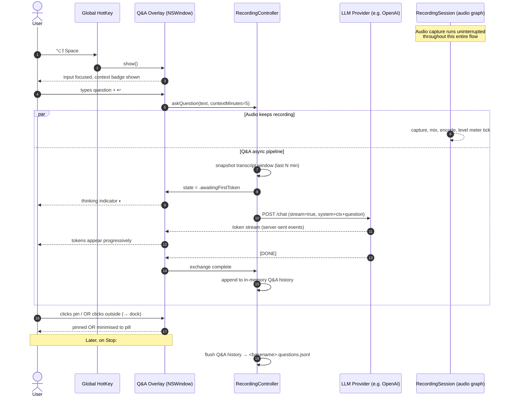

# In-Recording Questions — Ask the Sidelines While Recording

## Problem statement

While `macrec` is capturing a live conversation (a customer call, a 1:1, a podcast, a lecture), the user often needs to pull *context from the sidelines* without interrupting the audio capture or pulling focus away from the person they are looking at. Today the popover is optimised for **recording configuration** (folder, format, layout, provider) and **live transcript display** — there is no surface for the user to type a quick question like *"what was the customer's title again?"* or *"summarise the last 5 minutes"* and get an answer streamed back. The recording integrity rule (CLAUDE.md / project-purpose §"Critical requirements") forbids that any side-feature compromise the audio file, so this surface must be strictly additive and audio-non-blocking.

## User stories

1. **As a knowledge worker on a Zoom call**, I want to press a global shortcut, type a quick question, and read the answer in a floating overlay — so I can recall context without breaking eye contact with the camera and without stopping the recording.
2. **As a researcher conducting an interview**, I want to ask the assistant to *"summarise the last 5 minutes"* mid-conversation so that I can decide whether to dig deeper into a topic the subject just touched on.
3. **As a sales rep on a discovery call**, I want to ask *"pull up the 2024 numbers for product X"* and have the assistant answer from general knowledge (and, in v2, my connected docs) — without leaving the meeting tab.
4. **As a learner watching a recorded lecture I'm capturing for offline review**, I want to ask *"what is RAG?"* on a term the lecturer just used and have the answer logged in-line with the transcript so my notes are self-contained.
5. **As a power user who scripts macrec from the CLI**, I want the same Q&A surface accessible from the menu-bar popover *and* from a JSON-RPC / `macrec ask "<question>"` subcommand so I can wire it into Raycast / Alfred / shell aliases.

## Functional requirements

Each requirement is numbered for traceability into eventual `items/REQ-NNN-*.md` files. Topic guess in parentheses (taxonomy from `items/README.md`).

### Invocation & input

- **FR-IRQ-1** *(showcase)* — When a recording is in the `recording`, `paused`, `pausing`, `resuming`, `splitting` state (per `SessionState.swift` on `master`), the user MUST be able to summon a question input overlay via a global keyboard shortcut. Default shortcut: **`⌥⇧Space`** (Option+Shift+Space). Configurable in `GeneralSettingsView` (§FR-IRQ-16).
- **FR-IRQ-2** *(showcase)* — The overlay MUST also be reachable by clicking a persistent "Ask" pill rendered inside `LiveTranscriptPanel` (or its dual-mode equivalent `DualLiveTranscriptView`). The pill is hidden when the session is not recording.
- **FR-IRQ-3** *(showcase)* — The overlay MUST present as a **floating, frameless, always-on-top NSWindow** anchored to the right edge of the active display, NOT inside the existing popover. Rationale: the popover auto-dismisses when the menu-bar focus is lost (see `PopoverController.swift`); a Q&A surface must survive the user looking back at their conversation window.
- **FR-IRQ-4** *(showcase)* — The overlay MUST contain (1) a single-line, multi-line-expandable text input, (2) a Submit affordance (Return key + click target), (3) a Dismiss affordance (Esc + close button), (4) a Push Pin toggle that keeps the overlay sticky when the user clicks away (default OFF — clicking away minimises to a docked pill).
- **FR-IRQ-5** *(showcase)* — Input MUST be acceptable via **typing** (v1) and via **push-to-talk voice** (v2, deferred). v1 ships typing-only; the input field reserves a leading mic icon greyed-out with tooltip *"Voice input — coming soon"* so the v2 entry point is discoverable.

### Answering

- **FR-IRQ-6** *(integration)* — On submit, the question MUST be sent to the configured LLM provider together with **(a)** a transcript-context window of the last *N* minutes (default 5 min, configurable 1–30 min, §FR-IRQ-17), drawn from `RecordingController.transcriptSegments`, **(b)** a system prompt scoping the assistant to "answer briefly using the transcript and your general knowledge; cite which it came from".
- **FR-IRQ-7** *(integration)* — The LLM provider chain reuses the existing four-tier env-var resolution (`OPENAI_API_KEY`, `ANTHROPIC_API_KEY`, `GOOGLE_API_KEY`, `AZURE_OPENAI_*`, …) per `tool-conventions`. No new credential surface is introduced.
- **FR-IRQ-8** *(integration)* — Answers MUST be streamed token-by-token into the overlay; the in-progress state MUST show a typing/streaming indicator distinct from a static "loading" spinner so the user can tell the model is actively producing tokens.
- **FR-IRQ-9** *(integration)* — On streaming completion, the answer MUST remain visible in the overlay, with a one-line collapsed preview and an Expand affordance if the answer exceeds 6 visual lines. Collapsing/expanding MUST NOT re-query the model.

### Display & timeline

- **FR-IRQ-10** *(showcase)* — Each Q&A exchange MUST display **the asked question** (verbatim, with timestamp `mm:ss` since recording start), **the in-progress indicator while answering**, **the answer** (collapsible if >6 lines), and **a marker on the recording timeline** showing where in the audio the question was asked.
- **FR-IRQ-11** *(showcase)* — The overlay MUST keep a scrollable history of all Q&A exchanges from the current session, newest at the bottom. History is per-session (cleared on Stop) by default; persisting is §FR-IRQ-14.
- **FR-IRQ-12** *(showcase)* — The recording-timeline markers MUST visually distinguish three time-classes: **question-time** (a vertical tick), **answer-time** (a span ending at the answer's last-token timestamp), and **continued-recording-time** (the default audio waveform / elapsed line). The Live Transcript Panel's existing elapsed clock (`ElapsedTimeView.swift`) is augmented, not replaced.
- **FR-IRQ-13** *(showcase)* — Clicking a timeline marker MUST scroll the Q&A history overlay to the corresponding exchange and the transcript panel to the corresponding transcript segment (best-effort: the segment whose end-timestamp is closest to but ≤ the marker's recording time).

### Persistence

- **FR-IRQ-14** *(artifact)* — On session Stop, all Q&A exchanges of the session MUST be persisted as a sidecar file next to the audio: `<basename>.questions.jsonl`. Each line is one JSON object with fields `{ts_recording_ms, ts_wall, question, answer, model, transcript_window_start_ms, transcript_window_end_ms, provider}`. Persistence failures MUST NOT block session stop (recording-integrity invariant).
- **FR-IRQ-15** *(artifact)* — If the existing transcript sidecar (`<basename>.transcript.jsonl` / `.txt`) exists, the Q&A sidecar MUST cross-reference it via a relative path in its header line so `dual-transcript-merger` / downstream tooling can stitch them.

### Configuration & policy

- **FR-IRQ-16** *(showcase)* — The keyboard shortcut MUST be reconfigurable from `GeneralSettingsView` with a Key-Recorder field. The default `⌥⇧Space` MUST be unregistered cleanly on Quit (no orphan global hotkey).
- **FR-IRQ-17** *(showcase)* — The transcript-context window length (default 5 min) MUST be exposed as a slider in `GeneralSettingsView` (range 1–30 min) and persisted in `@AppStorage("com.macrec.ui.askContextMinutes")`.
- **FR-IRQ-18** *(security)* — The first time the user invokes the feature against a **cloud** LLM provider (any provider that is not the on-device Apple Foundation Models or an `OLLAMA_HOST` localhost endpoint), a privacy disclosure sheet — reusing `PrivacyDisclosureSheet.swift` — MUST be presented explaining that the question text AND the transcript window will be sent to the provider. Acknowledgement is per-provider (same `acknowledgedKey` pattern as the existing live-transcript privacy gate). No silent fallback.
- **FR-IRQ-19** *(security)* — If no LLM credential is resolvable for the selected provider, the overlay MUST surface a typed error inline (NOT a modal) and link to the relevant Settings section. No default key, no substituted value (CLAUDE.md no-fallback rule).
- **FR-IRQ-20** *(showcase)* — The feature MUST be globally togglable from `GeneralSettingsView` (`In-recording Q&A: On/Off`), default **On**. When Off, the global hotkey is unregistered and the Ask pill is hidden.

### Non-interference

- **FR-IRQ-21** *(platform)* — No code path inside the Q&A subsystem MAY block, pause, or otherwise touch the recording graph (`RecordingSession`, `CaptureBuffer`, `Recorder` implementations). All Q&A work runs on a dedicated `Task { ... }` cooperative-cancellation boundary; any failure is logged and surfaced in the overlay, never propagated up to `RecordingSession`.
- **FR-IRQ-22** *(platform)* — Audio level meters and the elapsed-time clock MUST continue to update at their existing cadence while a question is in flight; a "thinking" indicator on the Q&A overlay MUST NOT cause main-thread stalls visible in the level meter.

## Non-functional requirements

| Tag | Requirement |
|---|---|
| **NFR-IRQ-Latency-First-Token** | Time from Submit to first visible token of the answer **≤ 1500 ms p50, ≤ 3500 ms p95** when the configured provider is OpenAI / Anthropic / Gemini cloud over a healthy network (≥ 5 Mbps down). Measured against the existing `TranscriptionMetricsView` clock pattern. |
| **NFR-IRQ-Latency-Full-Answer** | Time to last token **≤ 8 s p50** for a 5-min context window. Local providers (Ollama / on-device foundation models) are best-effort; surfaced in the overlay as a "local provider — slower" hint. |
| **NFR-IRQ-Keyboard-Accessibility** | Every overlay control MUST be reachable by Tab / Shift-Tab; Return submits; Esc dismisses; ⌘C copies the focused message; ⌘↑ / ⌘↓ navigates history. VoiceOver labels for the input, Submit, Pin, Close, Expand. |
| **NFR-IRQ-Voice-Input** | v1 typing-only. v2 (deferred): push-to-talk via `AVCaptureSession` on a separate `AVCaptureDevice` from the recording mic — MUST NOT borrow the active recording's mic input under any circumstance (FR-IRQ-21). |
| **NFR-IRQ-Transcript-Context** | Default 5 minutes; range 1–30 minutes; max payload size 32 KB after UTF-8 encoding (truncated from the head of the window if exceeded, with a visible *"… (truncated)"* marker in the prompt audit log §FR-IRQ-14). |
| **NFR-IRQ-Audio-Non-Blocking** | Continuous audio capture during a 10-question stress test (back-to-back, 30 s apart) MUST show zero dropped audio frames (`CaptureBuffer.dropCount == 0`). This is the recording-integrity gate. |
| **NFR-IRQ-Privacy-Default-OnDevice** | When the user has Apple Foundation Models available (macOS 26+, Apple Silicon), the **default** provider for the Q&A surface MUST be the on-device option, not a cloud provider — to match the project's "local-first" posture. The user explicitly opts in to cloud via the existing provider picker. |
| **NFR-IRQ-Universal-Binary** | Same `arm64 + x86_64` posture as the rest of `macrec`. The on-device default only activates on Apple Silicon; x86_64 users see a cloud-only picker. |
| **NFR-IRQ-No-Server** | No new outbound endpoint introduced beyond the user-selected LLM provider's API. No telemetry. No background polling. (Project-purpose §"What it is explicitly NOT".) |

## Open questions for the product owner

1. **Default shortcut conflict** — `⌥⇧Space` is unused by stock macOS 26 but is claimed by some third-party launchers (Raycast, Alfred default). Should the install flow detect and warn, or just document and let the user re-bind?
2. **Q&A visible to others?** — Otter explicitly makes its in-meeting chat *shared with all meeting participants* (a deliberate collaboration choice). `macrec` is single-user / local-first, so the answer is presumably **always private**. Confirm — is there any imaginable future where we'd surface Q&A to a screen-shared view?
3. **Scope of "general knowledge"** — Beyond the transcript window, should v1 also pass **the entire transcript so far** (token budget permitting) as a second context block? Granola's "Ask Granola" passes the full meeting note + transcript. Trade-off: cost & latency vs. recall.
4. **Persistence default** — Default is "persist sidecar on Stop" (FR-IRQ-14). Some users (legal / regulated) will want **no persistence ever**. Add a per-session ephemeral toggle, or only a global preference?
5. **Citations / source linking** — Granola and Otter both cite back into the transcript ("this came from minute 03:42"). Worth the v1 effort, or v2?
6. **Streaming via existing transcription provider connections** — When the user already has `openai` selected as their live STT, can we reuse the same key + client for the Q&A LLM call, or do we keep STT-credentials and LLM-credentials as separate axes (the latter is simpler conceptually but doubles the configuration surface)?
7. **Voice input v2** — Push-to-talk dedicated mic, or whisper-to-the-mic-already-being-recorded with a wake phrase? The wake-phrase variant is contaminated by the meeting audio and is therefore probably not viable for our context.
8. **Recipes / saved prompts** — Granola and Fireflies both promote a `/`-slash menu of canned prompts ("/summarise", "/action-items"). v1 includes 3 hard-coded; v2 user-editable?
9. **Sharing with non-recording-tool users** — Out of scope per local-first posture, but worth a one-line confirmation.
10. **What happens on Pause?** — Should the Ask surface remain available while the audio session is paused, or be hidden (because there is no fresh transcript context being generated)? Recommendation: **remain available** — the user may want to pause specifically *because* they need to look something up.

## ASCII wireframes — the four key states

> Box-drawing characters; the actual SwiftUI rendering will be a frameless rounded-corner NSWindow with system materials. These sketches anchor *what is on screen in each state*, not pixel-perfect spacing.

### State 1 — Idle / docked

The overlay is not summoned; instead, a discreet pill is docked to the lower-right of the screen so the user knows the feature exists. Tooltip on hover.

```
                                                  ┌──────────────────────┐
                                                  │  ⌥⇧Space  Ask…   ⊕   │
                                                  └──────────────────────┘
                                                                       ▲
                                                       click pin to keep it open
```

### State 2 — Question typed (about to submit)

User has pressed `⌥⇧Space`; overlay expands. Cursor in input. The transcript-context badge tells the user how far back the assistant will look.

```
┌────────────────────────────────────────────────────────────────┐
│  Ask the recording                                ●  03:14  📌 │
├────────────────────────────────────────────────────────────────┤
│                                                                │
│  > What was the customer's title again?▌                       │
│                                                                │
│  ─────────────────────────────────────────────────────────────  │
│  context: last 5 min  ·  provider: openai (gpt-4o)  ·  ⏎ Send  │
└────────────────────────────────────────────────────────────────┘
```

Legend: `●` = red recording dot still ticking; `03:14` = elapsed; `📌` = pin toggle (unpinned).

### State 3 — Answering (streaming)

Question is now displayed above the input; thinking indicator pulses; tokens stream into the answer area. Audio level meters at the very bottom keep updating (proof the recording is unaffected).

```
┌────────────────────────────────────────────────────────────────┐
│  Ask the recording                                ●  03:17  📌 │
├────────────────────────────────────────────────────────────────┤
│                                                                │
│  You · 03:14                                                   │
│    What was the customer's title again?                        │
│                                                                │
│  Assistant · 03:15  ◐ streaming…                               │
│    Sarah Chen introduced herself at 02:41 as "VP of            │
│    Platform Engineering" at Northwind. She also mentioned      │
│    she reports to ▌                                            │
│                                                                │
│  ─────────────────────────────────────────────────────────────  │
│  ▎mic ▰▰▰▱▱▱▱   ▎sys ▰▰▰▰▰▱▱     ⌘C copy   Esc dismiss          │
└────────────────────────────────────────────────────────────────┘
```

Legend: `◐` = animated pulse glyph distinguishing *streaming* from a *static spinner* (FR-IRQ-8). The two level meters at the bottom are pass-through proof of FR-IRQ-22.

### State 4 — Answer shown, history, timeline

After the answer completes, the exchange settles into the history pane. Older Q&As above; latest at bottom. Timeline strip across the top shows Q-ticks and A-spans against continued recording.

```
┌────────────────────────────────────────────────────────────────┐
│  Ask the recording                                ●  06:42  📌 │
│  ┃━━━┃━━┃━━━━━━━┃━━━━━━━━━━━━━━━━━━━━━━━━━━━━━━━━━┃━━━━━━━━━━  │
│  Q1  A1 Q2  A2                                   Q3 (you are   │
│                                                       here)    │
├────────────────────────────────────────────────────────────────┤
│  You · 03:14                                                   │
│    What was the customer's title again?                        │
│  Assistant · 03:15      [▾ expand · 7 lines]                   │
│    Sarah Chen introduced herself at 02:41 as "VP of Platform   │
│    Engineering" at Northwind. …                                │
│                                                                │
│  You · 05:02                                                   │
│    Summarise the last 5 minutes.                               │
│  Assistant · 05:03      [▴ collapse]                           │
│    The team agreed to a 6-week pilot starting June 2.          │
│    Sarah pushed back on SSO timing; you offered a workaround   │
│    via SAML federation. Open questions: pricing tier for       │
│    burst usage, who from legal signs the DPA. Budget cap       │
│    confirmed at $48k for the pilot. Sarah's blocker: a Q3      │
│    OKR review forces a decision by June 14.                    │
│                                                                │
│  ─────────────────────────────────────────────────────────────  │
│  > ▌                                                           │
│  context: last 5 min  ·  provider: openai (gpt-4o)  ·  ⏎ Send  │
└────────────────────────────────────────────────────────────────┘
```

The timeline strip at top uses three glyphs (FR-IRQ-12):

- `┃` (vertical bar) — **question-time tick**
- `━` (run between two `┃` glyphs) — **answer-time span**
- gap of plain `━` — **continued recording**

Detailed per-state captions live in `wireframes.md`.

## Mermaid sequence diagram — end-to-end timing



## Related work — apps we drew inspiration from

| App | What we copied | What we explicitly didn't |
|---|---|---|
| **Granola** ([live chat docs](https://help.granola.ai/article/chatting-with-your-meetings-ask-granola)) | "Chat before / during / after the meeting" availability; per-meeting chat with citations back into the transcript; thinking-mode toggle; chat history clears on session exit (matches our local-first ephemerality). | Granola hosts on their backend; we keep everything local + per-provider opt-in. |
| **Otter.ai** ([Otter Chat in live meetings](https://help.otter.ai/hc/en-us/articles/15113851067415-Using-Otter-Chat-during-a-live-meeting)) | Sidebar-style panel separate from the live transcript; per-message controls (copy / regenerate / source link); suggested prompts; persistence of Q&A alongside the transcript. | Otter's chat is **shared with all meeting participants** via `@otter` mentions — we are explicitly single-user (Open Question #2). |
| **Read.ai** ([Ask Read](https://support.read.ai/hc/en-us/articles/39009378777875-Using-Search-Copilot-to-search-your-meetings-and-connected-apps)) | Natural-language input via a single bar; recent-history sidebar; multi-language support. | "Ask Read" spans the user's entire connected knowledge base — we scope strictly to the *current recording's* transcript window in v1. |
| **Fireflies AskFred** ([AskFred during meetings](https://guide.fireflies.ai/articles/6032274417-learn-about-fireflies-live-assist-get-real-time-suggestions-answers-and-notes-live-during-the-meeting)) | Floating, movable, always-on-top overlay (Live Assist); `/`-slash menu of canned skills (we adopt this as v2 Recipes per Open Question #8); dynamic topic suggestion chips. | AskFred consumes per-question billing credits and pushes nudges ("you have been speaking too long"); we have no remote billing and no proactive nudges in scope. |
| **Microsoft Teams Copilot** ([in-meeting Copilot](https://support.microsoft.com/en-us/office/use-copilot-in-microsoft-teams-meetings-0bf9dd3c-96f7-44e2-8bb8-790bedf066b1)) | Private-to-the-user sidebar; pop-out into separate window so the user can multitask; suggested wrap-up prompts in the last N minutes of the meeting. | Teams Copilot requires live transcription to be on for post-meeting recall; our Q&A surface MUST function even with transcription off (FR-IRQ-6 falls back to "general knowledge only" when no transcript context exists). |
| **Apple Voice Memos + Notes "smart summary" (iOS 18 / macOS 15+)** | The pattern of *recording-first, ask-later* with summaries surfaced inline next to the recording. | We support the during-recording case, not just after. |

## Out of scope for v1 (kept for v2 backlog)

- Voice (push-to-talk) input (FR-IRQ-5 v2).
- User-editable `/`-slash Recipes (Open Question #8).
- Connectors to external knowledge bases (Slack, Notion, Drive) à la Read.ai's "search your connected apps".
- Multi-user / shared Q&A surface in screen-sharing contexts (Open Question #2 confirms we stay single-user).
- Cross-recording / "all my recordings" Q&A à la Granola's home-screen chat.
- Real-time speaking-coach nudges (Fireflies-style) — separate concern, would need its own requirements doc.
