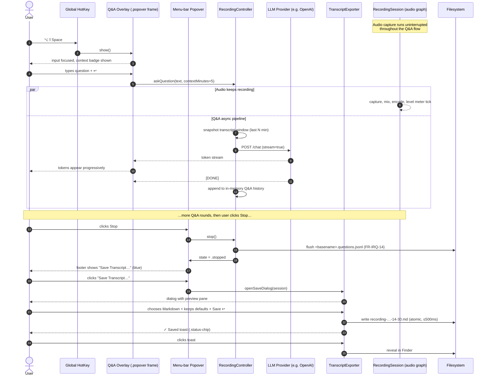

# In-Recording Questions — Ask the Sidelines While Recording

> **Consolidated direction (decided 2026-05-12).** After reviewing the four navigation candidates (see §"View navigation between transcript and Q&A"), the user adopted **Pattern C — Switch** with three concrete layout commitments:
>
> 1. **Mic + system-audio signal indicators move to the bottom of the popover**, in a status-bar layout, with animated bouncing bars while audio flows.
> 2. **A segmented control at the top of the popover toggles the body between two modes**: **Transcription** (engine + language picker + live transcript pane — default) and **Asking** (Q&A input + streaming answer history). The transcript continues to accumulate in the background while the user is in Asking mode; the Q&A history accumulates while the user is in Transcription mode.
> 3. **The footer's primary action transitions Stop → Save…**: while recording, a red **Stop** button mirrors `.record-btn`; after Stop it becomes a blue **Save…** that opens a folder-name dialog (default `recording-YYYY-MM-DD-HH-MM`) and writes the audio + transcript + Q&A artifacts into `~/Recordings/<folder-name>/`.
>
> This supersedes the Combined-Timeline (Pattern D) recommendation that appeared in the previous revision. That section is preserved below for context, but the **chosen** UI direction is Pattern C. The exploration archive of the Combined-Timeline interactive mock remains at `mock/index.html` for reference; the canonical target is `mockups/target-state.html`.

## Visual baseline — extend the popover mockup, do not re-invent

This proposal explicitly **extends the visual vocabulary established by the popover redesign mockup** at `docs/design/mockups/popover-redesign.html` (PNG mirror: `docs/design/mockups/popover-redesign.png`). Any surface introduced by this feature — the floating Ask overlay, the docked pill, the inline timeline strip, and the new end-of-recording **Save Transcript** dialog — MUST reuse the same primitives so the user perceives them as part of the same product.

The primitives we are reusing, verbatim, from `popover-redesign.html`:

| Token / element                  | Where it lives in the baseline               | How this proposal re-uses it                                                                                                                  |
|----------------------------------|----------------------------------------------|-----------------------------------------------------------------------------------------------------------------------------------------------|
| `.popover` rounded frame         | 360 pt wide, 14 pt radius, glass blur shadow | The Ask overlay uses the *same* frame at 400 pt wide; the Save Transcript dialog uses it at 480 pt wide. Same shadow stack, same blur.        |
| `.light` / `.dark` token sets    | `--label`, `--value`, `--secondary`, `--separator`, `--group-bg`, `--accent`, `--success-bg/fg/dot`, `--record-grad/shadow` | All new surfaces inherit those exact CSS variables — no new palette is introduced. The pill, the overlay, the dialog automatically theme. |
| Header (`.header`, `.header-input`) | Filename input + permission pill + meta dots | The Save dialog's header is the *same row* — editable filename, status pill (`Ready to save`), folder breadcrumb.                          |
| Sections (`.section`, `.section-title`) | Caps title + grouped rows                    | "Recent questions", "Export options", "What's included" become sections in the dialog. Same caps tracking, same hairline group.            |
| Grouped rows (`.group`, `.row`, `.row-sub`) | Inset rows, hairline dividers between siblings | Each Q&A exchange in the history is one `.row` with a hairline beneath. Export-format radio is a `.row` with a `.popup`-styled control.  |
| `.popup` select                  | NSPopUpButton styling                        | Export format chooser (Markdown / Plain text / JSON / SRT) is a `.popup`.                                                                    |
| `.switch`                        | NSSwitch styling                             | "Include Q&A interjections", "Include timestamps", "Include audio path reference" are `.switch` toggles in the Save dialog.                  |
| `.btn`                           | Subtle white-fill secondary button           | Cancel / Reveal in Finder / Copy path buttons.                                                                                                |
| `.record-btn` (red gradient)     | Primary action button                        | The primary **Save** button in the dialog uses a *blue* variant of the same gradient (`--accent` based) — same shape, same shadow, different hue: it is a "go" action, not a "record" action. |
| `.perm-pill` / `.status-chip`    | Permission / status pills                    | Saved-toast pill (`✓ Saved to ~/Documents/recording-…md`) reuses `.status-chip` with the success palette.                                    |
| `.key-input` (mono)              | Monospaced credential field                  | The transcript preview pane in the Save dialog renders in the same mono family at 11.5 pt with `--field-bg`.                                  |

**Layout zones** are likewise inherited: a popover-like frame opens **anchored to the menu-bar REC status item** (same anchor the popover uses); the Ask overlay floats free of that anchor (because the popover auto-dismisses on focus loss — see FR-IRQ-3) but uses the *same frame chrome*; the Save dialog is summoned from inside the popover itself when the recording stops, so it visually emerges from the same surface.

**Typography** is unchanged: `-apple-system, BlinkMacSystemFont, "SF Pro Text"`; 13 pt for row labels, 11 pt CAPS w/ 0.07 em tracking for section titles, 17 pt 600 for the editable filename, ui-monospace 11.5 pt for sidecar/preview text.

**Visual rule of thumb:** if a control or surface you are about to draw does not have a direct ancestor in `popover-redesign.html`, stop — and ask whether the existing primitive can be re-purposed before introducing a new one.

## View navigation between transcript and Q&A

> **DECISION (2026-05-12): Pattern C — Switch (segmented mode toggle) — is the chosen direction.** The four-way comparison below is preserved as the rationale audit trail; the comparison table remains useful for understanding *why* the other three were not chosen. The architectural and acceptance details for the chosen pattern live in the new sub-section §"Pattern C — Switch — the chosen direction" further below.

A reviewer of the first revision asked, reasonably, "how does the user move between the live transcript view and the Q&A view, and what happens when both matter at once?" — because the earlier wording implied a separate "Ask overlay" detached from the popover's transcript panel, with no story for transitioning. This section settles that question.

The popover already shows a **live transcript**. The Q&A surface adds a **question/answer stream** to the same session. There are four plausible patterns for how those two streams co-exist in a single small surface that is anchored to the menu bar and viewed at-a-glance during a meeting. Each is compared honestly below; the one we adopt is Pattern D.

### Pattern A — Tabs (segmented control)

```
┌──────────────────────────────────────────────┐
│ [ Transcript │   Ask  ]            ● 14:30  │ ← NSSegmentedControl in .header
├──────────────────────────────────────────────┤
│ (selected tab's content fills the body)      │
└──────────────────────────────────────────────┘
```

A segmented `NSSegmentedControl` lives in the popover header; the body swaps between "Transcript" and "Ask" content. Standard macOS HIG primitive, used widely in System Settings.

- **When it fits.** When the two views are *truly* independent — different data, different cadence, used in different sittings. A Photos `Library | Albums` switch is the canonical example.
- **When it doesn't.** When the views share temporal context. In a live meeting, hiding the transcript while reading an answer (or vice versa) discards the very context that gives both views meaning. The user's eyes have to remember "the last thing the speaker said was X" while reading the agent's reply — and they will mis-remember.
- **Real-world precedent.** Otter ([Otter desktop side panel](https://help.otter.ai/hc/en-us/articles/15113851067415-Using-Otter-Chat-during-a-live-meeting)) historically used a `Transcript | Outline | Chat` tab strip. Microsoft Teams in-call sidebar uses tabs for `People | Chat | Reactions | Notes | …` ([Teams panel docs](https://support.microsoft.com/en-us/office/use-the-side-panel-in-microsoft-teams-meetings-7c5dc5bb-2c5e-4e83-8c2d-c8c4f5d97f1d)).
- **Pros.** Familiar; cheap to implement; each view gets full popover width and height.
- **Cons.** One-screen-at-a-time discards continuity; switching has a click/keystroke cost on every transition; the user must *predict* whether they want transcript or Q&A before each look at the popover.

### Pattern B — Persistent split (transcript top, Ask bottom)

```
┌──────────────────────────────────────────────┐
│ TRANSCRIPT                                    │
│ ┌────────────────────────────────────────┐   │
│ │ …rolling transcript paragraphs…        │   │
│ └────────────────────────────────────────┘   │
├──────────────────────────────────────────────┤  ← drag handle / fixed split
│ Q&A                                          │
│ ┌────────────────────────────────────────┐   │
│ │ …rolling Q&A pairs…                    │   │
│ │ > input field…                         │   │
│ └────────────────────────────────────────┘   │
└──────────────────────────────────────────────┘
```

Both views are always visible, vertically stacked, with a drag handle to re-proportion them.

- **When it fits.** When the popover is *tall* — sidebar-sized — and the user is on a 27-inch display with screen real estate to spare. Granola's desktop app uses a variant (notes top, chat bottom, full-window).
- **When it doesn't.** When the popover is constrained to ~480 pt of vertical space (our case). Splitting that between a rolling transcript and a rolling Q&A history gives each pane ~200 pt — about three paragraphs of transcript and one Q&A pair before scroll is needed. Both feel cramped.
- **Real-world precedent.** Granola's main window ([Granola layout](https://help.granola.ai/article/chatting-with-your-meetings-ask-granola)) is split-ish: notes occupy the body, Ask Granola docks at the bottom. ChatGPT's "split with chat on right" plus desktop sidebar tools.
- **Pros.** Zero hidden state; user never has to "switch"; both streams are visible simultaneously.
- **Cons.** In a small menu-bar popover, the split makes both panes too short to be useful; the drag handle adds a new primitive not in the baseline; in practice users either ignore Q&A (because it's tiny) or shove the transcript pane closed (defeating the point).

### Pattern C — Toggle / slide (transcript default, Q&A slides in)

```
                                    transcript view                            with Ask layer slid in
┌──────────────────────────────────────────────┐                ┌──────────────────────────────────────────────┐
│ TRANSCRIPT                ● 14:30  Ask… ⌥⇧Sp │      ⌥⇧Sp →    │ TRANSCRIPT (dimmed)             [ Esc to close]│
│ …rolling paragraphs…                          │  ─────────→    │ ………… (dimmed)                                  │
│ …                                             │                │  ────────────────────────────────────────────  │
└──────────────────────────────────────────────┘                │ Q&A history (latest at bottom)                │
                                                                  │ > input field                                │
                                                                  └──────────────────────────────────────────────┘
```

Transcript is the default. Pressing `⌥⇧Space` (or focusing an Ask affordance) slides a Q&A layer over the transcript, which dims behind it. `Esc` slides it back.

- **When it fits.** When Q&A is an occasional / modal interaction — like Spotlight: the bulk of macOS use isn't searching, but when you need to search, search takes over the screen briefly.
- **When it doesn't.** When Q&A is intended to interleave with reading transcript. Our user *will* alternate between "what was just said" and "ask the agent" many times per meeting; modal slide-in/slide-out becomes friction.
- **Real-world precedent.** Microsoft Teams in-call chat panel slides in from the right and pushes the meeting video left (so it's actually a split, not a modal — see [Teams chat in meetings](https://support.microsoft.com/en-us/office/show-chat-in-a-microsoft-teams-meeting-cdb74d22-1f7a-4f02-8761-b40b9d18b89b)). Apple Spotlight is the cleanest modal-slide example. Raycast does the same.
- **Pros.** Each surface gets full popover when active; familiar from Spotlight/Raycast; clear "mode" mental model.
- **Cons.** Mode-switch friction; the user can't read transcript and previous Q&A simultaneously; "did I already ask that?" requires opening Q&A, losing transcript focus.

### Pattern D — Combined timeline (chosen)

```
┌──────────────────────────────────────────────┐
│ THIS RECORDING       54 lines · 3 Q&A   [⓪Q&A]│ ← Hide-Q&A toggle (filters chronological view)
├──────────────────────────────────────────────┤
│ Mic · 00:00:04 — Hi Sarah, thanks for taking │
│ System · 00:00:08 — Of course! Happy to walk │
│ ─────────────────────────────────────────────│
│ 🅀 You · 03:14 — What was the customer's…    │ ← Q&A row, accent-tinted background
│ 🅐 Assistant · 03:15 — Sarah Chen introduced │
│ ─────────────────────────────────────────────│
│ Mic · 05:14 — Right, so on the SSO question, │
│ System · 05:18 — Realistically Q3, but SAML… │
│ 🅀 You · 05:32 — Action items so far?        │
│ 🅐 Assistant · 05:33 — 1) DPA → legal …      │
│ ─────────────────────────────────────────────│
│ ┌──────────────────────────────────────────┐ │ ← persistent input bar
│ │ 🎙 Ask…                       [↩ Send]   │ │
│ └──────────────────────────────────────────┘ │
│ ▎mic ▰▰▰▱▱ ▎sys ▰▰▰▰▱           [● Stop ]   │ ← footer (level meters + Stop)
└──────────────────────────────────────────────┘
```

There is **no view to switch into**. The popover body is one scrollable chronological timeline whose items are of two kinds — *speech segments* (transcript) and *Q&A pairs* — interleaved by their recording-relative timestamp. The input bar is always present at the bottom. A single `[Hide Q&A]` toggle in the section title filters Q&A items out for users who want a pure-transcript reading view.

- **When it fits.** When the two streams share a single time axis (they do — both are pinned to recording-relative timestamps), when interleave preserves meaning (it does — "I asked X right after they said Y" *is* the structure), and when the surface is small (it is — combining streams uses one set of rows instead of two scroll regions).
- **When it doesn't.** When Q&A volume vastly exceeds transcript volume (it won't — typical meeting: 100 + speech segments, 3 – 10 Q&A pairs). When the user wants to scan only Q&A across recordings (out of v1 scope per Open Question #3).
- **Real-world precedent.** Granola interleaves "Ask Granola" answers into its notes timeline ([Ask Granola layout](https://help.granola.ai/article/chatting-with-your-meetings-ask-granola)). Slack and WhatsApp interleave human messages and system/bot messages in one thread. Read.ai shows chat answers next to their corresponding transcript moment ([Read meeting view](https://support.read.ai/hc/en-us/articles/39009378777875-Using-Search-Copilot-to-search-your-meetings-and-connected-apps)). Apple Messages SMS-vs-iMessage interleaving is the same pattern.
- **Pros.** Zero mode-switch; matches the user's mental model ("here's what was said, here's what I asked, here's what was said next"); preserves glance-ability (the *latest* item is always at the bottom); the persistent input bar is always one keystroke from a question; the export (FR-IRQ-29) is structurally identical to what the user sees — `Save Transcript` simply serialises the on-screen timeline.
- **Cons.** Long answers can push speech segments out of view (mitigated by per-Q&A collapse FR-IRQ-9 and by the `[Hide Q&A]` filter). Q&A items are visually heavier than speech rows by design — heavier rows can dominate the scroll perception; mitigated by colour-restraint (accent tint at ~6 % alpha, not a saturated badge).

### Previous recommendation (now superseded — exploration archive)

> ⚠ The next four paragraphs and the FR-IRQ-34..39 requirements that follow them captured the **Pattern D (Combined Timeline)** recommendation from the previous revision. **The user reviewed this and instead adopted Pattern C (Switch).** The text is preserved verbatim below so the rationale is not lost, but it should be read as **exploration archive** — the chosen direction lives in the next sub-section "Pattern C — Switch — the chosen direction".

**~~Adopt Pattern D — Combined Timeline — as the popover's in-recording surface.~~** The recording-tool constraints — small menu-bar-anchored popover, glance-ability during a live meeting, low-friction repeat questioning, single shared time axis — all point to D. Patterns A and C add mode-switch friction that is wrong for *frequent* Q&A; Pattern B is wrong for *small* popovers. Pattern D collapses both views into one and lets the user filter rather than switch.

**The floating Ask overlay (FR-IRQ-3) is preserved as a complementary surface, not a competing one.** Specifically:

- The **popover** (menu-bar-anchored, auto-dismisses on focus loss) shows the Combined Timeline whenever it is open. It is the *reading-and-asking* surface.
- The **floating Ask overlay** (separate `NSWindow`, free of the menu-bar anchor, always-on-top per FR-IRQ-3) is summoned via `⌥⇧Space` from anywhere — even when the popover is closed and the user's focus is on Zoom. It is the *hands-on-keyboard fast-lane* for when the user does not want to click the menu-bar item. The overlay's content is the same Combined Timeline (so the user sees their question land in the same chronological stream they would see in the popover); the difference is anchoring, not content.

Both surfaces write into the same in-memory `QASessionHistory`. The popover's Combined Timeline and the floating overlay's Combined Timeline are two views onto the same model — neither one is a "primary" or "secondary" version of the truth.

This decision implies a small set of follow-on requirements:

- **FR-IRQ-34** *(showcase)* — The popover, while a recording is in any active state (`recording / paused / pausing / resuming / splitting`), MUST render a **Combined Timeline** as its body — speech segments and Q&A pairs interleaved chronologically by recording-relative timestamp. The General / Live Transcription configuration sections (per the baseline popover) collapse to a single `Settings…` button in the footer while a recording is active; they re-expand when no recording is in progress.
- **FR-IRQ-35** *(showcase)* — Q&A rows in the Combined Timeline MUST be visually distinguished from speech rows by **(a)** a 🅀 / 🅐 glyph pair in `--accent` color at the start of the row meta, **(b)** a background tint of `--accent` at ~6 % alpha (light) / ~8 % alpha (dark), **(c)** the same `.row` height and `.separator` hairline as speech rows — i.e. no new primitive. No badge, no border, no icon system; only colour and glyph.
- **FR-IRQ-36** *(showcase)* — A `[Hide Q&A]` toggle MUST appear in the section title row of the Combined Timeline, rendered as the `.section-title .meta-right` slot the baseline already uses for the Live Transcription "Soniox / switch" affordance. Toggling it filters Q&A items out client-side; transcript continues to scroll; toggling it back restores the full chronological stream. The toggle state is per-session (not persisted across recordings).
- **FR-IRQ-37** *(showcase)* — The persistent input bar at the bottom of the Combined Timeline MUST always be visible while the popover is open during a recording. Pressing `↩` while the input has focus submits the question; the question lands as a 🅀 row at the bottom of the timeline; the streaming answer follows as a 🅐 row immediately beneath. Focus does not need to be moved — the user can keep typing the next question after the answer settles.
- **FR-IRQ-38** *(showcase)* — The popover Combined Timeline and the floating Ask overlay MUST share the same `QASessionHistory` model in `MacrecCore`. A question typed in one surface MUST appear instantly in the other (≤ 100 ms). Scrolling state is *not* shared (each surface tracks its own scroll offset).
- **FR-IRQ-39** *(showcase)* — When auto-scroll is engaged (the user is parked at the bottom of the timeline), new speech segments and new Q&A rows MUST extend the bottom edge and the view MUST stay pinned to the new bottom. When the user scrolls upward by more than one `.row` height, auto-scroll MUST disengage and the latest items MUST surface a small "↓ N new" pill in the lower-right corner (re-using the `.perm-pill` shape from the baseline). Tapping the pill snaps to the bottom and re-engages auto-scroll.

These five requirements supersede / refine — but do not contradict — the earlier FR-IRQ-10 / FR-IRQ-11 statements: the per-exchange display rules and the session-scoped history still hold; what changes is *where* the history lives (in the same scrollable region as the transcript, not a separate panel).

> *(End of Pattern D exploration archive — the requirements above are no longer the chosen direction.)*

### Pattern C — Switch — the chosen direction

The chosen popover layout, demonstrated in `mockups/target-state.html`, is built from three concrete layout commitments. The earlier per-exchange display rules (FR-IRQ-9, FR-IRQ-10) and the session-scoped history (FR-IRQ-11) still hold; the floating Ask overlay (FR-IRQ-3) still exists as a complementary fast-lane summoned by `⌥⇧Space`. What changes is the **default popover layout**: a single top-anchored segmented control selects which body content is shown, while the audio status moves to a bottom status bar so the recording state is always glance-able regardless of which mode the body is in.

The mockup `mockups/current-state.html` is the reference for "what the popover looks like today" (a thin frame around `docs/design/mockups/popover-redesign.html`); `mockups/target-state.html` is the consolidated target. A reviewer should be able to open both side-by-side and see only the three intentional changes.

The following requirements replace FR-IRQ-34..39 (which were authored for Pattern D and are no longer the chosen direction).

#### Layout commitment 1 — Bottom status bar with live signal indicators

- **FR-IRQ-40** *(showcase)* — The popover footer MUST host a status-bar `.group`-styled row containing, in left-to-right order: a **mic** indicator with animated bouncing bars + a `mic` mono label, a 0.5 pt vertical hairline, a **system-audio** indicator with bouncing bars + `sys` label, another hairline, the live recording state pill (red dot pulsing + `Recording` while live; grey + `Stopped` post-Stop), the elapsed `mm:ss` clock, a flexible spacer, and the right-most **action button** (Stop / Save…, per commitment 3). No other footer affordance is introduced; the General / Live Transcription configuration sections live inside the body Transcription mode (see commitment 2), not in the footer.
- **FR-IRQ-41** *(platform)* — The mic indicator MUST be tinted with `#34C759` (`--mic-color`, light) / `#30D158` (dark); the system-audio indicator MUST be tinted with `--accent` so the two streams are distinguishable at a glance even without their labels. Bar geometry: 7 bars × 3 pt wide × variable height (3 pt → 14 pt), 2 pt gap, 1.5 pt corner radius. Bars are driven by RMS levels emitted by `LevelMeterView`'s existing data source — the popover does NOT poll for levels; it subscribes.
- **FR-IRQ-42** *(platform)* — When the session is in `.stopped / .failed`, the bars MUST freeze at their lowest height (3 pt, no glow) and the recording-state pill MUST swap to a grey dot + the appropriate label (`Stopped`, `Stopped · error`). No flicker; transitions are 180 ms ease.

#### Layout commitment 2 — Top segmented control: Transcription | Asking

- **FR-IRQ-43** *(showcase)* — Immediately below the header (filename row), the popover MUST render a two-segment switch with the labels **Transcription** and **Asking**. The control MUST be built from the baseline's `.btn` chrome — two `<button>`s inside a `.chip-bg`-tinted container at 3 pt inset, with the selected segment promoted to `var(--control-bg)` background + accent text + the standard `.btn` shadow stack. **Default selection on session start: Transcription.**
- **FR-IRQ-44** *(showcase)* — Selecting **Transcription** MUST render, in the body region: (a) an "Engine & language" `.section` with three rows — Engine (`.popup` listing Soniox, Apple Speech, Apple Cloud, WhisperKit, Parakeet, Gemini, ElevenLabs, Azure OpenAI batch, Azure OpenAI realtime, matching the providers found at `Sources/MacrecCore/Transcription/Providers/` on master), Language (`.popup` with locale list and `Auto-detect`), Source (`.popup` Mixed / System / Mic / Split); (b) a "Live transcript" `.section` containing a `transcript-pane` (mono-readable, scrollable, ~200 pt tall) that streams new segments with timestamp + speaker label as they arrive.
- **FR-IRQ-45** *(showcase)* — Selecting **Asking** MUST render, in the same body region: (a) a top-of-body **input row** styled as the baseline's `.key-input` widened, with the v2-stub mic icon and a blue `.go-btn` "Ask" submit button (mirror of `.record-btn`, see FR-IRQ-23); (b) a **Q&A history** scrollable region beneath the input, populated by entries of `{question, ts_recording, answer, streaming}`. Each entry MUST display the question with its recording-relative timestamp annotated as `XX:YY in recording`, then the streaming answer beneath it. Empty-state copy: *"No questions yet. Type one above to ask the agent about what's been said so far."*
- **FR-IRQ-46** *(showcase)* — Switching modes MUST be instant from the user's perspective (≤ 50 ms wall-clock from segment click to body swap). Backstage cadence is unchanged: while the user is in Asking mode, the transcript-pump continues to accumulate transcript segments into the in-memory transcript model; while the user is in Transcription mode, the Q&A history model continues to receive answers that may still be streaming from prior questions. Switching back surfaces the accumulated state — no items are lost.
- **FR-IRQ-47** *(showcase)* — The segmented control MUST also be reachable from the keyboard via `⌘1` (Transcription) and `⌘2` (Asking) while the popover has key focus. The currently-selected segment is reflected on the `aria-selected` attribute for accessibility.

#### Layout commitment 3 — Stop / Save… footer action + folder dialog

- **FR-IRQ-48** *(showcase)* — While the session is in any active state (`recording / paused / pausing / resuming / splitting`), the status-bar's right-most action MUST be a **Stop** button styled as `.record-btn` (red gradient) with a square stop glyph (rounded 2 pt). When the session transitions to `.stopped`, the same button position MUST transition into a **Save…** button styled as the blue `.go-btn` (mirror geometry of `.record-btn`, accent gradient) with a folder glyph. The button's DOM position MUST NOT change — only its label, glyph, and gradient — so muscle memory is preserved.
- **FR-IRQ-49** *(showcase)* — Clicking **Save…** MUST open a centered modal dialog (NOT a system save panel — see FR-IRQ-50 for the rationale). The dialog MUST contain:
  - A title row reading **"Save this recording"**.
  - A one-line sub-headline explaining that everything (audio + transcript + Q&A) will be saved together under `~/Recordings/<folder-name>/`.
  - A **folder-name** text field (`.modal-input`, ui-monospace, focused on open with the text selected so the user can immediately overwrite). Default value MUST be computed as `recording-<YYYY-MM-DD>-<HH-MM>` using the recording's start time (NOT the save time).
  - A read-only path preview line: `→ ~/Recordings/<folder-name>/` that updates live as the user edits the field.
  - A **"Will be saved"** preview list (`.modal-filelist`) enumerating the artifacts: `transcript.md`, `qa.md`, `recording-001.m4a`, each with a one-line description.
  - Footer actions: **Cancel** (`.btn`) and **Save** (`.go-btn`, blue). `Esc` cancels, `↩` submits.
- **FR-IRQ-50** *(security)* — The Save dialog uses an in-app modal rather than `NSSavePanel` because the artifacts to write form a *folder*, not a single file. macOS `NSSavePanel` returns a single URL; presenting one would be misleading. The in-app modal makes it explicit that a folder is being created under `~/Recordings/`, and `~/Recordings/` is the user-controlled home subfolder chosen at recording time (per the popover baseline's "Save to" row — see `docs/design/mockups/popover-redesign.html`). If the user wants to write somewhere other than `~/Recordings/`, they change the recording-time folder before pressing Record; the Save dialog is for naming the *session sub-folder*, not for selecting the parent root.
- **FR-IRQ-51** *(artifact)* — Confirming the dialog MUST create `~/Recordings/<folder-name>/` (mkdir -p; refuses if the folder already exists, prompting for a different name — same overwrite-warning row as FR-IRQ-32) and write three artifacts:
   - `transcript.md` — the speech transcript in Markdown, FR-IRQ-29 layout, with timestamps, speaker labels, and the optional audio-path header.
   - `qa.md` — the Q&A interjections in Markdown, one section per pair: a `## Q (HH:MM:SS in recording)` heading + the question body, then a `**A** (HH:MM:SS)` line + the answer body. Q&A pairs are sorted by `ts_recording`.
   - `recording-001.m4a` — the primary audio file. When the user's recording layout is `Split` (per the baseline's Layout selector), the suffix increments: `recording-001-mic.m4a` + `recording-001-system.m4a`. When the layout is `Stereo split`, a single `recording-001-stereo.m4a` is written.
- **FR-IRQ-52** *(artifact)* — All file writes MUST be atomic (write to `.tmp` siblings, then rename). On any write failure, the partial folder MUST be left in place with a `.SAVE-INCOMPLETE` marker file so the user can recover manually; the toast MUST show a warn-styled message instead of the success message. No silent rollback.
- **FR-IRQ-53** *(showcase)* — A successful save MUST surface as the `.status-chip` toast described in FR-IRQ-30, reading `✓ Saved to ~/Recordings/<folder-name>/`. Clicking the toast opens the folder in Finder.
- **FR-IRQ-54** *(integration)* — The Save dialog's "OK" path MUST delegate to the `TranscriptExporter` module introduced in FR-IRQ-33, but with a new `--folder` mode that bundles all three artifacts under one directory instead of writing a single file: `macrec export --session <id> --folder ~/Recordings/<name>/` is the CLI mirror that produces the same byte-identical output (NFR-IRQ-Export-Determinism still applies).

#### Folder & file naming convention

```
~/Recordings/
└─ <folder-name>/                          ← user-named in the Save dialog
   ├─ transcript.md                        ← speech transcript (Markdown, timestamps)
   ├─ qa.md                                ← Q&A interjections, chronologically
   ├─ recording-001.m4a                    ← primary audio (Mixed layout)
   │   ── or ──
   ├─ recording-001-mic.m4a                ← (when Layout = Split)
   ├─ recording-001-system.m4a             ← (when Layout = Split)
   │   ── or ──
   ├─ recording-001-stereo.m4a             ← (when Layout = Stereo split)
   └─ .session.json                        ← internal: session metadata, FR-IRQ-15 cross-reference
```

`<folder-name>` constraints:

- **Default**: `recording-<YYYY-MM-DD>-<HH-MM>` derived from the recording's *start* time. Example: `recording-2026-05-12-21-36`.
- **Permitted characters**: `[A-Za-z0-9._-]`. Spaces, slashes, and shell metacharacters are stripped on confirm (with a one-line preview update so the user sees what will be written).
- **Length**: 1–96 characters.
- **Collision**: if the folder already exists, the dialog inlines an overwrite-warning row (same chrome as FR-IRQ-32) offering **Replace**, **Append timestamp** (suffix `-1`, `-2`, …), or **Cancel**. No silent overwrite, no silent rename.
- **Cardinal rule**: one folder = one session. macrec never writes multiple sessions into the same folder.

The audio numbering uses a 3-digit zero-padded suffix (`-001`, `-002`, …) so that, if a user re-runs macrec into the same folder via `macrec export --folder` (override only), the next audio export does not collide with the first. The suffix increments only for audio; `transcript.md` / `qa.md` are rewritten on each export (NFR-IRQ-Export-Determinism guarantees they will be byte-identical for the same session contents).

#### Acceptance criteria (testable)

These criteria gate "done" for the three commitments. Each maps to a specific FR-IRQ-* above and is observable from a user perspective without inspecting code.

- **AC-IRQ-Pat-C-1** — Open the popover during a live recording. **The mic and system-audio indicators render in a status bar at the *bottom* of the popover, NOT in the body or the header.** The bars animate continuously (height varies frame-by-frame) while audio is flowing; they freeze at minimum height when Stop is pressed. (Maps to FR-IRQ-40 / FR-IRQ-41 / FR-IRQ-42.)
- **AC-IRQ-Pat-C-2** — At the top of the popover body (immediately under the filename header), **a two-segment switch labelled "Transcription" and "Asking" is present**, with Transcription selected by default. Clicking Asking visibly swaps the body content within 50 ms to the Q&A surface (input + history). Clicking Transcription swaps it back to the engine/language pickers + live transcript pane. Both modes' models continue to accumulate while the other is on screen — switching back surfaces the new state, never empty. (Maps to FR-IRQ-43 / FR-IRQ-44 / FR-IRQ-45 / FR-IRQ-46 / FR-IRQ-47.)
- **AC-IRQ-Pat-C-3** — While recording, **the right-most footer action is a red Stop button**. Clicking Stop transitions the same button to a blue Save… button in the same DOM position. Clicking Save… opens a centered modal with a folder-name field defaulted to `recording-YYYY-MM-DD-HH-MM`, a `→ ~/Recordings/<folder>/` path preview that updates live, a "Will be saved" preview list (`transcript.md`, `qa.md`, `recording-001.m4a`), Cancel, and Save. Confirming closes the modal and surfaces a `✓ Saved to ~/Recordings/<folder>/` toast. The on-disk folder exists after confirm and contains the three artifacts above. (Maps to FR-IRQ-48 through FR-IRQ-53.)
- **AC-IRQ-Pat-C-4** — Visual-continuity check: open `mockups/current-state.html` and `mockups/target-state.html` side-by-side. The popover frame, palette, typography, button geometry, hairlines, group radii, and shadow stack MUST match exactly between the two. The only intentional differences are: (1) the top segmented control, (2) the bottom status bar layout, (3) the Stop/Save action button + dialog. Any other visual delta is a regression. (Maps to NFR-IRQ-Visual-Continuity.)
- **AC-IRQ-Pat-C-5** — Power-user path: `macrec export --session <id> --folder ~/Recordings/<name>/` writes byte-identical artifacts to what the UI's Save dialog would produce for the same session, with no UI launched. (Maps to FR-IRQ-54.)

## Problem statement

While `macrec` is capturing a live conversation (a customer call, a 1:1, a podcast, a lecture), the user often needs to pull *context from the sidelines* without interrupting the audio capture or pulling focus away from the person they are looking at. Today the popover is optimised for **recording configuration** (folder, format, layout, provider) and **live transcript display** — there is no surface for the user to type a quick question like *"what was the customer's title again?"* or *"summarise the last 5 minutes"* and get an answer streamed back. The recording integrity rule (CLAUDE.md / project-purpose §"Critical requirements") forbids that any side-feature compromise the audio file, so this surface must be strictly additive and audio-non-blocking.

A second, related gap surfaced in user feedback after the first draft of this proposal: **once the recording ends, the user has no obvious one-click way to export the full timeline — transcript plus the Q&A interjections plus timestamps — as a single human-readable artifact**. The current popover terminates with a Stop button and writes its sidecars silently to the configured folder. The Q&A interjections need to be woven back into the transcript so the saved artifact reads like a single annotated transcript, not three orphan JSONL files the user has to stitch by hand. This proposal therefore covers both the **in-recording Q&A surface** and the **post-recording Save Transcript flow**, because they share data, a dialog, and a visual vocabulary.

## User stories

1. **As a knowledge worker on a Zoom call**, I want to press a global shortcut, type a quick question, and read the answer in a floating overlay — so I can recall context without breaking eye contact with the camera and without stopping the recording.
2. **As a researcher conducting an interview**, I want to ask the assistant to *"summarise the last 5 minutes"* mid-conversation so that I can decide whether to dig deeper into a topic the subject just touched on.
3. **As a sales rep on a discovery call**, I want to ask *"pull up the 2024 numbers for product X"* and have the assistant answer from general knowledge (and, in v2, my connected docs) — without leaving the meeting tab.
4. **As a learner watching a recorded lecture I'm capturing for offline review**, I want to ask *"what is RAG?"* on a term the lecturer just used and have the answer logged in-line with the transcript so my notes are self-contained.
5. **As a power user who scripts macrec from the CLI**, I want the same Q&A surface accessible from the menu-bar popover *and* from a JSON-RPC / `macrec ask "<question>"` subcommand so I can wire it into Raycast / Alfred / shell aliases.
6. **As any of the above, once the recording ends**, I want to save the *complete annotated transcript* — speech segments AND my in-recording Q&A interjections, in chronological order, with timestamps — as a single Markdown file I can drop into Obsidian / Notion / a follow-up email, in one click from the same popover that records it.

## Functional requirements

Each requirement is numbered for traceability into eventual `items/REQ-NNN-*.md` files. Topic guess in parentheses (taxonomy from `items/README.md`).

### Invocation & input (Q&A)

- **FR-IRQ-1** *(showcase)* — When a recording is in the `recording`, `paused`, `pausing`, `resuming`, `splitting` state (per `SessionState.swift` on `master`), the user MUST be able to summon a question input overlay via a global keyboard shortcut. Default shortcut: **`⌥⇧Space`** (Option+Shift+Space). Configurable in `GeneralSettingsView` (§FR-IRQ-16).
- **FR-IRQ-2** *(showcase)* — The overlay MUST also be reachable by clicking a persistent **"Ask"** pill rendered inside `LiveTranscriptPanel` (or its dual-mode equivalent `DualLiveTranscriptView`). The pill is hidden when the session is not recording. The pill MUST render with the same `.perm-pill`/`.status-chip` shape from the popover baseline — same height, same radius, same blur material.
- **FR-IRQ-3** *(showcase)* — In addition to the popover-resident Combined Timeline (see §"View navigation between transcript and Q&A" and FR-IRQ-34), Q&A MUST be reachable via a **floating, frameless, always-on-top NSWindow** anchored to the right edge of the active display, summoned by the global shortcut. Rationale: the popover auto-dismisses when the menu-bar focus is lost (see `PopoverController.swift`); the floating overlay survives the user looking back at their conversation window. The two surfaces are *complementary views onto the same `QASessionHistory` model* (FR-IRQ-38), not alternatives — neither replaces the other. The floating overlay's frame chrome (radius, shadow, blur) MUST be the `.popover` styling from `docs/design/mockups/popover-redesign.html`.
- **FR-IRQ-4** *(showcase)* — The overlay MUST contain (1) a single-line, multi-line-expandable text input styled as a `.key-input` widened to fill the row, (2) a Submit affordance (Return key + click target — a blue-gradient mirror of `.record-btn`), (3) a Dismiss affordance (Esc + `.btn` close), (4) a Push Pin toggle that keeps the overlay sticky when the user clicks away (default OFF — clicking away minimises to a docked pill).
- **FR-IRQ-5** *(showcase)* — Input MUST be acceptable via **typing** (v1) and via **push-to-talk voice** (v2, deferred). v1 ships typing-only; the input field reserves a leading mic icon greyed-out with tooltip *"Voice input — coming soon"* so the v2 entry point is discoverable.

### Answering

- **FR-IRQ-6** *(integration)* — On submit, the question MUST be sent to the configured LLM provider together with **(a)** a transcript-context window of the last *N* minutes (default 5 min, configurable 1–30 min, §FR-IRQ-17), drawn from `RecordingController.transcriptSegments`, **(b)** a system prompt scoping the assistant to "answer briefly using the transcript and your general knowledge; cite which it came from".
- **FR-IRQ-7** *(integration)* — The LLM provider chain reuses the existing four-tier env-var resolution (`OPENAI_API_KEY`, `ANTHROPIC_API_KEY`, `GOOGLE_API_KEY`, `AZURE_OPENAI_*`, …) per `tool-conventions`. No new credential surface is introduced.
- **FR-IRQ-8** *(integration)* — Answers MUST be streamed token-by-token into the overlay; the in-progress state MUST show a typing/streaming indicator distinct from a static "loading" spinner so the user can tell the model is actively producing tokens.
- **FR-IRQ-9** *(integration)* — On streaming completion, the answer MUST remain visible in the overlay, with a one-line collapsed preview and an Expand affordance if the answer exceeds 6 visual lines. Collapsing/expanding MUST NOT re-query the model.

### Display & timeline

- **FR-IRQ-10** *(showcase)* — Each Q&A exchange MUST display **the asked question** (verbatim, with timestamp `mm:ss` since recording start), **the in-progress indicator while answering**, **the answer** (collapsible if >6 lines), and **a marker on the recording timeline** showing where in the audio the question was asked. Question + answer pair MUST sit inside a `.group` row pair with a hairline divider — same visual rhythm as the popover's General / Live Transcription sections.
- **FR-IRQ-11** *(showcase)* — Both Q&A surfaces (the popover's Combined Timeline per FR-IRQ-34 and the floating Ask overlay per FR-IRQ-3) MUST display the same scrollable history of all Q&A exchanges from the current session, newest at the bottom, interleaved chronologically with speech segments in the popover surface (FR-IRQ-35) and shown as a filtered Q&A-only stream in the floating overlay. History is per-session (cleared on Stop) by default; persisting is §FR-IRQ-14 and §FR-IRQ-23.
- **FR-IRQ-12** *(showcase)* — The recording-timeline markers MUST visually distinguish three time-classes: **question-time** (a vertical tick), **answer-time** (a span ending at the answer's last-token timestamp), and **continued-recording-time** (the default audio waveform / elapsed line). The Live Transcript Panel's existing elapsed clock (`ElapsedTimeView.swift`) is augmented, not replaced. Tick color = `--accent`; answer span = `--accent` at 35 % alpha; continued-recording line = `--separator`.
- **FR-IRQ-13** *(showcase)* — Clicking a timeline marker MUST scroll the Q&A history overlay to the corresponding exchange and the transcript panel to the corresponding transcript segment (best-effort: the segment whose end-timestamp is closest to but ≤ the marker's recording time).

### Persistence (raw sidecar)

- **FR-IRQ-14** *(artifact)* — On session Stop, all Q&A exchanges of the session MUST be persisted as a sidecar file next to the audio: `<basename>.questions.jsonl`. Each line is one JSON object with fields `{ts_recording_ms, ts_wall, question, answer, model, transcript_window_start_ms, transcript_window_end_ms, provider}`. Persistence failures MUST NOT block session stop (recording-integrity invariant).
- **FR-IRQ-15** *(artifact)* — If the existing transcript sidecar (`<basename>.transcript.jsonl` / `.txt`) exists, the Q&A sidecar MUST cross-reference it via a relative path in its header line so `dual-transcript-merger` / downstream tooling can stitch them.

### Configuration & policy

- **FR-IRQ-16** *(showcase)* — The keyboard shortcut MUST be reconfigurable from `GeneralSettingsView` with a Key-Recorder field. The default `⌥⇧Space` MUST be unregistered cleanly on Quit (no orphan global hotkey).
- **FR-IRQ-17** *(showcase)* — The transcript-context window length (default 5 min) MUST be exposed as a slider in `GeneralSettingsView` (range 1–30 min) and persisted in `@AppStorage("com.macrec.ui.askContextMinutes")`.
- **FR-IRQ-18** *(security)* — The first time the user invokes the feature against a **cloud** LLM provider (any provider that is not the on-device Apple Foundation Models or an `OLLAMA_HOST` localhost endpoint), a privacy disclosure sheet — reusing `PrivacyDisclosureSheet.swift` — MUST be presented explaining that the question text AND the transcript window will be sent to the provider. Acknowledgement is per-provider (same `acknowledgedKey` pattern as the existing live-transcript privacy gate). No silent fallback.
- **FR-IRQ-19** *(security)* — If no LLM credential is resolvable for the selected provider, the overlay MUST surface a typed error inline (NOT a modal) and link to the relevant Settings section. No default key, no substituted value (CLAUDE.md no-fallback rule).
- **FR-IRQ-20** *(showcase)* — The feature MUST be globally togglable from `GeneralSettingsView` (`In-recording Q&A: On/Off`), default **On**. When Off, the global hotkey is unregistered and the Ask pill is hidden.

### Non-interference

- **FR-IRQ-21** *(platform)* — No code path inside the Q&A subsystem MAY block, pause, or otherwise touch the recording graph (`RecordingSession`, `CaptureBuffer`, `Recorder` implementations). All Q&A work runs on a dedicated `Task { ... }` cooperative-cancellation boundary; any failure is logged and surfaced in the overlay, never propagated up to `RecordingSession`.
- **FR-IRQ-22** *(platform)* — Audio level meters and the elapsed-time clock MUST continue to update at their existing cadence while a question is in flight; a "thinking" indicator on the Q&A overlay MUST NOT cause main-thread stalls visible in the level meter.

### Save Transcript flow (post-recording export)

This is the new section added in revision 2026-05-12. It covers what happens **after** Stop is pressed — turning the in-memory transcript + Q&A history into a single human-readable artifact the user can hand to a third party or paste into their notes app.

- **FR-IRQ-23** *(showcase)* — When a session enters the `stopped` state, the popover MUST transition from its "Recording…" footer into a **post-recording summary state**. The footer's primary action MUST change from `Start Recording` (red gradient) to `Save Transcript…` (blue-accent gradient — same shape as the record button, swapped hue from `--record-grad` to a `--accent`-based gradient). A secondary `.btn` link "Reveal in Finder" opens the recording's folder. A tertiary `.btn` "New Recording" returns to the idle state.
- **FR-IRQ-24** *(showcase)* — Clicking `Save Transcript…` MUST open the **Save Transcript dialog** — a frameless popover-styled sheet anchored under the menu-bar item, reusing the `.popover` frame chrome from the baseline (`docs/design/mockups/popover-redesign.html`), styled identically in light & dark. The dialog MUST contain, top to bottom: editable filename, status pill, save-to path breadcrumb, "Export options" section (format select + toggles), "What's included" preview section, footer with Cancel + primary Save.
- **FR-IRQ-25** *(showcase)* — The format selector MUST offer four options as a `.popup` select. The **recommended default** is Markdown.

   | Option | Extension | When to choose it | Default |
   |---|---|---|---|
   | **Markdown** | `.md` | Human-readable; pastes into Notion / Obsidian / GitHub / email; preserves headings + timestamps + speaker labels; Q&A interjections rendered as blockquote callouts. | ✓ recommended |
   | **Plain text** | `.txt` | Lowest-common-denominator; one segment per paragraph; timestamps inline; no formatting. | |
   | **JSON** | `.json` | Structured / scriptable; one array of objects (`type: "speech" | "qa"`, `ts_ms`, `speaker?`, `text`, `question?`, `answer?`); for downstream tooling. | |
   | **SRT** | `.srt` | Subtitle file for re-importing into a video editor; Q&A interjections omitted (subtitles can't carry side commentary). A second `.questions.srt` is written alongside for Q&A. | |

- **FR-IRQ-26** *(showcase)* — The dialog MUST expose three boolean toggles as `.switch` controls (same as the baseline's "Live Transcription" engine toggle):
   1. **Include Q&A interjections** (default **On**) — when Off, only the speech transcript is exported; the Q&A sidecar is still written separately per FR-IRQ-14.
   2. **Include timestamps** (default **On**) — when Off, the export is timestamp-free for cleaner reading.
   3. **Include audio file reference** (default **On**) — when On, the export header carries a relative path back to the `.m4a` / `.wav` / `.caf` source so downstream tooling can locate the audio.
- **FR-IRQ-27** *(showcase)* — The dialog MUST render a **live preview pane** below the toggles — same `.field-bg` + `--mono` styling as the API-key input — showing the *first ~15 lines* of the final artifact. The preview MUST update reactively as toggles or format change, so the user sees exactly what gets written. The preview MUST be read-only.
- **FR-IRQ-28** *(showcase)* — The **default filename** MUST be derived as `recording-<YYYY-MM-DD>-<HH-MM>.<ext>` using the recording's start time (NOT the save time), e.g. `recording-2026-05-12-14-30.md`. Filename is editable inline (re-using `.header-input`). The default save folder is the recording's parent folder (same `Save to` chosen at recording time, per the popover's `Save to` row) so the export sits next to its audio. The user can override via a "Choose…" link styled as `.change` (same as `.path .change` in the baseline).
- **FR-IRQ-29** *(artifact)* — The exported file MUST chronologically interleave speech segments and Q&A interjections so the reader sees the conversation as it happened. The Markdown variant MUST render Q&A interjections as a blockquote with a `🅀 Question` / `🅐 Answer` glyph pair so they are visually distinct from speech segments. The Plain-text variant MUST prefix Q&A lines with `[Q]` / `[A]`. The JSON variant uses `type` discriminator.
- **FR-IRQ-30** *(artifact)* — A successful save MUST surface as a **toast** anchored under the menu-bar item — a single `.status-chip` (success palette: green dot, `--success-bg`/`--success-fg`) reading `✓ Saved to ~/Documents/recording-2026-05-12-14-30.md`. The toast auto-dismisses after 4 s; clicking it reveals the file in Finder. Toast dismissal MUST NOT block subsequent actions.
- **FR-IRQ-31** *(security)* — The Save Transcript flow MUST NOT phone home, MUST NOT upload to any cloud provider, MUST NOT post-process via an LLM. It is a local-only file write, with the same single-user/local-first posture as the rest of the project (project-purpose §"What it is explicitly NOT").
- **FR-IRQ-32** *(showcase)* — If a file with the chosen name already exists, the dialog MUST surface a non-modal warning row inside the dialog body (same `.row-sub` warning style used by the credential error in `wireframes.md` § State 5a) offering: **Replace**, **Append timestamp** (`-1`, `-2`, …), **Cancel**. No silent overwrite. No silent rename.
- **FR-IRQ-33** *(integration)* — The Save Transcript code path MUST live in a new `TranscriptExporter` module inside `MacrecCore`, with a CLI entry point at `macrec export --session <id> --format <md|txt|json|srt> --output <path>` so power users (User Story 5) can re-export an old recording's transcript without launching the UI.

## Non-functional requirements

| Tag | Requirement |
|---|---|
| **NFR-IRQ-Latency-First-Token** | Time from Submit to first visible token of the answer **≤ 1500 ms p50, ≤ 3500 ms p95** when the configured provider is OpenAI / Anthropic / Gemini cloud over a healthy network (≥ 5 Mbps down). Measured against the existing `TranscriptionMetricsView` clock pattern. |
| **NFR-IRQ-Latency-Full-Answer** | Time to last token **≤ 8 s p50** for a 5-min context window. Local providers (Ollama / on-device foundation models) are best-effort; surfaced in the overlay as a "local provider — slower" hint. |
| **NFR-IRQ-Keyboard-Accessibility** | Every overlay control MUST be reachable by Tab / Shift-Tab; Return submits; Esc dismisses; ⌘C copies the focused message; ⌘↑ / ⌘↓ navigates history. VoiceOver labels for the input, Submit, Pin, Close, Expand. Save Transcript dialog: ⌘S submits, Esc cancels, Tab cycles filename → format → toggles → preview → Save. |
| **NFR-IRQ-Voice-Input** | v1 typing-only. v2 (deferred): push-to-talk via `AVCaptureSession` on a separate `AVCaptureDevice` from the recording mic — MUST NOT borrow the active recording's mic input under any circumstance (FR-IRQ-21). |
| **NFR-IRQ-Transcript-Context** | Default 5 minutes; range 1–30 minutes; max payload size 32 KB after UTF-8 encoding (truncated from the head of the window if exceeded, with a visible *"… (truncated)"* marker in the prompt audit log §FR-IRQ-14). |
| **NFR-IRQ-Audio-Non-Blocking** | Continuous audio capture during a 10-question stress test (back-to-back, 30 s apart) MUST show zero dropped audio frames (`CaptureBuffer.dropCount == 0`). This is the recording-integrity gate. |
| **NFR-IRQ-Privacy-Default-OnDevice** | When the user has Apple Foundation Models available (macOS 26+, Apple Silicon), the **default** provider for the Q&A surface MUST be the on-device option, not a cloud provider — to match the project's "local-first" posture. The user explicitly opts in to cloud via the existing provider picker. |
| **NFR-IRQ-Universal-Binary** | Same `arm64 + x86_64` posture as the rest of `macrec`. The on-device default only activates on Apple Silicon; x86_64 users see a cloud-only picker. |
| **NFR-IRQ-No-Server** | No new outbound endpoint introduced beyond the user-selected LLM provider's API. No telemetry. No background polling. (Project-purpose §"What it is explicitly NOT".) |
| **NFR-IRQ-Visual-Continuity** | Every new surface introduced by this proposal — Ask overlay, Save Transcript dialog, success toast, error rows — MUST inherit `--label`/`--value`/`--secondary`/`--separator`/`--accent`/`--success-*` from the popover baseline. A visual-diff regression test (screenshot of the baseline popover next to the new surface) MUST show identical row heights (36 pt min), identical hairline color, identical corner radius (14 pt frame / 10 pt group). |
| **NFR-IRQ-Save-Latency** | For a 90-minute recording with up to 20 Q&A interjections, the Save Transcript dialog MUST: open in ≤ 200 ms p95; rebuild the preview pane in ≤ 50 ms on any toggle/format change; complete the file write in ≤ 500 ms p95. |
| **NFR-IRQ-Export-Determinism** | Re-running `macrec export` (FR-IRQ-33) over the same session with the same flags MUST produce a byte-identical file. No timestamps, no random IDs, no "exported on …" header — the export is a function of the session content, not of when the user clicked Save. |

## Open questions for the product owner

1. **Default shortcut conflict** — `⌥⇧Space` is unused by stock macOS 26 but is claimed by some third-party launchers (Raycast, Alfred default). Should the install flow detect and warn, or just document and let the user re-bind?
2. **Q&A visible to others?** — Otter explicitly makes its in-meeting chat *shared with all meeting participants* (a deliberate collaboration choice). `macrec` is single-user / local-first, so the answer is presumably **always private**. Confirm — is there any imaginable future where we'd surface Q&A to a screen-shared view?
3. **Scope of "general knowledge"** — Beyond the transcript window, should v1 also pass **the entire transcript so far** (token budget permitting) as a second context block? Granola's "Ask Granola" passes the full meeting note + transcript. Trade-off: cost & latency vs. recall.
4. **Persistence default** — Default is "persist sidecar on Stop" (FR-IRQ-14). Some users (legal / regulated) will want **no persistence ever**. Add a per-session ephemeral toggle, or only a global preference?
5. **Citations / source linking** — Granola and Otter both cite back into the transcript ("this came from minute 03:42"). Worth the v1 effort, or v2?
6. **Streaming via existing transcription provider connections** — When the user already has `openai` selected as their live STT, can we reuse the same key + client for the Q&A LLM call, or do we keep STT-credentials and LLM-credentials as separate axes (the latter is simpler conceptually but doubles the configuration surface)?
7. **Voice input v2** — Push-to-talk dedicated mic, or whisper-to-the-mic-already-being-recorded with a wake phrase? The wake-phrase variant is contaminated by the meeting audio and is therefore probably not viable for our context.
8. **Recipes / saved prompts** — Granola and Fireflies both promote a `/`-slash menu of canned prompts ("/summarise", "/action-items"). v1 includes 3 hard-coded; v2 user-editable?
9. **Sharing with non-recording-tool users** — Out of scope per local-first posture, but worth a one-line confirmation.
10. **What happens on Pause?** — Should the Ask surface remain available while the audio session is paused, or be hidden (because there is no fresh transcript context being generated)? Recommendation: **remain available** — the user may want to pause specifically *because* they need to look something up.
11. **Save-Transcript default format** — Recommended default is Markdown (FR-IRQ-25). Confirm — or do you prefer Plain text as a more universal default?
12. **Auto-save** — Should the Save Transcript flow auto-trigger on Stop with the default options (toast appears, file written, no dialog), with the dialog only shown if the user clicks `Save Transcript…` explicitly? This would be the "no-friction" mode. Recommendation: **no auto-save by default**, because silent file writes feel surprising; user can opt in via a `Settings ▸ Auto-save transcript on Stop` switch in v1.1.
13. **Markdown speaker labels** — The transcript already carries channel labels (`mic` / `system`); do we surface them as `**You**:` / `**Other**:` in the Markdown export, or stay channel-literal (`**Mic**:` / `**System**:`)? The former reads better but presumes the mic is "you" — which is almost always true but not universally.
14. **`.questions.srt` companion** — When the user picks SRT, FR-IRQ-25 specifies a sibling `.questions.srt` for Q&A — is that the right behaviour, or should Q&A simply be dropped from SRT exports without comment?

## ASCII wireframes — the four key Q&A states + the Save dialog

> Box-drawing characters; the actual SwiftUI rendering reuses the **`.popover` frame chrome** from `docs/design/mockups/popover-redesign.html`. These sketches anchor *what is on screen in each state*, not pixel-perfect spacing.

### State 1 — Idle / docked

```
                                            ┌──────────────────────┐
                                            │ ●  Ask… ⌥⇧Space  ⊕  │
                                            └──────────────────────┘
```

Pill renders at the same height & radius as the baseline's `.perm-pill`; the leading `●` is the live REC dot (sourced from `.menubar .recording-anchor .dot`).

### State 2 — Question typed

```
┌────────────────────────────────────────────────────────────────┐  ← .popover
│  Ask the recording                                 ●  03:14 📌 │  ← .header
├────────────────────────────────────────────────────────────────┤
│  ┌──────────────────────────────────────────────────────────┐  │  ← .group
│  │ 🎙 What was the customer's title again?▌                 │  │  ← .row + .key-input
│  └──────────────────────────────────────────────────────────┘  │
│  context: last 5 min · provider: openai (gpt-4o) · ⏎ Send   ▶ │  ← .row-sub + blue .record-btn
└────────────────────────────────────────────────────────────────┘
```

### State 3 — Answering (streaming)

```
┌────────────────────────────────────────────────────────────────┐
│  Ask the recording                                 ●  03:17 📌 │
├────────────────────────────────────────────────────────────────┤
│  ┌──────────────────────────────────────────────────────────┐  │  ← .group
│  │ You · 03:14                                              │  │  ← .row
│  │   What was the customer's title again?                   │  │
│  ├──────────────────────────────────────────────────────────┤  │  ← hairline (.row + .row)
│  │ Assistant · 03:15  ◐ streaming…                          │  │  ← .row
│  │   Sarah Chen introduced herself at 02:41 as "VP of       │  │
│  │   Platform Engineering" at Northwind. She also           │  │
│  │   mentioned she reports to ▌                             │  │
│  └──────────────────────────────────────────────────────────┘  │
│  ▎mic ▰▰▰▱▱▱▱   ▎sys ▰▰▰▰▰▱▱     ⌘C copy   Esc cancel        │  ← .footer
└────────────────────────────────────────────────────────────────┘
```

### State 4 — Answer shown, history, timeline

```
┌────────────────────────────────────────────────────────────────┐
│  Ask the recording                                 ●  06:42 📌 │
│  ┃━━━┃━━┃━━━━━━━┃━━━━━━━━━━━━━━━━━━━━━━━━━━━━━━━━┃━━━━━━━━━━━│  ← accent-tinted timeline
│  Q1  A1 Q2 A2                                    Q3 (you are  │
│                                                      here)    │
├────────────────────────────────────────────────────────────────┤
│  [.group of stacked .row pairs — one per Q&A, hairlines]      │
└────────────────────────────────────────────────────────────────┘
```

### State 6 — Save Transcript dialog (NEW — FR-IRQ-23..32)

```
┌──────────────────────────────────────────────────────────────────┐  ← .popover (480 pt)
│  recording-2026-05-12-14-30.md          ✓ Ready to save · 1.2 MB │  ← .header + .perm-pill
│  📁  Recordings/        Choose…                                   │  ← .path
├──────────────────────────────────────────────────────────────────┤
│  EXPORT OPTIONS                                                  │  ← .section-title
│  ┌────────────────────────────────────────────────────────────┐  │  ← .group
│  │ Format        [ Markdown — .md           ⌄ ]   recommended │  │  ← .row + .popup
│  ├────────────────────────────────────────────────────────────┤  │
│  │ Include Q&A interjections                          [ ●═○ ] │  │  ← .row + .switch on
│  ├────────────────────────────────────────────────────────────┤  │
│  │ Include timestamps                                 [ ●═○ ] │  │
│  ├────────────────────────────────────────────────────────────┤  │
│  │ Include audio file reference                       [ ●═○ ] │  │
│  └────────────────────────────────────────────────────────────┘  │
│                                                                  │
│  WHAT'S INCLUDED                       54 segments · 3 Q&A pairs │  ← .section-title
│  ┌────────────────────────────────────────────────────────────┐  │  ← .group + .key-input mono
│  │ # recording-2026-05-12-14-30                               │  │
│  │ _Audio: recording-2026-05-12-14-30.m4a · 47 min 22 s_      │  │
│  │                                                            │  │
│  │ **Mic · 00:00:04** — Hi Sarah, thanks for taking the time. │  │
│  │ **System · 00:00:08** — Of course! Happy to walk through…  │  │
│  │                                                            │  │
│  │ > 🅀 03:14 — What was the customer's title again?          │  │
│  │ > 🅐 03:15 — Sarah Chen introduced herself at 02:41 as…    │  │
│  │ …                                                          │  │
│  └────────────────────────────────────────────────────────────┘  │
│                                                                  │
│  [ Cancel ]   [ Reveal in Finder ]               [ Save  ↩ ]   ▶ │  ← .footer · blue gradient primary
└──────────────────────────────────────────────────────────────────┘
```

### State 7 — Saved confirmation toast

```
                                         ┌──────────────────────────────────────┐
                                         │ ● ✓ Saved to ~/Documents/recording-… │  ← .status-chip success
                                         └──────────────────────────────────────┘
```

Clicking the toast opens the file in Finder. Auto-dismiss after 4 s. Toast position: under menu-bar item, matching the popover anchor point.

Detailed per-state captions live in `wireframes.md`.

## Mermaid sequence diagram — end-to-end timing (Q&A + Save)



## Related work — apps we drew inspiration from

| App | What we copied | What we explicitly didn't |
|---|---|---|
| **Granola** ([live chat docs](https://help.granola.ai/article/chatting-with-your-meetings-ask-granola)) | "Chat before / during / after the meeting" availability; per-meeting chat with citations back into the transcript; thinking-mode toggle; chat history clears on session exit (matches our local-first ephemerality). | Granola hosts on their backend; we keep everything local + per-provider opt-in. |
| **Otter.ai** ([Otter Chat in live meetings](https://help.otter.ai/hc/en-us/articles/15113851067415-Using-Otter-Chat-during-a-live-meeting)) | Sidebar-style panel separate from the live transcript; per-message controls (copy / regenerate / source link); suggested prompts; persistence of Q&A alongside the transcript. | Otter's chat is **shared with all meeting participants** via `@otter` mentions — we are explicitly single-user (Open Question #2). |
| **Read.ai** ([Ask Read](https://support.read.ai/hc/en-us/articles/39009378777875-Using-Search-Copilot-to-search-your-meetings-and-connected-apps)) | Natural-language input via a single bar; recent-history sidebar; multi-language support. | "Ask Read" spans the user's entire connected knowledge base — we scope strictly to the *current recording's* transcript window in v1. |
| **Fireflies AskFred** ([AskFred during meetings](https://guide.fireflies.ai/articles/6032274417-learn-about-fireflies-live-assist-get-real-time-suggestions-answers-and-notes-live-during-the-meeting)) | Floating, movable, always-on-top overlay (Live Assist); `/`-slash menu of canned skills (we adopt this as v2 Recipes per Open Question #8); dynamic topic suggestion chips. | AskFred consumes per-question billing credits and pushes nudges ("you have been speaking too long"); we have no remote billing and no proactive nudges in scope. |
| **Microsoft Teams Copilot** ([in-meeting Copilot](https://support.microsoft.com/en-us/office/use-copilot-in-microsoft-teams-meetings-0bf9dd3c-96f7-44e2-8bb8-790bedf066b1)) | Private-to-the-user sidebar; pop-out into separate window so the user can multitask; suggested wrap-up prompts in the last N minutes of the meeting. | Teams Copilot requires live transcription to be on for post-meeting recall; our Q&A surface MUST function even with transcription off (FR-IRQ-6 falls back to "general knowledge only" when no transcript context exists). |
| **Apple Voice Memos + Notes "smart summary" (iOS 18 / macOS 15+)** | The pattern of *recording-first, ask-later* with summaries surfaced inline next to the recording. | We support the during-recording case, not just after. |
| **Obsidian / Notion Markdown paste flow** | The Markdown export uses blockquote callouts for Q&A so it pastes legibly into both. We tested the rendered output by pasting into a sample Obsidian vault. | We don't ship a plugin — the file is just a `.md` the user drags in. |

## Out of scope for v1 (kept for v2 backlog)

- Voice (push-to-talk) input (FR-IRQ-5 v2).
- User-editable `/`-slash Recipes (Open Question #8).
- Connectors to external knowledge bases (Slack, Notion, Drive) à la Read.ai's "search your connected apps".
- Multi-user / shared Q&A surface in screen-sharing contexts (Open Question #2 confirms we stay single-user).
- Cross-recording / "all my recordings" Q&A à la Granola's home-screen chat.
- Real-time speaking-coach nudges (Fireflies-style) — separate concern, would need its own requirements doc.
- Auto-save transcript on Stop (Open Question #12). v1.1.
- Export to DOCX / PDF — Markdown + a user pandoc invocation covers it.
- Re-running an export on a *partial* session (mid-recording). v1 only exports after Stop.
