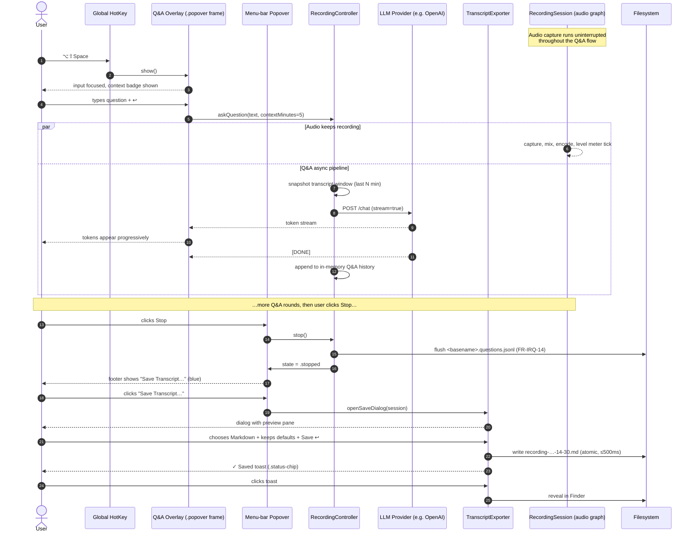

# In-Recording Questions — Ask the Sidelines While Recording

## Visual baseline — extend the popover mockup, do not re-invent

This proposal explicitly **extends the visual vocabulary established by the popover redesign mockup** at `docs/design/mockups/popover-redesign.html` (PNG mirror: `docs/design/mockups/popover-redesign.png`). Any surface introduced by this feature — the floating Ask overlay, the docked pill, the inline timeline strip, and the new end-of-recording **Save Transcript** dialog — MUST reuse the same primitives so the user perceives them as part of the same product.

The primitives we are reusing, verbatim, from `popover-redesign.html`:

| Token / element                  | Where it lives in the baseline               | How this proposal re-uses it                                                                                                                  |
|----------------------------------|----------------------------------------------|-----------------------------------------------------------------------------------------------------------------------------------------------|
| `.popover` rounded frame         | 360 pt wide, 14 pt radius, glass blur shadow | The Ask overlay uses the *same* frame at 400 pt wide; the Save Transcript dialog uses it at 480 pt wide. Same shadow stack, same blur.        |
| `.light` / `.dark` token sets    | `--label`, `--value`, `--secondary`, `--separator`, `--group-bg`, `--accent`, `--success-bg/fg/dot`, `--record-grad/shadow` | All new surfaces inherit those exact CSS variables — no new palette is introduced. The pill, the overlay, the dialog automatically theme. |
| Header (`.header`, `.header-input`) | Filename input + permission pill + meta dots | The Save dialog's header is the *same row* — editable filename, status pill (`Ready to save`), folder breadcrumb.                          |
| Sections (`.section`, `.section-title`) | Caps title + grouped rows                    | "Recent questions", "Export options", "What's included" become sections in the dialog. Same caps tracking, same hairline group.            |
| Grouped rows (`.group`, `.row`, `.row-sub`) | Inset rows, hairline dividers between siblings | Each Q&A exchange in the history is one `.row` with a hairline beneath. Export-format radio is a `.row` with a `.popup`-styled control.  |
| `.popup` select                  | NSPopUpButton styling                        | Export format chooser (Markdown / Plain text / JSON / SRT) is a `.popup`.                                                                    |
| `.switch`                        | NSSwitch styling                             | "Include Q&A interjections", "Include timestamps", "Include audio path reference" are `.switch` toggles in the Save dialog.                  |
| `.btn`                           | Subtle white-fill secondary button           | Cancel / Reveal in Finder / Copy path buttons.                                                                                                |
| `.record-btn` (red gradient)     | Primary action button                        | The primary **Save** button in the dialog uses a *blue* variant of the same gradient (`--accent` based) — same shape, same shadow, different hue: it is a "go" action, not a "record" action. |
| `.perm-pill` / `.status-chip`    | Permission / status pills                    | Saved-toast pill (`✓ Saved to ~/Documents/recording-…md`) reuses `.status-chip` with the success palette.                                    |
| `.key-input` (mono)              | Monospaced credential field                  | The transcript preview pane in the Save dialog renders in the same mono family at 11.5 pt with `--field-bg`.                                  |

**Layout zones** are likewise inherited: a popover-like frame opens **anchored to the menu-bar REC status item** (same anchor the popover uses); the Ask overlay floats free of that anchor (because the popover auto-dismisses on focus loss — see FR-IRQ-3) but uses the *same frame chrome*; the Save dialog is summoned from inside the popover itself when the recording stops, so it visually emerges from the same surface.

**Typography** is unchanged: `-apple-system, BlinkMacSystemFont, "SF Pro Text"`; 13 pt for row labels, 11 pt CAPS w/ 0.07 em tracking for section titles, 17 pt 600 for the editable filename, ui-monospace 11.5 pt for sidecar/preview text.

**Visual rule of thumb:** if a control or surface you are about to draw does not have a direct ancestor in `popover-redesign.html`, stop — and ask whether the existing primitive can be re-purposed before introducing a new one.

## Problem statement

While `macrec` is capturing a live conversation (a customer call, a 1:1, a podcast, a lecture), the user often needs to pull *context from the sidelines* without interrupting the audio capture or pulling focus away from the person they are looking at. Today the popover is optimised for **recording configuration** (folder, format, layout, provider) and **live transcript display** — there is no surface for the user to type a quick question like *"what was the customer's title again?"* or *"summarise the last 5 minutes"* and get an answer streamed back. The recording integrity rule (CLAUDE.md / project-purpose §"Critical requirements") forbids that any side-feature compromise the audio file, so this surface must be strictly additive and audio-non-blocking.

A second, related gap surfaced in user feedback after the first draft of this proposal: **once the recording ends, the user has no obvious one-click way to export the full timeline — transcript plus the Q&A interjections plus timestamps — as a single human-readable artifact**. The current popover terminates with a Stop button and writes its sidecars silently to the configured folder. The Q&A interjections need to be woven back into the transcript so the saved artifact reads like a single annotated transcript, not three orphan JSONL files the user has to stitch by hand. This proposal therefore covers both the **in-recording Q&A surface** and the **post-recording Save Transcript flow**, because they share data, a dialog, and a visual vocabulary.

## User stories

1. **As a knowledge worker on a Zoom call**, I want to press a global shortcut, type a quick question, and read the answer in a floating overlay — so I can recall context without breaking eye contact with the camera and without stopping the recording.
2. **As a researcher conducting an interview**, I want to ask the assistant to *"summarise the last 5 minutes"* mid-conversation so that I can decide whether to dig deeper into a topic the subject just touched on.
3. **As a sales rep on a discovery call**, I want to ask *"pull up the 2024 numbers for product X"* and have the assistant answer from general knowledge (and, in v2, my connected docs) — without leaving the meeting tab.
4. **As a learner watching a recorded lecture I'm capturing for offline review**, I want to ask *"what is RAG?"* on a term the lecturer just used and have the answer logged in-line with the transcript so my notes are self-contained.
5. **As a power user who scripts macrec from the CLI**, I want the same Q&A surface accessible from the menu-bar popover *and* from a JSON-RPC / `macrec ask "<question>"` subcommand so I can wire it into Raycast / Alfred / shell aliases.
6. **As any of the above, once the recording ends**, I want to save the *complete annotated transcript* — speech segments AND my in-recording Q&A interjections, in chronological order, with timestamps — as a single Markdown file I can drop into Obsidian / Notion / a follow-up email, in one click from the same popover that records it.

## Functional requirements

Each requirement is numbered for traceability into eventual `items/REQ-NNN-*.md` files. Topic guess in parentheses (taxonomy from `items/README.md`).

### Invocation & input (Q&A)

- **FR-IRQ-1** *(showcase)* — When a recording is in the `recording`, `paused`, `pausing`, `resuming`, `splitting` state (per `SessionState.swift` on `master`), the user MUST be able to summon a question input overlay via a global keyboard shortcut. Default shortcut: **`⌥⇧Space`** (Option+Shift+Space). Configurable in `GeneralSettingsView` (§FR-IRQ-16).
- **FR-IRQ-2** *(showcase)* — The overlay MUST also be reachable by clicking a persistent **"Ask"** pill rendered inside `LiveTranscriptPanel` (or its dual-mode equivalent `DualLiveTranscriptView`). The pill is hidden when the session is not recording. The pill MUST render with the same `.perm-pill`/`.status-chip` shape from the popover baseline — same height, same radius, same blur material.
- **FR-IRQ-3** *(showcase)* — The overlay MUST present as a **floating, frameless, always-on-top NSWindow** anchored to the right edge of the active display, NOT inside the existing popover. Rationale: the popover auto-dismisses when the menu-bar focus is lost (see `PopoverController.swift`); a Q&A surface must survive the user looking back at their conversation window. The frame chrome (radius, shadow, blur) MUST be the `.popover` styling from `docs/design/mockups/popover-redesign.html`.
- **FR-IRQ-4** *(showcase)* — The overlay MUST contain (1) a single-line, multi-line-expandable text input styled as a `.key-input` widened to fill the row, (2) a Submit affordance (Return key + click target — a blue-gradient mirror of `.record-btn`), (3) a Dismiss affordance (Esc + `.btn` close), (4) a Push Pin toggle that keeps the overlay sticky when the user clicks away (default OFF — clicking away minimises to a docked pill).
- **FR-IRQ-5** *(showcase)* — Input MUST be acceptable via **typing** (v1) and via **push-to-talk voice** (v2, deferred). v1 ships typing-only; the input field reserves a leading mic icon greyed-out with tooltip *"Voice input — coming soon"* so the v2 entry point is discoverable.

### Answering

- **FR-IRQ-6** *(integration)* — On submit, the question MUST be sent to the configured LLM provider together with **(a)** a transcript-context window of the last *N* minutes (default 5 min, configurable 1–30 min, §FR-IRQ-17), drawn from `RecordingController.transcriptSegments`, **(b)** a system prompt scoping the assistant to "answer briefly using the transcript and your general knowledge; cite which it came from".
- **FR-IRQ-7** *(integration)* — The LLM provider chain reuses the existing four-tier env-var resolution (`OPENAI_API_KEY`, `ANTHROPIC_API_KEY`, `GOOGLE_API_KEY`, `AZURE_OPENAI_*`, …) per `tool-conventions`. No new credential surface is introduced.
- **FR-IRQ-8** *(integration)* — Answers MUST be streamed token-by-token into the overlay; the in-progress state MUST show a typing/streaming indicator distinct from a static "loading" spinner so the user can tell the model is actively producing tokens.
- **FR-IRQ-9** *(integration)* — On streaming completion, the answer MUST remain visible in the overlay, with a one-line collapsed preview and an Expand affordance if the answer exceeds 6 visual lines. Collapsing/expanding MUST NOT re-query the model.

### Display & timeline

- **FR-IRQ-10** *(showcase)* — Each Q&A exchange MUST display **the asked question** (verbatim, with timestamp `mm:ss` since recording start), **the in-progress indicator while answering**, **the answer** (collapsible if >6 lines), and **a marker on the recording timeline** showing where in the audio the question was asked. Question + answer pair MUST sit inside a `.group` row pair with a hairline divider — same visual rhythm as the popover's General / Live Transcription sections.
- **FR-IRQ-11** *(showcase)* — The overlay MUST keep a scrollable history of all Q&A exchanges from the current session, newest at the bottom. History is per-session (cleared on Stop) by default; persisting is §FR-IRQ-14 and §FR-IRQ-23.
- **FR-IRQ-12** *(showcase)* — The recording-timeline markers MUST visually distinguish three time-classes: **question-time** (a vertical tick), **answer-time** (a span ending at the answer's last-token timestamp), and **continued-recording-time** (the default audio waveform / elapsed line). The Live Transcript Panel's existing elapsed clock (`ElapsedTimeView.swift`) is augmented, not replaced. Tick color = `--accent`; answer span = `--accent` at 35 % alpha; continued-recording line = `--separator`.
- **FR-IRQ-13** *(showcase)* — Clicking a timeline marker MUST scroll the Q&A history overlay to the corresponding exchange and the transcript panel to the corresponding transcript segment (best-effort: the segment whose end-timestamp is closest to but ≤ the marker's recording time).

### Persistence (raw sidecar)

- **FR-IRQ-14** *(artifact)* — On session Stop, all Q&A exchanges of the session MUST be persisted as a sidecar file next to the audio: `<basename>.questions.jsonl`. Each line is one JSON object with fields `{ts_recording_ms, ts_wall, question, answer, model, transcript_window_start_ms, transcript_window_end_ms, provider}`. Persistence failures MUST NOT block session stop (recording-integrity invariant).
- **FR-IRQ-15** *(artifact)* — If the existing transcript sidecar (`<basename>.transcript.jsonl` / `.txt`) exists, the Q&A sidecar MUST cross-reference it via a relative path in its header line so `dual-transcript-merger` / downstream tooling can stitch them.

### Configuration & policy

- **FR-IRQ-16** *(showcase)* — The keyboard shortcut MUST be reconfigurable from `GeneralSettingsView` with a Key-Recorder field. The default `⌥⇧Space` MUST be unregistered cleanly on Quit (no orphan global hotkey).
- **FR-IRQ-17** *(showcase)* — The transcript-context window length (default 5 min) MUST be exposed as a slider in `GeneralSettingsView` (range 1–30 min) and persisted in `@AppStorage("com.macrec.ui.askContextMinutes")`.
- **FR-IRQ-18** *(security)* — The first time the user invokes the feature against a **cloud** LLM provider (any provider that is not the on-device Apple Foundation Models or an `OLLAMA_HOST` localhost endpoint), a privacy disclosure sheet — reusing `PrivacyDisclosureSheet.swift` — MUST be presented explaining that the question text AND the transcript window will be sent to the provider. Acknowledgement is per-provider (same `acknowledgedKey` pattern as the existing live-transcript privacy gate). No silent fallback.
- **FR-IRQ-19** *(security)* — If no LLM credential is resolvable for the selected provider, the overlay MUST surface a typed error inline (NOT a modal) and link to the relevant Settings section. No default key, no substituted value (CLAUDE.md no-fallback rule).
- **FR-IRQ-20** *(showcase)* — The feature MUST be globally togglable from `GeneralSettingsView` (`In-recording Q&A: On/Off`), default **On**. When Off, the global hotkey is unregistered and the Ask pill is hidden.

### Non-interference

- **FR-IRQ-21** *(platform)* — No code path inside the Q&A subsystem MAY block, pause, or otherwise touch the recording graph (`RecordingSession`, `CaptureBuffer`, `Recorder` implementations). All Q&A work runs on a dedicated `Task { ... }` cooperative-cancellation boundary; any failure is logged and surfaced in the overlay, never propagated up to `RecordingSession`.
- **FR-IRQ-22** *(platform)* — Audio level meters and the elapsed-time clock MUST continue to update at their existing cadence while a question is in flight; a "thinking" indicator on the Q&A overlay MUST NOT cause main-thread stalls visible in the level meter.

### Save Transcript flow (post-recording export)

This is the new section added in revision 2026-05-12. It covers what happens **after** Stop is pressed — turning the in-memory transcript + Q&A history into a single human-readable artifact the user can hand to a third party or paste into their notes app.

- **FR-IRQ-23** *(showcase)* — When a session enters the `stopped` state, the popover MUST transition from its "Recording…" footer into a **post-recording summary state**. The footer's primary action MUST change from `Start Recording` (red gradient) to `Save Transcript…` (blue-accent gradient — same shape as the record button, swapped hue from `--record-grad` to a `--accent`-based gradient). A secondary `.btn` link "Reveal in Finder" opens the recording's folder. A tertiary `.btn` "New Recording" returns to the idle state.
- **FR-IRQ-24** *(showcase)* — Clicking `Save Transcript…` MUST open the **Save Transcript dialog** — a frameless popover-styled sheet anchored under the menu-bar item, reusing the `.popover` frame chrome from the baseline (`docs/design/mockups/popover-redesign.html`), styled identically in light & dark. The dialog MUST contain, top to bottom: editable filename, status pill, save-to path breadcrumb, "Export options" section (format select + toggles), "What's included" preview section, footer with Cancel + primary Save.
- **FR-IRQ-25** *(showcase)* — The format selector MUST offer four options as a `.popup` select. The **recommended default** is Markdown.

   | Option | Extension | When to choose it | Default |
   |---|---|---|---|
   | **Markdown** | `.md` | Human-readable; pastes into Notion / Obsidian / GitHub / email; preserves headings + timestamps + speaker labels; Q&A interjections rendered as blockquote callouts. | ✓ recommended |
   | **Plain text** | `.txt` | Lowest-common-denominator; one segment per paragraph; timestamps inline; no formatting. | |
   | **JSON** | `.json` | Structured / scriptable; one array of objects (`type: "speech" | "qa"`, `ts_ms`, `speaker?`, `text`, `question?`, `answer?`); for downstream tooling. | |
   | **SRT** | `.srt` | Subtitle file for re-importing into a video editor; Q&A interjections omitted (subtitles can't carry side commentary). A second `.questions.srt` is written alongside for Q&A. | |

- **FR-IRQ-26** *(showcase)* — The dialog MUST expose three boolean toggles as `.switch` controls (same as the baseline's "Live Transcription" engine toggle):
   1. **Include Q&A interjections** (default **On**) — when Off, only the speech transcript is exported; the Q&A sidecar is still written separately per FR-IRQ-14.
   2. **Include timestamps** (default **On**) — when Off, the export is timestamp-free for cleaner reading.
   3. **Include audio file reference** (default **On**) — when On, the export header carries a relative path back to the `.m4a` / `.wav` / `.caf` source so downstream tooling can locate the audio.
- **FR-IRQ-27** *(showcase)* — The dialog MUST render a **live preview pane** below the toggles — same `.field-bg` + `--mono` styling as the API-key input — showing the *first ~15 lines* of the final artifact. The preview MUST update reactively as toggles or format change, so the user sees exactly what gets written. The preview MUST be read-only.
- **FR-IRQ-28** *(showcase)* — The **default filename** MUST be derived as `recording-<YYYY-MM-DD>-<HH-MM>.<ext>` using the recording's start time (NOT the save time), e.g. `recording-2026-05-12-14-30.md`. Filename is editable inline (re-using `.header-input`). The default save folder is the recording's parent folder (same `Save to` chosen at recording time, per the popover's `Save to` row) so the export sits next to its audio. The user can override via a "Choose…" link styled as `.change` (same as `.path .change` in the baseline).
- **FR-IRQ-29** *(artifact)* — The exported file MUST chronologically interleave speech segments and Q&A interjections so the reader sees the conversation as it happened. The Markdown variant MUST render Q&A interjections as a blockquote with a `🅀 Question` / `🅐 Answer` glyph pair so they are visually distinct from speech segments. The Plain-text variant MUST prefix Q&A lines with `[Q]` / `[A]`. The JSON variant uses `type` discriminator.
- **FR-IRQ-30** *(artifact)* — A successful save MUST surface as a **toast** anchored under the menu-bar item — a single `.status-chip` (success palette: green dot, `--success-bg`/`--success-fg`) reading `✓ Saved to ~/Documents/recording-2026-05-12-14-30.md`. The toast auto-dismisses after 4 s; clicking it reveals the file in Finder. Toast dismissal MUST NOT block subsequent actions.
- **FR-IRQ-31** *(security)* — The Save Transcript flow MUST NOT phone home, MUST NOT upload to any cloud provider, MUST NOT post-process via an LLM. It is a local-only file write, with the same single-user/local-first posture as the rest of the project (project-purpose §"What it is explicitly NOT").
- **FR-IRQ-32** *(showcase)* — If a file with the chosen name already exists, the dialog MUST surface a non-modal warning row inside the dialog body (same `.row-sub` warning style used by the credential error in `wireframes.md` § State 5a) offering: **Replace**, **Append timestamp** (`-1`, `-2`, …), **Cancel**. No silent overwrite. No silent rename.
- **FR-IRQ-33** *(integration)* — The Save Transcript code path MUST live in a new `TranscriptExporter` module inside `MacrecCore`, with a CLI entry point at `macrec export --session <id> --format <md|txt|json|srt> --output <path>` so power users (User Story 5) can re-export an old recording's transcript without launching the UI.

## Non-functional requirements

| Tag | Requirement |
|---|---|
| **NFR-IRQ-Latency-First-Token** | Time from Submit to first visible token of the answer **≤ 1500 ms p50, ≤ 3500 ms p95** when the configured provider is OpenAI / Anthropic / Gemini cloud over a healthy network (≥ 5 Mbps down). Measured against the existing `TranscriptionMetricsView` clock pattern. |
| **NFR-IRQ-Latency-Full-Answer** | Time to last token **≤ 8 s p50** for a 5-min context window. Local providers (Ollama / on-device foundation models) are best-effort; surfaced in the overlay as a "local provider — slower" hint. |
| **NFR-IRQ-Keyboard-Accessibility** | Every overlay control MUST be reachable by Tab / Shift-Tab; Return submits; Esc dismisses; ⌘C copies the focused message; ⌘↑ / ⌘↓ navigates history. VoiceOver labels for the input, Submit, Pin, Close, Expand. Save Transcript dialog: ⌘S submits, Esc cancels, Tab cycles filename → format → toggles → preview → Save. |
| **NFR-IRQ-Voice-Input** | v1 typing-only. v2 (deferred): push-to-talk via `AVCaptureSession` on a separate `AVCaptureDevice` from the recording mic — MUST NOT borrow the active recording's mic input under any circumstance (FR-IRQ-21). |
| **NFR-IRQ-Transcript-Context** | Default 5 minutes; range 1–30 minutes; max payload size 32 KB after UTF-8 encoding (truncated from the head of the window if exceeded, with a visible *"… (truncated)"* marker in the prompt audit log §FR-IRQ-14). |
| **NFR-IRQ-Audio-Non-Blocking** | Continuous audio capture during a 10-question stress test (back-to-back, 30 s apart) MUST show zero dropped audio frames (`CaptureBuffer.dropCount == 0`). This is the recording-integrity gate. |
| **NFR-IRQ-Privacy-Default-OnDevice** | When the user has Apple Foundation Models available (macOS 26+, Apple Silicon), the **default** provider for the Q&A surface MUST be the on-device option, not a cloud provider — to match the project's "local-first" posture. The user explicitly opts in to cloud via the existing provider picker. |
| **NFR-IRQ-Universal-Binary** | Same `arm64 + x86_64` posture as the rest of `macrec`. The on-device default only activates on Apple Silicon; x86_64 users see a cloud-only picker. |
| **NFR-IRQ-No-Server** | No new outbound endpoint introduced beyond the user-selected LLM provider's API. No telemetry. No background polling. (Project-purpose §"What it is explicitly NOT".) |
| **NFR-IRQ-Visual-Continuity** | Every new surface introduced by this proposal — Ask overlay, Save Transcript dialog, success toast, error rows — MUST inherit `--label`/`--value`/`--secondary`/`--separator`/`--accent`/`--success-*` from the popover baseline. A visual-diff regression test (screenshot of the baseline popover next to the new surface) MUST show identical row heights (36 pt min), identical hairline color, identical corner radius (14 pt frame / 10 pt group). |
| **NFR-IRQ-Save-Latency** | For a 90-minute recording with up to 20 Q&A interjections, the Save Transcript dialog MUST: open in ≤ 200 ms p95; rebuild the preview pane in ≤ 50 ms on any toggle/format change; complete the file write in ≤ 500 ms p95. |
| **NFR-IRQ-Export-Determinism** | Re-running `macrec export` (FR-IRQ-33) over the same session with the same flags MUST produce a byte-identical file. No timestamps, no random IDs, no "exported on …" header — the export is a function of the session content, not of when the user clicked Save. |

## Open questions for the product owner

1. **Default shortcut conflict** — `⌥⇧Space` is unused by stock macOS 26 but is claimed by some third-party launchers (Raycast, Alfred default). Should the install flow detect and warn, or just document and let the user re-bind?
2. **Q&A visible to others?** — Otter explicitly makes its in-meeting chat *shared with all meeting participants* (a deliberate collaboration choice). `macrec` is single-user / local-first, so the answer is presumably **always private**. Confirm — is there any imaginable future where we'd surface Q&A to a screen-shared view?
3. **Scope of "general knowledge"** — Beyond the transcript window, should v1 also pass **the entire transcript so far** (token budget permitting) as a second context block? Granola's "Ask Granola" passes the full meeting note + transcript. Trade-off: cost & latency vs. recall.
4. **Persistence default** — Default is "persist sidecar on Stop" (FR-IRQ-14). Some users (legal / regulated) will want **no persistence ever**. Add a per-session ephemeral toggle, or only a global preference?
5. **Citations / source linking** — Granola and Otter both cite back into the transcript ("this came from minute 03:42"). Worth the v1 effort, or v2?
6. **Streaming via existing transcription provider connections** — When the user already has `openai` selected as their live STT, can we reuse the same key + client for the Q&A LLM call, or do we keep STT-credentials and LLM-credentials as separate axes (the latter is simpler conceptually but doubles the configuration surface)?
7. **Voice input v2** — Push-to-talk dedicated mic, or whisper-to-the-mic-already-being-recorded with a wake phrase? The wake-phrase variant is contaminated by the meeting audio and is therefore probably not viable for our context.
8. **Recipes / saved prompts** — Granola and Fireflies both promote a `/`-slash menu of canned prompts ("/summarise", "/action-items"). v1 includes 3 hard-coded; v2 user-editable?
9. **Sharing with non-recording-tool users** — Out of scope per local-first posture, but worth a one-line confirmation.
10. **What happens on Pause?** — Should the Ask surface remain available while the audio session is paused, or be hidden (because there is no fresh transcript context being generated)? Recommendation: **remain available** — the user may want to pause specifically *because* they need to look something up.
11. **Save-Transcript default format** — Recommended default is Markdown (FR-IRQ-25). Confirm — or do you prefer Plain text as a more universal default?
12. **Auto-save** — Should the Save Transcript flow auto-trigger on Stop with the default options (toast appears, file written, no dialog), with the dialog only shown if the user clicks `Save Transcript…` explicitly? This would be the "no-friction" mode. Recommendation: **no auto-save by default**, because silent file writes feel surprising; user can opt in via a `Settings ▸ Auto-save transcript on Stop` switch in v1.1.
13. **Markdown speaker labels** — The transcript already carries channel labels (`mic` / `system`); do we surface them as `**You**:` / `**Other**:` in the Markdown export, or stay channel-literal (`**Mic**:` / `**System**:`)? The former reads better but presumes the mic is "you" — which is almost always true but not universally.
14. **`.questions.srt` companion** — When the user picks SRT, FR-IRQ-25 specifies a sibling `.questions.srt` for Q&A — is that the right behaviour, or should Q&A simply be dropped from SRT exports without comment?

## ASCII wireframes — the four key Q&A states + the Save dialog

> Box-drawing characters; the actual SwiftUI rendering reuses the **`.popover` frame chrome** from `docs/design/mockups/popover-redesign.html`. These sketches anchor *what is on screen in each state*, not pixel-perfect spacing.

### State 1 — Idle / docked

```
                                            ┌──────────────────────┐
                                            │ ●  Ask… ⌥⇧Space  ⊕  │
                                            └──────────────────────┘
```

Pill renders at the same height & radius as the baseline's `.perm-pill`; the leading `●` is the live REC dot (sourced from `.menubar .recording-anchor .dot`).

### State 2 — Question typed

```
┌────────────────────────────────────────────────────────────────┐  ← .popover
│  Ask the recording                                 ●  03:14 📌 │  ← .header
├────────────────────────────────────────────────────────────────┤
│  ┌──────────────────────────────────────────────────────────┐  │  ← .group
│  │ 🎙 What was the customer's title again?▌                 │  │  ← .row + .key-input
│  └──────────────────────────────────────────────────────────┘  │
│  context: last 5 min · provider: openai (gpt-4o) · ⏎ Send   ▶ │  ← .row-sub + blue .record-btn
└────────────────────────────────────────────────────────────────┘
```

### State 3 — Answering (streaming)

```
┌────────────────────────────────────────────────────────────────┐
│  Ask the recording                                 ●  03:17 📌 │
├────────────────────────────────────────────────────────────────┤
│  ┌──────────────────────────────────────────────────────────┐  │  ← .group
│  │ You · 03:14                                              │  │  ← .row
│  │   What was the customer's title again?                   │  │
│  ├──────────────────────────────────────────────────────────┤  │  ← hairline (.row + .row)
│  │ Assistant · 03:15  ◐ streaming…                          │  │  ← .row
│  │   Sarah Chen introduced herself at 02:41 as "VP of       │  │
│  │   Platform Engineering" at Northwind. She also           │  │
│  │   mentioned she reports to ▌                             │  │
│  └──────────────────────────────────────────────────────────┘  │
│  ▎mic ▰▰▰▱▱▱▱   ▎sys ▰▰▰▰▰▱▱     ⌘C copy   Esc cancel        │  ← .footer
└────────────────────────────────────────────────────────────────┘
```

### State 4 — Answer shown, history, timeline

```
┌────────────────────────────────────────────────────────────────┐
│  Ask the recording                                 ●  06:42 📌 │
│  ┃━━━┃━━┃━━━━━━━┃━━━━━━━━━━━━━━━━━━━━━━━━━━━━━━━━┃━━━━━━━━━━━│  ← accent-tinted timeline
│  Q1  A1 Q2 A2                                    Q3 (you are  │
│                                                      here)    │
├────────────────────────────────────────────────────────────────┤
│  [.group of stacked .row pairs — one per Q&A, hairlines]      │
└────────────────────────────────────────────────────────────────┘
```

### State 6 — Save Transcript dialog (NEW — FR-IRQ-23..32)

```
┌──────────────────────────────────────────────────────────────────┐  ← .popover (480 pt)
│  recording-2026-05-12-14-30.md          ✓ Ready to save · 1.2 MB │  ← .header + .perm-pill
│  📁  Recordings/        Choose…                                   │  ← .path
├──────────────────────────────────────────────────────────────────┤
│  EXPORT OPTIONS                                                  │  ← .section-title
│  ┌────────────────────────────────────────────────────────────┐  │  ← .group
│  │ Format        [ Markdown — .md           ⌄ ]   recommended │  │  ← .row + .popup
│  ├────────────────────────────────────────────────────────────┤  │
│  │ Include Q&A interjections                          [ ●═○ ] │  │  ← .row + .switch on
│  ├────────────────────────────────────────────────────────────┤  │
│  │ Include timestamps                                 [ ●═○ ] │  │
│  ├────────────────────────────────────────────────────────────┤  │
│  │ Include audio file reference                       [ ●═○ ] │  │
│  └────────────────────────────────────────────────────────────┘  │
│                                                                  │
│  WHAT'S INCLUDED                       54 segments · 3 Q&A pairs │  ← .section-title
│  ┌────────────────────────────────────────────────────────────┐  │  ← .group + .key-input mono
│  │ # recording-2026-05-12-14-30                               │  │
│  │ _Audio: recording-2026-05-12-14-30.m4a · 47 min 22 s_      │  │
│  │                                                            │  │
│  │ **Mic · 00:00:04** — Hi Sarah, thanks for taking the time. │  │
│  │ **System · 00:00:08** — Of course! Happy to walk through…  │  │
│  │                                                            │  │
│  │ > 🅀 03:14 — What was the customer's title again?          │  │
│  │ > 🅐 03:15 — Sarah Chen introduced herself at 02:41 as…    │  │
│  │ …                                                          │  │
│  └────────────────────────────────────────────────────────────┘  │
│                                                                  │
│  [ Cancel ]   [ Reveal in Finder ]               [ Save  ↩ ]   ▶ │  ← .footer · blue gradient primary
└──────────────────────────────────────────────────────────────────┘
```

### State 7 — Saved confirmation toast

```
                                         ┌──────────────────────────────────────┐
                                         │ ● ✓ Saved to ~/Documents/recording-… │  ← .status-chip success
                                         └──────────────────────────────────────┘
```

Clicking the toast opens the file in Finder. Auto-dismiss after 4 s. Toast position: under menu-bar item, matching the popover anchor point.

Detailed per-state captions live in `wireframes.md`.

## Mermaid sequence diagram — end-to-end timing (Q&A + Save)



## Related work — apps we drew inspiration from

| App | What we copied | What we explicitly didn't |
|---|---|---|
| **Granola** ([live chat docs](https://help.granola.ai/article/chatting-with-your-meetings-ask-granola)) | "Chat before / during / after the meeting" availability; per-meeting chat with citations back into the transcript; thinking-mode toggle; chat history clears on session exit (matches our local-first ephemerality). | Granola hosts on their backend; we keep everything local + per-provider opt-in. |
| **Otter.ai** ([Otter Chat in live meetings](https://help.otter.ai/hc/en-us/articles/15113851067415-Using-Otter-Chat-during-a-live-meeting)) | Sidebar-style panel separate from the live transcript; per-message controls (copy / regenerate / source link); suggested prompts; persistence of Q&A alongside the transcript. | Otter's chat is **shared with all meeting participants** via `@otter` mentions — we are explicitly single-user (Open Question #2). |
| **Read.ai** ([Ask Read](https://support.read.ai/hc/en-us/articles/39009378777875-Using-Search-Copilot-to-search-your-meetings-and-connected-apps)) | Natural-language input via a single bar; recent-history sidebar; multi-language support. | "Ask Read" spans the user's entire connected knowledge base — we scope strictly to the *current recording's* transcript window in v1. |
| **Fireflies AskFred** ([AskFred during meetings](https://guide.fireflies.ai/articles/6032274417-learn-about-fireflies-live-assist-get-real-time-suggestions-answers-and-notes-live-during-the-meeting)) | Floating, movable, always-on-top overlay (Live Assist); `/`-slash menu of canned skills (we adopt this as v2 Recipes per Open Question #8); dynamic topic suggestion chips. | AskFred consumes per-question billing credits and pushes nudges ("you have been speaking too long"); we have no remote billing and no proactive nudges in scope. |
| **Microsoft Teams Copilot** ([in-meeting Copilot](https://support.microsoft.com/en-us/office/use-copilot-in-microsoft-teams-meetings-0bf9dd3c-96f7-44e2-8bb8-790bedf066b1)) | Private-to-the-user sidebar; pop-out into separate window so the user can multitask; suggested wrap-up prompts in the last N minutes of the meeting. | Teams Copilot requires live transcription to be on for post-meeting recall; our Q&A surface MUST function even with transcription off (FR-IRQ-6 falls back to "general knowledge only" when no transcript context exists). |
| **Apple Voice Memos + Notes "smart summary" (iOS 18 / macOS 15+)** | The pattern of *recording-first, ask-later* with summaries surfaced inline next to the recording. | We support the during-recording case, not just after. |
| **Obsidian / Notion Markdown paste flow** | The Markdown export uses blockquote callouts for Q&A so it pastes legibly into both. We tested the rendered output by pasting into a sample Obsidian vault. | We don't ship a plugin — the file is just a `.md` the user drags in. |

## Out of scope for v1 (kept for v2 backlog)

- Voice (push-to-talk) input (FR-IRQ-5 v2).
- User-editable `/`-slash Recipes (Open Question #8).
- Connectors to external knowledge bases (Slack, Notion, Drive) à la Read.ai's "search your connected apps".
- Multi-user / shared Q&A surface in screen-sharing contexts (Open Question #2 confirms we stay single-user).
- Cross-recording / "all my recordings" Q&A à la Granola's home-screen chat.
- Real-time speaking-coach nudges (Fireflies-style) — separate concern, would need its own requirements doc.
- Auto-save transcript on Stop (Open Question #12). v1.1.
- Export to DOCX / PDF — Markdown + a user pandoc invocation covers it.
- Re-running an export on a *partial* session (mid-recording). v1 only exports after Stop.
